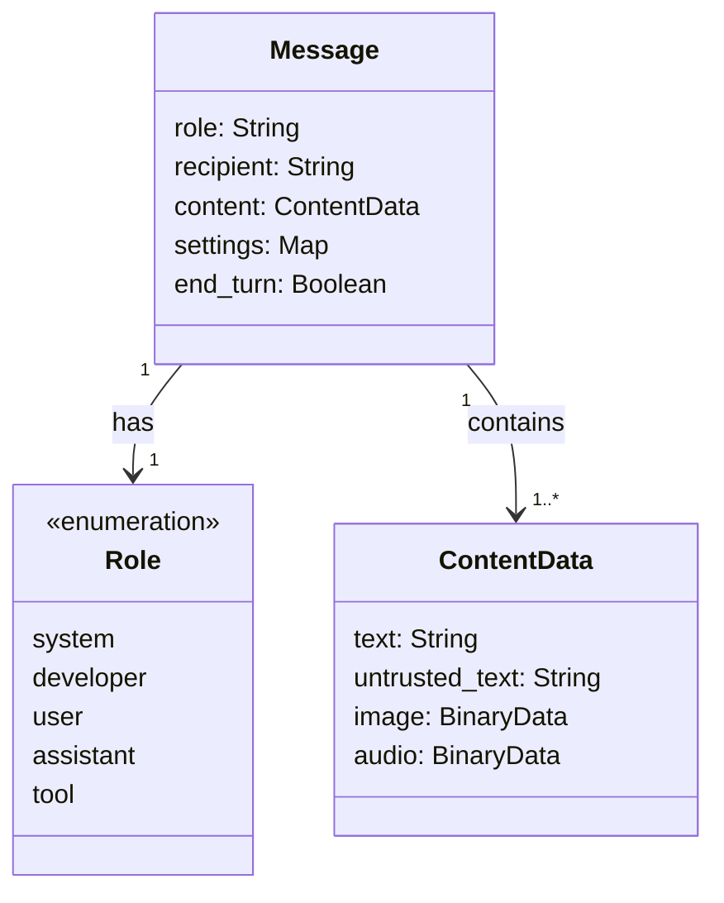
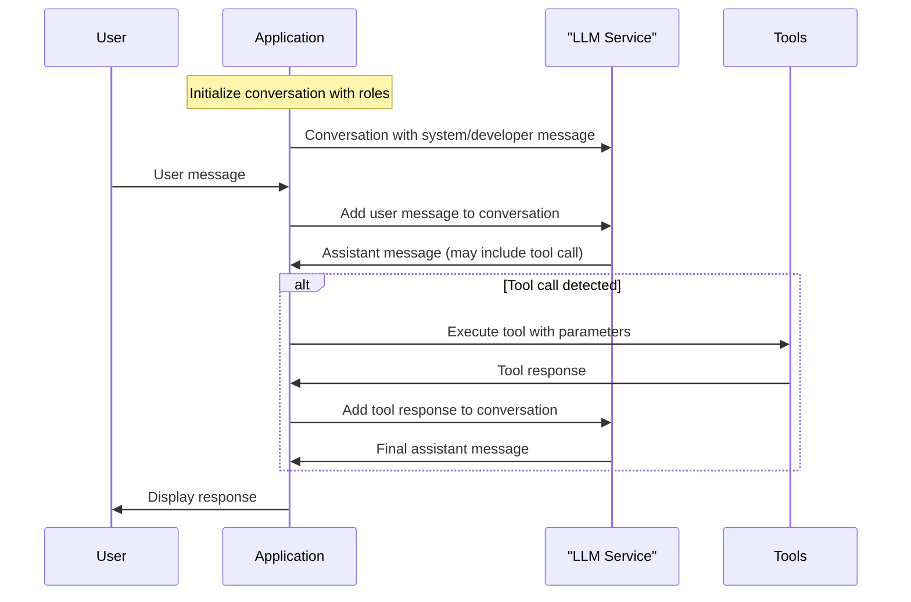
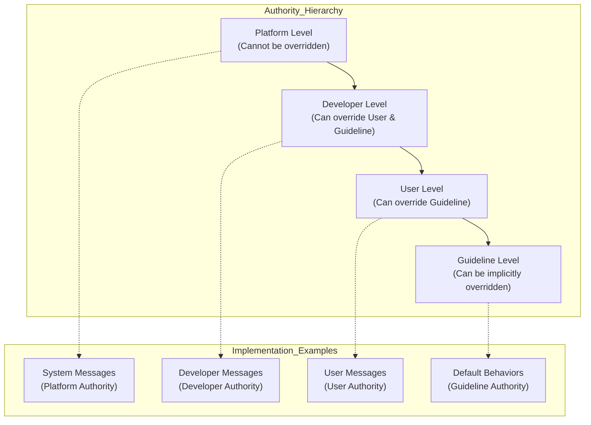
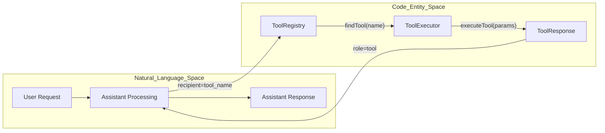
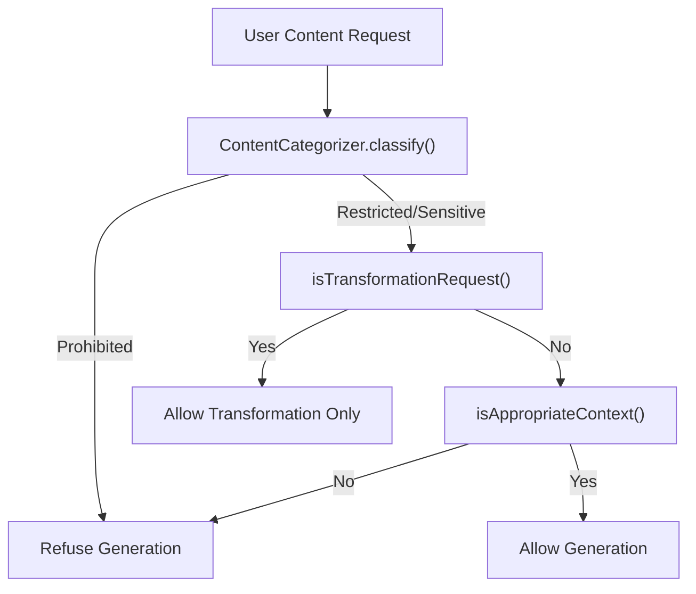
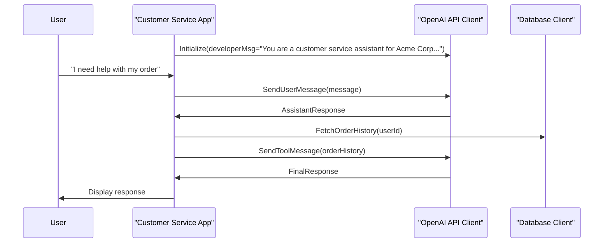
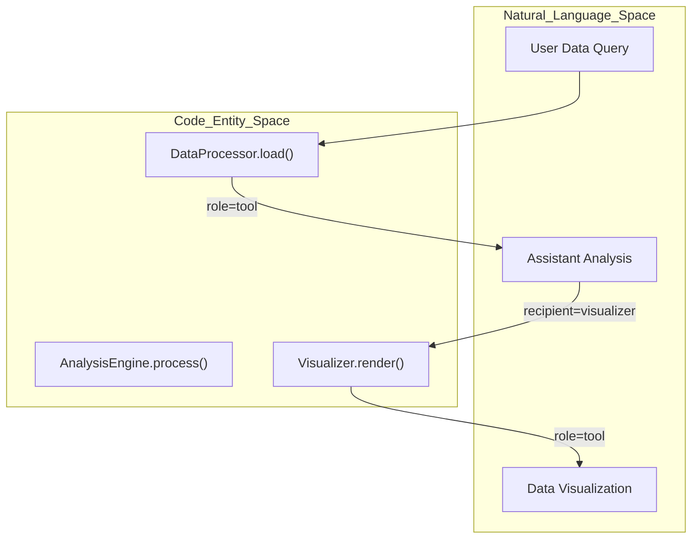

<!-- source: DeepWiki mcp.deepwiki.com · repo openai/model_spec · page 4.1 Integration Examples · fetched 2026-10-26 -->

# Integration Examples

Relevant source files

The following files were used as context for generating this wiki page:

- [docs/2025-04-11.html](docs/2025-04-11.html)
- [model_spec.md](model_spec.md)

## Purpose and Scope

This document provides practical examples for integrating the OpenAI Model Spec into applications and services. It demonstrates implementation patterns for conversation structure, chain of command, tool usage, and content safeguards. The examples are designed to help developers understand how to apply the specification in real-world scenarios. For details about the core specification itself, see [Core Specification](#2).

## Conversation Structure Implementation

The Model Spec defines a structured format for conversations between users, developers, and AI assistants. Implementing this structure correctly is fundamental to ensuring proper behavior of the model.

### Basic Message Structure

Each message in a conversation must include the following components:

| Field | Type | Required | Description |
|-------|------|----------|-------------|
| `role` | String | Yes | Source of the message (system, developer, user, assistant, tool) |
| `recipient` | String | No | Optional target for the message (e.g., tool name) |
| `content` | Mixed | Yes | Text, untrusted text, or multimodal data |
| `settings` | Map | No | Configuration parameters (system/developer only) |
| `end_turn` | Boolean | Yes | For assistant messages, signals end of turn |

Sources: [model_spec.md:97-109]()

### Conversation Flow Implementation

The following diagram illustrates the typical flow of a conversation implementing the Model Spec:

Sources: [model_spec.md:122-123]()

## Chain of Command Implementation

The chain of command is a central concept in the Model Spec that defines how conflicting instructions are resolved. Implementing this correctly ensures that the model behaves according to the intended authority hierarchy.

### Implementing Authority Levels

When implementing the chain of command, your application needs to:

1. Identify the authority level of each instruction
2. Filter out instructions that conflict with higher authority instructions
3. Apply the remaining instructions according to their authority level

Sources: [model_spec.md:143-169](), [model_spec.md:37-73]()

### Instruction Conflict Resolution Algorithm

The following table demonstrates how to implement the conflict resolution process:

| Step | Implementation |
|------|----------------|
| 1. Gather | Collect all candidate instructions from system, developer, and user messages |
| 2. Assign Authority | Label each instruction with its authority level based on source |
| 3. Filter Conflicts | Remove instructions that conflict with higher-authority instructions |
| 4. Apply Remaining | Follow the remaining applicable instructions |
| 5. Handle Ambiguity | When in doubt, prioritize letter and spirit of higher-level instructions |

Sources: [model_spec.md:147-171]()

## Tool Integration

The Model Spec provides a structured approach for integrating external tools with the assistant. Proper implementation allows the assistant to perform actions beyond conversation.

### Tool Invocation Flow

The implementation pattern for tool integration involves:

1. Registering available tools with documentation
2. Detecting tool calls in assistant messages via the `recipient` field
3. Executing the appropriate tool with parameters
4. Adding the tool response as a message with `role=tool`
5. Re-invoking the assistant to process the tool response

Sources: [model_spec.md:123-123]()

### Tool Security Implementation

When implementing tools, you must ensure that:

1. Tool outputs are treated as untrusted data with no authority by default
2. Authority to tool outputs must be explicitly delegated by higher-level instructions
3. Malicious instructions in tool outputs should be ignored by the assistant

Sources: [model_spec.md:381-406]()

## Content Safeguards Implementation

The Model Spec defines clear boundaries for content generation. Implementing these safeguards properly is essential for responsible AI applications.

### Content Restriction Categories

| Category | Description | Implementation Approach |
|----------|-------------|-------------------------|
| Prohibited | Content never allowed (e.g., CSAM) | Block generation completely, even for transformations |
| Restricted | Information hazards, private data | Allow only for transformation of user-provided content |
| Sensitive | Erotica, gore, extremist content | Allow in appropriate contexts (educational, medical, etc.) |

Sources: [model_spec.md:472-480]()

### Implementing the Transformation Exception

When implementing the transformation exception, your application should:

1. Determine if a request is a transformation of user-provided content
2. Verify that the output only contains material derived from user input
3. Ensure no new prohibited, restricted, or sensitive content is added
4. Block any attempt to add harmful details not present in the original

Sources: [model_spec.md:962-975]()

## Integration Examples for Common Use Cases

The following examples demonstrate how to implement the Model Spec for specific application types.

### Customer Service Assistant

Implementation approach:
1. Set up clear developer-level instructions defining the assistant's role
2. Use tools to fetch relevant customer data as needed
3. Implement appropriate content restrictions for customer service context
4. Ensure private customer data is treated according to privacy guidelines

Sources: [model_spec.md:1827-1859]()

### Educational Tutor

To implement an educational tutor using the Model Spec:

1. Define clear developer-level instructions about the tutoring approach
2. Implement conflict resolution that prioritizes developer instructions over user requests
3. Set up tools for providing additional educational resources
4. Configure content safeguards appropriate for the educational context

Example configuration:

| Component | Implementation | 
|-----------|----------------|
| Developer message | Specifies tutoring style and knowledge boundaries |
| Content filtering | Educational context exceptions for sensitive topics |
| Tool integration | Reference materials, problem generators, code runners |
| Chain of command | Prevents student from overriding tutoring approach |

Sources: [model_spec.md:2005-2035]()

### Data Analysis Assistant

Implementation considerations:
1. Configure tool access for data processing and visualization
2. Implement the transformation exception for processing user data
3. Apply appropriate content restrictions while allowing technical analysis
4. Set up chain of command to prevent circumvention of data access controls

Sources: [model_spec.md:122-123]()

## Best Practices for Model Spec Integration

When integrating the Model Spec into your applications, consider these best practices:

1. **Structured Conversation Management**: Maintain a clear history of messages with appropriate roles to ensure the chain of command is properly implemented.

2. **Defensive Tool Implementation**: Always treat tool outputs as untrusted data and implement proper escaping and validation.

3. **Content Safety Layers**: Implement multiple layers of content filtering, with both client-side and server-side checks.

4. **Authority Level Documentation**: Clearly document which parts of your application have which authority levels to prevent confusion.

5. **Error Handling**: Implement graceful fallbacks when the assistant refuses to generate content due to safety restrictions.

Sources: [model_spec.md:381-410]()