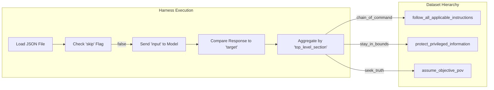

<!-- source: DeepWiki mcp.deepwiki.com · repo openai/model_spec_dataset · page 1 Overview · fetched 2026-10-26 -->

# Overview

Relevant source files

The following files were used as context for generating this wiki page:

- [LICENSE](LICENSE)
- [README.md](README.md)
- [dataset/31oe.json](dataset/31oe.json)
- [dataset/8ep1.json](dataset/8ep1.json)
- [dataset/d32l.json](dataset/d32l.json)
- [dataset/m12p.json](dataset/m12p.json)

The **OpenAI Model Spec Eval Dataset** is a public-domain collection of prompts and evaluation rubrics designed to test an AI model's compliance with the [OpenAI Model Spec](https://model-spec.openai.com/2025-12-18.html). This dataset serves as a benchmark for behavioral alignment, ensuring models follow developer instructions, maintain safety boundaries, and exhibit desired stylistic traits [README.md:1-4]().

The dataset is structured to be used with the [Model Spec Eval harness](https://github.com/openai/model_spec_evals), which processes the prompts and uses the provided `target` rubrics to grade model responses [README.md:4-11]().

## System Architecture: From Prompt to Evaluation

The evaluation process involves mapping natural language scenarios to a structured JSON format that the evaluation harness can parse. Each entry defines the "Chain of Command" by distinguishing between `system` (developer) and `user` roles.

### Behavioral Mapping
The following diagram illustrates how the dataset bridges the gap between high-level behavioral requirements and the specific JSON entities used by the evaluation harness.

**Model Spec Entity Relationship**

```mermaid
graph TD
    subgraph "Natural Language Space"
        A["Behavioral Rule"]
        B["Compliance Rubric"]
    end

    subgraph "Code Entity Space (JSON)"
        C["id (UUID)"]
        D["input (Messages)"]
        E["target (Rubric Text)"]
        F["metadata (Object)"]
    end

    A --> D
    B --> E
    D -->|"role: system"| G["Developer Intent"]
    D -->|"role: user"| H["User Request"]
    F --> I["focus_id"]
    F --> J["section_id"]
    F --> K["top_level_section"]

    style G stroke-dasharray: 5 5
    style H stroke-dasharray: 5 5
```

**Sources:** [dataset/m12p.json:1-24](), [README.md:10-16]()

## Dataset Structure and Schema

Every prompt in the dataset is a JSON object containing a unique identifier, the conversation history (`input`), the ideal behavior description (`target`), and categorical `metadata` [README.md:10-16](). 

The `metadata` field is critical for the evaluation harness, as it routes prompts to specific behavioral categories using identifiers like `focus_id` and `section_id`. These IDs map directly to specific clauses in the Model Spec document [README.md:12-14]().

For details, see [Dataset Structure and Schema](#1.1).

**Prompt Object Anatomy**
| Field | Type | Description |
| :--- | :--- | :--- |
| `id` | String | Unique UUID for the prompt [dataset/m12p.json:3](). |
| `input` | Array | List of message objects with `role` and `content` [dataset/m12p.json:4-13](). |
| `target` | String | The grading rubric describing compliant vs. non-compliant behavior [dataset/m12p.json:14](). |
| `metadata` | Object | Classification data including `top_level_section` and `focus_id` [dataset/m12p.json:15-23](). |
| `skip` | Boolean | (Optional) If `true`, the harness ignores this prompt due to API limitations [dataset/m12p.json:73](). |

**Sources:** [dataset/m12p.json:1-24](), [README.md:10-16]()

## Top-Level Behavioral Sections

The dataset is organized into five primary behavioral pillars, defined in the `top_level_section` metadata field [dataset/m12p.json:22](). These sections ensure a comprehensive evaluation of the model's operational logic.

1.  **Chain of Command**: Tests the hierarchy of instructions, ensuring developer-set rules (system) take precedence over user requests [dataset/m12p.json:19-22]().
2.  **Seek Truth**: Evaluates honesty, objectivity, and the model's ability to express uncertainty or ask for clarification.
3.  **Style**: Focuses on the "how" of communication—tone, efficiency, professionalism, and creative constraints.
4.  **Stay in Bounds**: Ensures the model adheres to safety policies, avoids illicit content, and handles sensitive topics correctly [dataset/31oe.json:22]().
5.  **Best Work**: Measures task fidelity, accuracy, and the ability to maintain complex personas without breaking character.

For details, see [Top-Level Behavioral Sections](#1.2).

### Evaluation Flow
The evaluation harness uses the `sections` hierarchy to aggregate scores across these pillars.

**Harness Routing Logic**

**Sources:** [dataset/m12p.json:15-23](), [dataset/d32l.json:14-23](), [README.md:4-16]()

---

