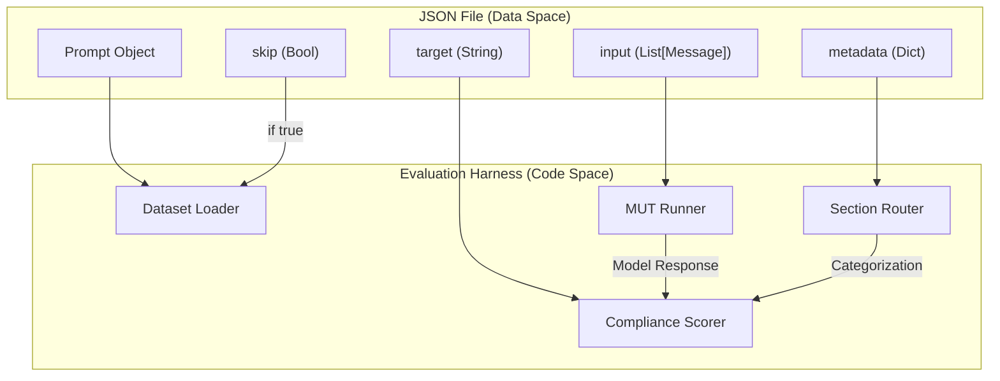
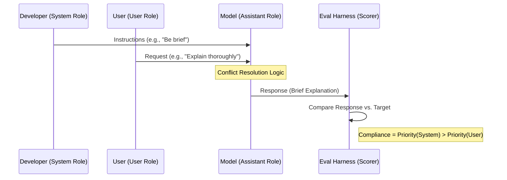

<!-- source: DeepWiki mcp.deepwiki.com · repo openai/model_spec_dataset · page 1.1 Dataset Structure and Schema · fetched 2026-10-26 -->

# Dataset Structure and Schema

Relevant source files

The following files were used as context for generating this wiki page:

- [dataset/1392.json](dataset/1392.json)
- [dataset/31oe.json](dataset/31oe.json)
- [dataset/3blt.json](dataset/3blt.json)
- [dataset/4lfk.json](dataset/4lfk.json)
- [dataset/8ep1.json](dataset/8ep1.json)
- [dataset/9881.json](dataset/9881.json)
- [dataset/d32l.json](dataset/d32l.json)
- [dataset/hcvn.json](dataset/hcvn.json)
- [dataset/kp2q.json](dataset/kp2q.json)
- [dataset/m12p.json](dataset/m12p.json)
- [dataset/onv4.json](dataset/onv4.json)
- [dataset/thyk.json](dataset/thyk.json)
- [dataset/ttmt.json](dataset/ttmt.json)
- [dataset/yjj2.json](dataset/yjj2.json)
- [dataset/zx8z.json](dataset/zx8z.json)

This page provides a technical breakdown of the JSON schema used throughout the OpenAI Model Spec Eval Dataset. It describes the individual fields that constitute a prompt object, the hierarchical metadata used for categorization, and how the evaluation harness interprets these structures to route data and determine compliance.

## JSON Object Schema

Every prompt in the dataset is represented as a JSON object within an array. These objects are stored in various `.json` files, typically named after their `focus_id` (e.g., `m12p.json`, `onv4.json`).

### Field Definitions

| Field | Type | Description |
| :--- | :--- | :--- |
| `id` | `string` | A unique UUID (version 4) assigned to each individual prompt example [dataset/m12p.json:3](). |
| `input` | `array` | A list of message objects representing the conversation history. Each message contains a `role` (system, user, or assistant) and `content` (the text) [dataset/m12p.json:4-13](). |
| `target` | `string` | A natural language description of the "ideal" response. This serves as the ground truth for human or model-based evaluation, specifying what constitutes compliance or non-compliance [dataset/m12p.json:14](). |
| `metadata` | `object` | A container for classification and routing flags used by the evaluation harness [dataset/m12p.json:15-23](). |
| `skip` | `boolean` | (Optional) If set to `true`, the evaluation harness will ignore this prompt during testing. Often used for experimental or deprecated examples [dataset/m12p.json:73](). |

### Metadata Schema

The `metadata` field is critical for organizing the dataset into the Model Spec's behavioral taxonomy.

*   **`top_level_section`**: Identifies which of the five primary Spec pillars the prompt belongs to (e.g., `chain_of_command`, `seek_truth`, `style`) [dataset/m12p.json:22]().
*   **`sections`**: An array representing the path from the top-level section down to the specific sub-behavior being tested [dataset/m12p.json:18-21]().
*   **`section_id`**: A string identifier for the immediate parent sub-section (e.g., `follow_all_applicable_instructions`) [dataset/m12p.json:16]().
*   **`focus_id`**: A short, unique alphanumeric code (e.g., `m12p`, `onv4`) that groups related prompts testing a specific nuance or edge case [dataset/m12p.json:17]().

**Sources:** [dataset/m12p.json:1-24](), [dataset/onv4.json:1-21](), [dataset/d32l.json:1-23]()

---

## Data Flow and Routing

The evaluation harness uses the schema to transform raw JSON into actionable test cases. The `input` array is passed to the Model Under Test (MUT), while the `metadata` and `target` are used to categorize the resulting metrics.

### Mapping Schema to Evaluation Logic

The following diagram illustrates how the JSON fields map to the components of the evaluation system.

**System Component Mapping**

**Sources:** [dataset/m12p.json:1-24](), [dataset/8ep1.json:1-23]()

---

## Behavioral Hierarchy and Logic

The dataset distinguishes between different instruction authorities through the `input` message sequence. This is primarily handled in the `chain_of_command` section but applies globally to how the harness interprets "compliance."

### Instruction Priority Logic
The evaluation harness expects the model to resolve conflicts based on the following hierarchy, as defined in the `target` descriptions:

1.  **Later System Instructions**: If two system messages conflict, the one appearing later in the `input` array takes precedence [dataset/d32l.json:68]().
2.  **System vs. User**: Developer instructions (system role) always override user instructions [dataset/m12p.json:64]().
3.  **Later User Instructions**: If two user messages conflict, the most recent instruction is the active constraint [dataset/d32l.json:41]().

**Entity Interaction Diagram**

**Sources:** [dataset/m12p.json:14](), [dataset/d32l.json:41](), [dataset/d32l.json:68]()

---

## Technical Details of Metadata Fields

### Focus IDs and Section IDs
While `section_id` provides a human-readable category, the `focus_id` is the primary key for dataset sharding.

| Focus ID | Primary Section | Intent |
| :--- | :--- | :--- |
| `m12p` | `follow_all_applicable_instructions` | Tests conflict between system-level personas and user-level requests [dataset/m12p.json:17](). |
| `d32l` | `follow_all_applicable_instructions` | Tests temporal priority (later instructions overriding earlier ones) [dataset/d32l.json:17](). |
| `onv4` | `assume_objective_pov` | Tests neutrality and evidence-based reporting on historical/political topics [dataset/onv4.json:13](). |
| `hcvn` | `be_thorough_but_efficient` | Tests the model's ability to provide direct answers without excessive hedging [dataset/hcvn.json:13](). |

**Sources:** [dataset/m12p.json:15-23](), [dataset/onv4.json:11-20](), [dataset/hcvn.json:11-19](), [dataset/d32l.json:15-23]()

---

