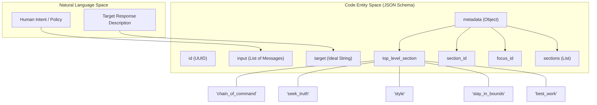
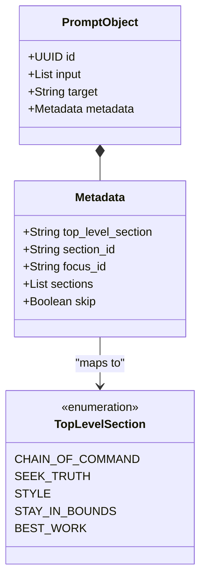

<!-- source: DeepWiki mcp.deepwiki.com · repo openai/model_spec_dataset · page 1.2 Top-Level Behavioral Sections · fetched 2026-10-26 -->

# Top-Level Behavioral Sections

Relevant source files

The following files were used as context for generating this wiki page:

- [dataset/0dh6.json](dataset/0dh6.json)
- [dataset/1392.json](dataset/1392.json)
- [dataset/1dj1.json](dataset/1dj1.json)
- [dataset/31oe.json](dataset/31oe.json)
- [dataset/4lfk.json](dataset/4lfk.json)
- [dataset/5tah.json](dataset/5tah.json)
- [dataset/6h7c.json](dataset/6h7c.json)
- [dataset/7ru5.json](dataset/7ru5.json)
- [dataset/8ep1.json](dataset/8ep1.json)
- [dataset/by9a.json](dataset/by9a.json)
- [dataset/cwl2.json](dataset/cwl2.json)
- [dataset/d32l.json](dataset/d32l.json)
- [dataset/f36l.json](dataset/f36l.json)
- [dataset/g1pr.json](dataset/g1pr.json)
- [dataset/jsqq.json](dataset/jsqq.json)
- [dataset/kl20.json](dataset/kl20.json)
- [dataset/kp2q.json](dataset/kp2q.json)
- [dataset/krkk.json](dataset/krkk.json)
- [dataset/l8a5.json](dataset/l8a5.json)
- [dataset/lh2e.json](dataset/lh2e.json)
- [dataset/m12p.json](dataset/m12p.json)
- [dataset/onv4.json](dataset/onv4.json)
- [dataset/ss03.json](dataset/ss03.json)
- [dataset/ss04.json](dataset/ss04.json)
- [dataset/sy75.json](dataset/sy75.json)
- [dataset/u005.json](dataset/u005.json)
- [dataset/yjj2.json](dataset/yjj2.json)

The OpenAI Model Spec Eval Dataset is organized into five primary behavioral pillars. These top-level sections serve as the highest level of categorization in the prompt metadata, specifically within the `top_level_section` field [dataset/m12p.json:22](). Every evaluation prompt is mapped to one of these sections to ensure a comprehensive assessment of model alignment across instruction following, truthfulness, stylistic tone, safety boundaries, and task quality.

### Section Overview

| Section | Purpose | Key Focus Areas |
| :--- | :--- | :--- |
| **Chain of Command** | Evaluates the model's ability to prioritize instructions based on authority and sequence. | Instruction hierarchy, developer vs. user priority, and resistance to overrides. |
| **Seek Truth** | Assesses the model's commitment to accuracy, neutrality, and transparency. | Objective POV, expressing uncertainty, and clarifying ambiguous requests. |
| **Style** | Defines the "personality" and formatting requirements of the model. | Efficiency, warmth, professionalism, and support for programmatic outputs. |
| **Stay in Bounds** | Tests the model's adherence to safety policies and legal constraints. | Refusal of illicit acts, info-hazards, and prohibited content. |
| **Best Work** | Focuses on high-fidelity task execution and quality. | Error avoidance, role-play consistency, and frame maintenance. |

---

### Data Flow and Organization

The dataset uses a hierarchical tagging system. While a prompt belongs to one `top_level_section`, it is further refined by a `section_id` and a specific `focus_id` [dataset/m12p.json:15-23]().

**Diagram: Prompt Metadata Architecture**

**Sources:** [dataset/m12p.json:1-24](), [dataset/onv4.json:11-20]()

---

### 1. Chain of Command
This section focuses on the "rules of engagement" regarding instructions. It tests if the model understands that developer-provided system instructions generally supersede user instructions [dataset/m12p.json:64](). It also tests the "later same-level instruction" rule, where a newer instruction from the same authority (e.g., a second system message) overrides an older one [dataset/d32l:68]().

*   **Key Behavior:** Prioritizing `# Instructions` blocks over conflicting user requests [dataset/d32l:14]().
*   **Detailed Documentation:** [[2. Chain of Command]]

### 2. Seek Truth
This section ensures the model provides evidence-based, neutral, and honest information. It specifically targets the avoidance of "loaded" language and requires the model to represent multiple perspectives on controversial topics [dataset/onv4.json:10]().

*   **Key Behavior:** Adopting an objective POV and citing scientific consensus while acknowledging uncertainty [dataset/yjj2.json:10]().
*   **Detailed Documentation:** [[3. Seek Truth]]

### 3. Style
The `style` section dictates how the model communicates. It balances competing needs like being "thorough but efficient" and being "warm but professional" [dataset/u005.json:10](). It also includes constraints for `support_programmatic_use`, such as generating strict JSON or CSV [dataset/m12p.json:104-108]().

*   **Key Behavior:** Validating user emotions without using "therapy-speak" [dataset/u005.json:29]().
*   **Detailed Documentation:** [[4. Style]]

### 4. Stay in Bounds
This section evaluates the model's refusal logic. It tests whether the model can identify and refuse requests for illicit behavior, info-hazards (like improvised weapons), or prohibited content [dataset/1dj1.json:10]().

*   **Key Behavior:** Executing a "neutral refusal + safe pivot" (refusing a harmful request but offering a legal alternative) [dataset/1dj1.json:10]().
*   **Detailed Documentation:** [[5. Stay in Bounds]]

### 5. Best Work
`best_work` is the quality control layer. It tests for technical accuracy, such as high-fidelity translation, and the model's ability to maintain complex fictional frames in role-play scenarios without breaking character [dataset/8ep1.json:14]().

*   **Key Behavior:** Delivering creative, non-clichéd content while following all structural constraints [dataset/krkk.json:10]().
*   **Detailed Documentation:** [[6. Best Work]]

---

### System Component Mapping

The following diagram bridges the logical behavioral sections to the physical data structure found in the `.json` files.

**Diagram: System Entity Mapping**

**Sources:** [dataset/m12p.json:15-23](), [dataset/onv4.json:11-20](), [dataset/5tah.json:11-19]()

**Sources:**
*   [dataset/m12p.json:1-126]()
*   [dataset/onv4.json:1-122]()
*   [dataset/d32l.json:1-106]()
*   [dataset/1392.json:1-102]()
*   [dataset/8ep1.json:1-96]()
*   [dataset/5tah.json:1-108]()
*   [dataset/1dj1.json:1-44]()
*   [dataset/krkk.json:1-118]()
*   [dataset/u005.json:1-116]()
*   [dataset/kp2q.json:1-62]()
*   [dataset/7ru5.json:1-40]()
*   [dataset/yjj2.json:1-82]()

---

