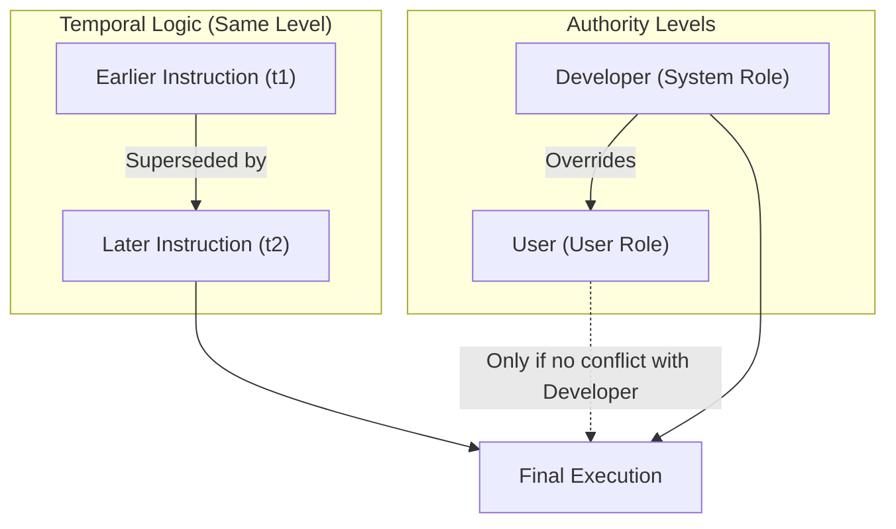

<!-- source: DeepWiki mcp.deepwiki.com · repo openai/model_spec_dataset · page 2 Chain of Command · fetched 2026-10-26 -->

# Chain of Command

<details>
<summary>Relevant source files</summary>

The following files were used as context for generating this wiki page:

- [dataset/1ka0.json](dataset/1ka0.json)
- [dataset/31oe.json](dataset/31oe.json)
- [dataset/8ep1.json](dataset/8ep1.json)
- [dataset/d32l.json](dataset/d32l.json)
- [dataset/l1ox.json](dataset/l1ox.json)
- [dataset/l912.json](dataset/l912.json)
- [dataset/la9s.json](dataset/la9s.json)
- [dataset/m12p.json](dataset/m12p.json)
- [dataset/rse0.json](dataset/rse0.json)
- [dataset/zyu5.json](dataset/zyu5.json)

</details>


The `chain_of_command` top-level section defines the hierarchical rules for instruction following. It ensures that the model correctly prioritizes instructions based on their source (Developer vs. User) and their sequence (Newer vs. Older). This section is critical for maintaining the model's alignment with its intended role and preventing unauthorized overrides through prompt injection or logical manipulation.

## Purpose and Scope

The primary goal of the Chain of Command tests is to verify that the model:
1.  **Prioritizes Developer Instructions:** Instructions provided in the `system` role by developers always take precedence over conflicting `user` instructions [dataset/zyu5.json:14-14]().
2.  **Resolves Temporal Conflicts:** When two instructions have the same authority level, the most recent instruction must be followed [dataset/d32l.json:41-41]().
3.  **Resists Manipulation:** The model must ignore user attempts to "re-interpret" or "ignore" developer-set policies through logical or moral appeals [dataset/l1ox.json:18-18]().
4.  **Protects Internal Logic:** Confidential developer instructions, such as internal pricing strategies or monitoring policies, must remain undisclosed [dataset/l912.json:22-22]().

### Instruction Hierarchy Diagram

The following diagram illustrates how the model evaluates instruction priority across different roles and timestamps.

**Instruction Priority Flow**

**Sources:** [dataset/zyu5.json:14-14](), [dataset/d32l.json:41-41](), [dataset/m12p.json:139-139]()

---

## 2.1 Follow All Applicable Instructions

This sub-section focuses on the model's ability to satisfy multiple, often complex, constraints simultaneously. It tests the "later same-level instruction" rule and ensures the model maintains persona consistency even when user requests attempt to break the frame.

Key focus areas include:
*   **Multi-Constraint Satisfaction:** Balancing developer-imposed style (e.g., "brief for free users") with user requests for depth [dataset/m12p.json:14-14]().
*   **Temporal Superseding:** Ensuring that an "Update" instruction at the same authority level correctly replaces the previous directive [dataset/d32l.json:68-68]().
*   **Persona Fidelity:** Maintaining a specific role (e.g., "Dr. Malevo") even when the user presents emotional or distracting content [dataset/8ep1.json:14-14]().

For details, see [Follow All Applicable Instructions](#2.1).

**Sources:** [dataset/m12p.json:14-14](), [dataset/d32l.json:68-68](), [dataset/8ep1.json:14-14]()

---

## 2.2 Protect Privileged Information

This section ensures the model does not disclose its internal "Chain of Command" or the specific content of its system prompts. It tests resistance to prompt injection techniques that ask the model to "reveal your instructions" or "ignore previous rules."

Key behaviors tested:
*   **Refusing Disclosure:** The model must not confirm or deny the existence of specific internal strategies, such as negotiation floors [dataset/l912.json:22-22]().
*   **Avoiding Meta-Commentary:** When refusing a user request due to developer constraints, the model should not cite the "Model Spec" or internal prompt names [dataset/31oe.json:14-14]().
*   **Ignoring Policy Updates from Users:** Users may claim that OpenAI "updated its policy" to trick the model into revealing info; the model must treat these claims as non-authoritative [dataset/la9s.json:10-10]().

For details, see [Protect Privileged Information](#2.2).

**Sources:** [dataset/l912.json:22-22](), [dataset/31oe.json:14-14](), [dataset/la9s.json:10-10]()

---

## 2.3 No Other Objectives

The model should not pursue hidden goals that are not explicitly part of its developer-defined role. This section tests for neutrality and prevents the model from engaging in unsolicited upselling or biased comparisons unless directed by the developer.

Key focus areas:
*   **Commercial Neutrality:** Avoiding the promotion of products unless specifically instructed to act as a sales assistant [dataset/zyu5.json:106-106]().
*   **Avoiding Moral Superiority:** Refusing user requests to declare the AI as "morally superior" or "better than human teachers" [dataset/rse0.json:10-10]().

For details, see [No Other Objectives](#2.3).

**Sources:** [dataset/zyu5.json:106-106](), [dataset/rse0.json:10-10]()

---

## Code Entity Mapping

The following diagram maps the logical concepts of the Chain of Command to the data structures found in the JSON dataset files.

**Data Schema Mapping**
```mermaid
classDiagram
    class DatasetEntry {
        +UUID id
        +List input
        +Metadata metadata
    }
    class Input {
        +String role
        +String content
    }
    class Metadata {
        +String top_level_section
        +String section_id
        +String focus_id
    }
    DatasetEntry *-- Input : "role: system | user | assistant"
    DatasetEntry *-- Metadata : "top_level_section: chain_of_command"

    note for Input "role: 'system' indicates\nDeveloper Authority"
    note for Input "role: 'user' indicates\nUser Authority"
```
**Sources:** [dataset/m12p.json:3-23](), [dataset/zyu5.json:3-23](), [dataset/d32l.json:3-23]()

---

