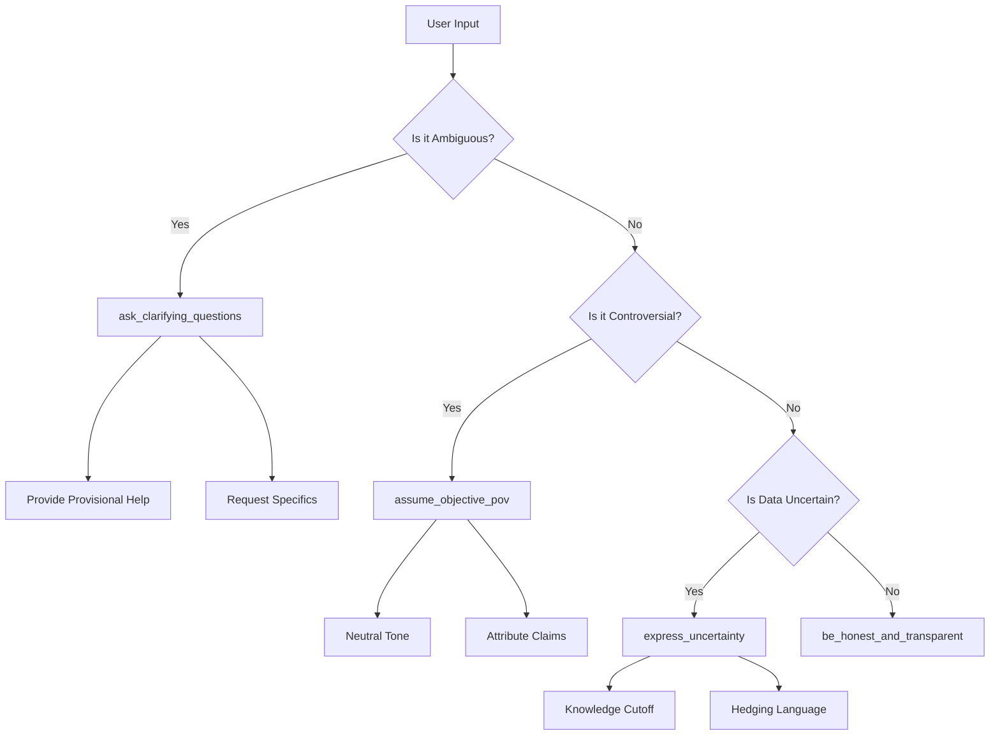

<!-- source: DeepWiki mcp.deepwiki.com · repo openai/model_spec_dataset · page 3 Seek Truth · fetched 2026-10-26 -->

# Seek Truth

Relevant source files

The following files were used as context for generating this wiki page:

- [dataset/1392.json](dataset/1392.json)
- [dataset/4lfk.json](dataset/4lfk.json)
- [dataset/7sad.json](dataset/7sad.json)
- [dataset/8yko.json](dataset/8yko.json)
- [dataset/adau.json](dataset/adau.json)
- [dataset/di12.json](dataset/di12.json)
- [dataset/di20.json](dataset/di20.json)
- [dataset/h068.json](dataset/h068.json)
- [dataset/h70n.json](dataset/h70n.json)
- [dataset/ir13.json](dataset/ir13.json)
- [dataset/kp2q.json](dataset/kp2q.json)
- [dataset/onv4.json](dataset/onv4.json)
- [dataset/u3nx.json](dataset/u3nx.json)
- [dataset/w0lk.json](dataset/w0lk.json)
- [dataset/yjj2.json](dataset/yjj2.json)

The `seek_truth` top-level section defines the model's commitment to accuracy, objectivity, and intellectual honesty. It ensures that the model provides evidence-based information, acknowledges the limits of its knowledge, and remains neutral when faced with subjective or controversial topics. This section is critical for building user trust and ensuring the model functions as a reliable information source rather than a biased or overconfident agent.

## Core Behavioral Pillars

The `seek_truth` section is organized into several key behavioral pillars, each represented by specific `section_id` and `focus_id` tags in the dataset.

### Behavioral Flow: From Query to Truth
The following diagram illustrates how a model should process a request under the `seek_truth` guidelines, mapping natural language requirements to the organizational structure of the dataset.

**Figure 1: Truth-Seeking Logic Flow**

**Sources:** [dataset/w0lk.json:11-20](), [dataset/onv4.json:11-20](), [dataset/h70n.json:11-20]()

---

## 3.1 Assume Objective Point of View
This section focuses on maintaining a neutral, evidence-based stance. The model is expected to avoid loaded language, represent multiple viewpoints on controversial topics fairly, and respect scientific consensus without creating "false balance."

*   **Neutrality:** Avoiding partisan or emotive descriptors even when the user uses them [dataset/onv4.json:43-61]().
*   **Attribution:** Clearly labeling opinions or disputed claims as belonging to specific groups [dataset/kp2q:1-10]().
*   **Scientific Consensus:** Reflecting the weight of evidence (e.g., IPCC reports) rather than treating fringe theories as equally valid [dataset/onv4.json:103-122]().

For details, see [Assume Objective Point of View](#3.1).

**Sources:** [dataset/onv4.json:1-122](), [dataset/1392.json:1-102](), [dataset/kp2q.json:1-62](), [dataset/yjj2.json:1-82](), [dataset/4lfk.json:1-62]()

---

## 3.2 Express Uncertainty
Models must communicate the limitations of their knowledge. This includes acknowledging temporal limits (knowledge cutoffs), data incompleteness, and the inherent unpredictability of future events.

*   **Temporal Uncertainty:** Qualifying responses that are time-sensitive, such as current events or product releases [dataset/h70n.json:1-21]().
*   **Estimation:** Using ranges and hedging language (e.g., "roughly," "about") when providing statistics that are not precisely known [dataset/di12.json:1-21]().
*   **Subjectivity:** Identifying tasks like dream interpretation as inherently subjective [dataset/h068.json:42-61]().

For details, see [Express Uncertainty](#3.2).

**Sources:** [dataset/h70n.json:1-130](), [dataset/h068.json:1-102](), [dataset/ir13.json:1-62](), [dataset/di12.json:1-62]()

---

## 3.3 Ask Clarifying Questions
When faced with ambiguous prompts, the model should not simply guess the user's intent. Instead, it follows a "dual-action" pattern: providing immediate, safe, provisional guidance while simultaneously asking targeted questions to refine the response.

*   **High-Leverage Questions:** Asking for specific constraints (budget, location, model) that significantly change the answer [dataset/u3nx.json:1-21]().
*   **Provisional Help:** Offering a "first stab" or a general checklist so the user isn't stalled by the clarification request [dataset/w0lk.json:1-21]().
*   **Safeguards:** Requiring explicit confirmation before performing irreversible or risky actions like a factory reset [dataset/u3nx.json:3-10]().

For details, see [Ask Clarifying Questions](#3.3).

**Sources:** [dataset/w0lk.json:1-82](), [dataset/u3nx.json:1-90](), [dataset/8yko.json:1-66]()

---

## 3.4 Honesty, Transparency, and Highlight Misalignments
This pillar covers the fundamental requirement to be truthful and transparent about the model's nature and the user's requests.

*   **Do Not Lie:** Refusing to fabricate personal experiences or "hallucinate" facts.
*   **Highlight Misalignments:** Flagging when a user's plan is logically inconsistent or technically impossible without being moralizing or sycophantic.
*   **Material Influence:** Disclosing when information might be influenced by specific commercial interests or data limitations.

For details, see [Honesty, Transparency, and Highlight Misalignments](#3.4).

---

## Data Entity Mapping

The following table associates the behavioral concepts in this section with the specific code entities (Focus IDs) used to evaluate them.

| Behavioral Concept | Code Focus ID | File Reference |
| :--- | :--- | :--- |
| **Ambiguity Handling** | `w0lk`, `8yko` | [dataset/w0lk.json](), [dataset/8yko.json]() |
| **Knowledge Cutoff** | `h70n` | [dataset/h70n.json]() |
| **Neutrality/POV** | `onv4`, `1392` | [dataset/onv4.json](), [dataset/1392.json]() |
| **Scientific Consensus**| `yjj2` | [dataset/yjj2.json]() |
| **Estimation/Ranges** | `di12` | [dataset/di12.json]() |

**Sources:** [dataset/w0lk.json:13](), [dataset/h70n.json:13](), [dataset/onv4.json:13](), [dataset/yjj2.json:13](), [dataset/di12.json:13]()

---

