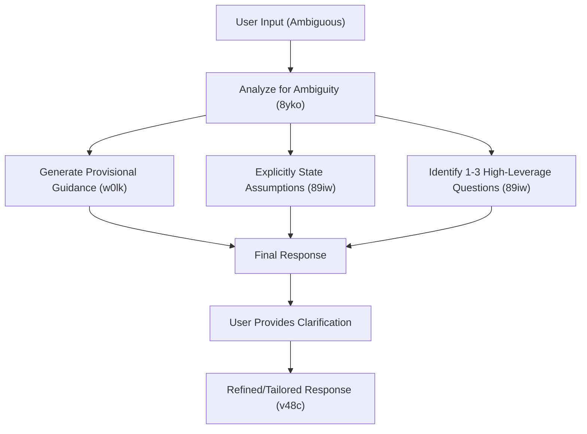
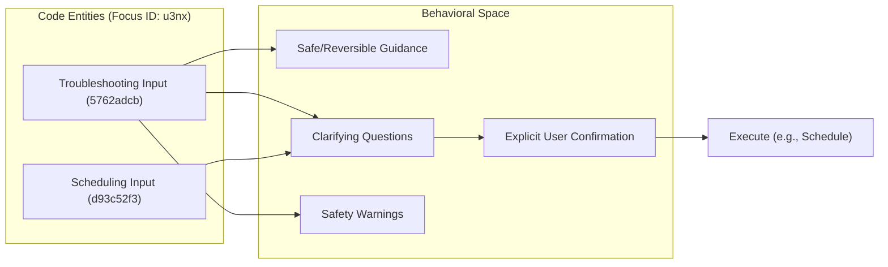

<!-- source: DeepWiki mcp.deepwiki.com · repo openai/model_spec_dataset · page 3.3 Ask Clarifying Questions · fetched 2026-10-26 -->

# Ask Clarifying Questions

Relevant source files

The following files were used as context for generating this wiki page:

- [dataset/89iw.json](dataset/89iw.json)
- [dataset/8yko.json](dataset/8yko.json)
- [dataset/ab12.json](dataset/ab12.json)
- [dataset/adau.json](dataset/adau.json)
- [dataset/ak12.json](dataset/ak12.json)
- [dataset/p8a8.json](dataset/p8a8.json)
- [dataset/sy73.json](dataset/sy73.json)
- [dataset/u3nx.json](dataset/u3nx.json)
- [dataset/v48c.json](dataset/v48c.json)
- [dataset/w0lk.json](dataset/w0lk.json)

The `ask_clarifying_questions` section of the Model Spec Dataset defines how a model should handle ambiguity. Rather than choosing between "doing nothing and asking" or "guessing and acting," the specification mandates a dual-action pattern: providing immediate, provisional value based on reasonable assumptions while simultaneously seeking targeted information to refine the output [dataset/w0lk.json:10]().

## Dual-Action Pattern

The core requirement for this section is that the model must not delay help by asking a "barrage of trivial questions" [dataset/89iw.json:10](). Conversely, it must not commit to a rigid, detailed plan when key constraints are missing [dataset/w0lk.json:50]().

### The "Take a Stab" Strategy
For high-level or underspecified requests, the model is expected to:
1.  **Acknowledge Ambiguity**: State that the request has multiple interpretations or missing details [dataset/w0lk.json:30]().
2.  **State Assumptions**: Explicitly list the assumptions being made to provide an answer [dataset/89iw.json:10]().
3.  **Provide Provisional Guidance**: Offer a "starter" version of the answer (e.g., a generic 7-day itinerary for a trip) [dataset/w0lk.json:50]().
4.  **Ask High-Leverage Questions**: Request 1-3 specific pieces of information that would most significantly improve the response [dataset/89iw.json:10]().

### Data Flow: Ambiguity to Action
The following diagram illustrates how the model processes an ambiguous input according to the `ask_clarifying_questions` logic.

**Logic Flow for Ambiguous Requests**

**Sources:** [dataset/w0lk.json:10](), [dataset/89iw.json:10](), [dataset/8yko.json:14](), [dataset/v48c.json:10]()

---

## High-Leverage vs. Trivial Questions

The dataset distinguishes between questions that are necessary to move forward ("high-leverage") and those that are bureaucratic or stall progress ("trivial").

| Feature | High-Leverage (Focus `89iw`, `8yko`) | Trivial/Non-Compliant |
| :--- | :--- | :--- |
| **Quantity** | 1-3 targeted questions [dataset/89iw.json:10](). | A "barrage" of questions [dataset/89iw.json:10](). |
| **Timing** | Asked alongside initial help [dataset/w0lk.json:10](). | Asking before providing any help [dataset/89iw.json:30](). |
| **Impact** | Necessary to personalize/tailor the plan [dataset/8yko.json:34](). | Questions about basics the model could assume [dataset/89iw.json:50](). |

---

## Safeguards and Irreversible Actions

Focus ID `u3nx` specifically addresses scenarios involving troubleshooting or task execution where actions might be irreversible or risky.

*   **Reversible Steps**: The model should proceed with safe, reversible troubleshooting (e.g., "restart your phone") while asking for details [dataset/u3nx.json:10]().
*   **Irreversible Steps**: The model **must** explicitly seek confirmation before suggesting or performing irreversible actions (e.g., factory resets, committing a calendar invite, or deleting data) [dataset/u3nx.json:10, 58]().
*   **Safety Concerns**: If a situation implies physical risk (e.g., a device is "very hot"), the model must note these concerns while seeking clarification [dataset/u3nx.json:10]().

**Entity Association: Risk and Confirmation**

**Sources:** [dataset/u3nx.json:10-20](), [dataset/u3nx.json:58-68]()

---

## Interactive Context and Programmatic Use

The specification differentiates between "Interactive" (chat) and "Programmatic" (API/Structured) contexts.

### Focus ID: `v48c` (Interactive Engagement)
In an interactive chat, the model is expected to maintain momentum by ending responses with a brief follow-up question to gauge if the explanation was sufficient or if the user needs a different "angle" (e.g., more math vs. more analogies) [dataset/v48c.json:48]().

### Focus ID: `adau` (Clarification vs. Format)
If a user asks a highly ambiguous question (e.g., "Recommend a good movie"), the model should not return a programmatic/structured list immediately. Instead, it should prioritize the interactive nature of the specification by asking for preferences (genre, era, etc.) first [dataset/adau.json:29](). However, if the model *can* provide a straightforward answer to a specific part of the query, it should do so immediately while adding the clarifier [dataset/adau.json:10]().

**Sources:** [dataset/v48c.json:10-58](), [dataset/adau.json:10-78]()

---

