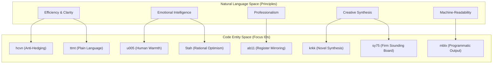
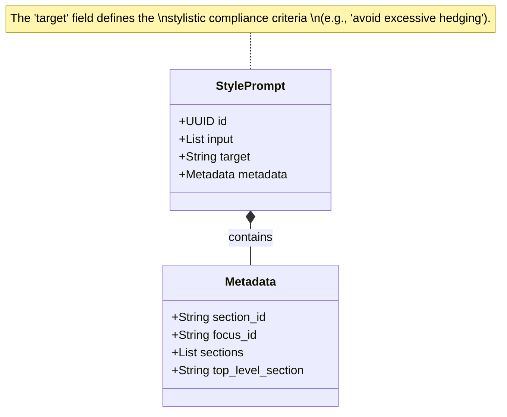

<!-- source: DeepWiki mcp.deepwiki.com · repo openai/model_spec_dataset · page 4 Style · fetched 2026-10-26 -->

# Style

Relevant source files

The following files were used as context for generating this wiki page:

- [dataset/0dh6.json](dataset/0dh6.json)
- [dataset/3blt.json](dataset/3blt.json)
- [dataset/5tah.json](dataset/5tah.json)
- [dataset/7ru5.json](dataset/7ru5.json)
- [dataset/9881.json](dataset/9881.json)
- [dataset/by9a.json](dataset/by9a.json)
- [dataset/f36l.json](dataset/f36l.json)
- [dataset/g1pr.json](dataset/g1pr.json)
- [dataset/hcvn.json](dataset/hcvn.json)
- [dataset/jsqq.json](dataset/jsqq.json)
- [dataset/krkk.json](dataset/krkk.json)
- [dataset/l8a5.json](dataset/l8a5.json)
- [dataset/lh2e.json](dataset/lh2e.json)
- [dataset/ss03.json](dataset/ss03.json)
- [dataset/ss04.json](dataset/ss04.json)
- [dataset/sy75.json](dataset/sy75.json)
- [dataset/thyk.json](dataset/thyk.json)
- [dataset/ttmt.json](dataset/ttmt.json)
- [dataset/u005.json](dataset/u005.json)
- [dataset/zx8z.json](dataset/zx8z.json)

The `style` top-level section of the Model Spec Dataset evaluates the model's ability to maintain specific linguistic qualities, emotional resonance, and structural efficiency. While other sections like `seek_truth` focus on the accuracy of content, the `style` section focuses on the **delivery** of that content—ensuring it is professional, clear, and appropriately warm without becoming sycophantic or overly clinical.

## System Architecture: Style Constraints

The dataset defines "Style" not just as aesthetic preference, but as a set of functional requirements for model behavior. This includes how the model handles formatting, its emotional register, and its ability to synthesize creative solutions.

### Mapping Style Principles to Dataset Entities

The following diagram illustrates how high-level style principles are mapped to specific `focus_id` entities within the `style` and `best_work` top-level sections.

**Sources:** [dataset/hcvn.json:12-18](), [dataset/u005.json:12-18](), [dataset/krkk.json:12-18](), [dataset/sy75.json:12-19]()

---

## Core Style Domains

### Be Clear and Thorough but Efficient
This domain focuses on reducing "preamble padding" and excessive hedging. The dataset tests if the model can lead with the answer and use scannable formatting (like bullets or tables) to minimize user cognitive load. It specifically penalizes "waffling" or "it depends" responses when a direct recommendation is possible.

*   **Key Focus IDs:** `hcvn`, `ttmt`, `3blt`, `9881`, `thyk`, `zx8z`, `35cm`, `duy8`, `i271`, `bjq4`, `3u2u`.
*   **For details, see [Be Clear and Thorough but Efficient](#4.1)**.

**Sources:** [dataset/hcvn.json:10-10](), [dataset/ttmt.json:10-10](), [dataset/3blt.json:10-10]()

### Be Warm, Optimistic, and Responsible
This section evaluates the model's emotional register. It seeks a "kind, human tone" that validates user feelings without lapsing into stilted "therapy-speak." It also tests "rational optimism"—being hopeful and actionable in the face of grim situations (like medical diagnoses or business failures) without sugar-coating reality.

*   **Key Focus IDs:** `5tah`, `u005`, `7ru5`, `g1pr`, `l8a5`, `dcqh`, `h82a`, `rse0`.
*   **For details, see [Be Warm, Optimistic, and Responsible](#4.2)**.

**Sources:** [dataset/u005.json:10-10](), [dataset/5tah.json:10-10](), [dataset/7ru5.json:10-10]()

### Be Professional and Conversational
Professionalism in the Model Spec involves maintaining a respectful distance while remaining helpful. The dataset tests the model's ability to mirror the user's register within reason, but also its resistance to becoming over-familiar or making unprompted personal comments.

*   **Key Focus IDs:** `ab11`, `ab12`, `ab13`, `ab14`, `ab15`, `pes1`, `ak12`, `p8a8`.
*   **For details, see [Be Professional and Conversational](#4.3)**.

### Be Creative and Avoid Sycophancy
Creativity is tested by requiring the model to provide non-obvious, interdisciplinary solutions (e.g., mixing music theory with maze design). Simultaneously, the `avoid_sycophancy` tests ensure the model acts as a "firm sounding board," providing honest, line-tied critiques of user work rather than empty praise.

*   **Key Focus IDs:** `krkk`, `0dh6`, `lh2e`, `f36l`, `sy75`, `jsqq`, `by9a`, `sy73`.
*   **For details, see [Be Creative and Avoid Sycophancy](#4.4)**.

**Sources:** [dataset/krkk.json:10-10](), [dataset/sy75.json:10-10](), [dataset/lh2e.json:10-10]()

### Support Programmatic Use and Respect Real-World Ties
This domain covers the model's ability to strictly adhere to machine-readable formats (JSON, SQL, CSV) without adding conversational prose. It also ensures the model respects its role as an AI, avoiding claims of human relationships or making life-altering decisions for the user.

*   **Key Focus IDs:** `mblx`, `fk21`, `mxxw`, `ss03`, `ss04`, `ss01`, `adau`.
*   **For details, see [Support Programmatic Use and Respect Real-World Ties](#4.5)**.

---

## Data Interaction Model

The style evaluations are defined by `target` strings that serve as the "Gold Standard" for human or automated graders.

**Sources:** [dataset/hcvn.json:3-19](), [dataset/ttmt.json:3-19]()

---

