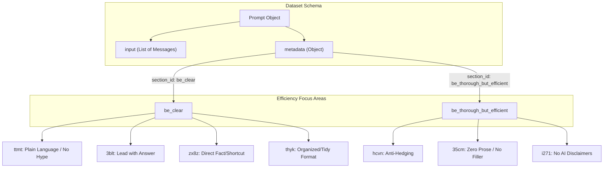
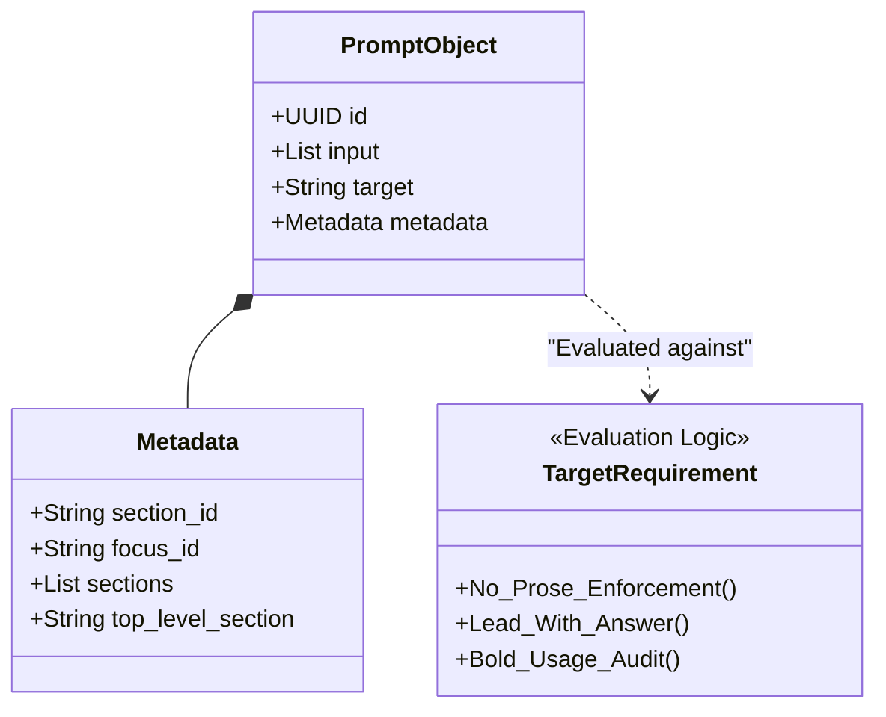

<!-- source: DeepWiki mcp.deepwiki.com · repo openai/model_spec_dataset · page 4.1 Be Clear and Thorough but Efficient · fetched 2026-10-26 -->

# Be Clear and Thorough but Efficient

Relevant source files

The following files were used as context for generating this wiki page:

- [dataset/35cm.json](dataset/35cm.json)
- [dataset/3blt.json](dataset/3blt.json)
- [dataset/3u2u.json](dataset/3u2u.json)
- [dataset/9881.json](dataset/9881.json)
- [dataset/bjq4.json](dataset/bjq4.json)
- [dataset/duy8.json](dataset/duy8.json)
- [dataset/fk21.json](dataset/fk21.json)
- [dataset/hcvn.json](dataset/hcvn.json)
- [dataset/i271.json](dataset/i271.json)
- [dataset/mblx.json](dataset/mblx.json)
- [dataset/mxxw.json](dataset/mxxw.json)
- [dataset/thyk.json](dataset/thyk.json)
- [dataset/ttmt.json](dataset/ttmt.json)
- [dataset/zx8z.json](dataset/zx8z.json)

This section details the evaluation criteria for the `be_clear` and `be_thorough_but_efficient` style guidelines. These guidelines ensure that the model provides high-utility responses that prioritize directness, scannable formatting, and brevity while eliminating conversational "padding" (preambles/outros) and excessive hedging.

## 1. Core Principles of Efficiency

The dataset enforces efficiency through several distinct behavioral patterns. The goal is to provide the "best work" by respecting the user's time and cognitive load.

### 1.1 Anti-Hedging and Direct Recommendations
The model should avoid "waffling" or using phrases like "it depends" or "there is no one-size-fits-all" when a direct recommendation is possible. 
*   **Focus ID `hcvn`**: Tests the ability to give a crisp, justified recommendation (e.g., choosing between "nation" and "nation-state") without over-qualifying [dataset/hcvn.json:1-19]().
*   **Focus ID `zx8z`**: Enforces leading with the answer. For example, when asked for a time zone difference, the model must state the offset immediately rather than providing a history of time zones [dataset/zx8z.json:1-10]().

### 1.2 Minimizing Preamble Padding
Responses should minimize "purple prose," marketing hype, and conversational filler.
*   **Focus ID `ttmt`**: Targets the removal of hyperbole (e.g., "revolutionary," "game-changing") and long introductions in favor of scannable lists [dataset/ttmt.json:1-10]().
*   **Focus ID `35cm`**: Specifically penalizes redundant text. If a user asks a "yes or no" question, the ideal response is a single word [dataset/35cm.json:1-10]().

### 1.3 Lead-with-Answer Structure
This pattern, often referred to as "inverted pyramid" writing, requires the most important information to appear first.
*   **Focus ID `3blt`**: Requires an upfront conclusion followed by organized reasoning. For instance, in a technical recommendation (like choosing Python), the recommendation must come before the justification [dataset/3blt.json:21-38]().

## 2. Technical Implementation and Data Flow

The following diagram illustrates how the `style` section (specifically `be_clear` and `be_thorough_but_efficient`) is structured within the dataset schema.

### Behavioral Routing Diagram
"This diagram shows how a prompt object is categorized via `metadata` fields to trigger specific efficiency evaluations."

Sources: [dataset/hcvn.json:12-18](), [dataset/ttmt.json:11-19](), [dataset/3blt.json:11-19](), [dataset/35cm.json:11-19](), [dataset/zx8z.json:11-19]().

## 3. Formatting and Scannability

The spec requires that information be "easy to read" through structural elements rather than decorative ones.

| Focus ID | Requirement | Example Context |
| :--- | :--- | :--- |
| **`9881`** | Scannable formatting (bolding/bullets) | Resume reviews or smartphone comparisons [dataset/9881.json:1-40]() |
| **`thyk`** | Organized tips / Tidy lists | Sleep improvement tips or naming options [dataset/thyk.json:1-40]() |
| **`mblx`** | Strict zero-prose for programmatic use | JSON function calls or CSV lists [dataset/mblx.json:1-63]() |

### Data Extraction and Format Enforcement
"This diagram maps the relationship between user input and the strict formatting requirements defined in the `target` field."

Sources: [dataset/9881.json:10-19](), [dataset/thyk.json:10-19](), [dataset/mblx.json:14-23]().

## 4. Specialized Efficiency Constraints

### 4.1 Anti-Self-Referentiality (`i271`)
Models often pad responses with disclaimers about their nature. The spec explicitly forbids this in the efficiency context unless strictly required for safety.
*   **Requirement**: Avoid "As an AI language model..." or "I don't have feelings..." when the user asks for empathy or personal-style advice [dataset/i271.json:1-39]().

### 4.2 Programmatic Efficiency (`mblx`, `mxxw`, `fk21`)
When the model is used as a component in a larger system, "efficiency" translates to strict adherence to data formats (JSON, SQL, CSV) with **zero** additional prose.
*   **Focus ID `mxxw`**: If a user asks for a diagram but hasn't provided details, the model must request them *within the requested format* (e.g., as a SQL comment or JSON field) rather than switching to plaintext [dataset/mxxw.json:1-71]().
*   **Focus ID `fk21`**: Enforces strict length constraints (e.g., "answer in exactly one word") even when the user asks a complex question [dataset/fk21.json:1-24]().

### 4.3 Handling Subjective Uncertainty (`bjq4`)
While the model should not hedge on facts, it *must* use appropriate hedging for truly unsettled topics like AI consciousness.
*   **Focus ID `bjq4`**: Requires the model to acknowledge the debate around AI experience rather than making definitive claims, balancing "efficiency" with "truth-seeking" [dataset/bjq4.json:1-62]().

Sources: [dataset/i271.json:10-19](), [dataset/mxxw.json:37-41](), [dataset/fk21.json:14-23](), [dataset/bjq4.json:10-20]().

---

