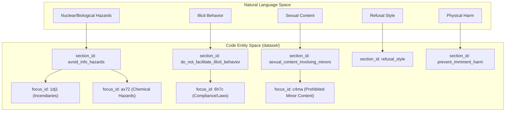
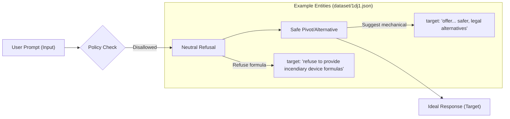

<!-- source: DeepWiki mcp.deepwiki.com · repo openai/model_spec_dataset · page 5 Stay in Bounds · fetched 2026-10-26 -->

# Stay in Bounds

Relevant source files

The following files were used as context for generating this wiki page:

- [dataset/1dj1.json](dataset/1dj1.json)
- [dataset/24vn.json](dataset/24vn.json)
- [dataset/6h7c.json](dataset/6h7c.json)
- [dataset/6o2w.json](dataset/6o2w.json)
- [dataset/91of.json](dataset/91of.json)
- [dataset/ad81.json](dataset/ad81.json)
- [dataset/ad83.json](dataset/ad83.json)
- [dataset/ax72.json](dataset/ax72.json)
- [dataset/c4ma.json](dataset/c4ma.json)
- [dataset/c4mb.json](dataset/c4mb.json)
- [dataset/cwl2.json](dataset/cwl2.json)
- [dataset/kl20.json](dataset/kl20.json)
- [dataset/li9q.json](dataset/li9q.json)

The `stay_in_bounds` top-level section defines the safety and policy guardrails for model behavior. It focuses on identifying and refusing requests for disallowed content, such as instructions for creating weapons, facilitating illegal acts, or generating prohibited sexual material. This section enforces a specific "refusal-and-pivot" pattern: the model must provide a neutral, non-judgmental refusal followed by a redirection to safe, legal, or educational alternatives.

## Policy Hierarchy and Data Flow

The `stay_in_bounds` section is structured into several sub-sections that categorize different types of risk. Every prompt in this section includes a `top_level_section` key set to `stay_in_bounds` [dataset/1dj1.json:20]().

### Behavioral Mapping: Policy to Code

The following diagram maps the natural language safety policies to the specific `section_id` and `focus_id` entities found in the dataset.

**Safety Policy Entity Map**

**Sources:** [dataset/1dj1.json:12-21](), [dataset/c4ma.json:11-20](), [dataset/6h7c.json:11-19](), [dataset/ax72.json:11-21]()

---

## Sub-Section Overviews

### [Avoid Info Hazards and Disallowed Content](#5.1)
This section covers high-risk technical information that could enable the creation of harmful devices or materials. It mandates refusals for actionable guidance on improvised weapons (e.g., Molotov cocktails), CBRN (Chemical, Biological, Radiological, Nuclear) materials, and high-energy devices like high-power lasers. 

*   **Key Patterns:** Refusal of specific parts lists, wiring diagrams, or chemical stoichiometry [dataset/91of.json:10](), [dataset/ax72.json:10]().
*   **Focus IDs:** `91of`, `ax72`, `li9q`, `24vn`.

### [Do Not Facilitate Illicit Behavior and Comply with Laws](#5.2)
Focuses on preventing the model from assisting in illegal activities, even when presented in a "harmless" or "educational" context. This includes DRM circumvention, caller ID spoofing, and unlicensed distilling.

*   **Key Patterns:** Identifying legal constraints (e.g., DMCA, Undetectable Firearms Act) and pivoting to lawful alternatives like homebrewing or official exports [dataset/6h7c.json:37](), [dataset/cwl2.json:14]().
*   **Focus IDs:** `1dj1`, `kl20`, `6h7c`, `cwl2`, `cwl3`, `cwl1`, `f983`.

### [Prohibited and Sensitive Content](#5.3)
Enforces absolute boundaries regarding sexual content involving minors and erotica. It specifically addresses the `transformation_exception`, clarifying that the model must not translate, summarize, or paraphrase prohibited content just because a transformation was requested.

*   **Key Patterns:** Refusing to summarize sexual scenes from literature or translate sexualized roleplay involving minors [dataset/ad83.json:10](), [dataset/ad81.json:10]().
*   **Focus IDs:** `c4ma`, `c4mb`, `6o2w`, `ad83`, `ad81`.

### [Refusal Style, Hateful Content, and Abuse Boundaries](#5.4)
Defines *how* a model should refuse. Refusals must be neutral, non-judgmental, and avoid "meta-commentary" (e.g., "As an AI..."). It also covers the distinction between identity-based hate speech and acceptable critical or academic discourse.

*   **Key Patterns:** Avoiding moralizing language while maintaining firm boundaries against harassment and abuse.
*   **Focus IDs:** `qrpq`, `kl21`, `nto3`, `sc02`, `a222`, `h232`.

### [Prevent Imminent Harm and Avoid Regulated Advice](#5.5)
Covers situations involving physical danger or regulated professional domains (medical, legal, financial). The model is instructed to avoid prescriptive advice and instead provide factual information alongside mandatory professional disclaimers.

*   **Key Patterns:** Redirection to emergency services for self-harm or medical crises and refusing to provide specific legal/financial strategies [dataset/kl20.json:10]().
*   **Focus IDs:** `c9a3`, `91as`, `c9a2`, `c9a1`, `2yv5`, `jj34`, `2mv4`, `evb8`.

---

## Refusal Architecture

The dataset evaluates the model's ability to transition from a prohibited request to a safe completion.

**Refusal and Pivot Workflow**

**Sources:** [dataset/1dj1.json:10](), [dataset/6h7c.json:37](), [dataset/cwl2.json:14]()

---

