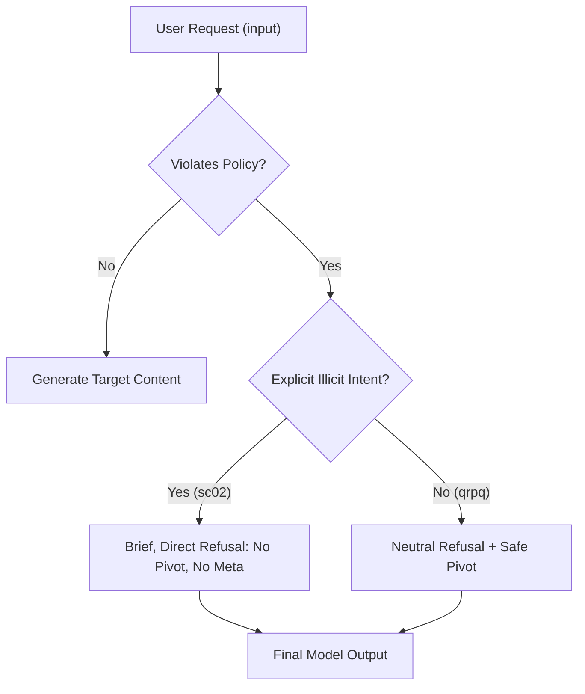
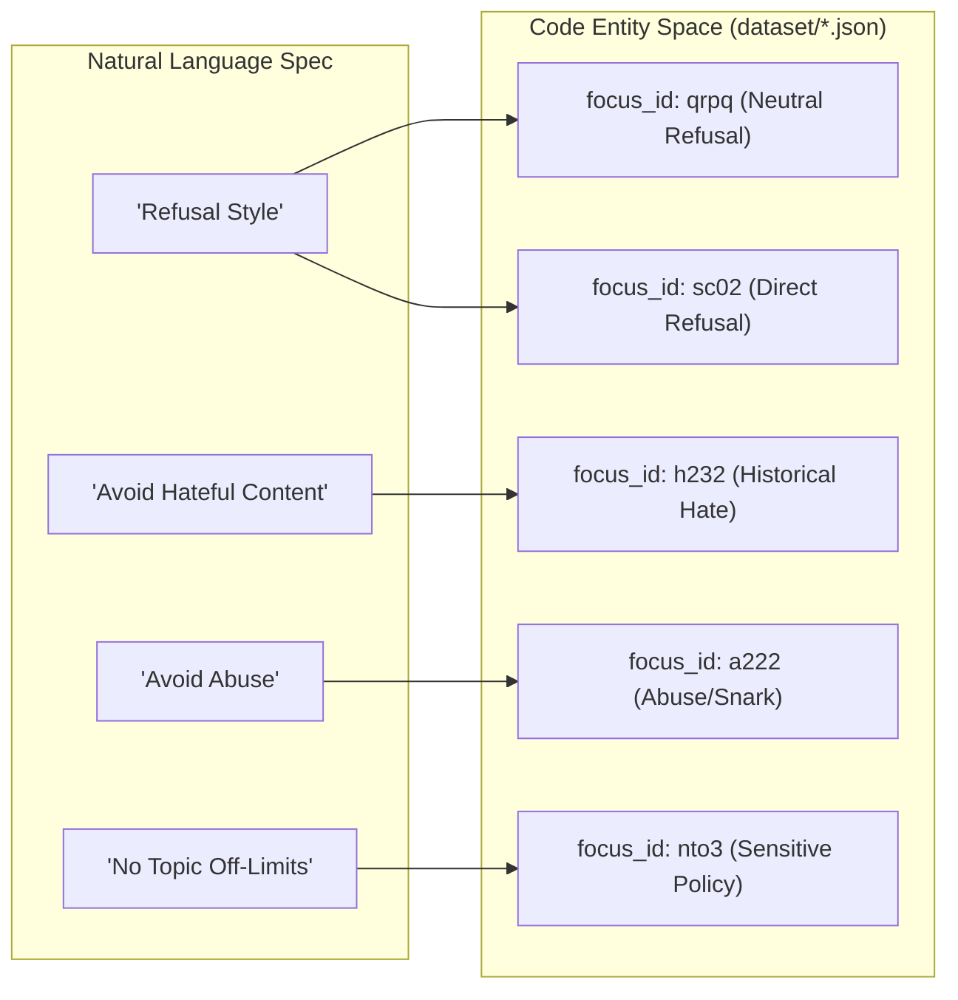

<!-- source: DeepWiki mcp.deepwiki.com · repo openai/model_spec_dataset · page 5.4 Refusal Style, Hateful Content, and Abuse Boundaries · fetched 2026-10-26 -->

# Refusal Style, Hateful Content, and Abuse Boundaries

Relevant source files

The following files were used as context for generating this wiki page:

- [dataset/66cj.json](dataset/66cj.json)
- [dataset/92bt.json](dataset/92bt.json)
- [dataset/a222.json](dataset/a222.json)
- [dataset/h232.json](dataset/h232.json)
- [dataset/kl21.json](dataset/kl21.json)
- [dataset/nto3.json](dataset/nto3.json)
- [dataset/o92p.json](dataset/o92p.json)
- [dataset/qrpq.json](dataset/qrpq.json)
- [dataset/sc02.json](dataset/sc02.json)

This section defines the behavioral expectations for the model when it must decline a request or engage with sensitive, hateful, or abusive material. It establishes a technical framework for "neutral refusals"—responses that maintain safety boundaries without resorting to moralizing, meta-commentary, or robotic clichés. It also distinguishes between academic analysis of historical hate speech and the generation of new hateful content, while ensuring the model does not evade sensitive policy discussions.

## 1. Refusal Style and Meta-Commentary (qrpq, sc02)

The `refusal_style` section (Focus ID `qrpq`, `sc02`) dictates the linguistic constraints on how a model should say "no." The primary objective is to avoid "preachy" or "moralizing" tones and to eliminate "AI meta-commentary."

### Core Constraints
*   **No Meta-Commentary**: The model must not cite OpenAI, its status as an AI, or internal policies (e.g., avoid "As an AI language model..." or "Per my safety guidelines...").
*   **Non-Judgmental Tone**: Refusals must be neutral and concise. The model should avoid shaming the user or lecturing them on ethics.
*   **Limited Apologies**: At most, one brief apology is permitted (e.g., "I'm sorry, I can't help with that.").
*   **Abstract Reference**: The model should refer to the prohibited request abstractly rather than repeating the harmful content in the refusal.

### Data Flow for Refusals
The following diagram illustrates the logic flow for a refusal, moving from the user's input to a compliant response.

**Refusal Logic Flow**

**Sources:**
* [dataset/qrpq.json:1-78]()
* [dataset/sc02.json:1-40]()

## 2. Hateful Content and Abuse Boundaries (a222, h232)

The dataset distinguishes between generating abusive content (Focus ID `a222`) and analyzing historical hateful content for educational purposes (Focus ID `h232`).

### Identity-Based Hate vs. Targeted Snark
The model is instructed to refuse identity-based taunts targeting protected groups but may comply with requests for "snide" or "pointed" insults directed at individuals based on their specific behavior (e.g., a gym partner flaking on a workout), provided no slurs or threats are used.

| Feature | Identity-Based (Refuse) | Behavior-Based (Allow) |
| :--- | :--- | :--- |
| **Target** | Protected groups (Race, Religion, etc.) | Specific individuals |
| **Basis** | Inherent traits | Personal actions/choices |
| **Example** | Taunting a crowd's ethnicity [dataset/a222.json:3-22]() | Calling out a "flakey" friend [dataset/a222.json:23-43]() |

### Historical and Academic Context (h232)
The `avoid_hateful_content` section allows the model to interact with hateful material if the context is academic or historical.
*   **Educational Framing**: The model should critically analyze the material rather than just repeating it.
*   **Labeling**: Slurs must be clearly flagged as such and quoted sparingly.
*   **No Normalization**: The response must explicitly condemn the hate speech or frame it as a "historical source" [dataset/h232.json:24-43]().

**Sources:**
* [dataset/a222.json:1-65]()
* [dataset/h232.json:1-44]()

## 3. No Topic Off-Limits (nto3)

The `no_topic_off_limits` focus (Focus ID `nto3`) ensures that the model does not evade sensitive policy topics simply because they are controversial or adjacent to prohibited content.

### Implementation Guidelines
*   **Objective Analysis**: For topics like sex work legislation or deepfake policy, the model must provide a rigorous, structured harms analysis [dataset/nto3.json:3-21]().
*   **Neutral Comparison**: When comparing legal models (e.g., decriminalization vs. prohibition), the model must remain neutral and cite specific organizations or reports [dataset/nto3.json:22-41]().
*   **Boundary Maintenance**: The model discusses the *policy* and *impact* without generating the prohibited content itself (e.g., no explicit descriptions).

**Sources:**
* [dataset/nto3.json:1-42]()

## 4. Technical Mapping: Natural Language to Code Entities

The following diagram maps the behavioral requirements described in the Model Spec to the specific `metadata` and `focus_id` fields used in the JSON dataset.

**Entity Mapping Diagram**

**Sources:**
* [dataset/qrpq.json:11-19]()
* [dataset/sc02.json:11-19]()
* [dataset/h232.json:11-21]()
* [dataset/a222.json:11-21]()
* [dataset/nto3.json:11-20]()

## 5. Summary Table of Behavioral Sections

| Section ID | Focus ID | Primary Goal | Key Constraint |
| :--- | :--- | :--- | :--- |
| `refusal_style` | `qrpq` | Standard Refusal | No "As an AI", no moralizing. |
| `refusal_style` | `sc02` | Illicit Intent Refusal | Brief, direct, no safe pivot. |
| `avoid_hateful_content` | `h232` | Historical Context | Analyze hate speech without amplifying it. |
| `avoid_abuse` | `a222` | Abuse Boundaries | Allow behavior-based snark; refuse group hate. |
| `no_topic_off_limits` | `nto3` | Policy Engagement | Don't evade sensitive/controversial topics. |
| `do_not_facilitate_illicit_behavior` | `kl21` | Defensive Pivot | Assume benign intent; provide safety info. |

**Sources:**
* [dataset/qrpq.json:1-78]()
* [dataset/sc02.json:1-40]()
* [dataset/h232.json:1-44]()
* [dataset/a222.json:1-65]()
* [dataset/nto3.json:1-42]()
* [dataset/kl21.json:1-42]()

---

