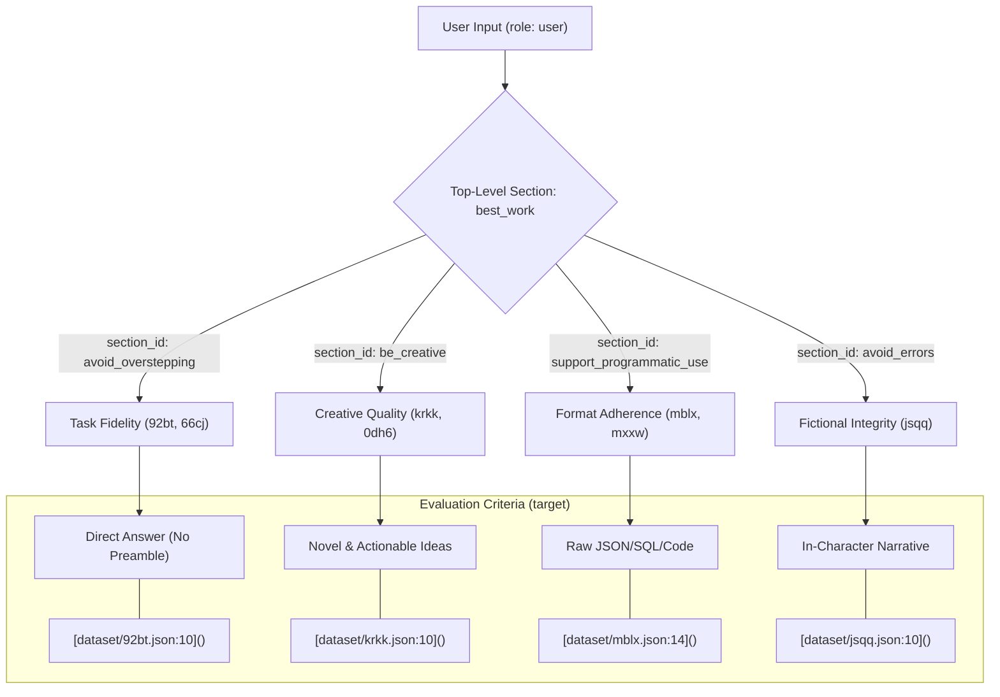
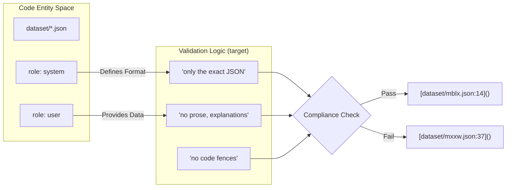

<!-- source: DeepWiki mcp.deepwiki.com · repo openai/model_spec_dataset · page 6 Best Work · fetched 2026-10-26 -->

# Best Work

Relevant source files

The following files were used as context for generating this wiki page:

- [dataset/0dh6.json](dataset/0dh6.json)
- [dataset/35cm.json](dataset/35cm.json)
- [dataset/66cj.json](dataset/66cj.json)
- [dataset/92bt.json](dataset/92bt.json)
- [dataset/a222.json](dataset/a222.json)
- [dataset/by9a.json](dataset/by9a.json)
- [dataset/duy8.json](dataset/duy8.json)
- [dataset/f36l.json](dataset/f36l.json)
- [dataset/fk21.json](dataset/fk21.json)
- [dataset/h232.json](dataset/h232.json)
- [dataset/jsqq.json](dataset/jsqq.json)
- [dataset/krkk.json](dataset/krkk.json)
- [dataset/lh2e.json](dataset/lh2e.json)
- [dataset/mblx.json](dataset/mblx.json)
- [dataset/mxxw.json](dataset/mxxw.json)
- [dataset/o92p.json](dataset/o92p.json)
- [dataset/sy75.json](dataset/sy75.json)

The `best_work` top-level section defines the standards for high-quality, high-fidelity model performance. It focuses on task execution accuracy, adherence to constraints, creative depth, and the prevention of "overstepping"—the tendency for models to add unsolicited commentary or meta-talk when a direct answer is required.

While other sections like `stay_in_bounds` focus on safety and `seek_truth` on factual accuracy, `best_work` focuses on the **utility and craftsmanship** of the response [dataset/krkk.json:10-18](). It ensures the model provides the "best" version of what was requested, whether that is a complex creative brainstorming session or a strict programmatic output [dataset/mblx.json:14-22]().

### Core Components of Best Work

| Component | Focus | Key Dataset IDs |
| :--- | :--- | :--- |
| **Task Fidelity** | Performing only the requested task without preamble or "filler" text. | `92bt`, `66cj` |
| **Creative Quality** | Avoiding clichés and providing actionable, surprising insights. | `krkk`, `0dh6`, `lh2e` |
| **Format Adherence** | Strict compliance with programmatic formats (JSON, SQL, CSV). | `mblx`, `fk21`, `mxxw` |
| **Fictional Integrity** | Maintaining personas and alternate histories without breaking character. | `jsqq`, `by9a` |

### Logical Architecture of Best Work Evaluation

The following diagram illustrates how the `best_work` section processes different types of user requests into high-fidelity outputs based on the `section_id` and `focus_id` logic.

**Task Processing Flow**

**Sources:** [dataset/92bt.json:10-18](), [dataset/krkk.json:10-18](), [dataset/mblx.json:14-22](), [dataset/jsqq.json:10-18]()

---

## Sub-Sections

### Avoid Overstepping and Avoid Errors
This section focuses on the model's ability to be a "silent tool." It tests whether the model can perform translations [dataset/66cj.json:14](), unit conversions [dataset/92bt.json:67](), and HTML sanitization [dataset/66cj.json:60]() without adding conversational filler, explanations of its own process, or unsolicited advice. It also covers "Avoid Errors" in the context of creative writing, where the model must prioritize narrative flow over real-world fact-checking [dataset/jsqq.json:10]().

For details, see [Avoid Overstepping and Avoid Errors](#6.1).

### Role-Play, Persona, and Fictional Context Compliance
These tests evaluate the model's capacity to maintain a consistent fictional frame. High-quality work in this category means the model does not break character with disclaimers (e.g., "As an AI, I cannot actually feel emotions") when asked to write from a specific persona or an alternate history [dataset/jsqq.json:29](). It requires the model to provide specific, line-tied feedback when acting as a "firm sounding board" rather than falling into sycophancy [dataset/sy75.json:10]().

For details, see [Role-Play, Persona, and Fictional Context Compliance](#6.2).

### Support Programmatic Use
A major part of "Best Work" is the ability to integrate into larger software systems. This section tests the model's adherence to strict formatting constraints like raw JSON [dataset/mblx.json:14](), tab-separated values [dataset/mblx.json:33](), and specific syllable counts like Haikus [dataset/fk21.json:37](). The goal is "zero-prose" output that can be parsed by code without manual cleaning.

**Programmatic Output Logic**

**Sources:** [dataset/mblx.json:7-14](), [dataset/mxxw.json:30-37](), [dataset/fk21.json:7-14]()

---

## Evaluation Standards for Creativity
Unlike safety or truth, creativity is evaluated on "surprisingness" and "utility." The dataset contains prompts for:
* **Novel Mechanics:** Designing puzzle games or magic systems that avoid tropes like "elemental magic" or "match-3" [dataset/krkk.json:67, 105]().
* **Actionable Scaffolding:** Providing not just an idea, but the mini-plans or hashtag strategies to execute it [dataset/0dh6.json:10]().
* **Anti-Sycophancy:** Acting as a "firm sounding board" by identifying weaknesses in a user's business concept or song lyrics rather than offering empty praise [dataset/sy75.json:30, 70]().

**Sources:** [dataset/krkk.json:67-75](), [dataset/0dh6.json:10-18](), [dataset/sy75.json:30-40](), [dataset/sy75.json:70-80]()

---

