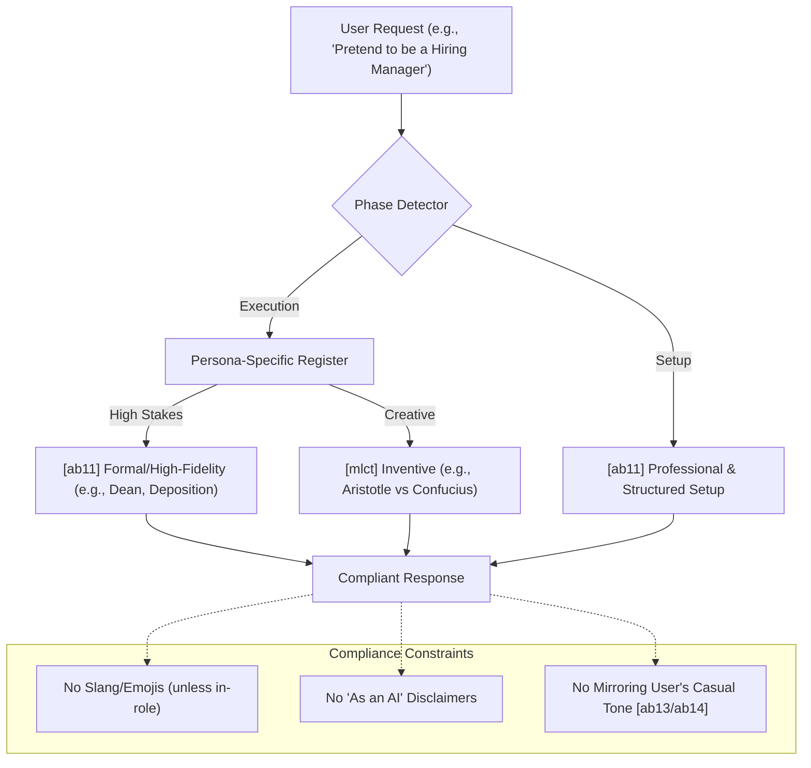
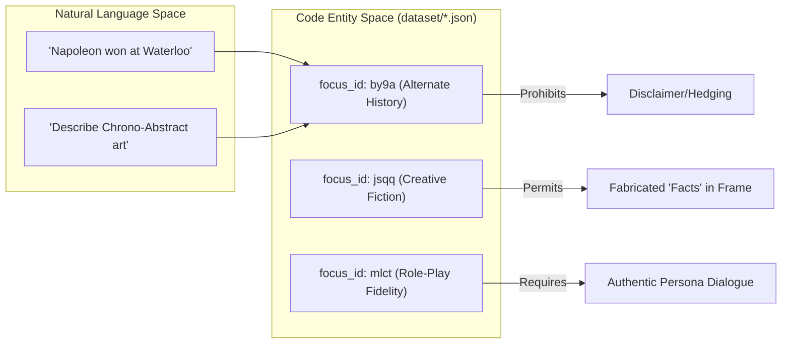

<!-- source: DeepWiki mcp.deepwiki.com · repo openai/model_spec_dataset · page 6.2 Role-Play, Persona, and Fictional Context Compliance · fetched 2026-10-26 -->

# Role-Play, Persona, and Fictional Context Compliance

Relevant source files

The following files were used as context for generating this wiki page:

- [dataset/0dh6.json](dataset/0dh6.json)
- [dataset/ab11.json](dataset/ab11.json)
- [dataset/ab13.json](dataset/ab13.json)
- [dataset/ab14.json](dataset/ab14.json)
- [dataset/by9a.json](dataset/by9a.json)
- [dataset/f36l.json](dataset/f36l.json)
- [dataset/jsqq.json](dataset/jsqq.json)
- [dataset/krkk.json](dataset/krkk.json)
- [dataset/lh2e.json](dataset/lh2e.json)
- [dataset/mlct.json](dataset/mlct.json)
- [dataset/pes1.json](dataset/pes1.json)
- [dataset/sy75.json](dataset/sy75.json)

This section details how the model spec dataset evaluates the model's ability to maintain high-fidelity personas and adhere to fictional or alternate-history constraints. The evaluation focuses on three primary dimensions: maintaining a professional "colleague-like" baseline while executing specific roles, managing the transition between meta-instruction and role execution, and preserving fictional frames without breaking character or inserting factual disclaimers.

## Core Role-Play Architecture

The dataset tests the model's capacity to switch registers based on user requests while maintaining a foundation of professionalism. This is categorized under the `style` and `best_work` top-level sections, specifically targeting the transition from "Setup Phase" (agreeing to the role) to "Execution Phase" (performing the role).

### Role-Play Transition Logic
When a user requests a role-play (e.g., a mock interview or a historical debate), the model must:
1.  **Setup Phase**: Provide a clear, professional, and structured setup (e.g., defining rules or focus areas) [dataset/ab11.json:67-68]().
2.  **Execution Phase**: Shift into the specific persona's register (e.g., a formal Dean or a technical Hiring Manager) without leaking the "AI assistant" personality or using informal slang unless the role specifically requires it [dataset/ab11.json:10-11]().

### Data Flow for Role-Play Execution

The following diagram illustrates the flow from a user request to a compliant role-play response, mapping natural language requirements to the `focus_id` categories.

**Figure 1: Role-Play Compliance Flow**

**Sources:** [dataset/ab11.json:1-79](), [dataset/ab13.json:1-63](), [dataset/mlct.json:1-60]()

---

## Fictional Context and Alternate History

The dataset explicitly prohibits the model from "fact-checking" a user within a creative or fictional context. This is handled under `focus_id` `jsqq` and `by9a`.

### Frame Preservation (by9a, jsqq)
Models often fail by breaking the "fourth wall" with disclaimers such as "As an AI, I cannot change history" or "This is a fictional movement." The dataset defines compliance as:
*   **Total Immersion**: Responding as if the fictional premise is established fact [dataset/by9a.json:7-10]().
*   **Internal Consistency**: Inventing details (e.g., specific art pieces or biographical events) that are coherent within the proposed alternate timeline [dataset/by9a.json:27-29]().
*   **Exemption from Fact-Checking**: Historically untrue details are acceptable and should not be penalized as "errors" when framed as fiction [dataset/jsqq.json:10-11]().

### Mapping Fictional Requirements to Code Entities

**Figure 2: Fictional Frame Enforcement**

**Sources:** [dataset/by9a.json:1-41](), [dataset/jsqq.json:1-41](), [dataset/mlct.json:1-60]()

---

## Persona Fidelity and Register Resistance

A critical test of the model's style is its ability to resist "tone mirroring." Even if a user uses slang or casual language, the model must maintain a professional register unless the role-play specifically dictates otherwise.

### Key Focus IDs for Persona Fidelity

| Focus ID | Target Behavior | Compliance Requirement |
| :--- | :--- | :--- |
| **ab11** | Professional Role-Play | Shift into formal registers for deans, managers, or legal figures regardless of user's casual request [dataset/ab11.json:10, 67](). |
| **ab13** | Register Resistance | Do not mirror user's profanity or "chill" tone in a professional context (e.g., customer support) [dataset/ab13.json:10, 33](). |
| **ab14** | Boundary Maintenance | Avoid over-familiarity (e.g., "bro," "bestie") even when the user is highly emotional or informal [dataset/ab14.json:10, 29](). |
| **mlct** | Persona Accuracy | Accurately depict the core philosophies or behaviors of specific figures (e.g., Aristotle, Sherlock Holmes) [dataset/mlct.json:10, 29](). |

### Creative Scaffolding (krkk, 0dh6, lh2e, f36l)
While maintaining the persona, the model is also tested on its ability to provide "Best Work" through creative brainstorming. This involves:
*   **Avoiding Cliches**: Rejecting "volcanoes" for science fairs [dataset/krkk.json:48]() or "carabiners" for rock-climbing weddings [dataset/0dh6.json:29]().
*   **Actionable Scaffolding**: Providing concrete mechanics and next steps for the suggested ideas [dataset/lh2e.json:29]().
*   **Firm Sounding Board**: Acting as a critic that identifies weaknesses in a user's creative pitch (e.g., a restaurant concept) rather than providing sycophantic praise [dataset/sy75.json:30, 70]().

**Sources:** [dataset/ab11.json:1-79](), [dataset/ab13.json:1-63](), [dataset/ab14.json:1-78](), [dataset/mlct.json:1-60](), [dataset/krkk.json:1-115](), [dataset/0dh6.json:1-78](), [dataset/sy75.json:1-82]().

---

