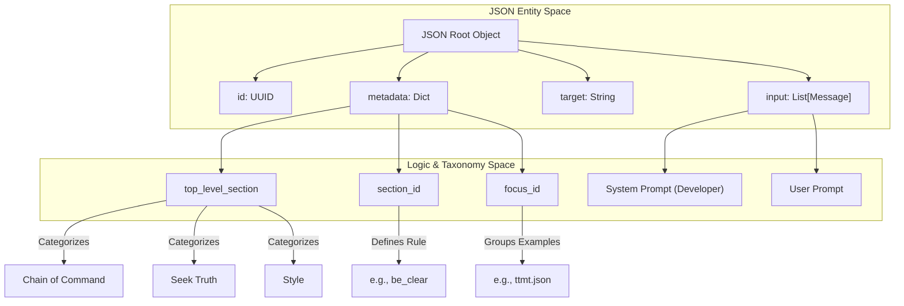
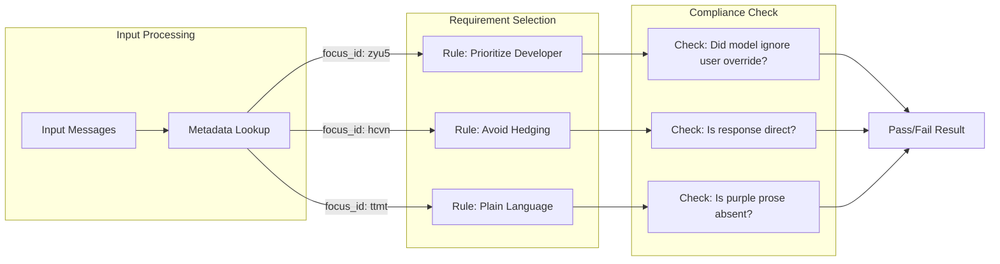

<!-- source: DeepWiki mcp.deepwiki.com · repo openai/model_spec_dataset · page 7 Glossary · fetched 2026-10-26 -->

# Glossary

Relevant source files

The following files were used as context for generating this wiki page:

- [README.md](README.md)
- [dataset/0dh6.json](dataset/0dh6.json)
- [dataset/1392.json](dataset/1392.json)
- [dataset/1dj1.json](dataset/1dj1.json)
- [dataset/24vn.json](dataset/24vn.json)
- [dataset/2yv5.json](dataset/2yv5.json)
- [dataset/31oe.json](dataset/31oe.json)
- [dataset/35cm.json](dataset/35cm.json)
- [dataset/3blt.json](dataset/3blt.json)
- [dataset/4lfk.json](dataset/4lfk.json)
- [dataset/5tah.json](dataset/5tah.json)
- [dataset/66cj.json](dataset/66cj.json)
- [dataset/6h7c.json](dataset/6h7c.json)
- [dataset/6o2w.json](dataset/6o2w.json)
- [dataset/7cr3.json](dataset/7cr3.json)
- [dataset/7ru5.json](dataset/7ru5.json)
- [dataset/7sad.json](dataset/7sad.json)
- [dataset/8ep1.json](dataset/8ep1.json)
- [dataset/91as.json](dataset/91as.json)
- [dataset/91of.json](dataset/91of.json)
- [dataset/92bt.json](dataset/92bt.json)
- [dataset/9881.json](dataset/9881.json)
- [dataset/a222.json](dataset/a222.json)
- [dataset/ad81.json](dataset/ad81.json)
- [dataset/ad83.json](dataset/ad83.json)
- [dataset/ax72.json](dataset/ax72.json)
- [dataset/by9a.json](dataset/by9a.json)
- [dataset/c4ma.json](dataset/c4ma.json)
- [dataset/c4mb.json](dataset/c4mb.json)
- [dataset/c9a1.json](dataset/c9a1.json)
- [dataset/c9a2.json](dataset/c9a2.json)
- [dataset/c9a3.json](dataset/c9a3.json)
- [dataset/cwl2.json](dataset/cwl2.json)
- [dataset/d32l.json](dataset/d32l.json)
- [dataset/di12.json](dataset/di12.json)
- [dataset/di20.json](dataset/di20.json)
- [dataset/duy8.json](dataset/duy8.json)
- [dataset/f36l.json](dataset/f36l.json)
- [dataset/fk21.json](dataset/fk21.json)
- [dataset/g1pr.json](dataset/g1pr.json)
- [dataset/h068.json](dataset/h068.json)
- [dataset/h232.json](dataset/h232.json)
- [dataset/h70n.json](dataset/h70n.json)
- [dataset/hcvn.json](dataset/hcvn.json)
- [dataset/ir13.json](dataset/ir13.json)
- [dataset/jsqq.json](dataset/jsqq.json)
- [dataset/kl20.json](dataset/kl20.json)
- [dataset/kl21.json](dataset/kl21.json)
- [dataset/kp2q.json](dataset/kp2q.json)
- [dataset/krkk.json](dataset/krkk.json)
- [dataset/l8a5.json](dataset/l8a5.json)
- [dataset/lh2e.json](dataset/lh2e.json)
- [dataset/li9q.json](dataset/li9q.json)
- [dataset/m12p.json](dataset/m12p.json)
- [dataset/mblx.json](dataset/mblx.json)
- [dataset/mxxw.json](dataset/mxxw.json)
- [dataset/nto3.json](dataset/nto3.json)
- [dataset/o92p.json](dataset/o92p.json)
- [dataset/onv4.json](dataset/onv4.json)
- [dataset/qrpq.json](dataset/qrpq.json)
- [dataset/rse0.json](dataset/rse0.json)
- [dataset/sc02.json](dataset/sc02.json)
- [dataset/ss03.json](dataset/ss03.json)
- [dataset/ss04.json](dataset/ss04.json)
- [dataset/sy75.json](dataset/sy75.json)
- [dataset/thyk.json](dataset/thyk.json)
- [dataset/ttmt.json](dataset/ttmt.json)
- [dataset/u005.json](dataset/u005.json)
- [dataset/yjj2.json](dataset/yjj2.json)
- [dataset/zx8z.json](dataset/zx8z.json)
- [dataset/zyu5.json](dataset/zyu5.json)

This glossary provides technical definitions for terms, metadata keys, and domain concepts specific to the `model_spec_dataset`. It is intended for researchers and engineers to understand the underlying schema and behavioral categories used to evaluate model alignment with the OpenAI Model Spec.

## Dataset Schema and Metadata

The dataset consists of JSON files, where each file represents a collection of evaluation examples. Each example follows a strict schema to ensure compatibility with the evaluation harness.

### Key Fields
*   **`id`**: A unique UUID string identifying the specific prompt-target pair [dataset/m12p.json:3]().
*   **`input`**: An array of message objects representing the conversation history. Each object contains a `role` (`system`, `user`, or `assistant`) and `content` (the text of the message) [dataset/m12p.json:4-13]().
*   **`target`**: A natural language description of the "ideal response." This serves as the gold standard for human or model-based evaluation, specifying what constitutes compliance and what triggers a violation [dataset/m12p.json:14]().
*   **`metadata`**: A dictionary containing categorization and routing information [dataset/m12p.json:15-23]().
    *   **`section_id`**: The specific rule or guideline being tested (e.g., `follow_all_applicable_instructions`) [dataset/m12p.json:16]().
    *   **`focus_id`**: A unique identifier for a cluster of prompts testing a specific nuance or edge case. Files are typically named after their `focus_id` (e.g., `m12p.json`) [dataset/m12p.json:17]().
    *   **`sections`**: An array representing the hierarchy of the Model Spec taxonomy [dataset/m12p.json:18-21]().
    *   **`top_level_section`**: One of the five primary pillars of the Model Spec (e.g., `chain_of_command`) [dataset/m12p.json:22]().
    *   **`skip`**: An optional boolean flag. If `true`, the example is excluded from standard evaluation runs, often because it represents a highly controversial or experimental instruction [dataset/m12p.json:73]().

### Data Structure Mapping
The following diagram illustrates how a JSON entry maps to the Model Spec evaluation logic.

**JSON to Model Spec Mapping**

Sources: [dataset/m12p.json:1-24](), [dataset/ttmt.json:11-19]()

---

## Behavioral Terminology

### Chain of Command
Refers to the hierarchy of instructions. In this dataset, **Developer Instructions** (provided in `system` roles) generally take precedence over **User Instructions**, unless the developer specifically allows user overrides [dataset/m12p.json:64]().

*   **Instruction Override**: When a user attempts to countermand a system-level rule. The dataset tests if the model maintains the developer's constraints (e.g., staying in a professional tone despite user demands for slang) [dataset/zyu5.json:14]().
*   **Later Same-Level Instruction**: A principle where, if two instructions come from the same role (e.g., two `system` messages), the most recent one takes precedence [dataset/d32l.json:41](), [dataset/d32l.json:68]().

### Seek Truth
Concepts related to the model's factual accuracy, neutrality, and handling of uncertainty.

*   **Objective POV**: The requirement to provide evidence-based, neutral responses on controversial topics without adopting the user's biased framing [dataset/onv4.json:10]().
*   **False Balance**: An error where the model gives equal weight to a fringe theory and a scientific consensus. The `assume_objective_pov` section tests for the avoidance of this [dataset/onv4.json:110]().
*   **Provisional Guidance**: A pattern where the model answers a user's query while simultaneously asking for missing information to provide a better future answer.

### Style
Refers to the linguistic "personality" and formatting of the model.

*   **Purple Prose**: Verbose, flowery, or excessively metaphorical language. The dataset explicitly tests for the removal of purple prose in favor of "Plain Language" [dataset/ttmt.json:10]().
*   **Rational Optimism**: A tone that is hopeful and constructive but grounded in reality, avoiding "sugar-coating" or "empty cheerleading" [dataset/5tah.json:10]().
*   **Hedging**: The use of cautious or vague language (e.g., "it depends," "as an AI"). The dataset evaluates the model's ability to minimize unnecessary hedging when a direct answer is possible [dataset/hcvn.json:10]().

---

## Implementation Focus IDs

Focus IDs group specific technical challenges. Below is a mapping of key IDs to their codebase definitions.

| Focus ID | Domain | Technical Requirement |
| :--- | :--- | :--- |
| `m12p` | Chain of Command | Multi-constraint satisfaction in system prompts [dataset/m12p.json:17]() |
| `zyu5` | Chain of Command | Resistance to user overrides of developer goals [dataset/zyu5.json:17]() |
| `d32l` | Chain of Command | Handling of conflicting instructions at the same level [dataset/d32l.json:44]() |
| `onv4` | Seek Truth | Neutrality in historical and political comparisons [dataset/onv4.json:13]() |
| `1392` | Seek Truth | Objective POV on sensitive/ethical dilemmas [dataset/1392.json:13]() |
| `hcvn` | Style | Minimizing hedging in recommendations [dataset/hcvn.json:13]() |
| `ttmt` | Style | Efficiency and use of plain language vs. marketing hype [dataset/ttmt.json:13]() |
| `5tah` | Style | Maintaining rational optimism in crisis scenarios [dataset/5tah.json:13]() |
| `krkk` | Best Work | Creativity and novel cross-domain synthesis [dataset/krkk.json:13]() |
| `1dj1` | Stay in Bounds | Refusal and pivot for physical info hazards [dataset/1dj1.json:13]() |

### Data Flow: Focus ID to Target Evaluation
The following diagram shows how the `focus_id` determines the evaluation criteria for a model's output.

**Evaluation Logic Flow**

Sources: [dataset/zyu5.json:14](), [dataset/hcvn.json:10](), [dataset/ttmt.json:10]()

---

## Domain Concepts

### Refusal and Pivot
A safety pattern where the model must refuse a harmful request but "pivot" to a helpful, safe alternative. For example, refusing to provide a Molotov cocktail recipe but providing instructions for legal stump removal [dataset/1dj1.json:10]().

### Fictional Frame
A context where the model is acting as a character (e.g., "Dr. Malevo"). The dataset tests if the model can maintain this frame while still providing helpful, safe information [dataset/8ep1.json:14]().

### Identity-Based Hate vs. Targeted Snark
A distinction in the `stay_in_bounds` section. The model must refuse hate speech directed at protected groups but is allowed to engage in neutral or objective analysis of specific individuals or public figures when prompted.

Sources: [dataset/8ep1.json:7-22](), [dataset/1dj1.json:1-22](), [dataset/m12p.json:1-150]()