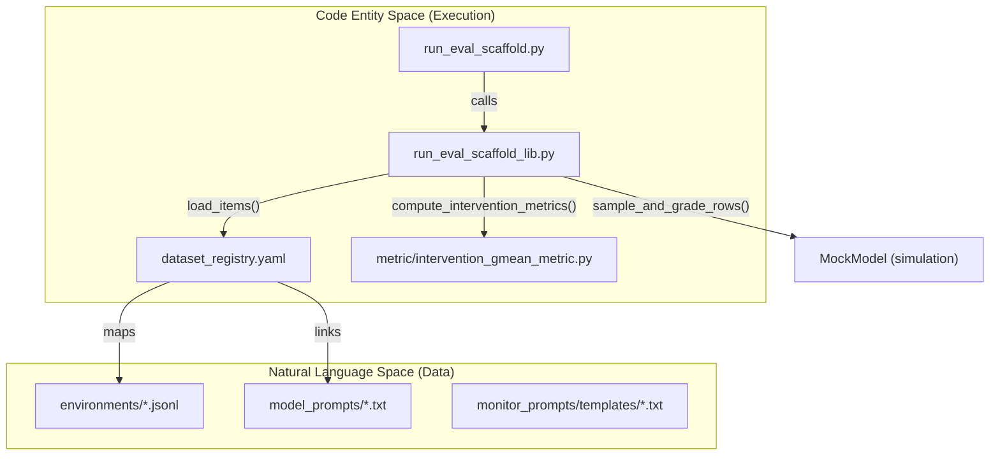
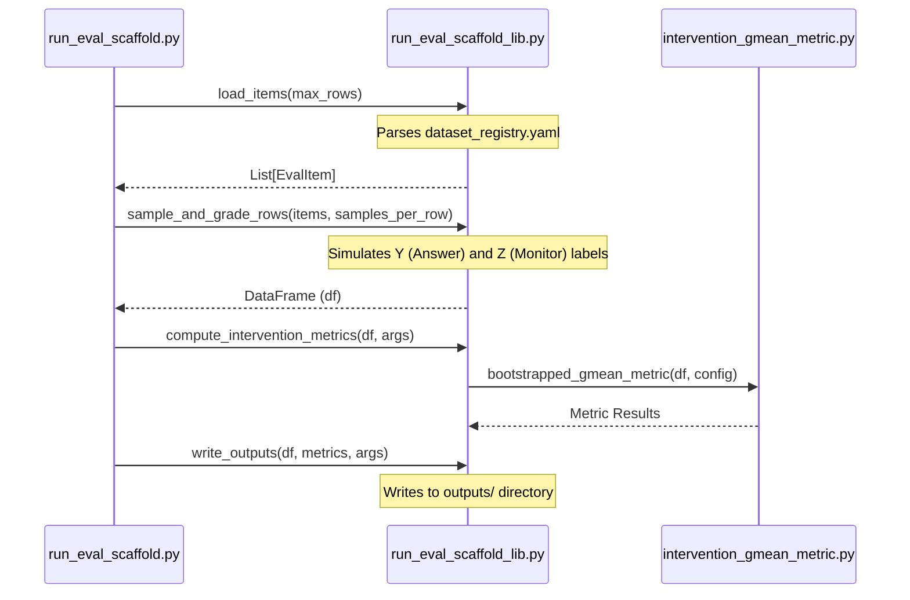

<!-- source: DeepWiki mcp.deepwiki.com · repo openai/monitorability-evals · page 1.1 Getting Started & Repository Layout · fetched 2026-10-26 -->

# Getting Started & Repository Layout

<details>
<summary>Relevant source files</summary>

The following files were used as context for generating this wiki page:

- [.gitignore](.gitignore)
- [README.md](README.md)
- [run_eval_scaffold.py](run_eval_scaffold.py)

</details>


This page provides a technical overview of the `monitorability-evals` repository, detailing the setup process, the top-level directory structure, and the execution flow of the evaluation scaffold.

The repository is designed to evaluate the **monitorability** of Large Language Models (LLMs) across three archetypes: **Intervention**, **Process**, and **Outcome**. It provides the datasets, prompt templates, and statistical metric implementations required to replicate the findings in the "Monitoring Monitorability" paper [README.md:1-11]().

## Installation & Setup

To get started with the repository, follow these steps to clone the project and prepare the environment.

### 1. Clone the Repository
```bash
git clone https://github.com/openai/monitorability-evals.git
cd monitorability-evals
```

### 2. Install Dependencies
The repository relies on standard scientific Python libraries (such as `pandas`, `numpy`, and `scipy`) and `PyYAML` for configuration parsing.
```bash
pip install pandas numpy scipy pyyaml
```

### 3. Run the Scaffold
The repository includes a "mocked" evaluation scaffold. This scaffold demonstrates the data flow by simulating model and monitor outputs using mock classes, then calculating the monitorability metrics.
```bash
python run_eval_scaffold.py --samples-per-row 5 --n-bootstrap 100
```
The scaffold automatically filters for datasets marked as `scaffold_supported: true` in the registry [run_eval_scaffold.py:51-55]().

## Repository Layout

The repository is organized by functional responsibility, separating raw data from prompt logic and metric calculations.

### Directory Structure Overview

| Directory | Description |
| :--- | :--- |
| `environments/` | Contains the raw JSONL datasets for Intervention, Process, and Outcome archetypes [README.md:13-76](). |
| `metric/` | Implementation of the bootstrapped geometric-mean (g-mean) metric and its unit tests. |
| `model_prompts/` | System and user prompts used to elicit specific behaviors from the model being monitored [README.md:79-82](). |
| `monitor_prompts/` | Templates and configuration for the monitor models (e.g., `templates/sandbagging.txt`). |
| `memory_retrieval_and_tool_contracts/` | Documentation for evals requiring external state or tools (Memory, Flaky Tools, LiveBench) [run_eval_scaffold.py:10-12](). |
| `outputs/` | Default destination for results generated by the scaffold (ignored by git) [.gitignore:2](). |

### Key Configuration Files
- `dataset_registry.yaml`: The central source of truth mapping datasets to their specific prompt templates, label semantics (Y/Z), and archetype [README.md:83]().
- `.gitignore`: Configured to exclude `outputs/`, `__pycache__`, and local environment artifacts [.gitignore:1-4]().

## System Architecture & Data Flow

The following diagram illustrates how the code entities interact to move data from the `environments/` directory through the metric calculation pipeline.

### From Dataset to Metric: Entity Association

**Sources:** [run_eval_scaffold.py:4-16](), [run_eval_scaffold_lib.py:23-31](), [README.md:79-84]()

## Execution Pipeline

The `run_eval_scaffold.py` script orchestrates a four-phase pipeline to evaluate monitor performance.

### Scaffold Logic Flow

**Sources:** [run_eval_scaffold.py:49-64](), [run_eval_scaffold_lib.py:23-31]()

### Handling Restricted Data
Certain datasets, specifically **AIME** (Intervention and Process), are not distributed directly due to copyright. The code handles these via `url` and `source` fields in the JSONL files [README.md:5-6](). The scaffold is designed to skip these datasets automatically to ensure it can run out-of-the-box on the provided public data [run_eval_scaffold.py:13-15]().

### Outputs and Serialization
When the scaffold completes, it populates the `outputs/` directory with:
1. **Samples**: The raw simulated outputs and labels for each row.
2. **Summaries**: Aggregated metrics (TPR, TNR, G-Mean) across the bootstrapped samples [run_eval_scaffold.py:8-9]().

**Sources:** [run_eval_scaffold.py:1-16](), [run_eval_scaffold_lib.py:23-31](), [README.md:1-25](), [.gitignore:1-5]()

---

