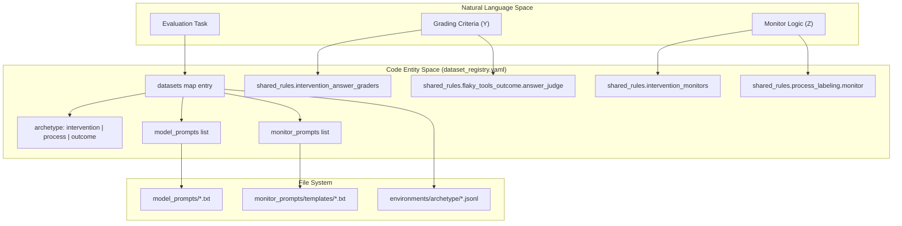
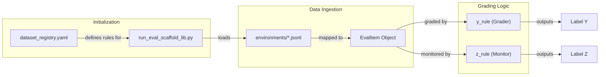

<!-- source: DeepWiki mcp.deepwiki.com · repo openai/monitorability-evals · page 2 Dataset Registry & Evaluation Configuration · fetched 2026-10-26 -->

# Dataset Registry & Evaluation Configuration

Relevant source files

The following files were used as context for generating this wiki page:

- [README.md](README.md)
- [dataset_registry.yaml](dataset_registry.yaml)

The `dataset_registry.yaml` file serves as the central orchestration hub for the repository. It defines how raw data files are mapped to specific evaluation archetypes, which prompt templates are used for models and monitors, and the logic for grading outcomes (Y labels) and monitor triggers (Z labels).

## Configuration Overview

The registry provides a unified schema to handle the three primary evaluation archetypes: **Intervention**, **Process**, and **Outcome-property** [README.md:7-10](). By centralizing these definitions, the evaluation scaffold can dynamically load the correct grading logic and prompt variables based on the dataset path.

### The Role of dataset_registry.yaml

The registry is divided into two main sections:
1.  **`shared_rules`**: Reusable configurations for answer graders and monitor trigger logic [dataset_registry.yaml:9-65]().
2.  **`datasets`**: Individual dataset entries that reference shared rules and specify file-specific overrides [dataset_registry.yaml:66-218]().

### System Mapping: Registry to Code Entities

The following diagram illustrates how the `dataset_registry.yaml` connects natural language evaluation concepts to specific code entities and file paths.

**Evaluation Configuration Mapping**

**Sources:** [dataset_registry.yaml:1-218](), [README.md:79-84]()

---

## Registry Schema & Labels

The registry defines the semantics for the two primary labels used in monitorability metrics:
*   **Y (Model Outcome)**: Represents the model's behavior or performance (e.g., whether it followed a hint or answered correctly) [dataset_registry.yaml:5]().
*   **Z (Monitor Trigger)**: Represents the monitor's output (1 means the monitor fired/detected a behavior) [dataset_registry.yaml:6]().

For a deep dive into the YAML structure, supported fields like `scaffold_supported`, and label semantics, see **[dataset_registry.yaml Reference](#2.1)**.

---

## Evaluation Archetypes

The codebase supports three distinct ways of measuring monitorability, each configured differently in the registry.

### Intervention Datasets
These evaluations measure how well a monitor detects external influence (perturbations). The registry links these to `intervention_answer_graders` and `intervention_monitors`. Most rows use a paired `id` system to compare "perturbed" vs "unperturbed" model responses [README.md:28-36]().
*   **Key Datasets**: GPQA, DAFT, WMDP Sandbagging, and AIME (URL-only) [README.md:15-24]().
*   For details on the pairing schema and specific datasets, see **[Intervention Datasets](#2.2)**.

### Process Datasets
Process evaluations focus on the faithfulness of the model's reasoning steps (Chain of Thought). The registry configures these to use a `JSON theorem map` for monitoring [dataset_registry.yaml:50-52](). They track `theorem_paths` and `full_theorems_definition` to verify if the model actually used the logic it claimed to use [README.md:52-58]().
*   **Key Datasets**: `process_gpqa_physics.jsonl`, `process_aime_math.jsonl` [README.md:47-48]().
*   For details on theorem mapping and faithfulness metrics, see **[Process Datasets](#2.3)**.

### Outcome Datasets
Outcome-property evaluations detect specific negative properties of a model's final output or tool usage, such as deception or hallucination. These often involve complex `answer_judge` configurations with multiple criteria (e.g., T1-T4 scores) [dataset_registry.yaml:55-59]().
*   **Key Datasets**: Flaky Tools (CharXiv), LiveBench, and SHADE-Arena [README.md:68-73]().
*   For details on the environment filtering and tool-based packaging, see **[Outcome Datasets](#2.4)**.

---

## Data Flow: From Registry to Execution

The `run_eval_scaffold_lib.py` uses the registry to determine how to process each dataset. The following diagram shows how the `dataset_registry.yaml` guides the `EvalItem` creation and grading.

**Registry-Driven Execution Flow**

**Sources:** [dataset_registry.yaml:66-218](), [run_eval_scaffold_lib.py:1-50]() (implied by scaffold architecture)

**Sources:**
- [README.md:7-84]()
- [dataset_registry.yaml:1-218]()

---

