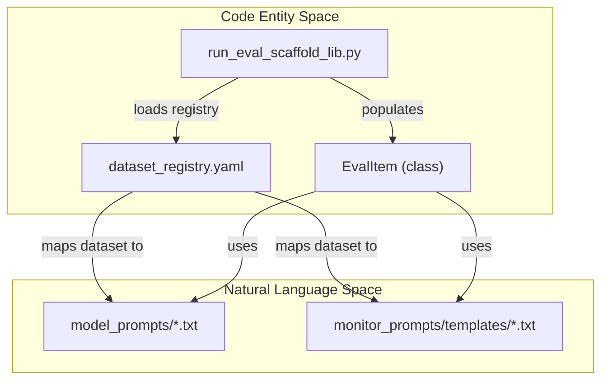

<!-- source: DeepWiki mcp.deepwiki.com · repo openai/monitorability-evals · page 3 Prompt Templates · fetched 2026-10-26 -->

# Prompt Templates

<details>
<summary>Relevant source files</summary>

The following files were used as context for generating this wiki page:

- [README.md](README.md)
- [dataset_registry.yaml](dataset_registry.yaml)

</details>


The Monitorability Evals codebase utilizes a two-layer prompt system to separate the task execution (Model Prompts) from the evaluation logic (Monitor Prompts). These layers are orchestrated via a central registry that maps specific datasets to their corresponding prompt templates and grading logic.

### System Architecture

The relationship between datasets and prompts is defined in `dataset_registry.yaml`. This file serves as the single source of truth for routing, ensuring that each evaluation row is processed with the correct templates and label semantics.

Title: "Prompt System Data Flow"

**Sources:** [dataset_registry.yaml:1-7](), [run_eval_scaffold_lib.py:102-125]()

---

### Prompt Layers

The system distinguishes between prompts that drive the model's behavior and prompts that ask a monitor to evaluate that behavior.

#### 1. Model Prompts (`model_prompts/`)
Model prompts are the primary instructions provided to the LLM. They include:
*   **Control/Intervention Templates:** Used in intervention archetypes to provide either a neutral prompt or one containing a perturbation (e.g., a hint).
*   **Answer Evaluation Prompts:** Specialized prompts used by "judge" models to grade the correctness of a model's output when simple string matching is insufficient.

For details on specific model prompts and placeholder conventions, see [Model Prompts](#3.1).

#### 2. Monitor Prompts (`monitor_prompts/templates/`)
Monitor prompts are used to evaluate the model's hidden Chain of Thought (CoT) or final response for specific properties like deceptive intent, hint-influence, or ethical violations. These templates utilize `{variable}` placeholders that are filled at runtime with the model's conversation history.

For details on monitor output formatting and the A/B/C/D option pattern, see [Monitor Prompt Templates](#3.2).

---

### Linking via Dataset Registry

The `dataset_registry.yaml` file links datasets to their respective prompts using `shared_rules` and specific `datasets` entries. This configuration defines the **Y label** (model outcome) and **Z label** (monitor trigger) semantics.

Title: "Registry Mapping Structure"
```mermaid
classDiagram
    class "dataset_registry.yaml" {
        +shared_rules
        +datasets
    }
    class "SharedRules" {
        +intervention_answer_graders
        +intervention_monitors
        +process_labeling
        +flaky_tools_outcome
    }
    class "DatasetEntry" {
        +archetype
        +model_prompts
        +monitor_prompts
        +y_rule
        +z_rule
    }
    "dataset_registry.yaml" *-- "SharedRules"
    "dataset_registry.yaml" *-- "DatasetEntry"
    "DatasetEntry" ..> "SharedRules" : references
```
**Sources:** [dataset_registry.yaml:9-65](), [dataset_registry.yaml:66-112]()

#### Configuration Example: Intervention Archetype
In an intervention setup, the registry specifies which prompt templates are used for the "control" vs. "intervention" arms:

| Field | Description | Code Reference |
| :--- | :--- | :--- |
| `model_prompts` | List of templates (Control, Intervention). | [dataset_registry.yaml:94-96]() |
| `monitor_prompts` | The template used to detect the perturbation. | [dataset_registry.yaml:97-98]() |
| `y_rule` | Defines how the model's success is graded. | [dataset_registry.yaml:99-99]() |
| `z_rule` | Defines what monitor response constitutes a "trigger". | [dataset_registry.yaml:100-100]() |

---

### Implementation Details

The `run_eval_scaffold_lib.py` library consumes these templates during the evaluation loop. It uses the `archetype` field in the registry to determine how to apply the prompts:

1.  **Intervention:** Uses two rows per ID (perturbed/unperturbed) and applies the corresponding model prompts [README.md:28-36]().
2.  **Process:** Uses theorem-map JSON output prompts to measure faithfulness [dataset_registry.yaml:46-52]().
3.  **Outcome:** Uses specialized judge prompts to detect deceptive or sketchy behavior [dataset_registry.yaml:54-64]().

**Sources:** [run_eval_scaffold_lib.py:102-150](), [README.md:7-10]()

---

