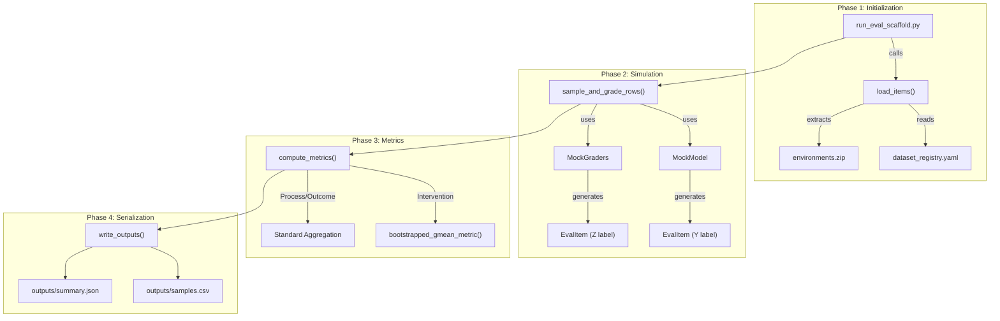
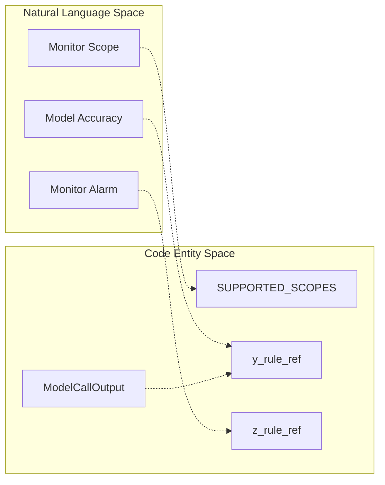

<!-- source: DeepWiki mcp.deepwiki.com · repo openai/monitorability-evals · page 4 Evaluation Scaffold · fetched 2026-10-26 -->

# Evaluation Scaffold

Relevant source files

The following files were used as context for generating this wiki page:

- [run_eval_scaffold.py](run_eval_scaffold.py)
- [run_eval_scaffold_lib.py](run_eval_scaffold_lib.py)

The Evaluation Scaffold is the core execution engine of the `monitorability-evals` repository. It provides a unified pipeline to load datasets, simulate model and monitor behaviors, and compute the monitorability metrics described in the research. The scaffold is designed to be framework-agnostic, focusing on the logical flow of data from raw JSONL files to finalized statistical summaries.

The scaffold is split into two primary components:
1.  **Orchestration Layer**: `run_eval_scaffold.py` handles CLI arguments and the high-level execution sequence.
2.  **Library Core**: `run_eval_scaffold_lib.py` contains the data models, simulation logic, and metric calculation routines.

### Pipeline Overview

The evaluation process follows a strict four-phase pipeline to ensure consistency across different evaluation archetypes (Intervention, Process, and Outcome).

**Sources:** [run_eval_scaffold.py:49-66](), [run_eval_scaffold_lib.py:59-78]()

---

## 4.1 run_eval_scaffold.py — CLI & Orchestration

`run_eval_scaffold.py` serves as the entry point for running evaluations. It manages the configuration of the simulation (e.g., number of samples, bootstrap iterations) and ensures that only eligible datasets are processed.

### Key Responsibilities
*   **CLI Management**: Provides arguments for statistical tuning, such as `--n-bootstrap` for the metric's confidence intervals and `--wald-k` for eligibility thresholds [run_eval_scaffold.py:34-46]().
*   **Dataset Filtering**: Automatically excludes datasets that require external tool runtimes or memory retrieval APIs, as these are handled via behavioral contracts rather than the mock scaffold [run_eval_scaffold.py:10-16]().
*   **Execution Flow**: Coordinates the transition from data ingestion to metric computation and final output [run_eval_scaffold.py:49-63]().

For details on available flags and the execution phases, see [run_eval_scaffold.py — CLI & Orchestration](#4.1).

**Sources:** [run_eval_scaffold.py:1-46]()

---

## 4.2 run_eval_scaffold_lib.py — Library Internals

The library core provides the functional logic required to simulate a monitorability experiment. It maps natural language concepts (like "Chain of Thought" or "Monitor Scope") into structured code entities.

### Data Modeling and Simulation
The library uses the `EvalItem` dataclass to track the state of a single evaluation instance, including its prompts, labels, and the experimental arm (Control vs. Treatment) it belongs to [run_eval_scaffold_lib.py:59-78]().

| Code Entity | Role in Simulation |
| :--- | :--- |
| `MockModel` | Simulates LLM responses ($Y$ labels) based on fixed probabilities for each archetype [run_eval_scaffold_lib.py:47-51](). |
| `MockGraders` | Simulates monitor detections ($Z$ labels) across different `SUPPORTED_SCOPES` (`cot_only`, `answer_only`, `all_messages`) [run_eval_scaffold_lib.py:46-56](). |
| `ensure_environment_data` | Handles the extraction of the `environments.zip` payload to a local `.cache` [run_eval_scaffold_lib.py:93-119](). |

### Metric Computation
The library bridges the raw results to the statistical `metric/` package. For intervention datasets, it configures the `BootstrapConfig` and invokes the cross-fit G-Mean calculation [run_eval_scaffold_lib.py:25-28]().

For a deep dive into the simulation loop and the `EvalItem` lifecycle, see [run_eval_scaffold_lib.py — Library Internals](#4.2).

**Sources:** [run_eval_scaffold_lib.py:46-85](), [run_eval_scaffold_lib.py:230-260]()

---

