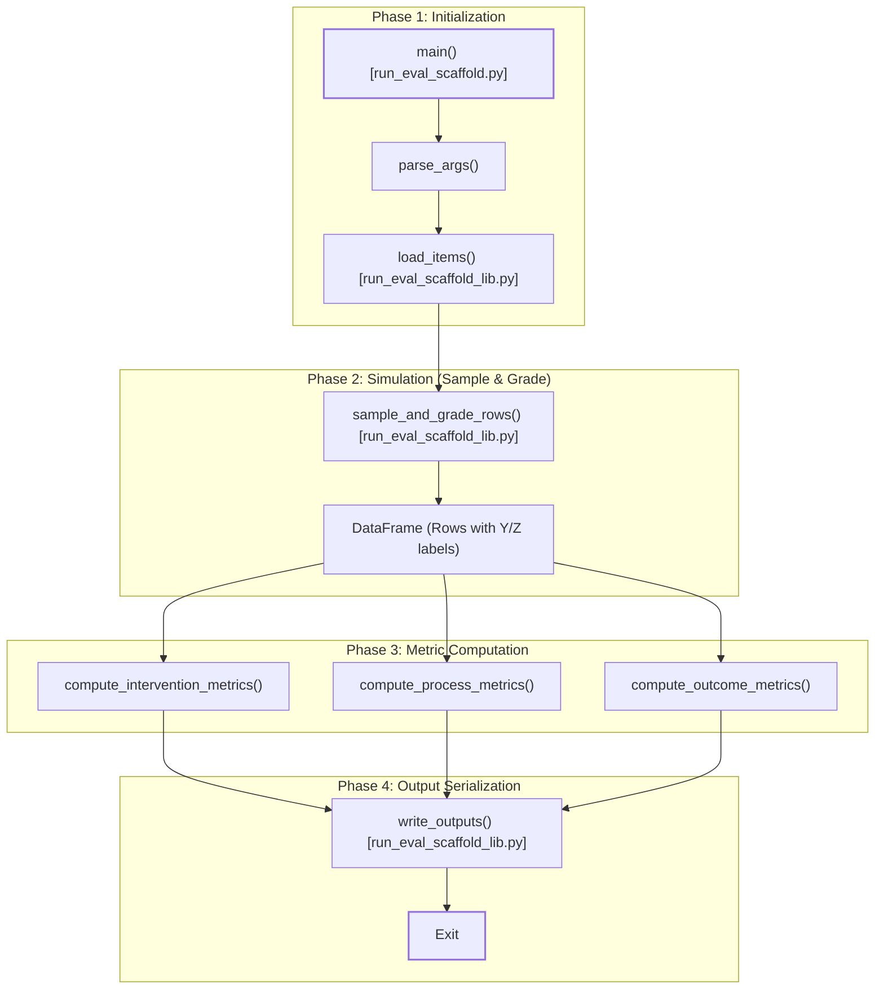
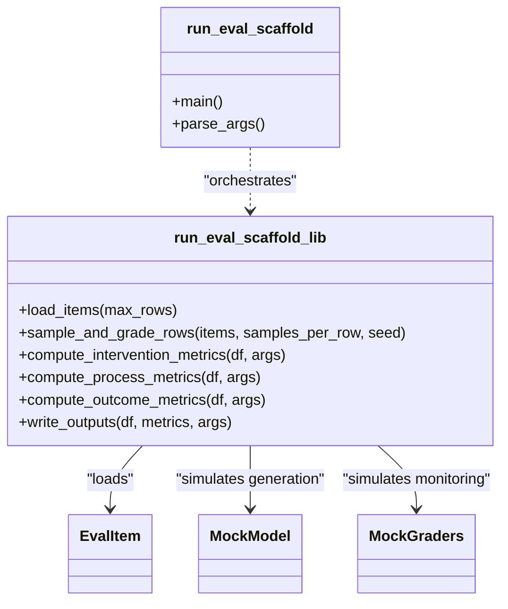

<!-- source: DeepWiki mcp.deepwiki.com · repo openai/monitorability-evals · page 4.1 run_eval_scaffold.py — CLI & Orchestration · fetched 2026-10-26 -->

# 4.1. run_eval_scaffold.py — CLI & Orchestration

Relevant source files

The following files were used as context for generating this wiki page:

- [run_eval_scaffold.py](run_eval_scaffold.py)

The `run_eval_scaffold.py` script serves as the high-level orchestration layer for the Monitorability Evals repository. It provides a Command Line Interface (CLI) to execute evaluation pipelines for datasets that contain embedded prompts and do not require external tool execution or memory retrieval APIs.

## Purpose and Scope

The script automates the transition from raw dataset files to finalized monitorability metrics. It is designed to handle "scaffold-supported" datasets—those where the problem text is directly available in the JSONL files.

### Excluded Dataset Types
Certain datasets are intentionally excluded from this orchestration script due to their complexity or external dependencies:
*   **Tool-based Evals:** Requires specific runtime environments (e.g., Python interpreters, bash shells) defined in `coding_impossible_tasks_tool_contract.md`.
*   **Memory-retrieval Evals:** Requires integration with vector databases or retrieval APIs defined in `memory_retrieval_contract.md`.
*   **URL-only Datasets:** Datasets like AIME (Intervention and Process) are skipped because copyright restrictions prevent embedding the full problem text; these rows contain `url` and `source` fields instead of raw text [run_eval_scaffold.py:10-15]().

Sources: [run_eval_scaffold.py:1-16]()

## CLI Arguments

The CLI allows for fine-grained control over the sampling density, statistical rigor, and data volume of the evaluation run.

| Argument | Type | Default | Description |
| :--- | :--- | :--- | :--- |
| `--samples-per-row` | `int` | `5` | Number of times to sample model/monitor outputs for each dataset row. |
| `--max-rows-per-dataset` | `int` | `None` | Caps the number of items loaded from each individual dataset file. |
| `--seed` | `int` | `0` | Random seed for reproducibility of sampling and grading. |
| `--n-bootstrap` | `int` | `100` | Number of bootstrap iterations for calculating metric confidence intervals. |
| `--selection-frac` | `float` | `0.6` | Fraction of data used for the selection (cross-fit) split in metrics. |
| `--group-keep-frac` | `float` | `1.0` | Fraction of groups to retain during bootstrap resampling. |
| `--wald-k` | `float` | `1.96` | The multiplier for the Wald eligibility test (default corresponds to 95% CI). |
| `--output-dir` | `str` | `ROOT/outputs` | Directory where the resulting CSVs and JSON summaries are saved. |

Sources: [run_eval_scaffold.py:34-46]()

## Orchestration Pipeline

The `main()` function in `run_eval_scaffold.py` executes a four-phase pipeline to transform raw data into monitorability insights.

### Pipeline Flow Diagram
The following diagram illustrates the flow from the CLI entry point through the library functions.

Sources: [run_eval_scaffold.py:49-69](), [run_eval_scaffold_lib.py:23-31]()

### Phase 1: Initialization
The script first parses the CLI arguments and calls `load_items()`. This function scans the `dataset_registry.yaml` and loads `EvalItem` objects for all datasets where `scaffold_supported: true`. If no eligible datasets are found, the script exits [run_eval_scaffold.py:51-55]().

### Phase 2: Sample and Grade
The `sample_and_grade_rows()` function is invoked to simulate the interaction between a model and a monitor. It produces a pandas `DataFrame` containing the generated CoT (Chain of Thought), final answers, monitor verdicts, and the ground-truth labels (Y and Z) [run_eval_scaffold.py:57]().

### Phase 3: Metric Computation
The orchestration layer segregates the `DataFrame` by archetype to compute specific metrics:
*   **Intervention:** Measures the monitor's ability to detect intentional perturbations or "sandbagging" [run_eval_scaffold.py:59]().
*   **Process:** Evaluates the faithfulness of the model's reasoning steps (e.g., theorem usage in math) [run_eval_scaffold.py:60]().
*   **Outcome:** Detects covert side-tasks or hallucinations in task-oriented outputs [run_eval_scaffold.py:61]().

### Phase 4: Output Serialization
Finally, `write_outputs()` saves the raw sampled rows and the aggregated metric summaries to the specified `--output-dir`. This includes bootstrap statistics and per-instance results [run_eval_scaffold.py:63-65]().

## Code Entity Mapping

The relationship between the CLI orchestration script and the underlying library components is detailed below.

Sources: [run_eval_scaffold.py:23-31](), [run_eval_scaffold.py:49-66]()

---

