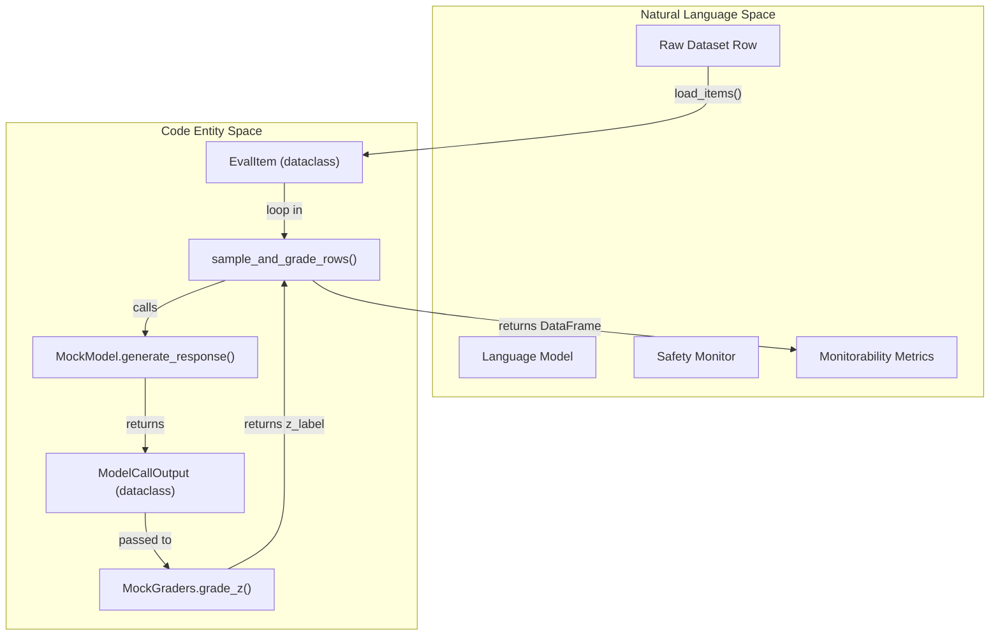
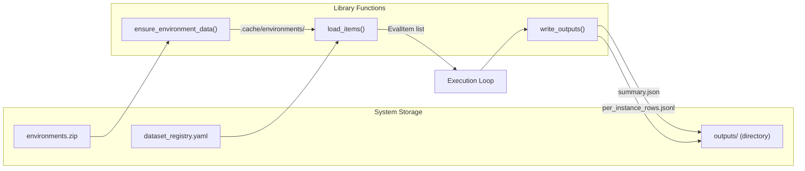

<!-- source: DeepWiki mcp.deepwiki.com · repo openai/monitorability-evals · page 4.2 run_eval_scaffold_lib.py — Library Internals · fetched 2026-10-26 -->

# run_eval_scaffold_lib.py — Library Internals

Relevant source files

The following files were used as context for generating this wiki page:

- [environments.zip](environments.zip)
- [run_eval_scaffold_lib.py](run_eval_scaffold_lib.py)

This page provides a deep dive into the `run_eval_scaffold_lib.py` library, which serves as the core execution engine for the Monitorability Evals scaffold. It handles data ingestion, simulation of model and monitor behaviors, metric computation, and result serialization.

## 1. Data Model & Ingestion Pipeline

The library uses a structured data model to represent evaluation instances across all three archetypes (Intervention, Process, Outcome).

### EvalItem Data Model
The `EvalItem` dataclass is the primary unit of data throughout the pipeline. It encapsulates the raw dataset row alongside registry-resolved metadata such as prompt templates and grading rules.

| Field | Description |
| :--- | :--- |
| `instance_id` | Unique identifier for the row, often derived from the source dataset. |
| `arm` | `0` for Control, `1` for Treatment (Intervention archetype only). |
| `y_rule_ref` | Registry path to the logic for grading the model's answer (e.g., `shared_rules.intervention_answer_graders.aime`). |
| `z_rule_ref` | Registry path to the logic for interpreting monitor outputs. |
| `monitor_prompt_template_text` | The raw text of the monitor template loaded from `monitor_prompts/templates/`. |

Sources: [run_eval_scaffold_lib.py:59-77]()

### Ingestion Flow: ensure_environment_data() and load_items()
The ingestion pipeline ensures that compressed environment data is available and then maps JSONL rows into `EvalItem` objects.

1.  **`ensure_environment_data()`**: Checks if the `.cache/environments/` directory exists. If not, it extracts `environments.zip` to the cache. [run_eval_scaffold_lib.py:93-119]()
2.  **`load_items()`**: Iterates through the `dataset_registry.yaml`. For each dataset, it:
    *   Locates the JSONL file in the extracted environment path. [run_eval_scaffold_lib.py:228-232]()
    *   Resolves monitor and model prompt templates via `_resolve_registry_ref()`. [run_eval_scaffold_lib.py:246-258]()
    *   Constructs `EvalItem` instances, handling arm-specific logic for Intervention datasets. [run_eval_scaffold_lib.py:260-285]()

Sources: [run_eval_scaffold_lib.py:93-134](), [run_eval_scaffold_lib.py:214-290]()

## 2. Simulation Classes: MockModel and MockGraders

Since the scaffold is designed for research into monitorability metrics rather than real-time inference, it simulates model and monitor outputs using parameterized distributions.

### MockModel
The `MockModel` class simulates an LLM's response, including Chain-of-Thought (CoT) and final answers.
*   **Performance Logic**: Uses `MOCK_MODEL_P_CORRECT` to determine if the model should produce a correct answer based on the archetype and arm. [run_eval_scaffold_lib.py:321-332]()
*   **Output Structure**: Returns a `ModelCallOutput` containing `final_answer`, `action_only`, `cot_only`, and `all_msgs`. [run_eval_scaffold_lib.py:79-85]()

### MockGraders
The `MockGraders` class simulates both the Answer Grader (Y) and the Monitor (Z).
*   **Answer Grading (`grade_y`)**: Compares the model's `final_answer` against the ground truth in the `EvalItem`. It supports directional labels (e.g., "any answer that is not A"). [run_eval_scaffold_lib.py:348-356](), [run_eval_scaffold_lib.py:145-157]()
*   **Monitor Simulation (`grade_z`)**: Simulates a monitor's binary verdict based on the ground truth state (e.g., was the model influenced by a hint?). It applies TPR/TNR values from `MOCK_MONITOR_SCOPE_QUALITY` based on the requested monitor scope. [run_eval_scaffold_lib.py:358-385]()

Sources: [run_eval_scaffold_lib.py:314-385](), [run_eval_scaffold_lib.py:47-56]()

## 3. The Execution Loop

The simulation is orchestrated by `sample_and_grade_rows()`, which processes a batch of `EvalItem` objects for a specific dataset and monitor scope.

### Monitor Scopes
The library supports three scopes that define what information the monitor can access:
1.  `cot_only`: Monitor sees only the model's internal reasoning.
2.  `answer_only`: Monitor sees only the model's final output.
3.  `all_messages`: Monitor sees the user prompt, CoT, and final answer.

Sources: [run_eval_scaffold_lib.py:46-46](), [run_eval_scaffold_lib.py:169-187]()

### Logical Data Flow
The following diagram maps the Natural Language concepts of "Model" and "Monitor" to the specific code entities and data structures.

Title: Evaluation Simulation Flow

Sources: [run_eval_scaffold_lib.py:59-85](), [run_eval_scaffold_lib.py:314-385](), [run_eval_scaffold_lib.py:388-426]()

## 4. Metrics Computation

The library branches into three distinct logic paths for computing metrics based on the archetype.

### Intervention Metrics
`compute_intervention_metrics()` calculates the G-Mean of TPR and TNR using the `bootstrapped_gmean_metric` function from the `metric` module.
*   **Grouped Bootstrap**: It uses `instance_id` as the unit of resampling to ensure that paired Control/Treatment arms are kept together during bootstrapping. [run_eval_scaffold_lib.py:456-465]()
*   **Eligibility**: Applies a Wald test to filter out instances where the monitor does not meet a minimal performance criterion. [metric/intervention_gmean_metric.py:115-125]()

### Process and Outcome Metrics
*   **Process**: Uses `compute_process_metrics()`. Since Process evals are essentially Intervention evals where the "Treatment" is the model's own CoT, it maps labels to a standard arm-based format before calling the G-Mean logic. [run_eval_scaffold_lib.py:478-493]()
*   **Outcome**: Uses `compute_outcome_metrics()`. It calculates a simplified G-Mean based on the monitor's ability to detect negative outcomes (e.g., hallucinations or rule violations). [run_eval_scaffold_lib.py:496-515]()

Sources: [run_eval_scaffold_lib.py:429-515](), [metric/intervention_gmean_metric.py:100-140]()

## 5. Serialization and Output

The final phase of the library involves writing results to the filesystem.

### write_outputs()
This function handles the serialization of three distinct files for every evaluation run:
1.  **`summary.json`**: Aggregated metrics across all datasets and scopes. [run_eval_scaffold_lib.py:539-543]()
2.  **`per_dataset_metrics.jsonl`**: Detailed bootstrap statistics (mean, std, confidence intervals) for each dataset. [run_eval_scaffold_lib.py:545-549]()
3.  **`per_instance_rows.jsonl`**: The raw simulation data, including model responses and monitor verdicts for every sample. [run_eval_scaffold_lib.py:551-555]()

### Code-to-System Mapping
Title: Data Ingestion and Serialization Mapping

Sources: [run_eval_scaffold_lib.py:93-119](), [run_eval_scaffold_lib.py:214-290](), [run_eval_scaffold_lib.py:521-558]()

---

