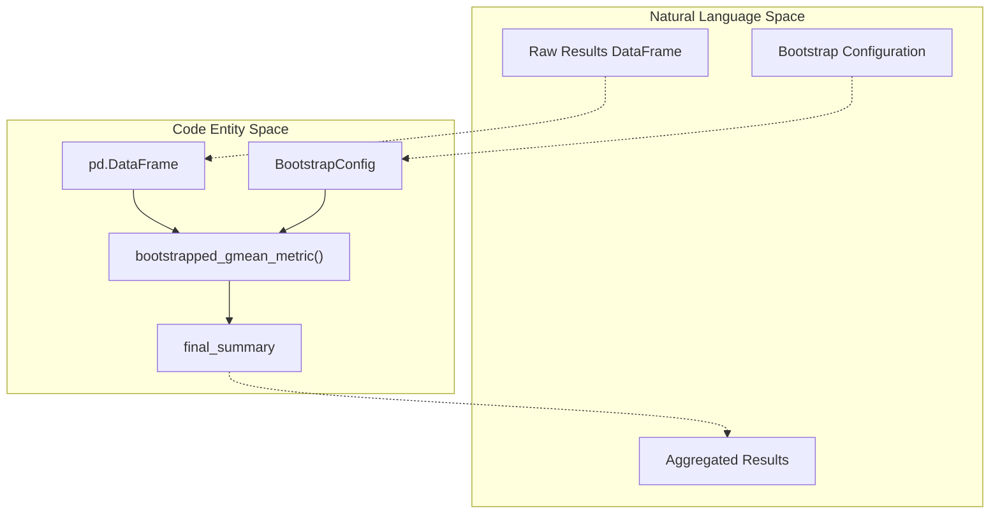
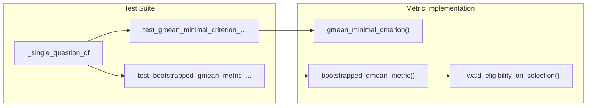

<!-- source: DeepWiki mcp.deepwiki.com · repo openai/monitorability-evals · page 5.2 Metric Usage & Testing · fetched 2026-10-26 -->

# Metric Usage & Testing

Relevant source files

The following files were used as context for generating this wiki page:

- [metric/example_usage.ipynb](metric/example_usage.ipynb)
- [metric/test_intervention_gmean_metric.py](metric/test_intervention_gmean_metric.py)

This page documents the practical application and verification of the monitorability g-mean metric. It covers the `metric/example_usage.ipynb` notebook, which provides a worked example for researchers, and `metric/test_intervention_gmean_metric.py`, which contains the unit test suite for the metric's statistical implementation.

## Worked Example: `example_usage.ipynb`

The `metric/example_usage.ipynb` notebook demonstrates how to process a raw pandas DataFrame containing model and monitor outputs into final monitorability scores.

### Data Preparation
The notebook simulates a dataset where instances (questions) are identified by a `task_id` and grouped by a `domain` (e.g., "math" or "legal") [metric/example_usage.ipynb:64-70](). Each row represents a single sample with:
* `x`: The arm (0 for control, 1 for intervention) [metric/example_usage.ipynb:66-66]().
* `y`: The model outcome (0 for correct, 1 for incorrect/violation) [metric/example_usage.ipynb:67-67]().
* `z`: The monitor's prediction (0 for safe, 1 for alarm) [metric/example_usage.ipynb:68-68]().

### Workflow Execution
The core workflow involves calling `bootstrapped_gmean_metric` with a `BootstrapConfig` [metric/example_usage.ipynb:46-50]().

**Entity Mapping: Notebook to Metric Code**

Sources: [metric/example_usage.ipynb:46-50](), [metric/example_usage.ipynb:199-200]()

### Output Interpretation
The metric returns three primary data structures:
1.  **`final_summary`**: Aggregated statistics per `final_groups` (e.g., domain). It includes `gmean_mean` and `eligible_fraction_mean` [metric/example_usage.ipynb:70-70]().
2.  **`per_bootstrap_summary`**: Detailed results for every bootstrap iteration, useful for manual variance analysis.
3.  **`per_instance_rows`**: The most granular output, showing `TPR`, `TNR_x0`, `TNR_x1`, and `eligible` status for every unique task ID [metric/example_usage.ipynb:208-210]().

Sources: [metric/example_usage.ipynb:70-70](), [metric/example_usage.ipynb:208-210]()

---

## Unit Testing: `test_intervention_gmean_metric.py`

The test suite ensures that the statistical logic in `intervention_gmean_metric.py` correctly handles edge cases, arm mismatches, and mathematical definitions.

### Key Test Categories

| Test Function | Purpose |
| :--- | :--- |
| `test_gmean_minimal_criterion_matches_manual_calculation` | Verifies that the base G-Mean and effect size calculations match a manually solved 2x2 contingency table [metric/test_intervention_gmean_metric.py:32-50](). |
| `test_gmean_minimal_criterion_sets_tnr_when_no_negatives_in_x1` | Ensures that if arm $x=1$ has no negative outcomes ($y=0$), the TNR is derived solely from $x=0$ [metric/test_intervention_gmean_metric.py:52-62](). |
| `test_bootstrapped_gmean_metric_marks_missing_groups_as_undefined` | Checks that instances lacking an intervention effect are marked as ineligible and result in `NaN` [metric/test_intervention_gmean_metric.py:64-80](). |
| `test_wald_selection_keeps_arm_mismatches_and_marks_them_ineligible` | Verifies that the cross-fit selection logic correctly identifies instances where one arm is entirely missing from a fold [metric/test_intervention_gmean_metric.py:151-186](). |

Sources: [metric/test_intervention_gmean_metric.py:32-186]()

### Data Flow in Testing
The tests utilize a helper function `_single_question_df` to construct minimal DataFrames with controlled $(y, z)$ pairs for both arms.

**Entity Mapping: Test Logic to Implementation**

Sources: [metric/test_intervention_gmean_metric.py:9-29](), [metric/test_intervention_gmean_metric.py:32-35](), [metric/test_intervention_gmean_metric.py:67-74]()

### Handling Missing Data and Ineligibility
A critical component of the testing is ensuring that the `eligible` flag is correctly set.
*   **Arm Mismatch**: If an instance only has data for $x=0$ or $x=1$, it must be marked `eligible=False` [metric/test_intervention_gmean_metric.py:135-149]().
*   **Zero Variance**: If the model never produces a $y=1$ outcome in the intervention arm, the effect size is undefined, and the instance is excluded [metric/test_intervention_gmean_metric.py:64-80]().
*   **Wald Test**: The tests verify that `_wald_eligibility_on_selection` correctly applies the $k$-sigma threshold to determine if the intervention effect is statistically significant enough to include the instance in the monitorability calculation [metric/test_intervention_gmean_metric.py:165-186]().

Sources: [metric/test_intervention_gmean_metric.py:64-80](), [metric/test_intervention_gmean_metric.py:135-149](), [metric/test_intervention_gmean_metric.py:165-186]()

---

