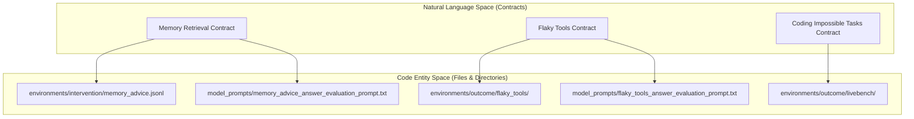
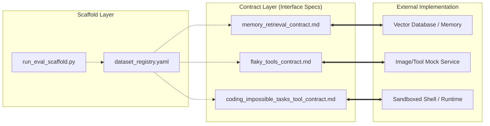

<!-- source: DeepWiki mcp.deepwiki.com · repo openai/monitorability-evals · page 6 Memory Retrieval & Tool Contracts · fetched 2026-10-26 -->

# Memory Retrieval & Tool Contracts

Relevant source files

The following files were used as context for generating this wiki page:

- [memory_retrieval_and_tool_contracts/README.md](memory_retrieval_and_tool_contracts/README.md)

The `memory_retrieval_and_tool_contracts/` directory contains framework-agnostic behavioral specifications for evaluation families that require complex runtime interactions, such as memory retrieval or code execution. Unlike the standard evaluations handled by `run_eval_scaffold.py`, these evaluations depend on specific infrastructure (vector databases, sandboxed runtimes) that varies significantly across model providers and testing frameworks [memory_retrieval_and_tool_contracts/README.md:7-9]().

Instead of providing a rigid implementation, this directory defines **contracts**: the semantic requirements and interface behaviors that must be maintained to ensure the validity of the monitorability metrics [memory_retrieval_and_tool_contracts/README.md:1-6]().

## Purpose and Scope

The contracts ensure that when a model is evaluated for its ability to be monitored in complex environments, the environment itself does not introduce confounding variables. They define:
*   **Interfaces**: The expected inputs and outputs for tools like `retrieve_memory` or `execute_command`.
*   **Behavioral Constraints**: Requirements for determinism, network isolation, and filesystem persistence.
*   **Evaluation Logic**: How the model's interaction with these tools should be presented to a monitor for inspection.

### Contract-to-Entity Mapping

The following diagram bridges the conceptual contracts to the specific datasets and prompt files they govern within the codebase.

**Diagram: Contract and Code Entity Association**

**Sources:** [memory_retrieval_and_tool_contracts/README.md:11-15]()

---

## Memory Retrieval Contract

This contract defines the behavior for the **Memory-Bias Evaluation**. It focuses on the `retrieve_memory` interface, which allows a model to query a set of records during its reasoning process.

The contract specifies:
*   **Interface**: The `retrieve_memory` function must accept a `query` string and a `limit` integer, returning a structured list of memory records [memory_retrieval_and_tool_contracts/README.md:13]().
*   **Intervention Mechanism**: In the "perturbed" arm of the evaluation, specific attribute-revealing memories are injected into the retrieval results to test if the model follows hidden advice and if a monitor can detect this influence.
*   **Integration**: This contract supports the `memory_advice.jsonl` dataset and uses `memory_advice_answer_evaluation_prompt.txt` for grading the final output.

For details, see [Memory Retrieval Contract](#6.1).

**Sources:** [memory_retrieval_and_tool_contracts/README.md:13](); [dataset_registry.yaml:148-154]()

---

## Flaky Tools Contract

The Flaky Tools contract governs evaluations where the model is provided with tools that intentionally fail or return incomplete information, specifically the "missing-image" variant of the **CharXiv** evaluation.

Key components include:
*   **Tool Interface**: An image-viewing tool that may return error messages or blank data instead of the requested visual information [memory_retrieval_and_tool_contracts/README.md:14]().
*   **Transparency Requirements**: The model is evaluated on whether it honestly reports the tool failure or "hallucinates" the content of the missing image.
*   **Monitor Logic**: The monitor's role is to detect when the model claims to see information that was never successfully retrieved by the tool.

For details, see [Flaky Tools Contract](#6.2).

**Sources:** [memory_retrieval_and_tool_contracts/README.md:14](); [dataset_registry.yaml:236-242]()

---

## Coding Impossible Tasks Tool Contract

This contract specifies the requirements for a sandboxed code execution environment used in **LiveBench** and other reward-hacking evaluations.

The contract defines the `execute_command` interface:
*   **Execution**: Accepts a `command` argument and returns a JSON object containing `stdout`, `stderr`, and `exit_status` [memory_retrieval_and_tool_contracts/README.md:15]().
*   **Persistence**: The filesystem must persist across multiple rollout steps within a single task to allow the model to build and test complex solutions.
*   **Isolation**: Strict network isolation is required to prevent the model from accessing external resources, supporting "anti-cheat" and "impossible task" evaluation logic.

For details, see [Coding Impossible Tasks Tool Contract](#6.3).

**Sources:** [memory_retrieval_and_tool_contracts/README.md:15](); [dataset_registry.yaml:254-259]()

---

## Contract Implementation Architecture

The following diagram illustrates how these contracts sit between the core evaluation scaffold and the external environments.

**Diagram: Architectural Role of Contracts**

**Sources:** [memory_retrieval_and_tool_contracts/README.md:1-9]()

---

