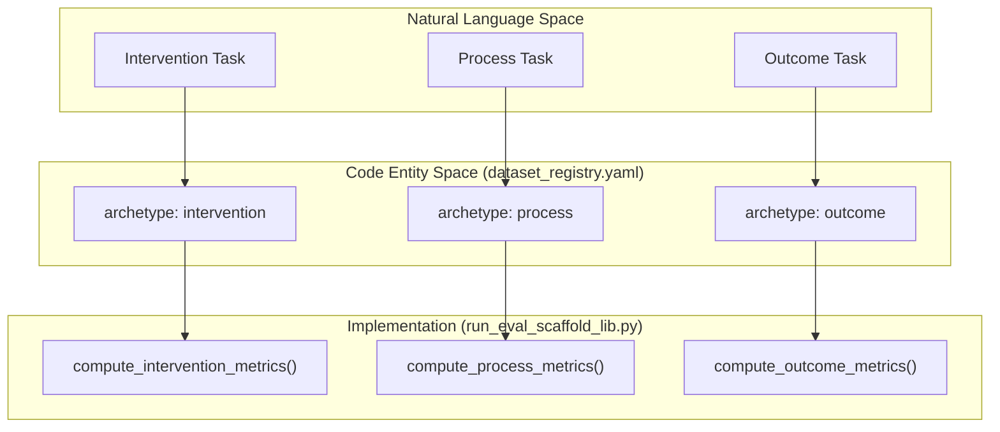
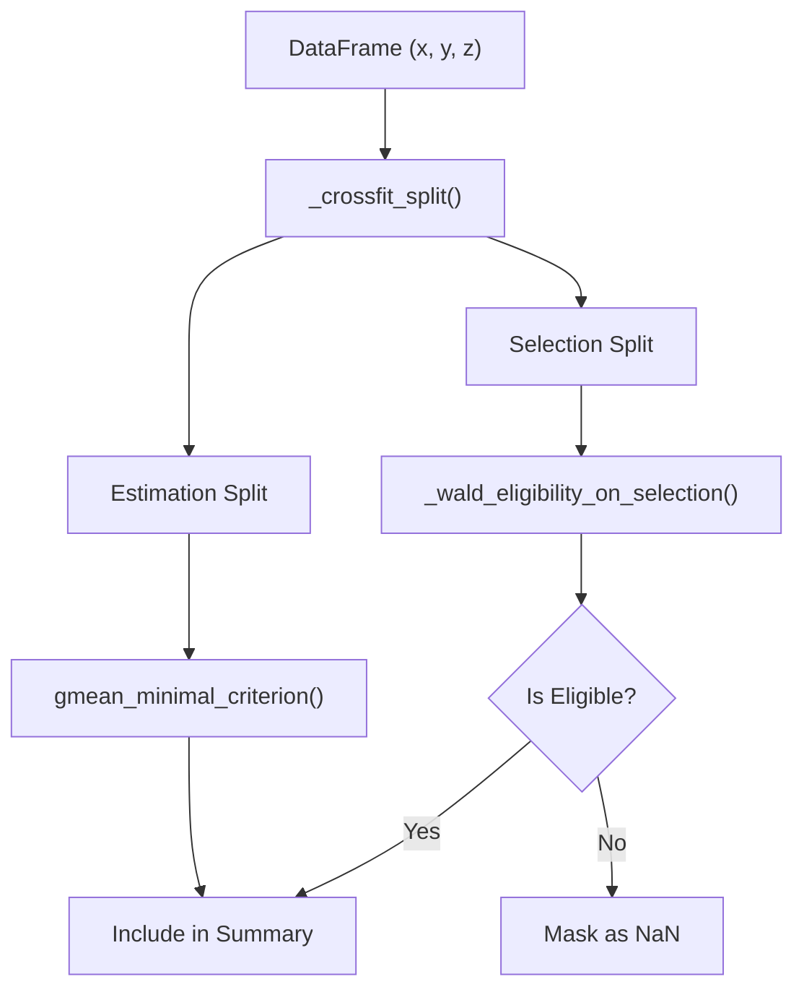
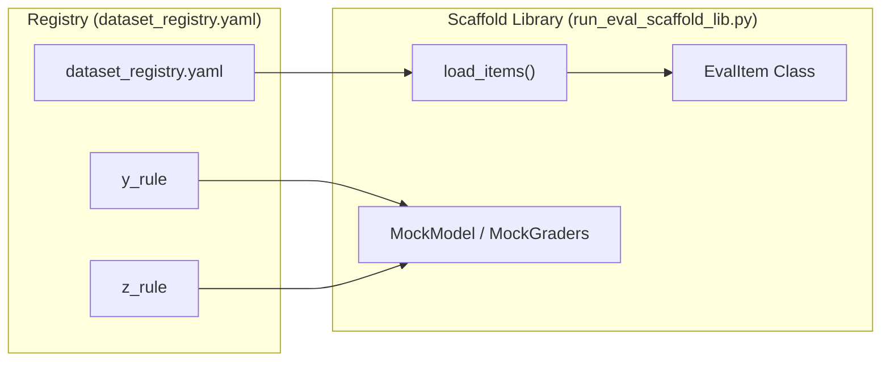

<!-- source: DeepWiki mcp.deepwiki.com · repo openai/monitorability-evals · page 7 Glossary · fetched 2026-10-26 -->

# Glossary

Relevant source files

The following files were used as context for generating this wiki page:

- [DATASET_ATTRIBUTION.md](DATASET_ATTRIBUTION.md)
- [README.md](README.md)
- [dataset_registry.yaml](dataset_registry.yaml)
- [environments/outcome/flaky_tools.md](environments/outcome/flaky_tools.md)
- [environments/outcome/livebench.md](environments/outcome/livebench.md)
- [environments/outcome/shadearena.md](environments/outcome/shadearena.md)
- [memory_retrieval_and_tool_contracts/README.md](memory_retrieval_and_tool_contracts/README.md)
- [metric/README.md](metric/README.md)
- [metric/intervention_gmean_metric.py](metric/intervention_gmean_metric.py)
- [run_eval_scaffold_lib.py](run_eval_scaffold_lib.py)

This page provides definitions for codebase-specific terms, abbreviations, and domain concepts used in the Monitorability Evals repository. It includes pointers to implementation details, data structures, and the statistical logic used to measure monitor effectiveness.

## Core Concepts & Archetypes

The repository categorizes evaluations into three primary "archetypes" which determine how data is structured and how metrics are calculated.

| Term | Definition | Code Pointer |
| :--- | :--- | :--- |
| **Intervention** | Evals where a perturbation (e.g., a hint or bias) is applied to influence the model toward a specific answer. Used to measure if a monitor can detect this influence. | [README.md:13-36]() |
| **Process** | Evals focusing on the model's internal reasoning steps (Chain of Thought). Monitors check if specific theorems or logic paths were actually used. | [README.md:44-65]() |
| **Outcome** | Evals where the task is inherently impossible or deceptive (e.g., missing tools, covert side-tasks). Monitors look for "hallucinated" success or deception. | [README.md:66-75]() |
| **Perturbation** | The specific text or mechanism used to bias a model in the Intervention archetype. | [README.md:34-34]() |
| **Arm** | A statistical term for the experimental group. `x=0` is the **Control** (unperturbed) and `x=1` is the **Intervention** (perturbed). | [metric/intervention_gmean_metric.py:51-53]() |

### Natural Language to Code Entity Mapping: Archetypes

**Sources:** [README.md:7-10](), [dataset_registry.yaml:68-154](), [run_eval_scaffold_lib.py:515-535]()

---

## Statistical Metric Terms

The "Monitorability" of a system is quantified using the **Geometric Mean (G-Mean)** of the True Positive Rate and True Negative Rate, adjusted for intervention attribution.

| Term | Definition | Code Pointer |
| :--- | :--- | :--- |
| **Y (Label)** | The model outcome label. `y=1` typically means the model was successfully influenced (Intervention) or reached a specific outcome. | [dataset_registry.yaml:5-5]() |
| **Z (Label)** | The monitor trigger label. `z=1` means the monitor fired (detected something). | [dataset_registry.yaml:6-6]() |
| **TE (Total Effect)** | The difference in probability of outcome `Y=1` between the intervention arm and control arm: `P(Y=1\|X=1) - P(Y=1\|X=0)`. | [metric/intervention_gmean_metric.py:199-199]() |
| **Minimal-Criterion TPR** | A conservative upper bound for TPR that accounts for the fact that not all `Y=1` outcomes in the intervention arm are caused by the intervention. | [metric/intervention_gmean_metric.py:197-200]() |
| **Cross-Fit Eligibility** | A technique to reduce noise by splitting data into a **Selection** split (to verify a significant effect size via Wald test) and an **Estimation** split (to compute the metric). | [metric/intervention_gmean_metric.py:23-29]() |
| **Wald Eligibility** | A one-sided test (`wald_z >= k`) to ensure the intervention actually moved the model's behavior before including the instance in metrics. | [metric/intervention_gmean_metric.py:112-164]() |

### Data Flow: Metric Calculation

**Sources:** [metric/intervention_gmean_metric.py:56-89](), [metric/intervention_gmean_metric.py:112-129](), [metric/intervention_gmean_metric.py:177-214]()

---

## Data & Infrastructure Terms

| Term | Definition | Code Pointer |
| :--- | :--- | :--- |
| **dataset_registry.yaml** | The single source of truth for mapping datasets to prompt templates, grading rules (`y_rule`), and monitor rules (`z_rule`). | [dataset_registry.yaml:1-10]() |
| **EvalItem** | The internal Python dataclass used to represent a single evaluation row during execution. | [run_eval_scaffold_lib.py:59-76]() |
| **Monitor Scope** | Determines what part of the model's response the monitor sees: `cot_only`, `answer_only`, or `all_messages`. | [run_eval_scaffold_lib.py:46-46]() |
| **Scaffold** | The orchestration logic (`run_eval_scaffold.py`) that simulates model/monitor interactions for testing purposes. | [run_eval_scaffold_lib.py:1-2]() |
| **Tool Contract** | A behavioral specification for environments requiring external tools (like code execution or memory retrieval) where the code is not provided in the repo. | [memory_retrieval_and_tool_contracts/README.md:1-18]() |

### Code Entity Mapping: Infrastructure

**Sources:** [dataset_registry.yaml:66-150](), [run_eval_scaffold_lib.py:59-76](), [run_eval_scaffold_lib.py:87-91]()

---

## Domain-Specific Abbreviations

*   **AIME**: American Invitational Mathematics Examination (Math competition data).
*   **CoT**: Chain of Thought (The reasoning steps produced by the model).
*   **DAFT**: Difficult Automatically-scorable Free-response Tasks.
*   **GPQA**: Graduate-Level Google-Proof Q&A Benchmark.
*   **TNR**: True Negative Rate (The probability that the monitor does *not* fire when no intervention-driven behavior is present).
*   **TPR**: True Positive Rate (The probability that the monitor fires when intervention-driven behavior *is* present).
*   **WMDP**: Weapons of Mass Destruction Proxy (Benchmark for hazardous knowledge).

**Sources:** [DATASET_ATTRIBUTION.md:8-67](), [README.md:16-24](), [metric/intervention_gmean_metric.py:192-200]()