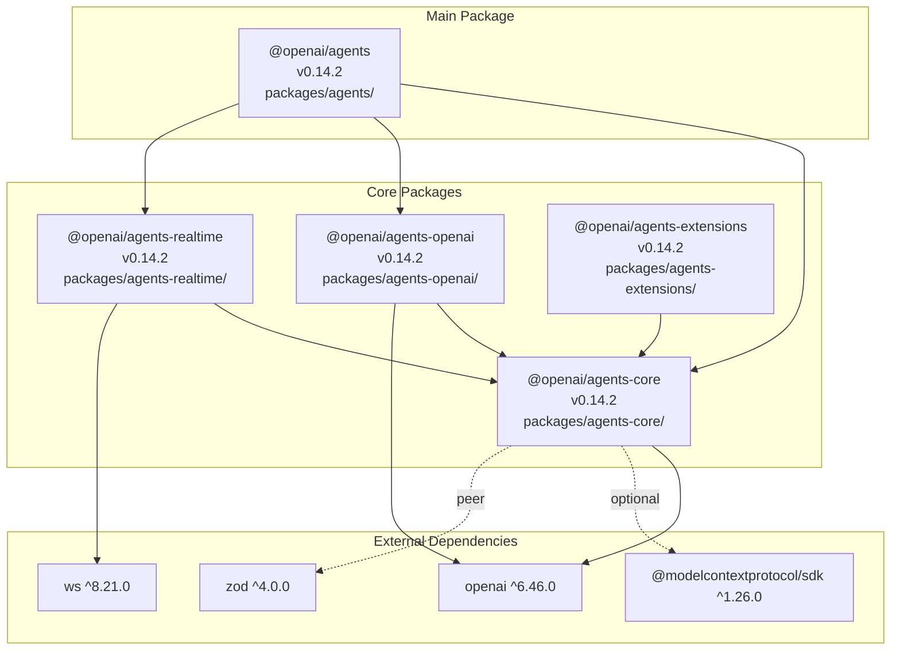
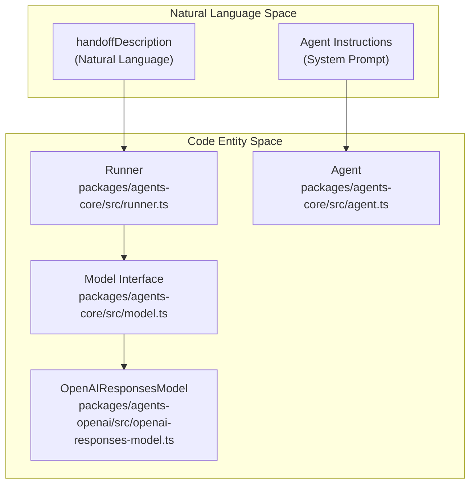
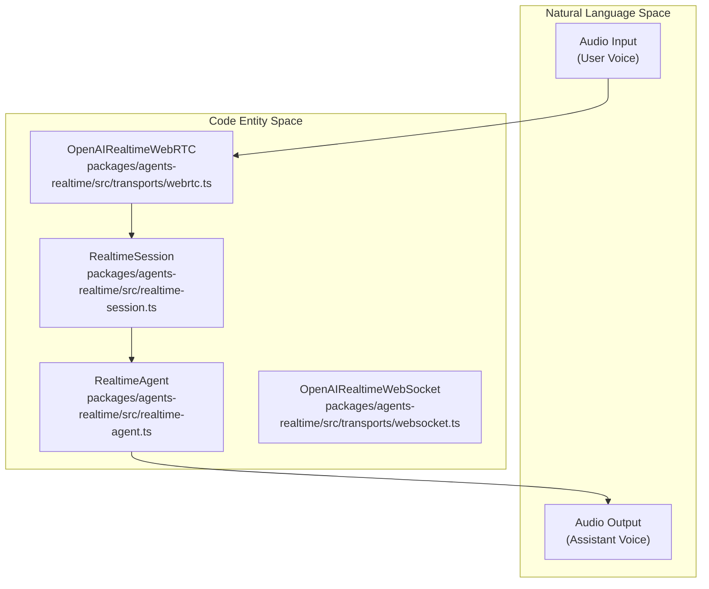

<!-- source: DeepWiki mcp.deepwiki.com · repo openai/openai-agents-js · page 1 Overview · fetched 2026-10-26 -->

# Overview

Relevant source files

The following files were used as context for generating this wiki page:

- [README.md](README.md)
- [docs/astro.config.mjs](docs/astro.config.mjs)
- [docs/src/components/Hero.astro](docs/src/components/Hero.astro)
- [docs/src/content/docs/extensions/twilio.mdx](docs/src/content/docs/extensions/twilio.mdx)
- [docs/src/content/docs/guides/guardrails.mdx](docs/src/content/docs/guides/guardrails.mdx)
- [docs/src/content/docs/guides/human-in-the-loop.mdx](docs/src/content/docs/guides/human-in-the-loop.mdx)
- [docs/src/content/docs/guides/quickstart.mdx](docs/src/content/docs/guides/quickstart.mdx)
- [docs/src/content/docs/guides/tracing.mdx](docs/src/content/docs/guides/tracing.mdx)
- [docs/src/content/docs/guides/voice-agents.mdx](docs/src/content/docs/guides/voice-agents.mdx)
- [docs/src/content/docs/guides/voice-agents/quickstart.mdx](docs/src/content/docs/guides/voice-agents/quickstart.mdx)
- [docs/src/content/docs/index.mdx](docs/src/content/docs/index.mdx)
- [docs/src/styles/global.css](docs/src/styles/global.css)
- [packages/agents-core/CHANGELOG.md](packages/agents-core/CHANGELOG.md)
- [packages/agents-core/package.json](packages/agents-core/package.json)
- [packages/agents-core/src/metadata.ts](packages/agents-core/src/metadata.ts)
- [packages/agents-extensions/CHANGELOG.md](packages/agents-extensions/CHANGELOG.md)
- [packages/agents-extensions/package.json](packages/agents-extensions/package.json)
- [packages/agents-extensions/src/metadata.ts](packages/agents-extensions/src/metadata.ts)
- [packages/agents-openai/CHANGELOG.md](packages/agents-openai/CHANGELOG.md)
- [packages/agents-openai/package.json](packages/agents-openai/package.json)
- [packages/agents-openai/src/metadata.ts](packages/agents-openai/src/metadata.ts)
- [packages/agents-realtime/CHANGELOG.md](packages/agents-realtime/CHANGELOG.md)
- [packages/agents-realtime/package.json](packages/agents-realtime/package.json)
- [packages/agents-realtime/src/metadata.ts](packages/agents-realtime/src/metadata.ts)
- [packages/agents/CHANGELOG.md](packages/agents/CHANGELOG.md)
- [packages/agents/README.md](packages/agents/README.md)
- [packages/agents/package.json](packages/agents/package.json)
- [packages/agents/src/metadata.ts](packages/agents/src/metadata.ts)

This document provides a comprehensive overview of the OpenAI Agents SDK for JavaScript/TypeScript, explaining its architecture, core concepts, and key capabilities. The SDK is a lightweight yet powerful framework for building multi-agent workflows that can orchestrate between multiple AI agents, execute tools, and manage complex conversational flows.

For detailed information about specific packages, see [Package Architecture](#1.1). For fundamental terminology and relationships, see [Core Concepts](#1.2).

## What is the OpenAI Agents SDK

The OpenAI Agents SDK for JavaScript/TypeScript is a lightweight yet powerful framework for building multi-agent workflows [packages/agents-core/package.json:6-6](). It provides a production-ready upgrade from OpenAI's experimental Swarm framework and is designed for building agentic applications that scale.

The SDK is organized as a monorepo containing several core packages (`@openai/agents-core`, `@openai/agents-openai`, `@openai/agents-realtime`, `@openai/agents-extensions`) and a main aggregator package (`@openai/agents`) that exports a unified API. All packages are version-synchronized at v0.14.2 [packages/agents/package.json:5-5]().

**Core Primitives:**

The framework provides fundamental primitives for agentic workflows:

| Primitive | Description | Key Classes/Functions |
|-----------|-------------|----------------------|
| **Agents** | LLM instances configured with instructions, tools, and handoffs | `Agent`, `RealtimeAgent` |
| **Tools** | Functions the agent can call (local, MCP, hosted, sandbox) | `tool()`, `MCPServer`, `HostedTool` |
| **Handoffs** | Mechanisms to transfer control between agents | `handoffs` configuration |
| **Guardrails** | Input/output validation for safety and reliability | `InputGuardrail`, `OutputGuardrail` |

**Execution Models:**

The SDK supports three distinct execution models:

1. **Text Agents**: Turn-based orchestration managed by the `Runner` class, supporting OpenAI models via Chat Completions or the Responses API [packages/agents-core/CHANGELOG.md:23-26]().
2. **Realtime Voice Agents**: Continuous audio streaming via `RealtimeSession`, using WebSocket or WebRTC to the Realtime API [packages/agents-realtime/package.json:6-6]().
3. **Sandbox Agents**: Agents operating in isolated environments with filesystem and shell access, managed via the `sandbox` sub-exports [packages/agents/package.json:16-25]().

**Sources:** [packages/agents-core/package.json:6-6](), [packages/agents/package.json:1-56](), [packages/agents/CHANGELOG.md:3-15](), [packages/agents-core/CHANGELOG.md:25-36]()

## Package Architecture

The SDK uses a monorepo structure with specialized packages plus a main aggregator. For a deep dive into the internal structure, see [Package Architecture](#1.1).

**Monorepo Package Structure:**

**Package Responsibilities:**

| Package | Purpose | Key Exports |
|---------|---------|-------------|
| `@openai/agents` | Main entry point, re-exports common utilities and sub-packages | `Agent`, `run()`, `tool()`, `realtime`, `sandbox` |
| `@openai/agents-core` | Foundation: `Agent`, `Runner`, `Model` interfaces, and Tracing | `Agent`, `Runner`, `MCPServer`, `TraceProvider` |
| `@openai/agents-openai` | OpenAI-specific model and hosted tool implementations | `OpenAIResponsesModel`, `OpenAIChatCompletionsModel` |
| `@openai/agents-realtime` | Real-time voice agents and session management | `RealtimeAgent`, `RealtimeSession`, `_shims` |
| `@openai/agents-extensions` | Third-party integrations and sandbox providers | `AiSdkModel`, `sandbox/` (E2B, Vercel, etc.) |

**Sources:** [packages/agents/package.json:43-49](), [packages/agents-core/package.json:115-121](), [packages/agents-openai/package.json:22-26](), [packages/agents-realtime/package.json:57-62](), [packages/agents-extensions/package.json:16-20](), [packages/agents-extensions/package.json:37-71]()

## Core Execution System

The SDK bridges natural language instructions with code entities through two primary execution architectures.

**Text Agent Execution Architecture:**

**Realtime Voice Agent Execution Architecture:**

For details on the specific terminology used in these systems, see [Core Concepts](#1.2).

**Sources:** [packages/agents-core/package.json:22-26](), [packages/agents-openai/package.json:8-9](), [packages/agents-realtime/package.json:8-9](), [packages/agents-realtime/CHANGELOG.md:80-84]()

## Key Features and Capabilities

### Multi-Agent Orchestration
Agents can transfer control via a handoff mechanism. The `Runner` handles the turn-based logic, supporting complex patterns like triage agents or manager-worker hierarchies [packages/agents-core/CHANGELOG.md:88-89]().

### Tool Integration System
The SDK supports a wide variety of tools:
- **Function Tools**: Local JS/TS functions defined via `tool()` with Zod schema validation.
- **MCP Tools**: Seamless integration with the Model Context Protocol [packages/agents-core/package.json:115-117]().
- **Hosted Tools**: OpenAI-managed tools like `web_search`, `file_search`, and `code_interpreter` [packages/agents-openai/CHANGELOG.md:84-85]().
- **Sandbox Tools**: Execution of shell commands and filesystem operations in isolated environments [packages/agents-core/CHANGELOG.md:25-41]().

### Real-time Voice
The `@openai/agents-realtime` package enables low-latency voice interactions using the Realtime API, supporting VAD (Voice Activity Detection) and audio interruption handling [packages/agents-realtime/package.json:6-6](), [packages/agents-realtime/CHANGELOG.md:127-129]().

### Tracing and Observability
Built-in tracing captures agent turns, tool executions, and model generations. The `TraceProvider` allows for exporting these spans to external observability platforms or the OpenAI Dashboard [packages/agents-core/CHANGELOG.md:25-26](), [packages/agents-core/CHANGELOG.md:128-138]().

**Sources:** [packages/agents-core/CHANGELOG.md:25-41](), [packages/agents-openai/CHANGELOG.md:31-33](), [packages/agents-realtime/CHANGELOG.md:33-35](), [packages/agents-core/CHANGELOG.md:108-110]()

---

