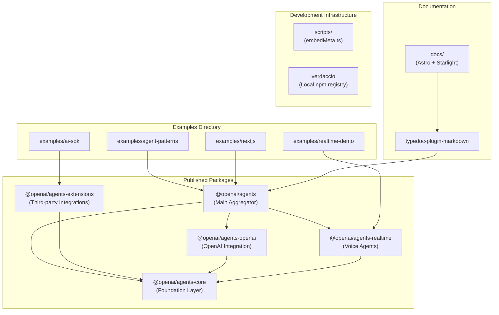
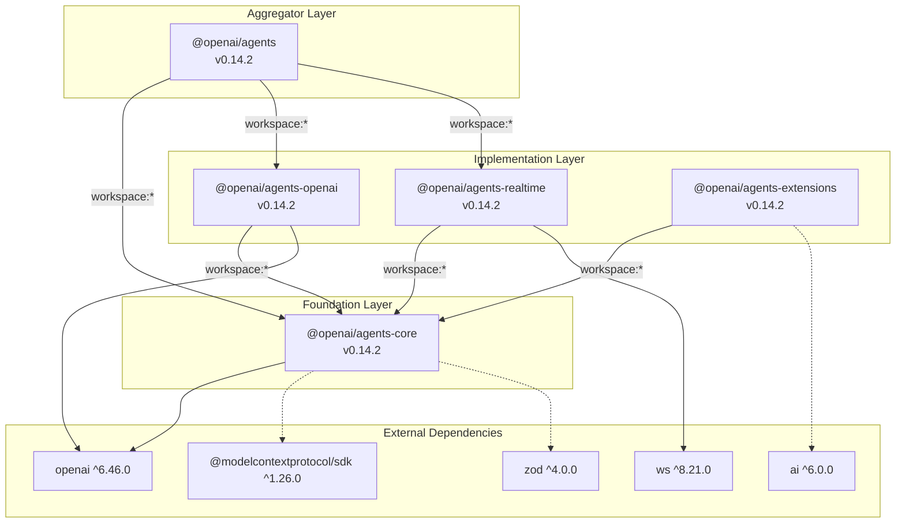
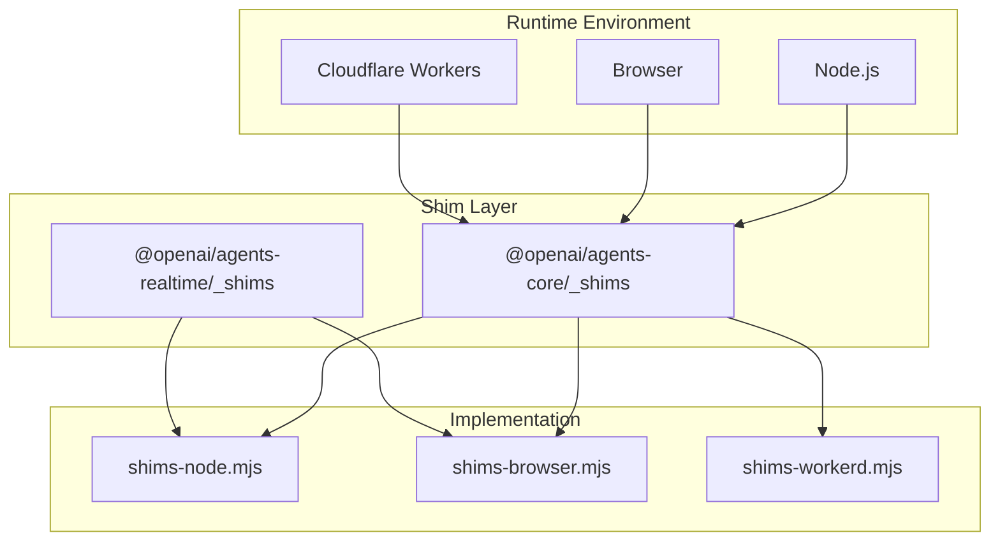

<!-- source: DeepWiki mcp.deepwiki.com · repo openai/openai-agents-js · page 1.1 Package Architecture · fetched 2026-10-26 -->

# Package Architecture

Relevant source files

The following files were used as context for generating this wiki page:

- [docs/package.json](docs/package.json)
- [examples/ai-sdk-ui/package.json](examples/ai-sdk-ui/package.json)
- [examples/ai-sdk-v1/package.json](examples/ai-sdk-v1/package.json)
- [examples/ai-sdk/package.json](examples/ai-sdk/package.json)
- [examples/nextjs/package.json](examples/nextjs/package.json)
- [examples/realtime-demo/package.json](examples/realtime-demo/package.json)
- [examples/realtime-next/package.json](examples/realtime-next/package.json)
- [examples/realtime-twilio-sip/package.json](examples/realtime-twilio-sip/package.json)
- [examples/realtime-twilio/package.json](examples/realtime-twilio/package.json)
- [packages/agents-core/CHANGELOG.md](packages/agents-core/CHANGELOG.md)
- [packages/agents-core/package.json](packages/agents-core/package.json)
- [packages/agents-core/src/metadata.ts](packages/agents-core/src/metadata.ts)
- [packages/agents-extensions/CHANGELOG.md](packages/agents-extensions/CHANGELOG.md)
- [packages/agents-extensions/package.json](packages/agents-extensions/package.json)
- [packages/agents-extensions/src/metadata.ts](packages/agents-extensions/src/metadata.ts)
- [packages/agents-openai/CHANGELOG.md](packages/agents-openai/CHANGELOG.md)
- [packages/agents-openai/package.json](packages/agents-openai/package.json)
- [packages/agents-openai/src/metadata.ts](packages/agents-openai/src/metadata.ts)
- [packages/agents-realtime/CHANGELOG.md](packages/agents-realtime/CHANGELOG.md)
- [packages/agents-realtime/package.json](packages/agents-realtime/package.json)
- [packages/agents-realtime/src/metadata.ts](packages/agents-realtime/src/metadata.ts)
- [packages/agents/CHANGELOG.md](packages/agents/CHANGELOG.md)
- [packages/agents/package.json](packages/agents/package.json)
- [packages/agents/src/metadata.ts](packages/agents/src/metadata.ts)
- [pnpm-lock.yaml](pnpm-lock.yaml)

The OpenAI Agents SDK is organized as a pnpm-based monorepo containing five published npm packages plus supporting infrastructure. This page explains the layered package architecture, workspace dependency protocol, build system, and how packages are organized to enable both modular usage and full-featured integration.

## Monorepo Structure

The repository is managed using pnpm workspaces [pnpm-lock.yaml:1-10](). The architecture follows a layered approach: a foundation layer (`agents-core`), specialized implementation layers (`agents-openai`, `agents-realtime`, `agents-extensions`), and an aggregator layer (`agents`).

### Directory Layout

The monorepo contains:
- **`packages/`**: Published npm packages.
- **`examples/`**: Working examples demonstrating SDK capabilities, including agent patterns [pnpm-lock.yaml:127](), AI SDK integrations [pnpm-lock.yaml:145](), and Next.js implementations [pnpm-lock.yaml:190]().
- **`docs/`**: Astro + Starlight documentation site [pnpm-lock.yaml:78-85]() with TypeDoc API reference generation [pnpm-lock.yaml:104-112]().
- **`scripts/`**: Build and development utilities, such as `embedMeta.ts` [packages/agents-core/package.json:11]().

### Package Architecture Diagram

This diagram maps the high-level system components to their corresponding code packages and directory structures.

**Sources:** [packages/agents/package.json:43-49](), [packages/agents-core/package.json:1-9](), [packages/agents-openai/package.json:22-26](), [packages/agents-realtime/package.json:57-62](), [packages/agents-extensions/package.json:16-20](), [pnpm-lock.yaml:1-126]()

## Layered Package Architecture

The SDK follows a strict layered architecture where each layer builds upon the previous one. All packages are versioned synchronously, currently at `0.14.2` [packages/agents/src/metadata.ts:4-14]().

### Layer 1: Foundation (`@openai/agents-core`)

The `agents-core` package provides the foundational abstractions and orchestration logic:
- **`Agent`** class: Configuration object for defining agent behavior.
- **`Runner`** class: Execution engine that orchestrates turn-based loops. Now supports optional `modelProvider` [packages/agents-core/CHANGELOG.md:131]().
- **`Model`** interface: Provider-agnostic model abstraction [packages/agents-core/package.json:22-26]().
- **Sandbox**: Local and internal sandbox runtimes [packages/agents-core/package.json:42-56]().
- **Tracing**: Built-in observability system with lifecycle dispatch helpers [packages/agents-core/CHANGELOG.md:122]().

**Dependencies:**
- `openai` ^6.46.0 [packages/agents-core/package.json:120]().
- `@modelcontextprotocol/sdk` ^1.26.0 (optional) [packages/agents-core/package.json:116]().
- `zod` ^4.0.0 (peer) [packages/agents-core/package.json:123]().

**Sources:** [packages/agents-core/package.json:1-174](), [packages/agents-core/CHANGELOG.md:3-20]()

### Layer 2: Specialized Implementations

#### `@openai/agents-openai`

OpenAI-specific model implementations and hosted tools:
- **`OpenAIResponsesModel`**: Implements Responses API integration.
- **`OpenAIChatCompletionsModel`**: Implements Chat Completions API integration.
- **Hosted tools**: Support for `web_search`, `file_search`, `code_interpreter`, and experimental hosted multi-agent support [packages/agents-openai/package.json:16-20](), [packages/agents-openai/CHANGELOG.md:83-85]().

**Sources:** [packages/agents-openai/package.json:1-58](), [packages/agents-openai/CHANGELOG.md:3-12]()

#### `@openai/agents-realtime`

Real-time voice agent capabilities:
- **`RealtimeAgent`**: Agent definition for voice interactions.
- **`RealtimeSession`**: Session management and lifecycle.
- **Transport layers**: WebSocket and WebRTC support [packages/agents-realtime/CHANGELOG.md:80-83]().

**Sources:** [packages/agents-realtime/package.json:1-81](), [packages/agents-realtime/CHANGELOG.md:3-13]()

#### `@openai/agents-extensions`

Third-party provider integrations and sandbox extensions:
- **`AiSdkModel`**: Adapter for Vercel AI SDK [packages/agents-extensions/package.json:27-31]().
- **Sandbox Providers**: Blaxel, Cloudflare, Daytona, E2B, Modal, Runloop, and Vercel [packages/agents-extensions/package.json:37-71]().

**Sources:** [packages/agents-extensions/package.json:1-186]()

### Layer 3: Aggregator (`@openai/agents`)

The main package re-exports functionality from specialized packages to provide a unified entry point:
- Re-exports core functionality.
- Provides specialized sub-paths for `/sandbox`, `/realtime`, and `/utils` [packages/agents/package.json:16-35]().

**Sources:** [packages/agents/package.json:1-84](), [packages/agents/src/metadata.ts:1-17]()

### Dependency Graph with Workspace Protocol

This diagram illustrates how internal packages depend on each other using the `workspace:*` protocol to ensure local development versions are used.

**Workspace Protocol:** Internal dependencies use `workspace:*`, ensuring they resolve to the local version within the monorepo during development [packages/agents/package.json:44-46](), [packages/agents-openai/package.json:23](), [packages/agents-realtime/package.json:58]().

**Sources:** [packages/agents/package.json:43-49](), [packages/agents-core/package.json:115-121](), [packages/agents-openai/package.json:22-26](), [packages/agents-realtime/package.json:57-62](), [packages/agents-extensions/package.json:16-20]()

## Package Export Structure

Packages use the `exports` field in `package.json` to define public APIs and provide platform-specific shims for Node.js, browsers, and Cloudflare Workers (workerd).

### Export Paths by Package

| Package | Export Path | Purpose |
|---------|------------|---------|
| `@openai/agents-core` | `.` | Core Agent, Runner, and Models [packages/agents-core/package.json:17-21]() |
| `@openai/agents-core` | `/sandbox` | Sandbox runtimes (local/internal) [packages/agents-core/package.json:42-56]() |
| `@openai/agents-core` | `/_shims` | Platform-specific shims [packages/agents-core/package.json:67-86]() |
| `@openai/agents-openai` | `.` | OpenAI model implementations [packages/agents-openai/package.json:11-15]() |
| `@openai/agents-realtime` | `.` | Voice agent logic [packages/agents-realtime/package.json:12-21]() |
| `@openai/agents-extensions` | `/ai-sdk` | Vercel AI SDK adapter [packages/agents-extensions/package.json:27-31]() |
| `@openai/agents-extensions` | `/sandbox/*` | Third-party sandbox providers [packages/agents-extensions/package.json:37-71]() |

### Platform Shims Architecture

The SDK handles environment differences (e.g., `WebSocket` availability, `AsyncLocalStorage`) via a shim system exposed through the `/_shims` path.

**Sources:** [packages/agents-core/package.json:67-86](), [packages/agents-realtime/package.json:22-41]()

## Build System and Development Infrastructure

The monorepo uses `tsc` for compilation and a custom script `embedMeta.ts` to inject package metadata.

### Build Pipeline

1. **`prebuild`**: Runs `tsx ../../scripts/embedMeta.ts` to generate `metadata.ts` with versioning info [packages/agents-core/package.json:11]().
2. **`build`**: Executes `tsc` to generate `dist/` artifacts [packages/agents-core/package.json:12]().
3. **`bundle`**: (Realtime only) Uses `vite build` to create a UMD bundle for browser usage [packages/agents-realtime/package.json:55]().
4. **`dist:check`**: Verifies the distribution build [packages/agents-core/package.json:14]().

### Versioning and Releases

Releases are managed via **Changesets**. Patch and minor changes are recorded in `CHANGELOG.md` files across packages [packages/agents/CHANGELOG.md:3-15](). Metadata is synchronized across the monorepo, ensuring all internal packages refer to the correct `0.14.2` version [packages/agents/src/metadata.ts:4-14]().

**Sources:** [packages/agents-core/package.json:10-15](), [packages/agents-realtime/package.json:50-56](), [packages/agents/src/metadata.ts:1-16](), [packages/agents/CHANGELOG.md:1-15]()

---

