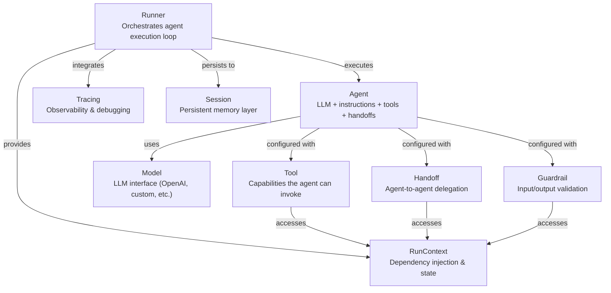
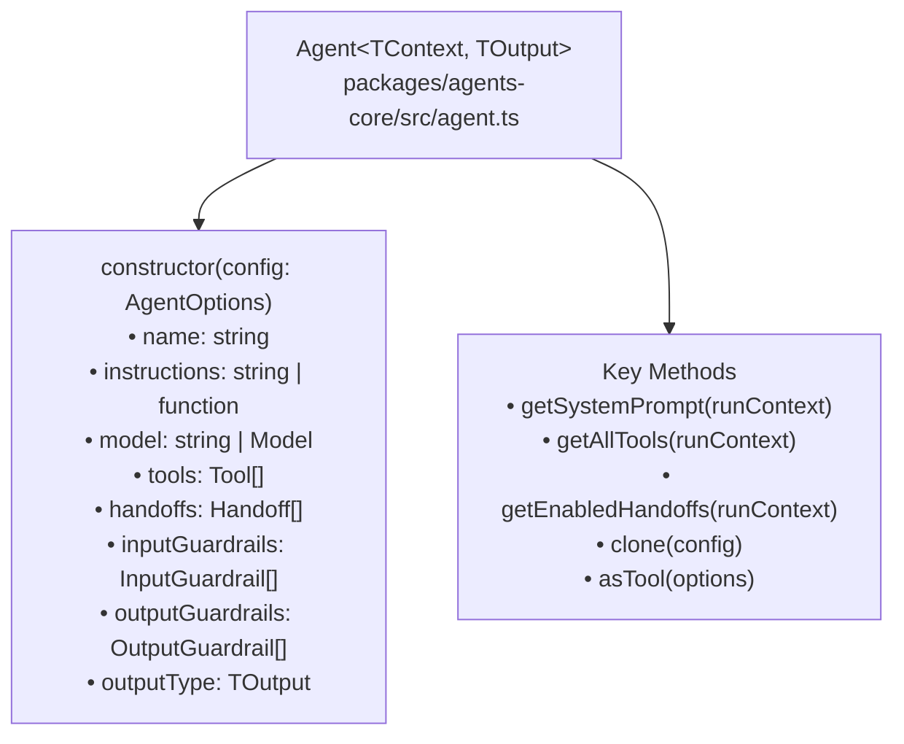
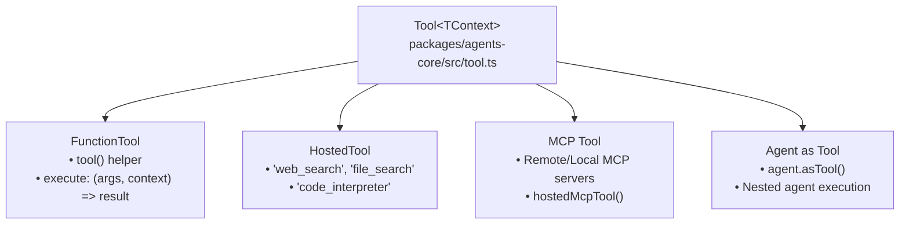
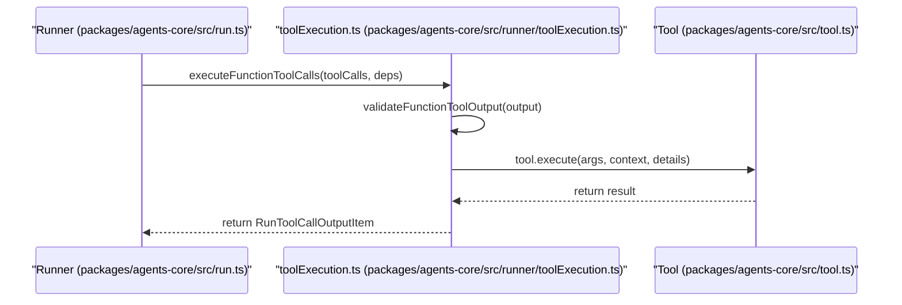
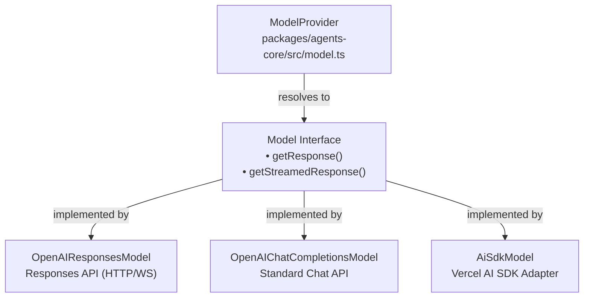

<!-- source: DeepWiki mcp.deepwiki.com · repo openai/openai-agents-js · page 1.2 Core Concepts · fetched 2026-10-26 -->

# Core Concepts

Relevant source files

The following files were used as context for generating this wiki page:

- [docs/src/content/docs/extensions/ai-sdk.mdx](docs/src/content/docs/extensions/ai-sdk.mdx)
- [docs/src/content/docs/guides/agents.mdx](docs/src/content/docs/guides/agents.mdx)
- [docs/src/content/docs/guides/mcp.mdx](docs/src/content/docs/guides/mcp.mdx)
- [docs/src/content/docs/guides/models.mdx](docs/src/content/docs/guides/models.mdx)
- [docs/src/content/docs/guides/running-agents.mdx](docs/src/content/docs/guides/running-agents.mdx)
- [docs/src/content/docs/guides/sessions.mdx](docs/src/content/docs/guides/sessions.mdx)
- [docs/src/content/docs/guides/tools.mdx](docs/src/content/docs/guides/tools.mdx)
- [docs/src/content/docs/guides/voice-agents/build.mdx](docs/src/content/docs/guides/voice-agents/build.mdx)
- [examples/docs/sessions/responsesCompactionManualSession.ts](examples/docs/sessions/responsesCompactionManualSession.ts)
- [packages/agents-core/src/agent.ts](packages/agents-core/src/agent.ts)
- [packages/agents-core/src/index.ts](packages/agents-core/src/index.ts)
- [packages/agents-core/src/run.ts](packages/agents-core/src/run.ts)
- [packages/agents-core/src/runContext.ts](packages/agents-core/src/runContext.ts)
- [packages/agents-core/src/runState.ts](packages/agents-core/src/runState.ts)
- [packages/agents-core/src/runner/approvalRejection.ts](packages/agents-core/src/runner/approvalRejection.ts)
- [packages/agents-core/src/runner/mcpApprovals.ts](packages/agents-core/src/runner/mcpApprovals.ts)
- [packages/agents-core/src/runner/runLoop.ts](packages/agents-core/src/runner/runLoop.ts)
- [packages/agents-core/src/runner/toolExecution.ts](packages/agents-core/src/runner/toolExecution.ts)
- [packages/agents-core/src/runner/turnResolution.ts](packages/agents-core/src/runner/turnResolution.ts)
- [packages/agents-core/test/agent.test.ts](packages/agents-core/test/agent.test.ts)
- [packages/agents-core/test/agentScenarios.test.ts](packages/agents-core/test/agentScenarios.test.ts)
- [packages/agents-core/test/run.stream.test.ts](packages/agents-core/test/run.stream.test.ts)
- [packages/agents-core/test/run.test.ts](packages/agents-core/test/run.test.ts)
- [packages/agents-core/test/runContext.test.ts](packages/agents-core/test/runContext.test.ts)
- [packages/agents-core/test/runState.test.ts](packages/agents-core/test/runState.test.ts)
- [packages/agents-core/test/runner/toolExecution.test.ts](packages/agents-core/test/runner/toolExecution.test.ts)

This page defines the fundamental abstractions in the OpenAI Agents SDK and explains how they relate to each other. These concepts apply to both text-based agents (using `Agent` and `Runner`) and real-time voice agents (using `RealtimeAgent` and `RealtimeSession`).

## Conceptual Overview

The SDK is built around several core concepts that work together to create intelligent, tool-enabled workflows:

**Terminology Overview**

**Sources:** [packages/agents-core/src/agent.ts:6-15](), [packages/agents-core/src/run.ts:223-246](), [docs/src/content/docs/guides/running-agents.mdx:30-41]()

## Agent

An `Agent` is a Large Language Model configured with specific instructions, tools, and delegation rules. The `Agent` class is defined in [packages/agents-core/src/agent.ts:336-449]() and is generic over context type (`TContext`) and output type (`TOutput`).

**Agent Class Structure**

**Key Configuration Properties**

| Property | Type | Description |
|----------|------|-------------|
| `name` | `string` | Required identifier used in handoffs and tracing. [packages/agents-core/src/agent.ts:118-118]() |
| `instructions` | `string \| PromptFunction` | System prompt. Can be static or dynamically generated via `RunContext`. [packages/agents-core/src/agent.ts:8-8]() |
| `model` | `string \| Model` | Model name (e.g., `'gpt-5.6-sol'`) or custom `Model` instance. [packages/agents-core/src/agent.ts:8-8]() |
| `tools` | `Tool[]` | Array of function tools, hosted tools, or MCP tools. [packages/agents-core/src/agent.ts:19-19]() |
| `handoffs` | `(Agent \| Handoff)[]` | Agents this agent can delegate to. [packages/agents-core/src/agent.ts:34-34]() |
| `outputType` | `ZodSchema \| JsonSchema` | For structured responses using OpenAI Structured Outputs. [packages/agents-core/src/agent.ts:10-10]() |

**Sources:** [packages/agents-core/src/agent.ts:5-61](), [packages/agents-core/test/agent.test.ts:24-43](), [docs/src/content/docs/guides/agents.mdx:49-70]()

## Tool

A `Tool` represents a capability that an agent can invoke. The SDK supports multiple tool categories, including local functions, hosted OpenAI tools, and Model Context Protocol (MCP) tools.

**Tool Type Hierarchy**

**Tool Execution Flow**
The `Runner` identifies tool calls in the model response and delegates to `executeFunctionToolCalls` or category-specific executors.

**Sources:** [packages/agents-core/src/tool.ts:223-260](), [packages/agents-core/src/runner/toolExecution.ts:33-37](), [docs/src/content/docs/guides/tools.mdx:19-30]()

## Model

A `Model` abstracts LLM interactions. The SDK uses a provider pattern to resolve model names to concrete implementations.

**Model Interface Architecture**

**Key Implementation Detail**
The SDK defaults to the Responses API [docs/src/content/docs/guides/models.mdx:83-83](). If you use GPT-5.x models, the SDK automatically applies optimized reasoning and verbosity settings [packages/agents-core/src/defaultModel.ts:163-167]().

**Sources:** [docs/src/content/docs/guides/models.mdx:20-23](), [packages/agents-core/src/defaultModel.ts:161-167](), [packages/agents-core/src/model.ts:158-176]()

## Runner

The `Runner` class [packages/agents-core/src/run.ts:192-221]() orchestrates the agent execution loop. It manages turns, tool calls, and handoffs.

**Runner Responsibilities:**
1.  **Turn Orchestration**: Manages the loop between model generation and tool execution [packages/agents-core/src/runner/runLoop.ts:81-85]().
2.  **State Management**: Tracks `RunState` [packages/agents-core/src/runState.ts:69-93]() and `RunContext` [packages/agents-core/src/runContext.ts:1-20]().
3.  **Safety**: Enforces `maxTurns` (default 10) to prevent infinite loops [packages/agents-core/src/runner/constants.ts:38-38]().
4.  **Persistence**: Interacts with `Session` to store and retrieve history [packages/agents-core/src/runner/sessionPersistence.ts:69-74]().

**Sources:** [docs/src/content/docs/guides/running-agents.mdx:14-41](), [packages/agents-core/src/run.ts:192-221](), [packages/agents-core/src/runState.ts:69-93]()

## Handoff

A `Handoff` enables agent-to-agent delegation. It is represented as a tool to the model but handled by the `Runner` to transition execution to a different agent.

**Handoff Properties:**
*   **Target Agent**: The agent receiving the delegation [packages/agents-core/src/handoff.ts:82-82]().
*   **Input Filter**: Mutates history items during the transfer to manage context window [packages/agents-core/src/handoff.ts:16-16]().
*   **Description**: Prompting guidance for when the model should delegate [packages/agents-core/src/handoff.ts:82-82]().

**Sources:** [packages/agents-core/src/handoff.ts:16-87](), [docs/src/content/docs/guides/running-agents.mdx:39-40]()

## Guardrail

Guardrails provide safety checks on inputs and outputs.
*   **Input Guardrails**: Run on the initial user input before the model is called [packages/agents-core/src/run.ts:5-7]().
*   **Output Guardrails**: Run on the final output before returning to the user [packages/agents-core/src/run.ts:8-9]().
*   **Tripwires**: If a guardrail triggers a tripwire, it throws a specific error to halt execution such as `InputGuardrailTripwireTriggered` [packages/agents-core/src/errors.ts:34-34]().

**Sources:** [packages/agents-core/src/guardrail.ts:1-60](), [packages/agents-core/src/run.ts:5-15](), [packages/agents-core/src/errors.ts:32-46]()

## Tracing

Tracing provides observability into agent runs. It records spans for agent invocations, model generations, tool calls, and handoffs.
*   **TraceProvider**: Manages the creation and collection of traces [packages/agents-core/src/tracing/provider.ts:70-70]().
*   **Sensitive Data**: Can be configured to exclude LLM inputs/outputs while still emitting spans via `traceIncludeSensitiveData` [packages/agents-core/src/run.ts:233-233]().

**Sources:** [docs/src/content/docs/guides/running-agents.mdx:95-96](), [packages/agents-core/src/tracing/context.ts:25-33](), [packages/agents-core/src/run.ts:230-240]()

---

