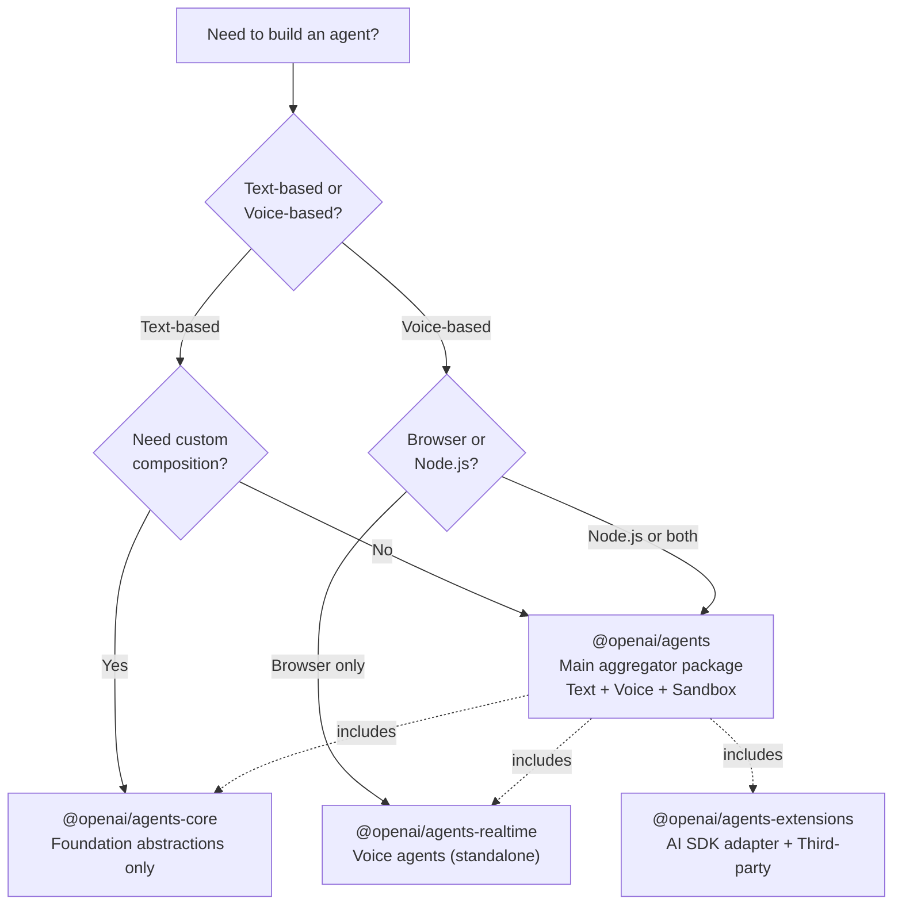
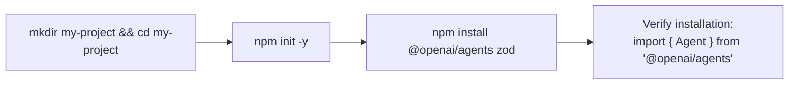
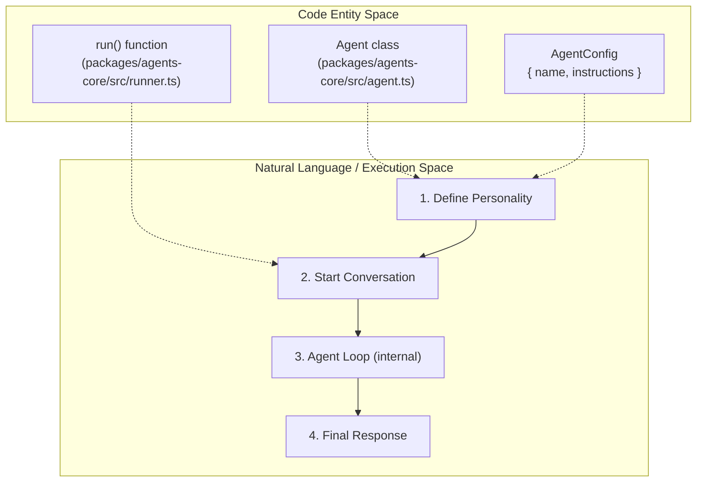
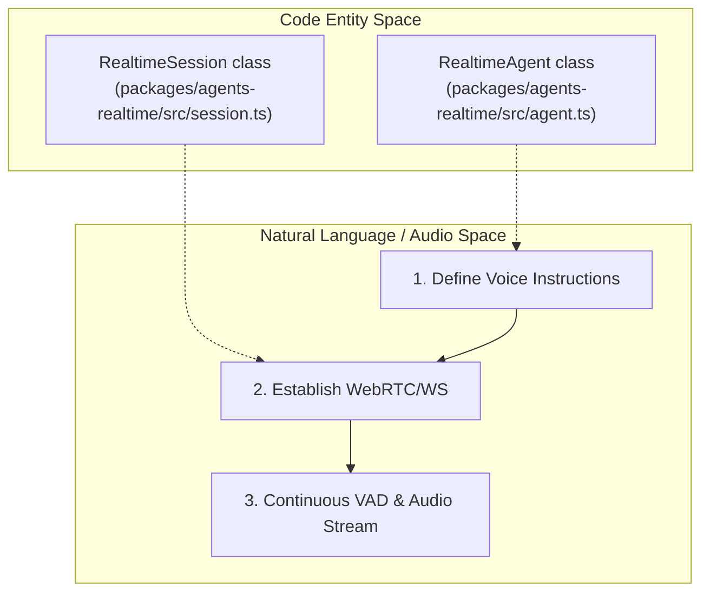

<!-- source: DeepWiki mcp.deepwiki.com · repo openai/openai-agents-js · page 2 Getting Started · fetched 2026-10-26 -->

# Getting Started

<details>
<summary>Relevant source files</summary>

The following files were used as context for generating this wiki page:

- [README.md](README.md)
- [docs/astro.config.mjs](docs/astro.config.mjs)
- [docs/src/components/Hero.astro](docs/src/components/Hero.astro)
- [docs/src/content/docs/extensions/twilio.mdx](docs/src/content/docs/extensions/twilio.mdx)
- [docs/src/content/docs/guides/guardrails.mdx](docs/src/content/docs/guides/guardrails.mdx)
- [docs/src/content/docs/guides/human-in-the-loop.mdx](docs/src/content/docs/guides/human-in-the-loop.mdx)
- [docs/src/content/docs/guides/quickstart.mdx](docs/src/content/docs/guides/quickstart.mdx)
- [docs/src/content/docs/guides/tracing.mdx](docs/src/content/docs/guides/tracing.mdx)
- [docs/src/content/docs/guides/voice-agents.mdx](docs/src/content/docs/guides/voice-agents.mdx)
- [docs/src/content/docs/guides/voice-agents/quickstart.mdx](docs/src/content/docs/guides/voice-agents/quickstart.mdx)
- [docs/src/content/docs/index.mdx](docs/src/content/docs/index.mdx)
- [docs/src/content/docs/ja/guides/quickstart.mdx](docs/src/content/docs/ja/guides/quickstart.mdx)
- [docs/src/content/docs/ja/guides/voice-agents/quickstart.mdx](docs/src/content/docs/ja/guides/voice-agents/quickstart.mdx)
- [docs/src/content/docs/ja/index.mdx](docs/src/content/docs/ja/index.mdx)
- [docs/src/content/docs/ko/guides/voice-agents/quickstart.mdx](docs/src/content/docs/ko/guides/voice-agents/quickstart.mdx)
- [docs/src/content/docs/ko/index.mdx](docs/src/content/docs/ko/index.mdx)
- [docs/src/content/docs/zh/guides/voice-agents/quickstart.mdx](docs/src/content/docs/zh/guides/voice-agents/quickstart.mdx)
- [docs/src/content/docs/zh/index.mdx](docs/src/content/docs/zh/index.mdx)
- [docs/src/styles/global.css](docs/src/styles/global.css)
- [examples/basic/package.json](examples/basic/package.json)
- [examples/docs/package.json](examples/docs/package.json)
- [examples/model-providers/package.json](examples/model-providers/package.json)
- [examples/tools/package.json](examples/tools/package.json)
- [packages/agents/README.md](packages/agents/README.md)

</details>


This page provides a practical introduction to the OpenAI Agents SDK for new users. It covers installation, environment setup, creating your first agent, and understanding the basic execution model. For detailed information about package architecture and design principles, see [Overview](#1). For advanced configuration options, see [Agent Fundamentals](#2.3).

## Prerequisites

The SDK supports the following JavaScript runtime environments:

| Runtime | Minimum Version | Status |
|---------|----------------|--------|
| Node.js | 22.0.0 | Fully supported [README.md:27-27]() |
| Deno | Latest | Fully supported [README.md:28-28]() |
| Bun | Latest | Fully supported [README.md:29-29]() |
| Cloudflare Workers | Latest with `nodejs_compat` | Experimental [README.md:31-33]() |

**Required dependencies:**
- `zod` (v4 recommended) - used for schema validation and structured outputs. [docs/src/content/docs/index.mdx:58-60]()

Sources: [README.md:25-35](), [docs/src/content/docs/index.mdx:54-60]()

## Package Selection

The SDK provides multiple packages for different use cases. Most users should start with the main `@openai/agents` aggregator.



**Installation commands:**

| Use Case | Command |
|----------|---------|
| Recommended Default (text + voice + sandbox) | `npm install @openai/agents zod` [docs/src/content/docs/index.mdx:56-58]() |
| Standalone Voice agents (browser-optimized) | `npm install @openai/agents-realtime zod` [docs/src/content/docs/index.mdx:69-69]() |
| Custom composition or non-OpenAI providers | `npm install @openai/agents-core @openai/agents-openai zod` [docs/src/content/docs/index.mdx:70-70]() |

Sources: [docs/src/content/docs/index.mdx:63-70](), [packages/agents/README.md:39-43]()

## Installation Process



**Step-by-step:**

1. **Initialize project**:
   ```bash
   mkdir my_project
   cd my_project
   npm init -y
   ```

2. **Install the SDK:**
   ```bash
   npm install @openai/agents zod
   ```

Sources: [docs/src/content/docs/ja/guides/quickstart.mdx:23-35](), [README.md:39-41]()

## Environment Configuration

The SDK requires an OpenAI API key for authentication.

### Method 1: Environment Variable (Recommended)

```bash
export OPENAI_API_KEY=sk-proj-...your-key-here
```

The SDK automatically reads from `process.env.OPENAI_API_KEY` when making API calls. [docs/src/content/docs/ja/guides/quickstart.mdx:37-41]()

### Method 2: Programmatic Configuration

The SDK provides global configuration helpers for setting keys and clients at the process level.

```typescript
import { setDefaultOpenAIKey, setTracingExportApiKey } from '@openai/agents';

// Set API key for agent execution
setDefaultOpenAIKey('sk-proj-...');

// Set separate key for tracing export (optional)
setTracingExportApiKey('sk-proj-...');
```

Sources: [README.md:106-106](), [docs/src/content/docs/ja/guides/quickstart.mdx:37-43]()

## First Agent: Hello World

The following diagram bridges code entities to the runtime execution space:



**Minimal working example:**

```typescript
import { Agent, run } from '@openai/agents';

const agent = new Agent({
  name: 'Assistant',
  instructions: 'You are a helpful assistant.',
});

const result = await run(
  agent,
  'Write a haiku about recursion in programming.',
);

console.log(result.finalOutput);
```

Sources: [README.md:47-59](), [packages/agents/README.md:45-61]()

## Sandbox Agents (Beta)

For tasks requiring a filesystem or shell access, use `SandboxAgent`. This pairs an agent with an isolated workspace.

```typescript
import { run } from '@openai/agents';
import { gitRepo, SandboxAgent } from '@openai/agents/sandbox';
import { UnixLocalSandboxClient } from '@openai/agents/sandbox/local';

const agent = new SandboxAgent({
  name: 'Workspace Assistant',
  instructions: 'Inspect the repo before changing files.',
  defaultManifest: {
    entries: { repo: gitRepo({ repo: 'openai/openai-agents-js' }) },
  },
});

const result = await run(
  agent,
  'Inspect the repo README and summarize what this project does.',
  { sandbox: { client: new UnixLocalSandboxClient() } },
);
```

Sources: [README.md:61-89](), [packages/agents/README.md:63-90]()

## Basic Usage Patterns

The SDK supports several core patterns that can be combined:

1. **Tools**: Give agents the ability to call functions. Defined via the `tool()` helper and `zod` schemas. [docs/src/content/docs/index.mdx:48-48]()
2. **Handoffs**: Transfer conversation control between specialized agents. Defined via the `handoffs` array in the `Agent` constructor. [docs/src/content/docs/index.mdx:28-28]()
3. **Guardrails**: Run validation checks in parallel with agent execution. [docs/src/content/docs/index.mdx:47-47]()
4. **Sessions**: Maintain persistent memory and history across multiple runs. [docs/src/content/docs/index.mdx:50-50]()

For details, see [Basic Usage Examples](#2.2).

## Real-time Voice Agents

Voice agents run inside a `RealtimeSession` and support low-latency bidirectional audio.



**Minimal Realtime example:**

```typescript
import { RealtimeAgent, RealtimeSession } from '@openai/agents/realtime';

const agent = new RealtimeAgent({
  name: 'Assistant',
  instructions: 'You are a helpful assistant.',
});

// Automatically connects microphone/audio in browser via WebRTC
const session = new RealtimeSession(agent);
await session.connect({ apiKey: '<client-ephemeral-token>' });
```

Sources: [README.md:90-105](), [docs/src/content/docs/guides/voice-agents/quickstart.mdx:62-101]()

## Next Steps

- **[Installation and Setup](#2.1)** — Detailed environment and dependency configuration.
- **[Basic Usage Examples](#2.2)** — Walkthroughs of tools, handoffs, and common patterns.
- **[Agent Fundamentals](#2.3)** — Deep dive into the `Agent` class and lifecycle hooks.
- **[Tracing and Observability](#4.6)** — Debug your agent flows at [platform.openai.com/traces](https://platform.openai.com/traces). [docs/src/content/docs/guides/tracing.mdx:10-10]()

Sources: [docs/src/content/docs/index.mdx:99-135]()

---

