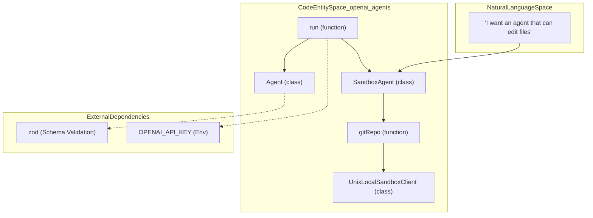
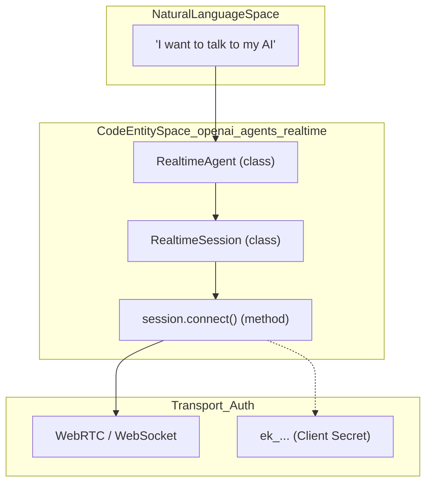

<!-- source: DeepWiki mcp.deepwiki.com · repo openai/openai-agents-js · page 2.1 Installation and Setup · fetched 2026-10-26 -->

# Installation and Setup

<details>
<summary>Relevant source files</summary>

The following files were used as context for generating this wiki page:

- [.github/dependabot.yml](.github/dependabot.yml)
- [.github/workflows/changeset.yml](.github/workflows/changeset.yml)
- [.github/workflows/docs.yml](.github/workflows/docs.yml)
- [.github/workflows/issues.yml](.github/workflows/issues.yml)
- [.github/workflows/release-tag.yml](.github/workflows/release-tag.yml)
- [.github/workflows/release.yml](.github/workflows/release.yml)
- [.github/workflows/test.yml](.github/workflows/test.yml)
- [README.md](README.md)
- [docs/astro.config.mjs](docs/astro.config.mjs)
- [docs/package.json](docs/package.json)
- [docs/src/components/Hero.astro](docs/src/components/Hero.astro)
- [docs/src/content/docs/extensions/twilio.mdx](docs/src/content/docs/extensions/twilio.mdx)
- [docs/src/content/docs/guides/guardrails.mdx](docs/src/content/docs/guides/guardrails.mdx)
- [docs/src/content/docs/guides/human-in-the-loop.mdx](docs/src/content/docs/guides/human-in-the-loop.mdx)
- [docs/src/content/docs/guides/quickstart.mdx](docs/src/content/docs/guides/quickstart.mdx)
- [docs/src/content/docs/guides/tracing.mdx](docs/src/content/docs/guides/tracing.mdx)
- [docs/src/content/docs/guides/voice-agents.mdx](docs/src/content/docs/guides/voice-agents.mdx)
- [docs/src/content/docs/guides/voice-agents/quickstart.mdx](docs/src/content/docs/guides/voice-agents/quickstart.mdx)
- [docs/src/content/docs/index.mdx](docs/src/content/docs/index.mdx)
- [docs/src/styles/global.css](docs/src/styles/global.css)
- [examples/ai-sdk-ui/package.json](examples/ai-sdk-ui/package.json)
- [examples/ai-sdk-v1/package.json](examples/ai-sdk-v1/package.json)
- [examples/ai-sdk/package.json](examples/ai-sdk/package.json)
- [examples/nextjs/package.json](examples/nextjs/package.json)
- [examples/realtime-demo/package.json](examples/realtime-demo/package.json)
- [examples/realtime-next/package.json](examples/realtime-next/package.json)
- [examples/realtime-twilio-sip/package.json](examples/realtime-twilio-sip/package.json)
- [examples/realtime-twilio/package.json](examples/realtime-twilio/package.json)
- [package.json](package.json)
- [packages/agents/README.md](packages/agents/README.md)
- [pnpm-lock.yaml](pnpm-lock.yaml)

</details>


This page details the technical requirements and procedures for installing the OpenAI Agents SDK in production environments, as well as the setup for developing within the monorepo.

---

## Production Installation

### System Requirements

The SDK is designed to run in modern JavaScript environments and leverages modern Node.js features for performance and compatibility.

| Requirement | Specification |
| :--- | :--- |
| **Node.js Runtime** | Node.js 22 or later (Recommended) [README.md:27](), [packages/agents/README.md:29]() |
| **Alternative Runtimes** | Deno, Bun [README.md:28-29]() |
| **Experimental Support** | Cloudflare Workers (requires `nodejs_compat` flag) [README.md:33-35]() |
| **Package Manager** | `npm`, `pnpm`, or `yarn` |

### Installation Commands

The primary package is `@openai/agents`, which serves as an aggregator for the core, OpenAI-specific, and realtime modules.

**Using npm:**
```bash
npm install @openai/agents zod
```
[README.md:40-41](), [packages/agents/README.md:42]()

**Using pnpm:**
```bash
pnpm add @openai/agents zod
```

### Required Dependencies

The SDK relies on **Zod** for schema validation and the official **OpenAI** client for model communication.

| Dependency | Version | Purpose |
| :--- | :--- | :--- |
| `zod` | `^4.0.0` | Required for tool schema validation and runtime type safety [examples/agent-patterns/package.json:141-143]() |
| `openai` | `^6.46.0` | Underlying client for OpenAI API interactions [examples/agent-patterns/package.json:138-140]() |

**Sources:** [README.md:40-41](), [examples/agent-patterns/package.json:138-143]()

---

## Environment Configuration

### OpenAI API Key

Most operations require an authenticated OpenAI client. The SDK automatically looks for the `OPENAI_API_KEY` environment variable when using the `run()` function or initializing models.

**Unix/macOS:**
```bash
export OPENAI_API_KEY="sk-..."
```
[README.md:106](), [docs/src/content/docs/guides/voice-agents/quickstart.mdx:39]()

**Windows (PowerShell):**
```powershell
$env:OPENAI_API_KEY="sk-..."
```

### Realtime API Credentials
For **Realtime Voice Agents**, client-side applications (like browsers) should use **ephemeral tokens** instead of permanent API keys to prevent credential leakage.

1. Your backend requests a token from `POST /v1/realtime/client_secrets` [docs/src/content/docs/guides/voice-agents/quickstart.mdx:40]().
2. The response contains a value starting with `ek_` [docs/src/content/docs/guides/voice-agents/quickstart.mdx:51]().
3. The frontend uses this token to call `session.connect({ apiKey: 'ek_...' })` [docs/src/content/docs/guides/voice-agents/quickstart.mdx:98]().

**Sources:** [docs/src/content/docs/guides/voice-agents/quickstart.mdx:34-60](), [README.md:106-108]()

---

## Package Selection

The SDK is modular. Depending on your use case, you may choose different entry points. The monorepo uses `workspace:*` protocols to ensure internal consistency.

| Entry Point | Use Case |
| :--- | :--- |
| `@openai/agents` | **Recommended Default.** Aggregator package containing text agents, sandbox agents (`/sandbox`), and voice agents (`/realtime`) [docs/astro.config.mjs:35-52]() |
| `@openai/agents-openai` | OpenAI-specific implementations like `OpenAIChatCompletionsModel` [docs/astro.config.mjs:59-64]() |
| `@openai/agents-realtime` | Standalone voice package for browser-only apps or minimal bundles [docs/astro.config.mjs:65-70]() |
| `@openai/agents-core` | Foundational primitives (Agent, Runner, Model interfaces) [docs/astro.config.mjs:53-58]() |
| `@openai/agents-extensions` | Integrations like **Vercel AI SDK**, **Twilio**, and **Cloudflare** [docs/astro.config.mjs:71-76]() |

**Sources:** [docs/astro.config.mjs:34-76](), [examples/ai-sdk/package.json:156-161]()

---

## Data Flow and Architecture

The following diagrams illustrate how the installation of specific packages maps to the code entities used in a typical workflow.

### Natural Language to Code Entity Space: Text & Sandbox
Title: "Text and Sandbox Agent Initialization Flow"

**Sources:** [README.md:47-87](), [packages/agents/README.md:45-89]()

### Natural Language to Code Entity Space: Realtime Voice
Title: "Realtime Voice Agent Connection Flow"

**Sources:** [README.md:95-103](), [docs/src/content/docs/guides/voice-agents/quickstart.mdx:71-99]()

---

## Development Environment Setup

If you are contributing to the `openai-agents-js` repository, follow these steps to set up the monorepo environment.

### Prerequisites
- **Node.js**: Version 22.x or 24.x is used in CI [ .github/workflows/test.yml:98]().
- **pnpm**: The repository uses pnpm workspaces for managing the monorepo [package.json:107]().

### Repository Setup
1. **Install Dependencies**:
   ```bash
   pnpm install
   ```
   [package.json:121]()
2. **Build All Packages**:
   The monorepo uses `tsc-multi` for compilation [package.json:8]().
   ```bash
   pnpm build
   ```

### Local Development Tools
The monorepo includes several scripts and tools for quality assurance:
- **tsc-multi**: Used for parallel builds and watching package changes [package.json:60, 11]().
- **Verdaccio**: Local npm registry for testing the full release cycle [package.json:81-82]().
- **Changesets**: Used for versioning and automated releases [package.json:77, 85]().
- **Vitest**: The primary testing framework for unit and integration tests [package.json:16, 105]().

**Sources:** [package.json:5-108](), [.github/workflows/test.yml:89-140]()

---

