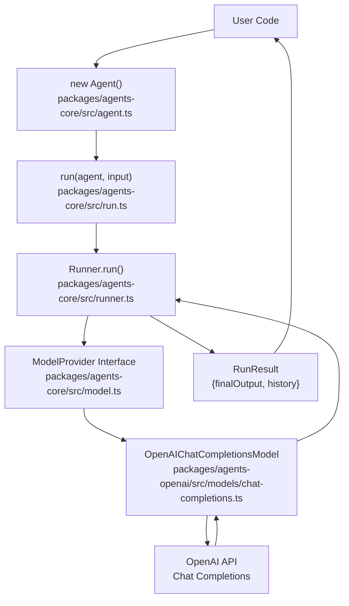
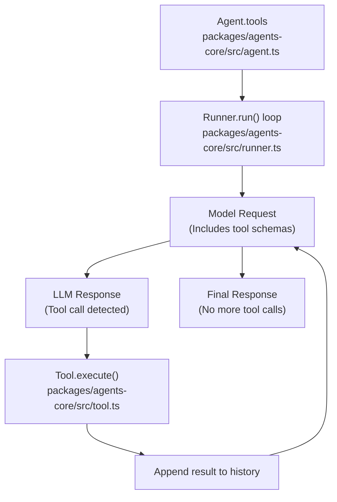
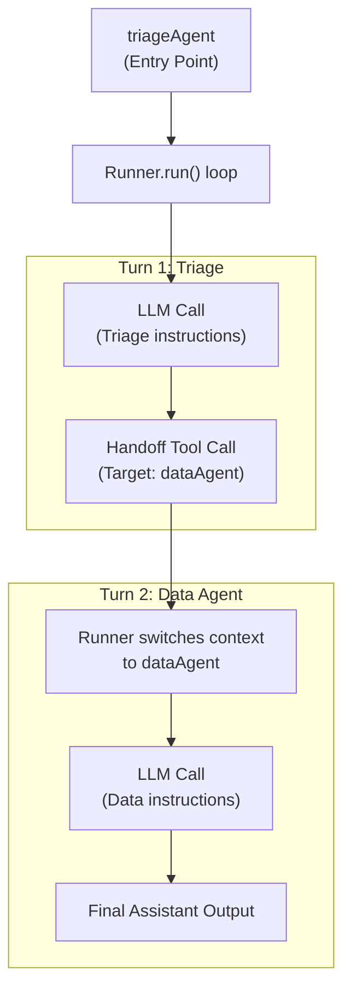

<!-- source: DeepWiki mcp.deepwiki.com · repo openai/openai-agents-js · page 2.2 Basic Usage Examples · fetched 2026-10-26 -->

# Basic Usage Examples

<details>
<summary>Relevant source files</summary>

The following files were used as context for generating this wiki page:

- [.agents/skills/examples-auto-run/SKILL.md](.agents/skills/examples-auto-run/SKILL.md)
- [examples/agent-patterns/routing.ts](examples/agent-patterns/routing.ts)
- [examples/ai-sdk-v1/ai-sdk-v1.ts](examples/ai-sdk-v1/ai-sdk-v1.ts)
- [examples/ai-sdk/README.md](examples/ai-sdk/README.md)
- [examples/ai-sdk/gpt-5.ts](examples/ai-sdk/gpt-5.ts)
- [examples/ai-sdk/image-tool-output.ts](examples/ai-sdk/image-tool-output.ts)
- [examples/ai-sdk/stream.ts](examples/ai-sdk/stream.ts)
- [examples/ai-sdk/tsconfig.json](examples/ai-sdk/tsconfig.json)
- [examples/basic/file-tool-output.ts](examples/basic/file-tool-output.ts)
- [examples/basic/hello-world-gpt-5.ts](examples/basic/hello-world-gpt-5.ts)
- [examples/basic/image-tool-output.ts](examples/basic/image-tool-output.ts)
- [examples/basic/index.ts](examples/basic/index.ts)
- [examples/basic/local-file.ts](examples/basic/local-file.ts)
- [examples/basic/local-image.ts](examples/basic/local-image.ts)
- [examples/basic/media/partial_o3-and-o4-mini-system-card.pdf](examples/basic/media/partial_o3-and-o4-mini-system-card.pdf)
- [examples/basic/package.json](examples/basic/package.json)
- [examples/basic/reasoning.ts](examples/basic/reasoning.ts)
- [examples/basic/remote-image.ts](examples/basic/remote-image.ts)
- [examples/basic/remote-pdf.ts](examples/basic/remote-pdf.ts)
- [examples/customer-service/index.ts](examples/customer-service/index.ts)
- [examples/docs/README.md](examples/docs/README.md)
- [examples/docs/guardrails/guardrails-input.ts](examples/docs/guardrails/guardrails-input.ts)
- [examples/docs/models/customProviders.ts](examples/docs/models/customProviders.ts)
- [examples/docs/package.json](examples/docs/package.json)
- [examples/docs/streaming/streamedHITL.ts](examples/docs/streaming/streamedHITL.ts)
- [examples/docs/tools/codexRunContextThread.ts](examples/docs/tools/codexRunContextThread.ts)
- [examples/docs/tools/codexTool.ts](examples/docs/tools/codexTool.ts)
- [examples/mcp/sse-example.ts](examples/mcp/sse-example.ts)
- [examples/memory/start-prisma.ts](examples/memory/start-prisma.ts)
- [examples/model-providers/package.json](examples/model-providers/package.json)
- [examples/research-bot/main.ts](examples/research-bot/main.ts)
- [examples/tools/README.md](examples/tools/README.md)
- [examples/tools/codex-same-thread.ts](examples/tools/codex-same-thread.ts)
- [examples/tools/codex.ts](examples/tools/codex.ts)
- [examples/tools/package.json](examples/tools/package.json)
- [examples/tools/web-search-filters.ts](examples/tools/web-search-filters.ts)
- [packages/agents-extensions/src/experimental/codex/index.ts](packages/agents-extensions/src/experimental/codex/index.ts)
- [packages/agents-extensions/test/experimental/codex/index.test.ts](packages/agents-extensions/test/experimental/codex/index.test.ts)
- [scripts/run-example-starts.mjs](scripts/run-example-starts.mjs)

</details>


This page demonstrates the fundamental usage patterns of the OpenAI Agents SDK through core examples: creating a basic agent, adding tools, and orchestrating multiple agents through handoffs. These examples illustrate the primary abstractions and execution patterns used when building agent workflows.

For installation and environment setup, see [Installation and Setup](2.1). For detailed agent configuration options, see [Agent Fundamentals](2.3).

---

## Hello World: Basic Agent Creation and Execution

The simplest agent workflow involves creating an `Agent` instance with instructions and executing it with the `run()` utility. While the `Agent` class defines the agent's behavior, the `Runner` class (invoked internally by `run()`) orchestrates the execution loop.

### Basic Agent Execution Flow


**Sources:** [examples/basic/hello-world-gpt-5.ts:1-31](), [examples/basic/index.ts:26-34]()

### Code Example: Hello World

The minimal agent requires a name and instructions. You can also specify a model and model-specific settings like reasoning effort or verbosity. The `outputType` property can be used with Zod to enforce structured output.

```typescript
import { Agent, run } from '@openai/agents';
import { z } from 'zod';

const outputSchema = z.object({
  title: z.string(),
  description: z.string(),
});

const agent = new Agent({
  name: 'GPT-5.4 Assistant',
  model: 'gpt-5.4',
  instructions: "You're a helpful assistant.",
  modelSettings: {
    reasoning: { effort: 'none' },
    text: { verbosity: 'low' },
  },
  outputType: outputSchema,
});

const result = await run(agent, 'Tell me about recursion in programming.');
console.log(result.finalOutput);
```
**Sources:** [examples/basic/hello-world-gpt-5.ts:10-32](), [examples/basic/reasoning.ts:8-17]()

---

## Agent with Tools: Extending Capabilities

Tools allow an agent to take actions like fetching data or calling external APIs. The SDK uses `zod` for parameter validation and the `tool()` helper to define executable logic.

### Tool Execution Flow in Agent Loop


**Sources:** [examples/basic/index.ts:4-11](), [examples/ai-sdk/image-tool-output.ts:5-18]()

### Code Example: Agent with Function Tools

This example demonstrates defining a custom tool with `zod` schema validation and attaching it to an agent.

```typescript
import { Agent, run, tool } from '@openai/agents';
import { z } from 'zod';

const getWeatherTool = tool({
  name: 'get_weather',
  description: 'Get the weather for a given city',
  parameters: z.object({ city: z.string() }),
  execute: async (input) => {
    return `The weather in ${input.city} is sunny`;
  },
});

const agent = new Agent({
  name: 'Weather Agent',
  instructions: 'Use the weather tool to answer questions.',
  tools: [getWeatherTool],
});

const result = await run(agent, 'What is the weather in San Francisco?');
```
**Sources:** [examples/basic/index.ts:4-34](), [examples/ai-sdk/image-tool-output.ts:21-26]()

---

## Multi-Agent Handoffs: Orchestration

Handoffs allow an agent to delegate a conversation to a specialist. This is implemented by providing an array of agents to the `handoffs` property. The SDK handles the context switching and history preservation.

### Multi-Agent Handoff Flow


**Sources:** [examples/agent-patterns/routing.ts:43-48]()

### Code Example: Handoff Pattern

In this pattern, a `triageAgent` acts as a router. When it decides to hand off, the `run()` function continues execution with the new agent.

```typescript
import { Agent, run } from '@openai/agents';

const frenchAgent = new Agent({
  name: 'french_agent',
  instructions: 'You only speak French',
});

const triageAgent = new Agent({
  name: 'triage_agent',
  instructions: 'Handoff to the appropriate agent based on the language.',
  handoffs: [frenchAgent],
});

const result = await run(triageAgent, 'Bonjour!');
// result.currentAgent will be frenchAgent
```
**Sources:** [examples/agent-patterns/routing.ts:28-48]()

---

## Advanced Basic Patterns

### Reasoning Summaries
When using reasoning models (like GPT-5.4/o1 series), you can inspect the thinking process by iterating over `reasoning_item` entries in the run result.

```typescript
const result = await run(agent, 'Compute T(25) for T(n) = T(n-1) + n.');

for (const item of result.newItems) {
  if (item.type === 'reasoning_item') {
    for (const entry of item.rawItem.content) {
      if (entry.type === 'input_text') {
        console.log(`Thought: ${entry.text}`);
      }
    }
  }
}
```
**Sources:** [examples/basic/reasoning.ts:22-35]()

### Input Guardrails
Guardrails can be used to block or modify execution based on safety or business logic.

```typescript
import { Agent, run, InputGuardrailTripwireTriggered } from '@openai/agents';

const mathGuardrail = {
  name: 'Math Homework Guardrail',
  runInParallel: false,
  execute: async ({ input }) => {
    const isHomework = input.includes('solve for x');
    return { tripwireTriggered: isHomework };
  },
};

const agent = new Agent({
  name: 'Support',
  inputGuardrails: [mathGuardrail],
});

try {
  await run(agent, 'solve for x: 2x = 10');
} catch (e) {
  if (e instanceof InputGuardrailTripwireTriggered) {
    console.log('Guardrail tripped!');
  }
}
```
**Sources:** [examples/docs/guardrails/guardrails-input.ts:18-46]()

---

## Example Code Locations

The following files in the repository contain runnable examples of these patterns:

| Pattern | File Path |
| :--- | :--- |
| **Hello World (GPT-5.4)** | [examples/basic/hello-world-gpt-5.ts:1-71]() |
| **Reasoning & Thinking** | [examples/basic/reasoning.ts:1-38]() |
| **Agent with Tools** | [examples/basic/index.ts:4-34]() |
| **Input Guardrails** | [examples/docs/guardrails/guardrails-input.ts:1-50]() |
| **Handoffs (Routing)** | [examples/agent-patterns/routing.ts:1-58]() |
| **Hosted Tools (Codex)** | [examples/tools/codex-same-thread.ts:75-131]() |

**Sources:** [examples/basic/package.json:1-36](), [examples/tools/package.json:1-33]()

---

