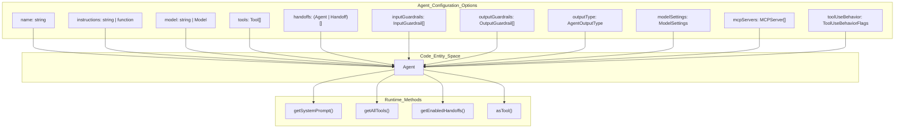
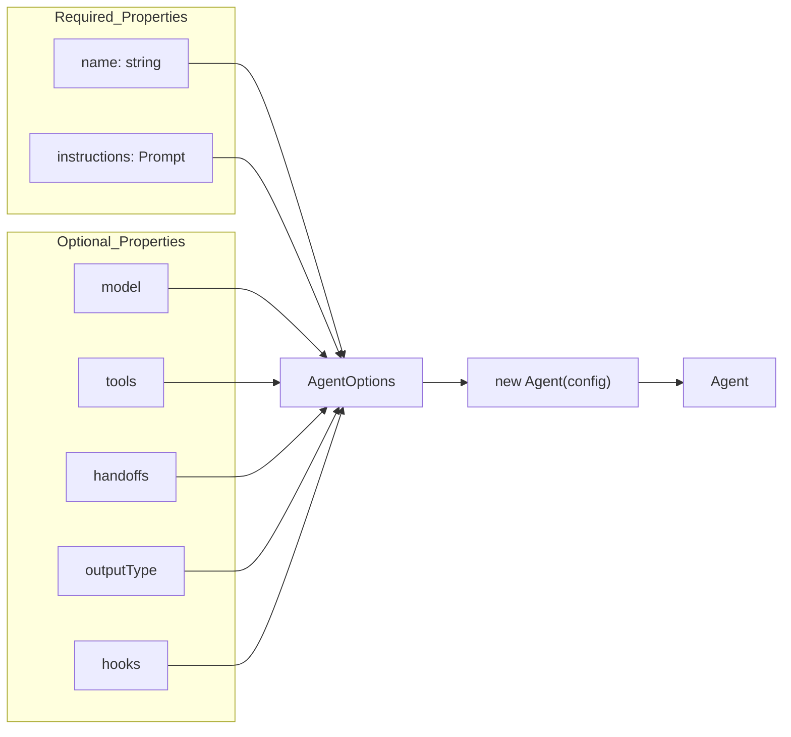
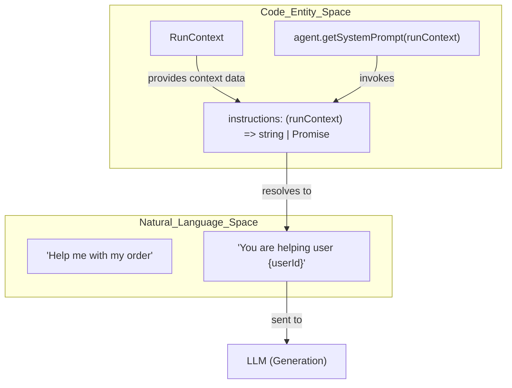

<!-- source: DeepWiki mcp.deepwiki.com · repo openai/openai-agents-js · page 2.3 Agent Fundamentals · fetched 2026-10-26 -->

# Agent Fundamentals

Relevant source files

The following files were used as context for generating this wiki page:

- [docs/src/content/docs/extensions/ai-sdk.mdx](docs/src/content/docs/extensions/ai-sdk.mdx)
- [docs/src/content/docs/guides/agents.mdx](docs/src/content/docs/guides/agents.mdx)
- [docs/src/content/docs/guides/mcp.mdx](docs/src/content/docs/guides/mcp.mdx)
- [docs/src/content/docs/guides/models.mdx](docs/src/content/docs/guides/models.mdx)
- [docs/src/content/docs/guides/running-agents.mdx](docs/src/content/docs/guides/running-agents.mdx)
- [docs/src/content/docs/guides/sessions.mdx](docs/src/content/docs/guides/sessions.mdx)
- [docs/src/content/docs/guides/tools.mdx](docs/src/content/docs/guides/tools.mdx)
- [docs/src/content/docs/guides/voice-agents/build.mdx](docs/src/content/docs/guides/voice-agents/build.mdx)
- [docs/src/content/docs/ja/guides/agents.mdx](docs/src/content/docs/ja/guides/agents.mdx)
- [docs/src/content/docs/ko/guides/agents.mdx](docs/src/content/docs/ko/guides/agents.mdx)
- [docs/src/content/docs/zh/guides/agents.mdx](docs/src/content/docs/zh/guides/agents.mdx)
- [examples/docs/sessions/responsesCompactionManualSession.ts](examples/docs/sessions/responsesCompactionManualSession.ts)
- [packages/agents-core/src/agent.ts](packages/agents-core/src/agent.ts)
- [packages/agents-core/src/runContext.ts](packages/agents-core/src/runContext.ts)
- [packages/agents-core/src/runner/approvalRejection.ts](packages/agents-core/src/runner/approvalRejection.ts)
- [packages/agents-core/src/runner/mcpApprovals.ts](packages/agents-core/src/runner/mcpApprovals.ts)
- [packages/agents-core/test/agent.test.ts](packages/agents-core/test/agent.test.ts)
- [packages/agents-core/test/agentScenarios.test.ts](packages/agents-core/test/agentScenarios.test.ts)
- [packages/agents-core/test/runContext.test.ts](packages/agents-core/test/runContext.test.ts)

This page explains the `Agent` class constructor, its configuration options, dynamic instructions, and lifecycle hooks. An `Agent` represents a configured Large Language Model (LLM) with instructions, tools, guardrails, and handoff capabilities.

---

## Agent Class Overview

The `Agent` class is the primary abstraction in the SDK. It wraps an LLM with configuration that defines how it should behave, what capabilities it has, and how it interacts with other agents. It is generic over its context type `TContext` and its output type `TOutput`.

Title: Agent Configuration and Runtime Behavior

**Sources:** [packages/agents-core/src/agent.ts:336-741](), [packages/agents-core/src/agent.ts:155-278]()

---

## Creating an Agent

The `Agent` constructor accepts a single configuration object. While `name` and `instructions` are the primary required fields, the constructor initializes a robust set of features including tool management and output validation.

Title: Agent Initialization Flow

**Sources:** [packages/agents-core/src/agent.ts:388-449](), [docs/src/content/docs/guides/agents.mdx:47-72]()

---

## Core Configuration Options

### name
A short human-readable identifier. It is used for logging, tracing, and identifying the agent when it is used as a tool by other agents.
**Sources:** [packages/agents-core/src/agent.ts:390-393](), [docs/src/content/docs/guides/agents.mdx:55]()

### instructions
The system prompt that tells the model who it is and how it should respond. This can be a static string or a dynamic function (see [Dynamic Instructions](#dynamic-instructions)).
**Sources:** [packages/agents-core/src/agent.ts:394](), [docs/src/content/docs/guides/agents.mdx:56]()

### model and modelSettings
`model` can be a string name (e.g., `'gpt-5.4-mini'`) or a concrete `Model` instance. `modelSettings` provides tuning parameters like `temperature` or `reasoning.effort`. If using GPT-5.x models, the SDK applies optimized default settings for reasoning and verbosity.
**Sources:** [packages/agents-core/src/agent.ts:398-399](), [docs/src/content/docs/guides/models.mdx:33-64]()

### tools
An array of capabilities the agent can invoke. The SDK supports multiple categories, including local function tools, hosted OpenAI tools (web search, code interpreter), and Model Context Protocol (MCP) tools.
**Sources:** [packages/agents-core/src/agent.ts:400-401](), [docs/src/content/docs/guides/tools.mdx:19-29]()

### handoffs
Defines a list of specialist agents this agent can delegate to. When a handoff occurs, the conversation history is preserved while the active agent changes.
**Sources:** [packages/agents-core/src/agent.ts:397](), [docs/src/content/docs/guides/agents.mdx:59]()

### outputType
By default, agents return plain text. By specifying an `outputType` (via Zod or JSON Schema), the SDK utilizes OpenAI's Structured Outputs to ensure the LLM returns a validated object.
**Sources:** [packages/agents-core/src/agent.ts:405-407](), [docs/src/content/docs/guides/agents.mdx:84-98]()

---

## Dynamic Instructions

Dynamic instructions allow the system prompt to be calculated at runtime. This is critical for agents that need to adapt based on user data, session state, or environment variables provided via `RunContext`.

Title: Dynamic Instruction Resolution

**Sources:** [packages/agents-core/src/agent.ts:608-616](), [docs/src/content/docs/guides/agents.mdx:142-153]()

---

## Lifecycle Hooks

The `Agent` class allows developers to register hooks to observe and react to execution events. These hooks can be passed in the `hooks` property of the `Agent` constructor.

| Hook Name | Description | Arguments |
| :--- | :--- | :--- |
| `agent_start` | Triggered when the agent begins its turn. | `(context, agent, turnInput?)` |
| `agent_end` | Triggered when the agent finishes its turn. | `(context, output)` |
| `agent_handoff` | Triggered when the agent delegates to another agent. | `(context, nextAgent)` |
| `agent_tool_call` | Triggered when the agent invokes a tool. | `(context, toolCall)` |

**Sources:** [packages/agents-core/src/agent.ts:336-341](), [packages/agents-core/src/lifecycle.ts:7-25](), [docs/src/content/docs/guides/agents.mdx:170-185]()

---

## Advanced Behaviors

### Forcing Tool Use
Developers can control how an agent interacts with tools using `toolUseBehavior`.
- `run_llm_again` (default): After a tool executes, the result is sent back to the LLM to generate a final response.
- `stop_on_first_tool`: The run terminates immediately after the tool call is generated, allowing for external handling or human-in-the-loop flows.

**Sources:** [packages/agents-core/src/agent.ts:199-212](), [docs/src/content/docs/guides/agents.mdx:68]()

### Agents as Tools
An entire `Agent` can be exposed as a tool using `agent.asTool()`. This creates a `FunctionTool` that, when called, initializes a nested `Runner` to execute the child agent. This is the foundation of the "Manager" pattern.

**Sources:** [packages/agents-core/src/agent.ts:497-600](), [docs/src/content/docs/guides/tools.mdx:27]()

---

