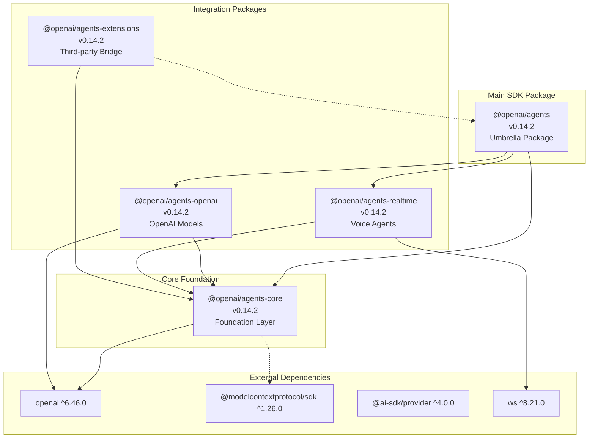
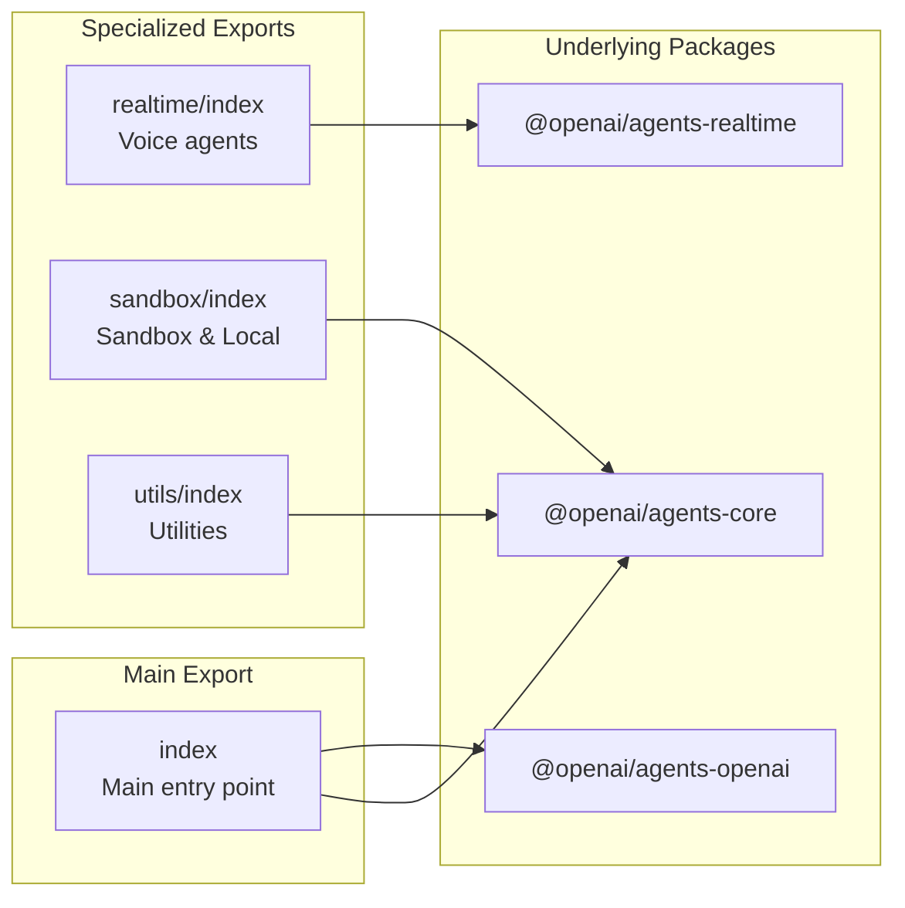
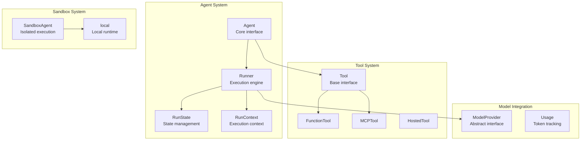

<!-- source: DeepWiki mcp.deepwiki.com · repo openai/openai-agents-js · page 3 Core Packages · fetched 2026-10-26 -->

# Core Packages

Relevant source files

The following files were used as context for generating this wiki page:

- [packages/agents-core/CHANGELOG.md](packages/agents-core/CHANGELOG.md)
- [packages/agents-core/package.json](packages/agents-core/package.json)
- [packages/agents-core/src/metadata.ts](packages/agents-core/src/metadata.ts)
- [packages/agents-extensions/CHANGELOG.md](packages/agents-extensions/CHANGELOG.md)
- [packages/agents-extensions/package.json](packages/agents-extensions/package.json)
- [packages/agents-extensions/src/metadata.ts](packages/agents-extensions/src/metadata.ts)
- [packages/agents-openai/CHANGELOG.md](packages/agents-openai/CHANGELOG.md)
- [packages/agents-openai/package.json](packages/agents-openai/package.json)
- [packages/agents-openai/src/metadata.ts](packages/agents-openai/src/metadata.ts)
- [packages/agents-realtime/CHANGELOG.md](packages/agents-realtime/CHANGELOG.md)
- [packages/agents-realtime/package.json](packages/agents-realtime/package.json)
- [packages/agents-realtime/src/metadata.ts](packages/agents-realtime/src/metadata.ts)
- [packages/agents/CHANGELOG.md](packages/agents/CHANGELOG.md)
- [packages/agents/package.json](packages/agents/package.json)
- [packages/agents/src/metadata.ts](packages/agents/src/metadata.ts)

The OpenAI Agents SDK is organized as a monorepo containing four core packages that provide different layers of functionality. This document covers the architecture, responsibilities, and relationships between these packages. For information about specific features and capabilities provided by these packages, see [Key Features](#4).

## Package Architecture Overview

The SDK follows a layered architecture where each package has specific responsibilities and clear dependency relationships. The versioning is synchronized across the core workspace (currently v0.14.2).

Sources: [packages/agents/package.json:44-48](), [packages/agents-core/package.json:116-121](), [packages/agents-openai/package.json:23-26](), [packages/agents-realtime/package.json:58-62](), [packages/agents-extensions/package.json:17-20](), [packages/agents/src/metadata.ts:4-14]()

## Package Responsibilities

| Package | Purpose | Key Components | Version |
|---------|---------|----------------|---------|
| `@openai/agents` | Main entry point and convenience exports | Re-exports from other packages, unified interface | 0.14.2 |
| `@openai/agents-core` | Foundation abstractions and utilities | `Agent`, `Runner`, `Tool` interfaces, MCP support, Sandbox core | 0.14.2 |
| `@openai/agents-openai` | OpenAI API integrations | `OpenAIResponsesModel`, `OpenAIChatCompletionsModel`, hosted tools | 0.14.2 |
| `@openai/agents-realtime` | Real-time voice capabilities | `RealtimeAgent`, `RealtimeSession`, WebRTC/WebSocket transports | 0.14.2 |
| `@openai/agents-extensions` | Third-party integrations | AI SDK adapter, Sandbox providers (E2B, Vercel, etc.) | 0.14.2 |

Sources: [packages/agents/package.json:5-6](), [packages/agents-core/package.json:5-6](), [packages/agents-openai/package.json:5-6](), [packages/agents-realtime/package.json:5-6](), [packages/agents-extensions/package.json:5-6]()

## @openai/agents

The umbrella package that provides a unified interface to the entire SDK. Most users will install and import from this package exclusively.

### Key Exports

The package exports are organized into logical groups, providing access to sandbox features and realtime voice capabilities from a single point.

### Dependencies

- **Direct dependencies**: `@openai/agents-core`, `@openai/agents-openai`, `@openai/agents-realtime`, `debug`, `openai`
- **Peer dependencies**: `zod` (required for schema validation)

Sources: [packages/agents/package.json:10-36](), [packages/agents/package.json:43-49](), [packages/agents/package.json:61-63]()

## @openai/agents-core

The foundation package providing core abstractions, interfaces, and cross-platform utilities. For details, see [@openai/agents-core](#3.1).

### Core Components

### Export Structure

The package provides granular exports for different concerns:

| Export Path | Purpose | Key Components |
|-------------|---------|----------------|
| `.` | Main entry point | `Agent`, `Runner`, core interfaces |
| `./model` | Model abstractions | `ModelProvider`, `Usage` |
| `./sandbox` | Sandbox core | `SandboxAgent`, manifest handling |
| `./sandbox/local` | Local sandbox | Local runtime implementation |
| `./utils` | Utility functions | Helper functions, validation |
| `./_shims` | Platform shims | Node/Browser/Cloudflare Workers support |

Sources: [packages/agents-core/package.json:16-106](), [packages/agents-core/CHANGELOG.md:32-40]()

## @openai/agents-openai

Provides OpenAI-specific implementations of the core abstractions, including model integrations and built-in tools. For details, see [@openai/agents-openai](#3.2).

### Key Components

- **Model Implementations**: `OpenAIResponsesModel` (Responses API) and `OpenAIChatCompletionsModel` (Chat Completions API).
- **Hosted Tools**: Built-in support for `web_search`, `file_search`, `code_interpreter`, and `image_generation`.
- **Context Management**: Support for model settings, reasoning effort, and tool search.
- **Experimental Support**: Support for hosted multi-agent Responses.

Sources: [packages/agents-openai/package.json:16-21](), [packages/agents-openai/CHANGELOG.md:32-34](), [packages/agents-openai/CHANGELOG.md:84-85](), [packages/agents-openai/CHANGELOG.md:96-96]()

## @openai/agents-realtime

Specialized package for building real-time voice agents using OpenAI's Realtime API. For details, see [@openai/agents-realtime](#3.3).

### Architecture Components

- **Session Management**: `RealtimeSession` for connection orchestration and `RealtimeAgent` for voice-specific configuration.
- **Transport Layer**: Abstracted transport supporting WebRTC (browser), WebSocket (server), and SIP/Twilio integrations.
- **Audio Handling**: Built-in VAD (Voice Activity Detection) and interruption handling.
- **Tool Handling**: Programmatic Tool Calling with caller-aware replay and runtime-validated Zod outputs.

Sources: [packages/agents-realtime/package.json:6-10](), [packages/agents-realtime/CHANGELOG.md:33-35](), [packages/agents-realtime/CHANGELOG.md:80-82](), [packages/agents-realtime/CHANGELOG.md:101-101]()

## @openai/agents-extensions

Bridge package for integrating with third-party AI providers and sandbox environments. For details, see [@openai/agents-extensions](#3.4).

### Integration Architecture

- **AI SDK Adapter**: `AiSdkModel` provider bridge for the Vercel AI SDK ecosystem.
- **Sandbox Providers**: Implementations for `E2B`, `Vercel`, `Daytona`, `Blaxel`, `Modal`, `Runloop`, and `Cloudflare`.
- **Experimental**: Support for `Codex` integration.

Sources: [packages/agents-extensions/package.json:21-77](), [packages/agents-extensions/package.json:78-92]()

## Cross-Platform Compatibility

All packages include environment shims to ensure compatibility across different JavaScript runtime environments:

| Environment | Shim Path | Purpose |
|-------------|-----------|---------|
| Node.js | `./_shims/shims-node` | Full Node.js APIs and filesystem access |
| Browser | `./_shims/shims-browser` | Web APIs and limited functionality |
| Cloudflare Workers | `./_shims/shims-workerd` | Workers runtime compatibility |

The shim system automatically detects the runtime environment and provides appropriate implementations for platform-specific APIs.

Sources: [packages/agents-core/package.json:67-106](), [packages/agents-realtime/package.json:22-41]()

---

