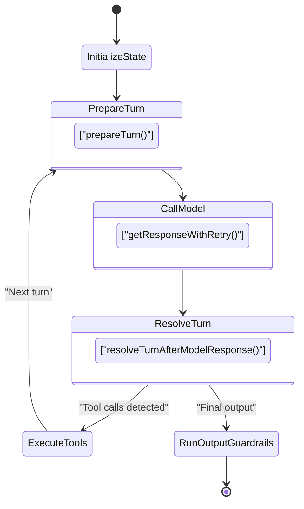

<!-- source: DeepWiki mcp.deepwiki.com · repo openai/openai-agents-js · page 3.1 @openai/agents-core · fetched 2026-10-26 -->

# @openai/agents-core

<details>
<summary>Relevant source files</summary>

The following files were used as context for generating this wiki page:

- [.changeset/quiet-expected-test-logs.md](.changeset/quiet-expected-test-logs.md)
- [eslint.config.mjs](eslint.config.mjs)
- [packages/agents-core/src/agent.ts](packages/agents-core/src/agent.ts)
- [packages/agents-core/src/errors.ts](packages/agents-core/src/errors.ts)
- [packages/agents-core/src/guardrail.ts](packages/agents-core/src/guardrail.ts)
- [packages/agents-core/src/index.ts](packages/agents-core/src/index.ts)
- [packages/agents-core/src/mcp.ts](packages/agents-core/src/mcp.ts)
- [packages/agents-core/src/mcpLogging.ts](packages/agents-core/src/mcpLogging.ts)
- [packages/agents-core/src/mcpServers.ts](packages/agents-core/src/mcpServers.ts)
- [packages/agents-core/src/mcpUtil.ts](packages/agents-core/src/mcpUtil.ts)
- [packages/agents-core/src/run.ts](packages/agents-core/src/run.ts)
- [packages/agents-core/src/runContext.ts](packages/agents-core/src/runContext.ts)
- [packages/agents-core/src/runState.ts](packages/agents-core/src/runState.ts)
- [packages/agents-core/src/runner/approvalRejection.ts](packages/agents-core/src/runner/approvalRejection.ts)
- [packages/agents-core/src/runner/mcpApprovals.ts](packages/agents-core/src/runner/mcpApprovals.ts)
- [packages/agents-core/src/runner/runLoop.ts](packages/agents-core/src/runner/runLoop.ts)
- [packages/agents-core/src/runner/toolExecution.ts](packages/agents-core/src/runner/toolExecution.ts)
- [packages/agents-core/src/runner/toolSearch.ts](packages/agents-core/src/runner/toolSearch.ts)
- [packages/agents-core/src/runner/turnResolution.ts](packages/agents-core/src/runner/turnResolution.ts)
- [packages/agents-core/src/shims/mcp-server/browser.ts](packages/agents-core/src/shims/mcp-server/browser.ts)
- [packages/agents-core/src/shims/mcp-server/node.ts](packages/agents-core/src/shims/mcp-server/node.ts)
- [packages/agents-core/src/tool.ts](packages/agents-core/src/tool.ts)
- [packages/agents-core/src/utils/serialize.ts](packages/agents-core/src/utils/serialize.ts)
- [packages/agents-core/test/agent.test.ts](packages/agents-core/test/agent.test.ts)
- [packages/agents-core/test/agentScenarios.test.ts](packages/agents-core/test/agentScenarios.test.ts)
- [packages/agents-core/test/errors.test.ts](packages/agents-core/test/errors.test.ts)
- [packages/agents-core/test/guardrail.test.ts](packages/agents-core/test/guardrail.test.ts)
- [packages/agents-core/test/mcpCache.test.ts](packages/agents-core/test/mcpCache.test.ts)
- [packages/agents-core/test/mcpLogging.test.ts](packages/agents-core/test/mcpLogging.test.ts)
- [packages/agents-core/test/mcpServers.test.ts](packages/agents-core/test/mcpServers.test.ts)
- [packages/agents-core/test/mcpToFunctionTool.test.ts](packages/agents-core/test/mcpToFunctionTool.test.ts)
- [packages/agents-core/test/mcpToolFilter.integration.test.ts](packages/agents-core/test/mcpToolFilter.integration.test.ts)
- [packages/agents-core/test/run.stream.test.ts](packages/agents-core/test/run.stream.test.ts)
- [packages/agents-core/test/run.test.ts](packages/agents-core/test/run.test.ts)
- [packages/agents-core/test/runContext.test.ts](packages/agents-core/test/runContext.test.ts)
- [packages/agents-core/test/runState.test.ts](packages/agents-core/test/runState.test.ts)
- [packages/agents-core/test/runner/toolExecution.test.ts](packages/agents-core/test/runner/toolExecution.test.ts)
- [packages/agents-core/test/shims/mcp-server/browser.test.ts](packages/agents-core/test/shims/mcp-server/browser.test.ts)
- [packages/agents-core/test/shims/mcp-server/node.test.ts](packages/agents-core/test/shims/mcp-server/node.test.ts)
- [packages/agents-core/test/taskTurnTracing.test.ts](packages/agents-core/test/taskTurnTracing.test.ts)
- [packages/agents-core/test/tool.test.ts](packages/agents-core/test/tool.test.ts)
- [packages/agents-core/test/toolCustomData.test.ts](packages/agents-core/test/toolCustomData.test.ts)
- [packages/agents-core/test/utils/serialize.test.ts](packages/agents-core/test/utils/serialize.test.ts)
- [packages/agents-extensions/src/ai-sdk/index.ts](packages/agents-extensions/src/ai-sdk/index.ts)
- [packages/agents-extensions/test/ai-sdk/GoogleFormat.test.ts](packages/agents-extensions/test/ai-sdk/GoogleFormat.test.ts)
- [packages/agents-extensions/test/ai-sdk/index.test.ts](packages/agents-extensions/test/ai-sdk/index.test.ts)

</details>


## Purpose and Scope

`@openai/agents-core` is the foundational package of the OpenAI Agents SDK. It provides the core abstractions and execution engine for building multi-agent workflows, including:

- **Agent execution orchestration** via `Runner` and `Agent` classes [packages/agents-core/src/run.ts:223-575]() [packages/agents-core/src/agent.ts:279-673]()
- **Provider-agnostic model interface** (`Model`) for LLM interactions [packages/agents-core/src/model.ts:14-118]()
- **Tool system** with function tools, hosted tools, and Model Context Protocol (MCP) integration [packages/agents-core/src/tool.ts:1-550]() [packages/agents-core/src/mcp.ts:1-288]()
- **Guardrails** for input/output validation [packages/agents-core/src/guardrail.ts:1-125]()
- **Built-in tracing** for observability [packages/agents-core/src/tracing/context.ts:1-110]()
- **State management** for resumable agent runs [packages/agents-core/src/runState.ts:1-380]()

**Sources:** [packages/agents-core/src/index.ts:1-270](), [packages/agents-core/src/run.ts:1-143](), [packages/agents-core/src/agent.ts:1-70]()

---

## Package Architecture

### Entry Points and Exports

The package exposes multiple entry points via conditional exports:

| Export Path | Purpose | Entry File |
|------------|---------|-----------|
| `.` | Main API (Agent, Runner, tools, tracing) | `src/index.ts` |
| `./model` | Model interface and types | `src/model.ts` |
| `./utils` | Utility functions | `src/utils/index.ts` |
| `./_shims` | Environment-specific shims | `src/shims/index.ts` |

The main entry point [packages/agents-core/src/index.ts:1-270]() exports all core abstractions including `Agent`, `Runner`, `run`, `tool`, `handoff`, MCP utilities, and tracing.

**Sources:** [packages/agents-core/src/index.ts:1-270]()

### Dependencies

```mermaid
graph TB
    ["@openai/agents-core"] --> ["openai ^4.73.0"]
    ["@openai/agents-core"] --> ["zod ^3.23.8"]
    ["@openai/agents-core"] -. "optional" .-> ["@modelcontextprotocol/sdk ^1.0.1"]
    
    subgraph "Role"
        ["openai ^4.73.0"] --- Note1["OpenAI SDK provides base HTTP client and types"]
        ["zod ^3.23.8"] --- Note2["Zod used for schema validation in tool definitions"]
        ["@modelcontextprotocol/sdk ^1.0.1"] --- Note3["MCP SDK enables external tool server integration"]
    end
```

**MCP integration:** The `@modelcontextprotocol/sdk` is an optional dependency, dynamically imported through environment-specific shims when MCP features are used [packages/agents-core/src/mcp.ts:1-7]().

**Sources:** [packages/agents-core/src/mcp.ts:1-10](), [packages/agents-core/src/index.ts:116-156]()

---

## Core Abstractions

### Agent Class

The `Agent` class [packages/agents-core/src/agent.ts:279-673]() encapsulates agent configuration:

```mermaid
graph TB
    subgraph "AgentConfiguration"
        ["name: string"]
        ["instructions: string | function"]
        ["model: string | Model"]
        ["modelSettings: ModelSettings"]
        ["tools: Tool[]"]
        ["mcpServers: MCPServer[]"]
        ["handoffs: (Agent | Handoff)[]"]
        ["outputType: AgentOutputType"]
        ["toolUseBehavior: ToolUseBehavior"]
    end
    
    ["Agent<TContext, TOutput>"] --> "AgentConfiguration"
    
    ["instructions: string | function"] -. "can be" .-> ["Dynamic Instructions: async fn(context, agent) => string"]
```

**Key properties:**
- `instructions`: System prompt, can be static string or async function [packages/agents-core/src/agent.ts:214-222]().
- `toolUseBehavior`: Controls whether LLM processes tool results (`run_llm_again` or `stop_on_first_tool`) [packages/agents-core/src/agent.ts:199-200]().
- `modelSettings`: Supports model-specific defaults like reasoning effort [packages/agents-core/src/agent.ts:223-228]().

**Sources:** [packages/agents-core/src/agent.ts:157-278](), [packages/agents-core/src/defaultModel.ts:1-50]()

### Runner Class

The `Runner` class [packages/agents-core/src/run.ts:248-594]() orchestrates agent execution through a turn-based loop. It handles the lifecycle of a run, including streaming events and result aggregation [packages/agents-core/src/run.ts:248-260]().

**Configuration precedence:**
1. Per-run options (passed to `run()`) [packages/agents-core/src/run.ts:188-194]()
2. Runner-level defaults (passed to constructor) [packages/agents-core/src/run.ts:248-280]()
3. Agent-level settings

**Sources:** [packages/agents-core/src/run.ts:144-242](), [packages/agents-core/src/run.ts:248-594]()

### RunState and RunContext

`RunState` [packages/agents-core/src/runState.ts:1-380]() manages mutable execution state and supports serialization via `toJSON()` [packages/agents-core/src/runState.ts:244-253]().

**Schema Versioning:** `RunState` uses a versioned schema (currently `1.16`) to ensure compatibility during serialization/resumption [packages/agents-core/src/runState.ts:127-148]().

**Sources:** [packages/agents-core/src/runState.ts:1-148](), [packages/agents-core/src/runContext.ts:1-37]()

---

## Agent Execution System

### Turn-Based Loop

The `Runner` executes agents through a loop managed by `run` and `Runner.run` [packages/agents-core/src/run.ts:190-212]().



**Safety Limits:** Execution is limited by `DEFAULT_MAX_TURNS` (25) to prevent infinite loops [packages/agents-core/src/runner/constants.ts:1-5]().

**Sources:** [packages/agents-core/src/run.ts:78-85](), [packages/agents-core/src/runner/turnResolution.ts:1-50](), [packages/agents-core/src/runner/turnPreparation.ts:1-50]()

---

## Tool System

### Tool Types

The SDK supports four tool categories [packages/agents-core/src/tool.ts:218-243]():
1. **FunctionTool**: Local JS functions wrapped with `tool()` [packages/agents-core/src/tool.ts:228]().
2. **HostedTool**: OpenAI-managed tools like `web_search` or `computer` [packages/agents-core/src/tool.ts:218]().
3. **MCPTool**: Tools dynamically loaded from Model Context Protocol servers [packages/agents-core/src/mcp.ts:1-10]().
4. **Agent-as-Tool**: Nested agents exposed as tools via `Agent.asTool()` [packages/agents-core/src/agent.ts:110-160]().

**Sources:** [packages/agents-core/src/tool.ts:218-243](), [packages/agents-core/src/agent.ts:110-173]()

---

## Model Context Protocol (MCP)

### MCPServer Interface

`MCPServer` [packages/agents-core/src/mcp.ts:87-122]() provides a unified interface for external tool servers:

```mermaid
graph TB
    subgraph "MCPServer Interface"
        ["connect()"]
        ["listTools()"]
        ["callTool(name, args)"]
    end
    
    subgraph "Implementations"
        ["MCPServerStdio (Node-only)"]
        ["MCPServerSSE (Browser/Node)"]
        ["MCPServerStreamableHttp"]
    end
    
    "MCPServer Interface" -. "implemented by" .-> "Implementations"
```

**Caching:** Servers can cache tool lists to avoid repeated discovery overhead [packages/agents-core/src/mcp.ts:88]().

**Sources:** [packages/agents-core/src/mcp.ts:87-288](), [packages/agents-core/src/shims/mcp-server/node.ts:35-50]()

---

## Guardrails and Safety

### Guardrail Types

1. **Input Guardrails**: Run on initial user input [packages/agents-core/src/guardrail.ts:5-7]().
2. **Output Guardrails**: Run on the agent's final response [packages/agents-core/src/guardrail.ts:8-15]().
3. **Tool Guardrails**: Run specifically on tool inputs/outputs [packages/agents-core/src/toolGuardrail.ts:69-86]().

**Tripwires:** If a guardrail returns `tripwireTriggered: true`, the run throws a `GuardrailTripwireTriggered` error [packages/agents-core/src/errors.ts:34-41]().

**Sources:** [packages/agents-core/src/guardrail.ts:1-125](), [packages/agents-core/src/errors.ts:32-46]()

---

## Tracing and Observability

The SDK provides built-in tracing via a `TraceProvider` and context management [packages/agents-core/src/tracing/context.ts:25-33]().

```mermaid
graph TB
    ["Trace (Workflow)"] --> ["Span: Agent Run"]
    ["Span: Agent Run"] --> ["Span: Generation (LLM)"]
    ["Span: Agent Run"] --> ["Span: Function (Tool)"]
    ["Span: Agent Run"] --> ["Span: Guardrail"]
```

**Processors:** Traces are processed by `TracingProcessor` implementations, such as the `BatchTraceProcessor` for export to monitoring backends [packages/agents-core/src/index.ts:1-3]().

**Sources:** [packages/agents-core/src/tracing/context.ts:1-110](), [packages/agents-core/src/index.ts:1-4]()

---

