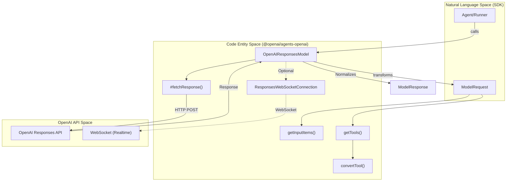
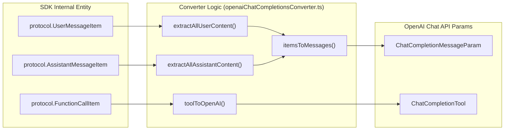

<!-- source: DeepWiki mcp.deepwiki.com · repo openai/openai-agents-js · page 3.2 @openai/agents-openai · fetched 2026-10-26 -->

# @openai/agents-openai

Relevant source files

The following files were used as context for generating this wiki page:

- [examples/memory/oai-compact.ts](examples/memory/oai-compact.ts)
- [packages/agents-core/src/model.ts](packages/agents-core/src/model.ts)
- [packages/agents-core/src/types/protocol.ts](packages/agents-core/src/types/protocol.ts)
- [packages/agents-core/test/sandboxToolRehydration.test.ts](packages/agents-core/test/sandboxToolRehydration.test.ts)
- [packages/agents-core/test/sandboxTools.test.ts](packages/agents-core/test/sandboxTools.test.ts)
- [packages/agents-extensions/src/ai-sdk-ui/uiMessageStream.ts](packages/agents-extensions/src/ai-sdk-ui/uiMessageStream.ts)
- [packages/agents-extensions/test/ai-sdk-ui/textStream.test.ts](packages/agents-extensions/test/ai-sdk-ui/textStream.test.ts)
- [packages/agents-extensions/test/ai-sdk-ui/uiMessageStream.test.ts](packages/agents-extensions/test/ai-sdk-ui/uiMessageStream.test.ts)
- [packages/agents-openai/src/index.ts](packages/agents-openai/src/index.ts)
- [packages/agents-openai/src/memory/openaiResponsesCompactionSession.ts](packages/agents-openai/src/memory/openaiResponsesCompactionSession.ts)
- [packages/agents-openai/src/openaiChatCompletionsConverter.ts](packages/agents-openai/src/openaiChatCompletionsConverter.ts)
- [packages/agents-openai/src/openaiChatCompletionsModel.ts](packages/agents-openai/src/openaiChatCompletionsModel.ts)
- [packages/agents-openai/src/openaiChatCompletionsStreaming.ts](packages/agents-openai/src/openaiChatCompletionsStreaming.ts)
- [packages/agents-openai/src/openaiProvider.ts](packages/agents-openai/src/openaiProvider.ts)
- [packages/agents-openai/src/openaiResponsesModel.ts](packages/agents-openai/src/openaiResponsesModel.ts)
- [packages/agents-openai/src/tools.ts](packages/agents-openai/src/tools.ts)
- [packages/agents-openai/src/types/providerData.ts](packages/agents-openai/src/types/providerData.ts)
- [packages/agents-openai/test/openaiChatCompletionsConverter.test.ts](packages/agents-openai/test/openaiChatCompletionsConverter.test.ts)
- [packages/agents-openai/test/openaiChatCompletionsModel.scenario.test.ts](packages/agents-openai/test/openaiChatCompletionsModel.scenario.test.ts)
- [packages/agents-openai/test/openaiChatCompletionsModel.test.ts](packages/agents-openai/test/openaiChatCompletionsModel.test.ts)
- [packages/agents-openai/test/openaiChatCompletionsStreaming.test.ts](packages/agents-openai/test/openaiChatCompletionsStreaming.test.ts)
- [packages/agents-openai/test/openaiResponsesCompactionSession.test.ts](packages/agents-openai/test/openaiResponsesCompactionSession.test.ts)
- [packages/agents-openai/test/openaiResponsesModel.helpers.test.ts](packages/agents-openai/test/openaiResponsesModel.helpers.test.ts)
- [packages/agents-openai/test/openaiResponsesModel.test.ts](packages/agents-openai/test/openaiResponsesModel.test.ts)
- [packages/agents-openai/test/tools.test.ts](packages/agents-openai/test/tools.test.ts)

The `@openai/agents-openai` package provides OpenAI-specific implementations of the core interfaces defined in `@openai/agents-core`. It translates the SDK's internal protocol into the formats required by OpenAI's APIs, specifically the **Responses API** and the **Chat Completions API**.

This package handles the complexity of hosted tools (Web Search, File Search, Code Interpreter), computer use, and stateful conversation management while providing a unified `Model` interface for the `Runner`.

Sources: [packages/agents-openai/src/index.ts:1-40](), [packages/agents-openai/src/openaiResponsesModel.ts:1-23]()

## OpenAIResponsesModel

The `OpenAIResponsesModel` is the primary implementation for the OpenAI Responses API. It supports advanced features like server-side context management, hosted tools, and the Model Context Protocol (MCP).

### Architecture and Data Flow

The model acts as a bridge between the `ModelRequest` (SDK protocol) and the `OpenAI.Responses.ResponseCreateParams` (API protocol).

Title: OpenAI Responses Model Data Flow

Sources: [packages/agents-openai/src/openaiResponsesModel.ts:915-941](), [packages/agents-openai/src/openaiResponsesModel.ts:1145-1215](), [packages/agents-openai/src/openaiResponsesModel.ts:133-171]()

### Key Functions and Classes

- **`OpenAIResponsesModel`**: Implements the `Model` interface. It manages request execution, usage tracking via the `Usage` class, and integrates with the SDK's tracing system using `withResponseSpan`. [packages/agents-openai/src/openaiResponsesModel.ts:825-831]()
- **`convertTool()`**: Converts SDK `SerializedTool` types into OpenAI API tool definitions. It handles specific mappings for `computer`, `shell`, `web_search`, and `file_search`, including snake_case conversion for API compatibility. [packages/agents-openai/test/openaiResponsesModel.helpers.test.ts:87-145]()
- **`getInputItems()`**: Translates SDK `AgentInputItem` types (text, images, files) into the `ResponseInputItem` array required by the Responses API. [packages/agents-openai/src/openaiResponsesModel.ts:430-584]()
- **`convertToOutputItem()`**: Recursively transforms API output items back into the SDK's `protocol.OutputModelItem` format, ensuring provider-specific data is preserved in `providerData`. [packages/agents-openai/src/openaiResponsesModel.ts:676-817]()

## Hosted Tools Integration

The package provides helper functions to configure OpenAI-hosted tools. These tools are executed on OpenAI's infrastructure.

| Tool | Helper Function | Key Options |
| :--- | :--- | :--- |
| **Web Search** | `webSearchTool()` | Configures the `web_search` tool for browsing the live web. [packages/agents-openai/src/tools.ts:127-148]() |
| **File Search** | `fileSearchTool()` | Enables vector-store based retrieval from uploaded documents. [packages/agents-openai/src/tools.ts:176-190]() |
| **Code Interpreter** | `codeInterpreterTool()` | Provides a sandboxed Python environment for computation and data analysis. [packages/agents-openai/src/tools.ts:71-91]() |
| **Tool Search** | `toolSearchTool()` | Allows the model to search a large tool library; supports client or server execution. [packages/agents-openai/src/tools.ts:204-233]() |

### Tool Search (Deferred Loading)
The `toolSearchTool` allows models to search for and dynamically load tools from large libraries (like MCP servers). If `execution` is set to `'client'`, the search results are replayed through the SDK's `Runner`. The implementation uses `toOpenAIToolSearchOutputToolPayload` to normalize the wire format.

Sources: [packages/agents-openai/src/openaiResponsesModel.ts:133-171](), [packages/agents-openai/src/tools.ts:192-202]()

## OpenAIChatCompletionsModel

The `OpenAIChatCompletionsModel` provides a `Model` implementation for the `/chat/completions` endpoint, supporting standard OpenAI models and compatible third-party providers.

### Protocol Translation Logic

The translation between the SDK protocol and Chat Completions messages is handled by `itemsToMessages`.

Title: Chat Completions Protocol Conversion

Sources: [packages/agents-openai/src/openaiChatCompletionsConverter.ts:84-116](), [packages/agents-openai/src/openaiChatCompletionsConverter.ts:118-216](), [packages/agents-openai/src/openaiChatCompletionsModel.ts:137-204]()

### Reasoning and Streaming
The model handles reasoning models (e.g., o1) by detecting `reasoning` fields. During streaming, `convertChatCompletionsStreamToResponses` aggregates chunks into a unified protocol event stream, capturing both content deltas and tool call fragments.

Sources: [packages/agents-openai/src/openaiChatCompletionsModel.ts:65-73](), [packages/agents-openai/src/openaiChatCompletionsStreaming.ts:21-38](), [packages/agents-openai/src/openaiChatCompletionsStreaming.ts:179-185]()

## API Integrations and Utilities

### Retries and Advice
OpenAI-specific retry logic is encapsulated in `getOpenAIRetryAdvice`. It inspects error objects to determine if a failure is transient (e.g., rate limits, server errors) and suggests `ModelRetryAdvice` to the `Runner`.

Sources: [packages/agents-openai/src/openaiResponsesModel.ts:26-26](), [packages/agents-openai/src/openaiChatCompletionsModel.ts:40-40]()

### WebSocket Transport
For the Responses API, `ResponsesWebSocketConnection` manages stateful WebSocket connections. This allows for low-latency interactions and supports features like `ResponsesWebSocketKeepAliveOptions` to maintain long-lived sessions.

Sources: [packages/agents-openai/src/responsesWebSocketConnection.ts:35-50](), [packages/agents-openai/src/openaiResponsesModel.ts:35-45]()

### Feature Validation
Both models support a `strictFeatureValidation` flag. When enabled, the models will throw a `UserError` if the request includes features not supported by the specific endpoint (e.g., server-managed conversation state in Chat Completions).

Sources: [packages/agents-openai/src/openaiChatCompletionsModel.ts:78-85](), [packages/agents-openai/src/openaiChatCompletionsModel.ts:211-230]()

### Context Compaction
The `OpenAIResponsesCompactionSession` provides a specialized session wrapper that triggers server-side compaction when history grows too large. It uses the `responses.compact` endpoint to compress conversation history while preserving essential context.

Sources: [packages/agents-openai/src/memory/openaiResponsesCompactionSession.ts:9-30](), [packages/agents-openai/test/openaiResponsesCompactionSession.test.ts:201-225]()

---

