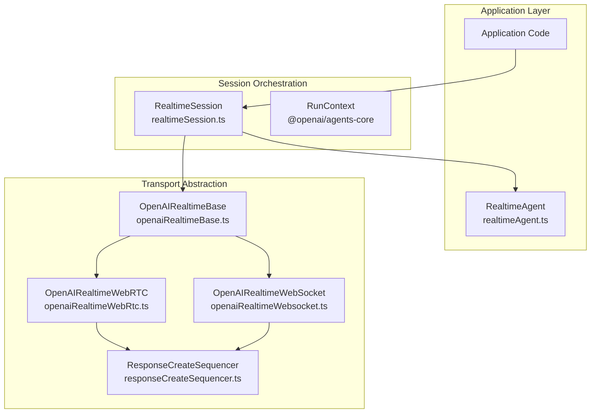
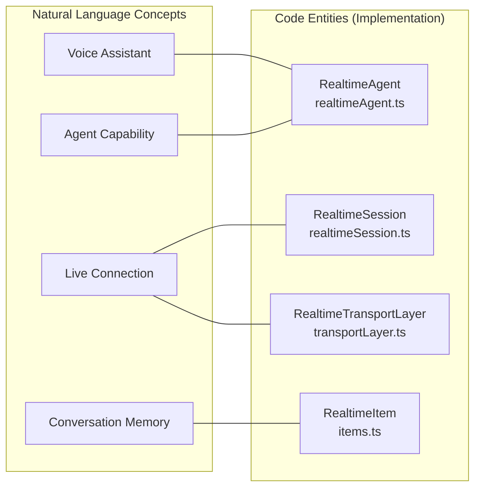
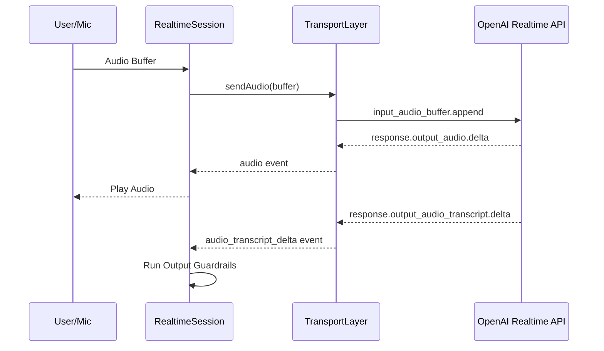

<!-- source: DeepWiki mcp.deepwiki.com · repo openai/openai-agents-js · page 3.3 @openai/agents-realtime · fetched 2026-10-26 -->

# @openai/agents-realtime

<details>
<summary>Relevant source files</summary>

The following files were used as context for generating this wiki page:

- [.changeset/realtime-text-output-guardrails.md](.changeset/realtime-text-output-guardrails.md)
- [docs/src/content/docs/guides/voice-agents/transport.mdx](docs/src/content/docs/guides/voice-agents/transport.mdx)
- [examples/realtime-twilio-sip/README.md](examples/realtime-twilio-sip/README.md)
- [examples/realtime-twilio-sip/agents.ts](examples/realtime-twilio-sip/agents.ts)
- [examples/realtime-twilio-sip/tsconfig.json](examples/realtime-twilio-sip/tsconfig.json)
- [examples/realtime-twilio-sip/types.d.ts](examples/realtime-twilio-sip/types.d.ts)
- [packages/agents-realtime/src/clientMessages.ts](packages/agents-realtime/src/clientMessages.ts)
- [packages/agents-realtime/src/index.ts](packages/agents-realtime/src/index.ts)
- [packages/agents-realtime/src/openaiRealtimeBase.ts](packages/agents-realtime/src/openaiRealtimeBase.ts)
- [packages/agents-realtime/src/openaiRealtimeEvents.ts](packages/agents-realtime/src/openaiRealtimeEvents.ts)
- [packages/agents-realtime/src/openaiRealtimeSip.ts](packages/agents-realtime/src/openaiRealtimeSip.ts)
- [packages/agents-realtime/src/openaiRealtimeWebRtc.ts](packages/agents-realtime/src/openaiRealtimeWebRtc.ts)
- [packages/agents-realtime/src/openaiRealtimeWebsocket.ts](packages/agents-realtime/src/openaiRealtimeWebsocket.ts)
- [packages/agents-realtime/src/realtimeSession.ts](packages/agents-realtime/src/realtimeSession.ts)
- [packages/agents-realtime/src/transportLayer.ts](packages/agents-realtime/src/transportLayer.ts)
- [packages/agents-realtime/src/transportLayerEvents.ts](packages/agents-realtime/src/transportLayerEvents.ts)
- [packages/agents-realtime/src/utils.ts](packages/agents-realtime/src/utils.ts)
- [packages/agents-realtime/test/openaiRealtimeBase.test.ts](packages/agents-realtime/test/openaiRealtimeBase.test.ts)
- [packages/agents-realtime/test/openaiRealtimeEvents.test.ts](packages/agents-realtime/test/openaiRealtimeEvents.test.ts)
- [packages/agents-realtime/test/openaiRealtimeSip.test.ts](packages/agents-realtime/test/openaiRealtimeSip.test.ts)
- [packages/agents-realtime/test/openaiRealtimeWebRtc.test.ts](packages/agents-realtime/test/openaiRealtimeWebRtc.test.ts)
- [packages/agents-realtime/test/openaiRealtimeWebsocket.test.ts](packages/agents-realtime/test/openaiRealtimeWebsocket.test.ts)
- [packages/agents-realtime/test/realtimeSession.test.ts](packages/agents-realtime/test/realtimeSession.test.ts)
- [packages/agents-realtime/test/realtimeVoiceConfigRegression.test.ts](packages/agents-realtime/test/realtimeVoiceConfigRegression.test.ts)
- [packages/agents-realtime/test/stubs.ts](packages/agents-realtime/test/stubs.ts)
- [packages/agents-realtime/test/utils.test.ts](packages/agents-realtime/test/utils.test.ts)

</details>


The `@openai/agents-realtime` package provides the infrastructure for building low-latency voice and multimodal agents. It facilitates persistent connections with OpenAI's Realtime API, abstracting complex tasks like audio streaming, Voice Activity Detection (VAD) management, session state synchronization, and tool execution during live conversations.

## Architecture Overview

The package follows a layered architecture that decouples the agent's logic from the specific transport mechanism (WebRTC, WebSocket, or SIP).



### Natural Language to Code Entity Mapping
This diagram bridges the conceptual "Voice Agent" space to the specific classes and files in the codebase.



Sources: [packages/agents-realtime/src/realtimeSession.ts:220-234](), [packages/agents-realtime/src/openaiRealtimeBase.ts:150-153](), [packages/agents-realtime/src/realtimeAgent.ts:12-15](), [packages/agents-realtime/src/transportLayer.ts:53-53]()

---

## Core Components

### RealtimeSession
The `RealtimeSession` is the primary entry point for voice applications. It manages the lifecycle of the connection and orchestrates the interaction between the `RealtimeAgent` and the `RealtimeTransportLayer`.

**Key Responsibilities:**
- **Connection Management:** Handles `connect()`, `close()`, and automatic status tracking [packages/agents-realtime/src/realtimeSession.ts:266-319]().
- **History Management:** Maintains a local copy of the conversation history in `RealtimeItem` format and synchronizes it with the server [packages/agents-realtime/src/realtimeSession.ts:602-649]().
- **Tool Execution:** Listens for `function_call` events from the transport, executes the corresponding tool in the agent, and sends the output back [packages/agents-realtime/src/realtimeSession.ts:421-516]().
- **Guardrails:** Runs output guardrails on streaming transcripts as they arrive via `runToolOutputGuardrails` [packages/agents-realtime/src/realtimeSession.ts:74-76]().

### RealtimeAgent
`RealtimeAgent` extends the core `Agent` class. It adds voice-specific configuration such as the `voice` property (e.g., "alloy", "shimmer") and provides a mechanism to filter tools specifically for the realtime environment [packages/agents-realtime/src/realtimeAgent.ts:12-50]().

### Transport Layers
The SDK provides several implementations of the `RealtimeTransportLayer` interface:

| Transport Class | Environment | Mechanism | Use Case |
| :--- | :--- | :--- | :--- |
| `OpenAIRealtimeWebRTC` | Browser | WebRTC Data/Media Channels | Low-latency browser apps with native mic access [packages/agents-realtime/src/openaiRealtimeWebRtc.ts:88-91](). |
| `OpenAIRealtimeWebSocket` | Node.js / Server | WebSockets | Server-side agents or environments without WebRTC [packages/agents-realtime/src/openaiRealtimeWebsocket.ts:83-85](). |
| `OpenAIRealtimeSIP` | Server | SIP/WebSocket | Integration with VoIP and telephony providers [packages/agents-realtime/src/openaiRealtimeSip.ts:18-21](). |

Sources: [packages/agents-realtime/src/transportLayer.ts:34-36](), [docs/src/content/docs/guides/voice-agents/transport.mdx:16-23]()

---

## Data Flow and Event System

The realtime system relies on a complex event-driven architecture to handle the asynchronous nature of voice.

### Audio and Transcript Flow
As the user speaks, audio is buffered and sent to the API. As the model responds, audio and text deltas flow back.



Sources: [packages/agents-realtime/src/openaiRealtimeBase.ts:276-291](), [packages/agents-realtime/src/realtimeSession.ts:651-684](), [packages/agents-realtime/src/transportLayerEvents.ts:35-39]()

### Event Normalization
`OpenAIRealtimeBase` acts as a translation layer, converting raw API events into normalized SDK events:
- `response.created` → `turn_started` [packages/agents-realtime/src/openaiRealtimeBase.ts:240-248]()
- `response.done` → `turn_done` (includes `Usage` calculations) [packages/agents-realtime/src/openaiRealtimeBase.ts:254-269]()
- `session.updated` → Internal state update of `#rawSessionConfig` [packages/agents-realtime/src/openaiRealtimeBase.ts:250-252]()

---

## Implementation Details

### Session Configuration
The SDK supports the latest OpenAI Realtime API configuration schema, including granular audio settings and reasoning effort.

```typescript
// Default configuration used if not provided
export const DEFAULT_OPENAI_REALTIME_SESSION_CONFIG: Partial<RealtimeSessionConfigDefinition> = {
  outputModalities: ['audio'],
  audio: {
    input: {
      format: { type: 'audio/pcm', rate: 24000 },
      transcription: { model: 'gpt-4o-mini-transcribe' },
      turnDetection: { type: 'semantic_vad' },
      noiseReduction: null,
    },
    output: {
      format: { type: 'audio/pcm', rate: 24000 },
      speed: 1,
    },
  },
};
```
Sources: [packages/agents-realtime/src/openaiRealtimeBase.ts:75-90](), [packages/agents-realtime/src/clientMessages.ts:125-134]()

### Interruption Handling
Interruptions are critical for voice agents. When the model detects user speech (`speech_started`) or a guardrail trips, `interrupt()` is called.
1. **Transport Level:** Sends `response.cancel` and `output_audio_buffer.clear` to the API [packages/agents-realtime/src/openaiRealtimeWebRtc.ts:400-410]().
2. **Session Level:** Truncates the conversation history via `conversation.item.truncate` to ensure the model's context matches what the user actually heard [packages/agents-realtime/src/openaiRealtimeWebsocket.ts:327-342]().

### Response Sequencing
The `ResponseCreateSequencer` ensures that `response.create` requests are not sent while a previous response is still being cancelled or processed, preventing race conditions in the model's state. It manages a queue of pending response requests and triggers them only when the transport reaches a stable state [packages/agents-realtime/src/openaiRealtimeWebRtc.ts:105-108](), [packages/agents-realtime/src/openaiRealtimeWebsocket.ts:108-111]().

---

## Tooling and MCP Integration

Realtime sessions support standard `FunctionTool` objects and **Model Context Protocol (MCP)** tools.

- **MCP Discovery:** The session can list tools from remote MCP servers using the `mcp_tools_listed` event [packages/agents-realtime/src/transportLayerEvents.ts:174-179]().
- **Approvals:** If a tool (Function or MCP) requires approval, the session emits an `mcp_approval_request`. The user can then call `session.approve()` to resume execution [packages/agents-realtime/src/realtimeSession.ts:377-404]().
- **Background Execution:** Tools can be marked for background execution using `backgroundResult`, allowing the agent to continue speaking while the tool processes [packages/agents-realtime/src/tool.ts:32-32]().

Sources: [packages/agents-realtime/src/realtimeSession.ts:421-516](), [packages/agents-realtime/src/transportLayerEvents.ts:168-173](), [packages/agents-realtime/src/openaiRealtimeBase.ts:223-238]()

---

