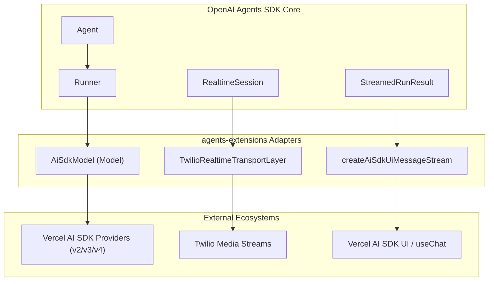
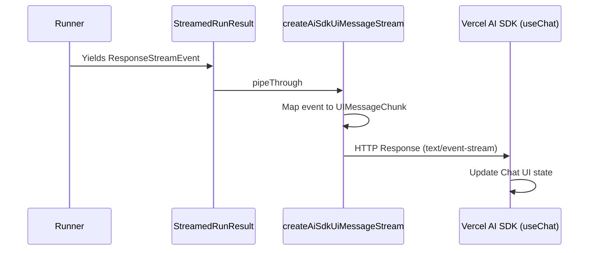
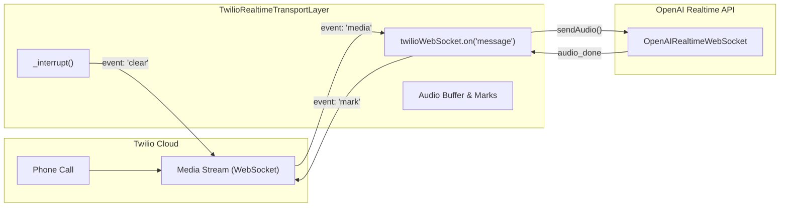

<!-- source: DeepWiki mcp.deepwiki.com · repo openai/openai-agents-js · page 3.4 @openai/agents-extensions · fetched 2026-10-26 -->

# @openai/agents-extensions

Relevant source files

The following files were used as context for generating this wiki page:

- [docs/src/content/docs/ja/extensions/ai-sdk.mdx](docs/src/content/docs/ja/extensions/ai-sdk.mdx)
- [docs/src/content/docs/ko/extensions/ai-sdk.mdx](docs/src/content/docs/ko/extensions/ai-sdk.mdx)
- [docs/src/content/docs/zh/extensions/ai-sdk.mdx](docs/src/content/docs/zh/extensions/ai-sdk.mdx)
- [examples/docs/extensions/twilio-basic.ts](examples/docs/extensions/twilio-basic.ts)
- [packages/agents-core/src/runner/toolSearch.ts](packages/agents-core/src/runner/toolSearch.ts)
- [packages/agents-core/src/tool.ts](packages/agents-core/src/tool.ts)
- [packages/agents-core/src/utils/serialize.ts](packages/agents-core/src/utils/serialize.ts)
- [packages/agents-core/test/tool.test.ts](packages/agents-core/test/tool.test.ts)
- [packages/agents-core/test/utils/serialize.test.ts](packages/agents-core/test/utils/serialize.test.ts)
- [packages/agents-extensions/src/TwilioRealtimeTransport.ts](packages/agents-extensions/src/TwilioRealtimeTransport.ts)
- [packages/agents-extensions/src/ai-sdk-ui/uiMessageStream.ts](packages/agents-extensions/src/ai-sdk-ui/uiMessageStream.ts)
- [packages/agents-extensions/src/ai-sdk/index.ts](packages/agents-extensions/src/ai-sdk/index.ts)
- [packages/agents-extensions/test/TwilioRealtimeTransport.test.ts](packages/agents-extensions/test/TwilioRealtimeTransport.test.ts)
- [packages/agents-extensions/test/ai-sdk-ui/textStream.test.ts](packages/agents-extensions/test/ai-sdk-ui/textStream.test.ts)
- [packages/agents-extensions/test/ai-sdk-ui/uiMessageStream.test.ts](packages/agents-extensions/test/ai-sdk-ui/uiMessageStream.test.ts)
- [packages/agents-extensions/test/ai-sdk/GoogleFormat.test.ts](packages/agents-extensions/test/ai-sdk/GoogleFormat.test.ts)
- [packages/agents-extensions/test/ai-sdk/index.test.ts](packages/agents-extensions/test/ai-sdk/index.test.ts)
- [packages/agents-extensions/test/index.test.ts](packages/agents-extensions/test/index.test.ts)
- [packages/agents-openai/src/openaiChatCompletionsStreaming.ts](packages/agents-openai/src/openaiChatCompletionsStreaming.ts)
- [packages/agents-openai/test/openaiChatCompletionsModel.scenario.test.ts](packages/agents-openai/test/openaiChatCompletionsModel.scenario.test.ts)
- [packages/agents-openai/test/openaiChatCompletionsStreaming.test.ts](packages/agents-openai/test/openaiChatCompletionsStreaming.test.ts)
- [packages/agents-realtime/src/shims/shims-browser.ts](packages/agents-realtime/src/shims/shims-browser.ts)
- [packages/agents-realtime/src/shims/shims-node.ts](packages/agents-realtime/src/shims/shims-node.ts)
- [packages/agents-realtime/src/shims/shims-workerd.ts](packages/agents-realtime/src/shims/shims-workerd.ts)

The `@openai/agents-extensions` package provides integrations between the OpenAI Agents SDK and third-party ecosystems, including voice platforms, alternative AI model providers, and UI streaming utilities. It serves as an adapter layer that translates between external protocols and the SDK's internal `Model`, `TransportLayer`, and `protocol.StreamEvent` interfaces.

## Package Overview

The package is organized into several key functional areas:
1.  **AI SDK Adapter**: A bridge to the [Vercel AI SDK](https://sdk.vercel.ai/), allowing any compatible model (Anthropic, Google, etc.) to power an OpenAI Agent.
2.  **AI SDK UI Streaming**: Helpers to convert Agents SDK streams into formats compatible with the Vercel AI SDK UI components.
3.  **Twilio Integration**: A specialized transport layer for connecting Twilio Media Streams to Realtime Voice Agents.

### Extension Architecture

Sources: [packages/agents-extensions/src/ai-sdk/index.ts:14-34](), [packages/agents-extensions/src/TwilioRealtimeTransport.ts:1-14](), [packages/agents-extensions/src/ai-sdk-ui/uiMessageStream.ts:1-15]()

---

## AI SDK Model Adapter

The `AiSdkModel` class implements the `Model` interface, delegating inference to an AI SDK `LanguageModelV2` or compatible instance (v3/v4).

### Protocol Translation
The adapter performs deep translation between the SDK's `ModelItem` protocol and the AI SDK's `LanguageModelV2Message` format.

| Component | Function | Description |
| :--- | :--- | :--- |
| **Messages** | `itemsToLanguageV2Messages` | Converts `user`, `assistant`, and `system` items. Handles multi-modal content like `input_image` by parsing Base64 data URLs. [packages/agents-extensions/src/ai-sdk/index.ts:193-243]() |
| **Tools** | `toolToLanguageV2Tool` | Maps SDK `function` tools to `LanguageModelV2FunctionTool` and `hosted_tool` to `provider-defined` tools. [packages/agents-extensions/src/ai-sdk/index.ts:1143-1185]() |
| **Output** | `getResponseFormat` | Translates SDK `SerializedOutputType` (text or JSON schema) to AI SDK `LanguageModelV2ResponseFormat`. [packages/agents-extensions/src/ai-sdk/index.ts:1210-1233]() |

### Tool Search and Hosted Tools
The extension provides `aiSdkToolSearchTool` to adapt AI SDK provider-defined tool search (server-side execution) for use within an Agent. It requires a provider tool definition with a valid `id`. [packages/agents-extensions/src/ai-sdk/index.ts:106-141]()

### Implementation Details
The `AiSdkModel` supports both `getResponse` and `getStreamedResponse`. In streaming mode, it processes `text-delta`, `tool-call`, and `response-metadata` events from the AI SDK stream, reconstructing them into the SDK's `ResponseStreamEvent` protocol. [packages/agents-extensions/src/ai-sdk/index.ts:931-1123]()

Sources: [packages/agents-extensions/src/ai-sdk/index.ts:46-105](), [packages/agents-extensions/src/ai-sdk/index.ts:156-183](), [packages/agents-extensions/src/ai-sdk/index.ts:1143-1185]()

---

## AI SDK UI Integration

The `@openai/agents-extensions/ai-sdk-ui` module provides utilities to bridge the Agents SDK's internal streaming protocol to the Vercel AI SDK UI layer.

### Key Streaming Helpers
- **`createAiSdkUiMessageStream(source)`**: Converts a `StreamedRunResult` into a `ReadableStream<UIMessageChunk>`. This handles the mapping of `output_text_delta` and `tool_call` events into UI-compatible chunks. [packages/agents-extensions/src/ai-sdk-ui/uiMessageStream.ts:100-110]()
- **`createAiSdkUiMessageStreamResponse(source, options)`**: A high-level helper that returns a standard Web `Response` object with the correct headers for streaming to a frontend `useChat` hook. [packages/agents-extensions/src/ai-sdk-ui/uiMessageStream.ts:160-180]()
- **`createAiSdkTextStreamResponse(source, options)`**: Specifically for plain text streaming, bypassing structured UI message chunks. [packages/agents-extensions/src/ai-sdk-ui/uiMessageStream.ts:185-205]()

### Data Flow: SDK to UI

Sources: [packages/agents-extensions/src/ai-sdk-ui/uiMessageStream.ts:15-50](), [docs/src/content/docs/ja/extensions/ai-sdk.mdx:117-130]()

---

## Twilio Realtime Integration

The `TwilioRealtimeTransportLayer` extends `OpenAIRealtimeWebSocket` to provide a turn-key solution for voice agents over telephony.

### Key Features
- **Audio Transcoding**: Automatically defaults to `g711_ulaw` (8kHz) for both input and output to match Twilio's telephony standards. [packages/agents-extensions/src/TwilioRealtimeTransport.ts:69-78]()
- **Interruption Handling**: Uses Twilio's `mark` events to track exactly how much audio the user heard before an interruption occurred. This is used to truncate the conversation item in the Realtime API. [packages/agents-extensions/src/TwilioRealtimeTransport.ts:133-151]()
- **Stream Synchronization**: Sends Twilio `clear` events to the `streamSid` to flush the telephony buffer when the model detects a user barge-in. [packages/agents-extensions/src/TwilioRealtimeTransport.ts:206-218]()

### Twilio Data Flow

Sources: [packages/agents-extensions/src/TwilioRealtimeTransport.ts:56-67](), [packages/agents-extensions/src/TwilioRealtimeTransport.ts:127-157](), [packages/agents-extensions/test/TwilioRealtimeTransport.test.ts:122-168]()

---

