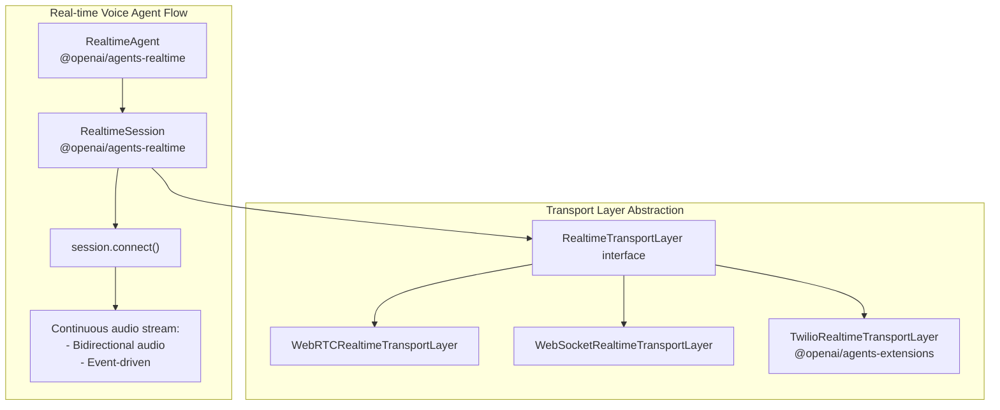
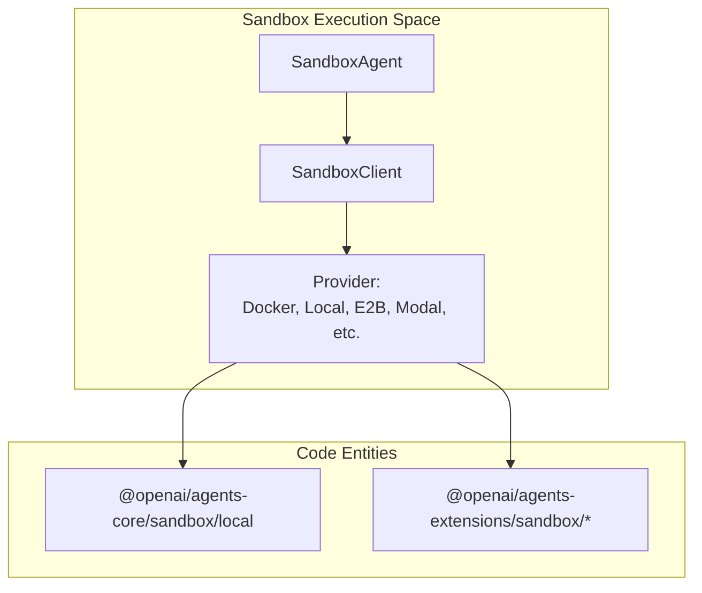

<!-- source: DeepWiki mcp.deepwiki.com · repo openai/openai-agents-js · page 4 Key Features · fetched 2026-10-26 -->

# Key Features

Relevant source files

The following files were used as context for generating this wiki page:

- [packages/agents-core/CHANGELOG.md](packages/agents-core/CHANGELOG.md)
- [packages/agents-core/package.json](packages/agents-core/package.json)
- [packages/agents-extensions/CHANGELOG.md](packages/agents-extensions/CHANGELOG.md)
- [packages/agents-extensions/package.json](packages/agents-extensions/package.json)
- [packages/agents-extensions/src/metadata.ts](packages/agents-extensions/src/metadata.ts)
- [packages/agents-openai/CHANGELOG.md](packages/agents-openai/CHANGELOG.md)
- [packages/agents-openai/package.json](packages/agents-openai/package.json)
- [packages/agents-realtime/CHANGELOG.md](packages/agents-realtime/CHANGELOG.md)
- [packages/agents-realtime/package.json](packages/agents-realtime/package.json)
- [packages/agents/CHANGELOG.md](packages/agents/CHANGELOG.md)
- [packages/agents/package.json](packages/agents/package.json)

This page provides an overview of the major capabilities that differentiate the OpenAI Agents SDK. Each feature is implemented as a distinct subsystem with specific code entities and integration points. For detailed implementation guides, see the subsections: [Tools System](#4.1), [Model Context Protocol (MCP)](#4.2), [Real-time Voice Agents](#4.3), [Multi-Agent Workflows](#4.4), [Guardrails and Safety](#4.5), [Tracing and Observability](#4.6), and [Sandbox Agents](#4.7).

The SDK is designed around a small set of primitives that compose to enable complex agentic workflows without requiring a steep learning curve. This page maps each feature to its core code entities and demonstrates how they integrate with the `Agent` and `Runner` classes.

**Sources:** [packages/agents-core/package.json:6-6](), [packages/agents/package.json:6-6]()

## Feature Architecture Overview

The SDK organizes its key features into seven major capability areas, each implemented through specific packages and code entities:

```mermaid
graph TB
    subgraph "Core Agent System"
        Agent["Agent class<br/>@openai/agents-core"]
        Runner["Runner class<br/>@openai/agents-core"]
        run["run() function<br/>@openai/agents"]
    end
    
    subgraph "Tools System (#4.1)"
        tool["tool() helper"]
        SerializedTool["SerializedTool interface"]
        HostedTools["Hosted tools<br/>web_search, file_search, etc."]
        MCPServerInterface["MCPServer interface"]
        agentAsTool["Agent.asTool() method"]
    end
    
    subgraph "Real-time Voice (#4.3)"
        RealtimeAgent["RealtimeAgent class<br/>@openai/agents-realtime"]
        RealtimeSession["RealtimeSession class"]
        TransportLayer["RealtimeTransportLayer"]
        WebRTCTransport["WebRTCRealtimeTransportLayer"]
        WebSocketTransport["WebSocketRealtimeTransportLayer"]
    end
    
    subgraph "Multi-Agent Workflows (#4.4)"
        handoffs["handoffs: Agent[]"]
        handoffDescription["handoffDescription: string"]
        AgentCreate["Agent.create() static method"]
        HandoffCallItem["RunHandoffCallItem"]
    end
    
    subgraph "Guardrails (#4.5)"
        InputGuardrail["InputGuardrail interface"]
        OutputGuardrail["OutputGuardrail interface"]
        runInParallel["runInParallel: boolean"]
        tripwireTriggered["tripwireTriggered: boolean"]
        GuardrailTripwire["GuardrailTripwireTriggered error"]
    end
    
    subgraph "Tracing (#4.6)"
        TraceProvider["TraceProvider class"]
        withTrace["withTrace() function"]
        Span["Span types:<br/>AgentSpan, GenerationSpan,<br/>FunctionSpan, etc."]
        OpenAITracingExporter["OpenAITracingExporter"]
    end

    subgraph "Sandbox Agents (#4.7)"
        SandboxAgent["SandboxAgent class"]
        SandboxClient["SandboxClient interface"]
        Manifest["Workspace Manifest"]
        Capabilities["Filesystem, Shell, Skills"]
    end
    
    Agent --> tool
    Agent --> HostedTools
    Agent --> MCPServerInterface
    Agent --> handoffs
    Agent --> InputGuardrail
    Agent --> OutputGuardrail
    
    Runner --> Agent
    run --> Runner
    
    Runner --> TraceProvider
    Runner --> GuardrailTripwire
    Runner --> HandoffCallItem
    
    RealtimeSession --> RealtimeAgent
    RealtimeSession --> TransportLayer
    
    TraceProvider --> Span
    TraceProvider --> OpenAITracingExporter

    SandboxAgent --> SandboxClient
    SandboxAgent --> Manifest
```

**Sources:** [packages/agents/package.json:44-48](), [packages/agents-core/CHANGELOG.md:21-26](), [packages/agents-realtime/package.json:6-6]()

## Feature Integration Matrix

The following table maps each key feature to its primary code entities and package locations:

| Feature | Primary Classes | Package Location | Integration Point |
|---------|----------------|------------------|-------------------|
| **Tools System** | `tool()`, `MCPServer` | `@openai/agents-core` | `Agent.tools: Tool[]` |
| **Real-time Voice** | `RealtimeAgent`, `RealtimeSession` | `@openai/agents-realtime` | `RealtimeSessionConfig` |
| **Multi-Agent Workflows** | `Agent`, `Runner` | `@openai/agents-core` | `Agent.handoffs: Agent[]` |
| **Guardrails** | `InputGuardrail`, `OutputGuardrail` | `@openai/agents-core` | `Agent.inputGuardrails` |
| **Tracing** | `TraceProvider`, `withTrace()` | `@openai/agents-core` | `RunConfig.tracingDisabled` |
| **Sandbox Agents** | `SandboxAgent`, `SandboxClient` | `@openai/agents-core/sandbox` | `Agent.create()` |
| **MCP Integration** | `MCPServer`, `getAllMcpTools()` | `@openai/agents-core` | `tools: [mcpServer.asTool()]` |

**Sources:** [packages/agents-core/package.json:37-51](), [packages/agents-realtime/package.json:2-6](), [packages/agents-extensions/package.json:37-71]()

## Tools System Architecture

The Tools System provides four distinct integration patterns, all unified under the `Tool` type interface. The `tool()` helper function facilitates the creation of function tools with automatic JSON schema generation from Zod schemas. Recent updates include **Programmatic Tool Calling** with runtime-validated Zod outputs and caller-aware replay. [packages/agents-core/CHANGELOG.md:32-32]()

- **Function Tools**: Local JavaScript functions validated with Zod.
- **Hosted Tools**: OpenAI server-side tools like `web_search`, `file_search`, and `code_interpreter`. [packages/agents-openai/package.json:16-20]()
- **MCP Tools**: Tools exposed by external servers via the Model Context Protocol (stdio, HTTP, SSE). [packages/agents-core/package.json:116-117]()
- **Agents-as-Tools**: Sub-agents wrapped as tools using `agent.asTool()`.

For details, see [Tools System](#4.1).

**Sources:** [packages/agents-core/CHANGELOG.md:32-32](), [packages/agents-openai/package.json:16-20](), [packages/agents-core/package.json:116-117]()

## Real-time Voice Agent System

Real-time voice agents use a fundamentally different execution model from standard text agents, operating through continuous audio streams rather than discrete turn-based loops. This is managed via `RealtimeSession` and `RealtimeAgent`. The system now defaults to `gpt-realtime-2.1`. [packages/agents-realtime/CHANGELOG.md:101-101]()

For details, see [Real-time Voice Agents](#4.3).

**Sources:** [packages/agents-realtime/package.json:6-10](), [packages/agents-realtime/CHANGELOG.md:80-82](), [packages/agents-extensions/package.json:18-18]()

## Multi-Agent Workflow Patterns

Multi-agent workflows are implemented through two complementary mechanisms: handoffs for delegation and agents-as-tools for hierarchical composition. The `Runner` handles switching between agents and maintaining conversation context during handoffs. The SDK provides `Agent.create()` for type-safe agent instantiation. [packages/agents-core/CHANGELOG.md:19-19]()

- **Triage Pattern**: A central agent directs the user to specialized sub-agents.
- **Manager Pattern**: An agent uses other agents as tools to accomplish complex tasks.

For details, see [Multi-Agent Workflows](#4.4).

**Sources:** [packages/agents-core/CHANGELOG.md:19-19](), [packages/agents-core/CHANGELOG.md:59-59](), [packages/agents-core/CHANGELOG.md:129-129]()

## Guardrails and Safety System

Guardrails provide validation and safety checks that run in parallel with or before agent execution. If a guardrail triggers its "tripwire", execution is halted with a `GuardrailTripwireTriggered` error. The system supports opt-in pre-approval tool input guardrails. [packages/agents-core/CHANGELOG.md:108-108]()

- **Input Guardrails**: Validate user prompts before they reach the model.
- **Output Guardrails**: Validate model responses before they are returned to the user.
- **Parallel Execution**: Minimize latency by running checks alongside the LLM call.

For details, see [Guardrails and Safety](#4.5).

**Sources:** [packages/agents-core/CHANGELOG.md:108-108](), [packages/agents-core/CHANGELOG.md:158-158](), [packages/agents-core/CHANGELOG.md:211-213]()

## Tracing and Observability System

Built-in tracing captures comprehensive execution data, including LLM generations, tool calls, and handoffs. The SDK includes an `OpenAITracingExporter` to send traces to the OpenAI Dashboard. Tracing is now enabled by default for tasks and turns with a per-run opt-out. [packages/agents-core/CHANGELOG.md:25-25]()

- **TraceProvider**: Manages the lifecycle of spans and traces. [packages/agents-core/CHANGELOG.md:128-128]()
- **Automatic Instrumentation**: The `Runner` automatically instruments all internal steps.
- **Sensitive Data Redaction**: Sensitive model and tool data logging is disabled by default with a programmatic opt-in. [packages/agents-core/CHANGELOG.md:26-26]()

For details, see [Tracing and Observability](#4.6).

**Sources:** [packages/agents-core/CHANGELOG.md:25-26](), [packages/agents-core/CHANGELOG.md:128-128](), [packages/agents-openai/CHANGELOG.md:31-31]()

## Sandbox Agents (Beta)

Sandbox Agents allow agents to operate within secure, isolated environments with persistent filesystems and shell access. This feature supports multiple providers (Docker, E2B, Modal, Blaxel, etc.) via the `@openai/agents-extensions` package. [packages/agents-extensions/package.json:37-71]()

For details, see [Sandbox Agents](#4.7).

**Sources:** [packages/agents-core/CHANGELOG.md:16-18](), [packages/agents-extensions/package.json:37-71](), [packages/agents/package.json:16-25]()

## Package Distribution

The SDK features are distributed across specialized packages:

| Package | Purpose |
|---------|---------|
| `@openai/agents-core` | Foundational abstractions and core logic. |
| `@openai/agents-openai` | OpenAI-specific model implementations and hosted tools. |
| `@openai/agents-realtime` | Real-time voice and streaming capabilities. |
| `@openai/agents-extensions` | Third-party adapters and sandbox providers. |
| `@openai/agents` | Aggregator package for most common use cases. |

**Sources:** [packages/agents/package.json:44-48](), [packages/agents-extensions/package.json:5-6](), [packages/agents-realtime/package.json:5-6]()

---

