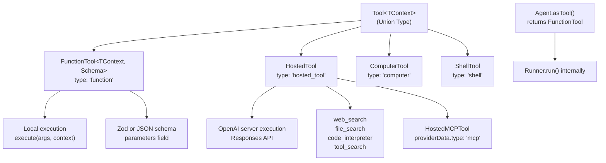
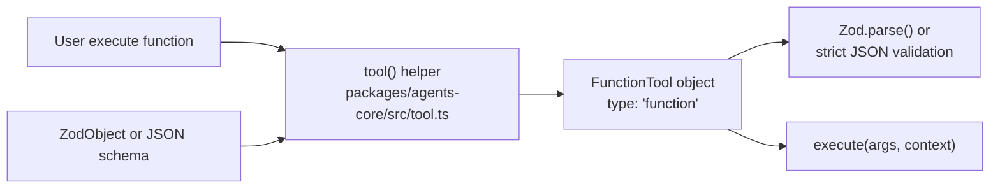
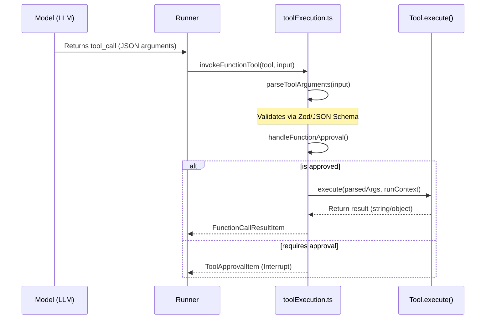

<!-- source: DeepWiki mcp.deepwiki.com · repo openai/openai-agents-js · page 4.1 Tools System · fetched 2026-10-26 -->

# Tools System

Relevant source files

The following files were used as context for generating this wiki page:

- [.changeset/strict-typeless-objects.md](.changeset/strict-typeless-objects.md)
- [packages/agents-core/src/runner/toolSearch.ts](packages/agents-core/src/runner/toolSearch.ts)
- [packages/agents-core/src/tool.ts](packages/agents-core/src/tool.ts)
- [packages/agents-core/src/types/helpers.ts](packages/agents-core/src/types/helpers.ts)
- [packages/agents-core/src/utils/serialize.ts](packages/agents-core/src/utils/serialize.ts)
- [packages/agents-core/src/utils/strictToolSchema.ts](packages/agents-core/src/utils/strictToolSchema.ts)
- [packages/agents-core/src/utils/tools.ts](packages/agents-core/src/utils/tools.ts)
- [packages/agents-core/src/utils/typeGuards.ts](packages/agents-core/src/utils/typeGuards.ts)
- [packages/agents-core/src/utils/zodJsonSchemaCompat.ts](packages/agents-core/src/utils/zodJsonSchemaCompat.ts)
- [packages/agents-core/test/runner/toolOutputNormalization.test.ts](packages/agents-core/test/runner/toolOutputNormalization.test.ts)
- [packages/agents-core/test/tool.test.ts](packages/agents-core/test/tool.test.ts)
- [packages/agents-core/test/utils/serialize.test.ts](packages/agents-core/test/utils/serialize.test.ts)
- [packages/agents-core/test/utils/strictToolSchema.test.ts](packages/agents-core/test/utils/strictToolSchema.test.ts)
- [packages/agents-core/test/utils/tools.test.ts](packages/agents-core/test/utils/tools.test.ts)
- [packages/agents-core/test/utils/zodJsonSchemaCompat.test.ts](packages/agents-core/test/utils/zodJsonSchemaCompat.test.ts)
- [packages/agents-extensions/src/ai-sdk/index.ts](packages/agents-extensions/src/ai-sdk/index.ts)
- [packages/agents-extensions/test/ai-sdk/GoogleFormat.test.ts](packages/agents-extensions/test/ai-sdk/GoogleFormat.test.ts)
- [packages/agents-extensions/test/ai-sdk/index.test.ts](packages/agents-extensions/test/ai-sdk/index.test.ts)
- [packages/agents-openai/src/tools.ts](packages/agents-openai/src/tools.ts)
- [packages/agents-openai/src/types/providerData.ts](packages/agents-openai/src/types/providerData.ts)
- [packages/agents-openai/test/openaiResponsesModel.helpers.test.ts](packages/agents-openai/test/openaiResponsesModel.helpers.test.ts)
- [packages/agents-openai/test/tools.test.ts](packages/agents-openai/test/tools.test.ts)

## Purpose and Scope

The Tools System provides agents with executable capabilities beyond text generation. It supports multiple tool categories including local function tools, hosted OpenAI tools, Model Context Protocol (MCP) tools, and hierarchical "agents-as-tools". The system handles schema validation via Zod, execution lifecycle management, and human-in-the-loop approval workflows.

---

## Tool Categories and Type Hierarchy

The SDK defines a unified `Tool<TContext>` type. Each category has distinct characteristics for definition, execution location, and serialization.

### Tool Category Architecture

**Sources:** [packages/agents-core/src/tool.ts:222-300](), [packages/agents-core/src/model.ts:23-40]()

---

## Function Tools: `tool()` Helper

Function tools wrap JavaScript/TypeScript functions with schema validation. The `tool()` helper constructs a `FunctionTool` object which is then serialized for the model.

### Tool Definition Mapping

**Key properties:**
- **`parameters`**: Supports Zod objects or raw `JsonObjectSchema`. Zod schemas are automatically converted to JSON Schema [packages/agents-core/src/tool.ts:239-242]().
- **`strict`**: Defaults to `true` when using Zod. Controls whether the model must adhere strictly to the schema [packages/agents-core/src/tool.ts:243-243]().
- **`needsApproval`**: Can be a `boolean` or a `ToolApprovalFunction` for dynamic runtime checks [packages/agents-core/src/tool.ts:76-80](), [packages/agents-core/src/tool.ts:258-262]().
- **`allowedCallers`**: Restricts tool usage to specific execution contexts like `programmatic` [packages/agents-core/src/tool.ts:289-289]().

**Sources:** [packages/agents-core/src/tool.ts:222-300](), [packages/agents-core/src/utils/tools.ts:13-18]()

### Zod Schema Validation and Compatibility

The SDK uses `zodJsonSchemaCompat` to transform Zod definitions into JSON Schema. This includes handling optional properties, unions, and intersections to ensure the LLM receives valid OpenAPI-style tool definitions.

| Zod Feature | JSON Schema Mapping | File Reference |
| :--- | :--- | :--- |
| `z.string().optional()` | Omitted from `required` array | [packages/agents-core/src/utils/zodJsonSchemaCompat.ts:210-212]() |
| `z.union([...])` | `anyOf` | [packages/agents-core/src/utils/zodJsonSchemaCompat.ts:314-316]() |
| `z.enum([...])` | `type: 'string', enum: [...]` | [packages/agents-core/src/utils/zodJsonSchemaCompat.ts:344-347]() |

**Sources:** [packages/agents-core/src/utils/zodJsonSchemaCompat.ts:72-96](), [packages/agents-core/src/utils/zodJsonSchemaCompat.ts:185-226]()

---

## Tool Execution Flow

The execution flow bridges the gap between the model's generated tool calls and the local JavaScript environment.

### Natural Language to Code Entity Space

**Sources:** [packages/agents-core/src/runner/toolExecution.ts:188-240](), [packages/agents-core/src/tool.ts:6-12]()

---

## Hosted Tools: OpenAI Server-Side Execution

Hosted tools execute on OpenAI's infrastructure. These are configured using helper functions that return `HostedTool` definitions with `providerData`.

| Helper | Type | Provider Data Details |
| :--- | :--- | :--- |
| `webSearchTool()` | `hosted_tool` | `user_location`, `search_context_size` |
| `fileSearchTool()` | `hosted_tool` | `vector_store_ids`, `max_num_results` |
| `codeInterpreterTool()` | `hosted_tool` | `container` (auto/reference), `include_outputs` |
| `toolSearchTool()` | `hosted_tool` | `execution` (server/client) |

**Sources:** [packages/agents-openai/src/tools.ts:73-93](), [packages/agents-openai/src/tools.ts:129-150](), [packages/agents-openai/src/tools.ts:187-206]()

### Tool Search (Deferred Loading)
`tool_search` allows agents to search for and load tools dynamically. If `execution: 'client'` is specified, the SDK handles the search locally against deferred tools (tools with `deferLoading: true`) [packages/agents-openai/src/tools.ts:222-237]().

**Sources:** [packages/agents-core/src/runner/toolSearch.ts:38-40](), [packages/agents-core/src/runner/toolSearch.ts:245-251]()

---

## Agents as Tools: Hierarchical Composition

The `Agent.asTool()` method allows one agent to be used as a tool by another.

1. **Serialization**: The sub-agent's name and instructions are used to create a tool description.
2. **Parameters**: A standard schema is created, usually accepting a single `input` string.
3. **Execution**: When called, the parent `Runner` initiates a nested `run()` for the child agent.
4. **Result**: The `finalOutput` of the child agent is returned as the tool result string.

**Sources:** [packages/agents-core/src/agent.ts:496-600](), [packages/agents-core/src/runner/toolExecution.ts:10-10]()

---

## Human-in-the-Loop: Approval Flow

The `needsApproval` flag triggers an interruption in the `Runner`.

- **`ToolApprovalFunction`**: An async function that determines if approval is needed based on `RunContext` and `input` [packages/agents-core/src/tool.ts:76-80]().
- **Interruption**: If approval is required, the `Runner` returns a `RunResult` containing `ToolApprovalItem` [packages/agents-core/src/runner/toolExecution.ts:196-210]().
- **Resumption**: The user must approve or reject the call. Approved calls are stored in the `RunState` and executed on the next turn [packages/agents-core/src/runner/toolExecution.ts:245-255]().

**Sources:** [packages/agents-core/src/tool.ts:76-80](), [packages/agents-core/src/runner/toolExecution.ts:196-210]()

---

