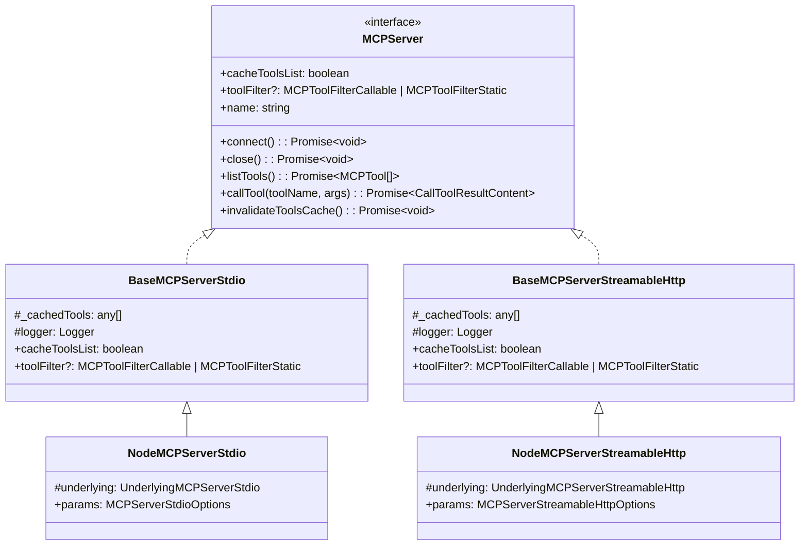
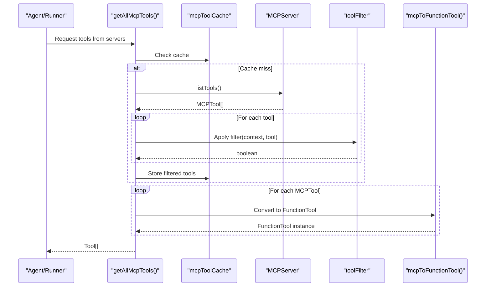
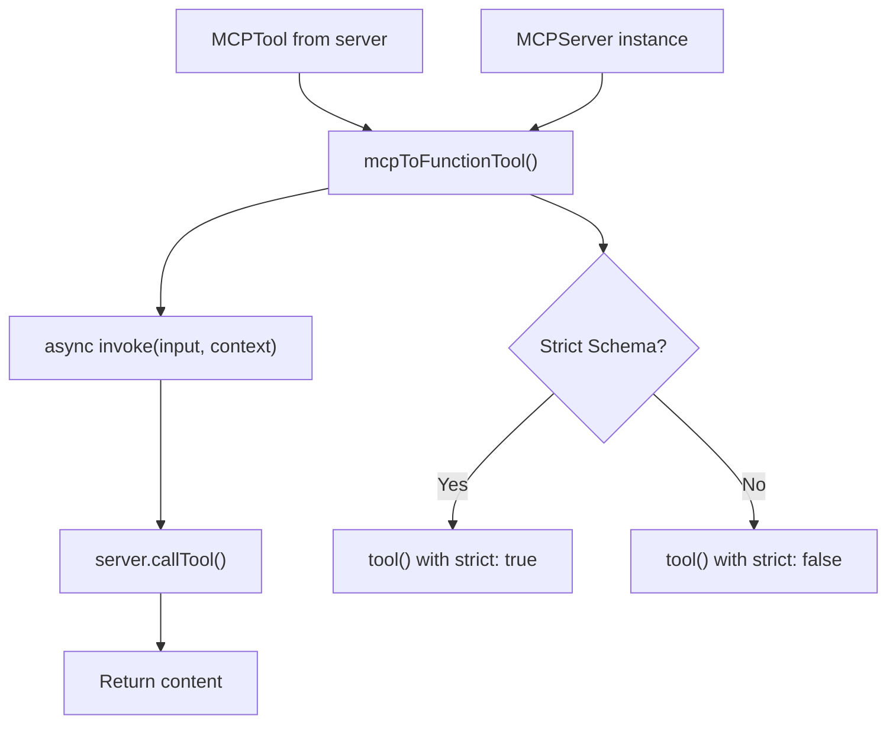

<!-- source: DeepWiki mcp.deepwiki.com · repo openai/openai-agents-js · page 4.2 Model Context Protocol (MCP) · fetched 2026-10-26 -->

# Model Context Protocol (MCP)

<details>
<summary>Relevant source files</summary>

The following files were used as context for generating this wiki page:

- [.changeset/calm-tools-list-all-pages.md](.changeset/calm-tools-list-all-pages.md)
- [.changeset/quiet-expected-test-logs.md](.changeset/quiet-expected-test-logs.md)
- [examples/basic/chat.ts](examples/basic/chat.ts)
- [examples/docs/mcp/stdio.ts](examples/docs/mcp/stdio.ts)
- [examples/docs/tools/mcpLocalServer.ts](examples/docs/tools/mcpLocalServer.ts)
- [examples/mcp/README.md](examples/mcp/README.md)
- [examples/mcp/filesystem-example.ts](examples/mcp/filesystem-example.ts)
- [examples/mcp/get-all-mcp-tools-example.ts](examples/mcp/get-all-mcp-tools-example.ts)
- [examples/mcp/hosted-mcp-simple.ts](examples/mcp/hosted-mcp-simple.ts)
- [examples/mcp/mcp-servers-example.ts](examples/mcp/mcp-servers-example.ts)
- [examples/mcp/package.json](examples/mcp/package.json)
- [examples/mcp/tool-filter-example.ts](examples/mcp/tool-filter-example.ts)
- [examples/mcp/tsconfig.json](examples/mcp/tsconfig.json)
- [examples/sandbox/handoffs.ts](examples/sandbox/handoffs.ts)
- [packages/agents-core/src/mcp.ts](packages/agents-core/src/mcp.ts)
- [packages/agents-core/src/mcpLogging.ts](packages/agents-core/src/mcpLogging.ts)
- [packages/agents-core/src/mcpServers.ts](packages/agents-core/src/mcpServers.ts)
- [packages/agents-core/src/mcpUtil.ts](packages/agents-core/src/mcpUtil.ts)
- [packages/agents-core/src/shims/mcp-server/browser.ts](packages/agents-core/src/shims/mcp-server/browser.ts)
- [packages/agents-core/src/shims/mcp-server/node.ts](packages/agents-core/src/shims/mcp-server/node.ts)
- [packages/agents-core/test/mcpCache.test.ts](packages/agents-core/test/mcpCache.test.ts)
- [packages/agents-core/test/mcpLogging.test.ts](packages/agents-core/test/mcpLogging.test.ts)
- [packages/agents-core/test/mcpServers.test.ts](packages/agents-core/test/mcpServers.test.ts)
- [packages/agents-core/test/mcpToFunctionTool.test.ts](packages/agents-core/test/mcpToFunctionTool.test.ts)
- [packages/agents-core/test/mcpToolFilter.integration.test.ts](packages/agents-core/test/mcpToolFilter.integration.test.ts)
- [packages/agents-core/test/mcpToolFilter.test.ts](packages/agents-core/test/mcpToolFilter.test.ts)
- [packages/agents-core/test/shims/mcp-server/browser.test.ts](packages/agents-core/test/shims/mcp-server/browser.test.ts)
- [packages/agents-core/test/shims/mcp-server/node.test.ts](packages/agents-core/test/shims/mcp-server/node.test.ts)
- [packages/agents-core/test/shims/mcp-server/streamableHttpRetry.test.ts](packages/agents-core/test/shims/mcp-server/streamableHttpRetry.test.ts)
- [packages/agents-core/test/taskTurnTracing.test.ts](packages/agents-core/test/taskTurnTracing.test.ts)
- [packages/agents-core/test/toolCustomData.test.ts](packages/agents-core/test/toolCustomData.test.ts)

</details>


This document covers the Model Context Protocol (MCP) integration within the OpenAI Agents JS framework. MCP enables agents to dynamically discover and use tools from external servers using standardized protocols. For information about the broader tools system, see [Tools System](#4.1). For details about agent configuration and execution, see [Agent Fundamentals](#2.3).

## Architecture Overview

The MCP integration provides a bridge between agents and external tool servers through multiple transport protocols. The system converts MCP tool definitions into `FunctionTool` instances that agents can use seamlessly. The integration is built on top of the `@modelcontextprotocol/sdk` package (optional peer dependency).

**MCP Integration Architecture**

```mermaid
graph TB
    subgraph "Agent Layer"
        Agent["Agent"]
        Runner["Runner"]
    end
    
    subgraph "MCP Integration Layer (agents-core/src/mcp.ts)"
        getAllMcpTools["getAllMcpTools()"]
        mcpToFunctionTool["mcpToFunctionTool()"]
        MCPServer["MCPServer interface"]
        CacheLayer["_cachedTools cache"]
    end
    
    subgraph "Server Implementations"
        MCPServerStdio["MCPServerStdio"]
        MCPServerStreamableHttp["MCPServerStreamableHttp"] 
        MCPServerSSE["MCPServerSSE"]
        BaseMCPServerStdio["BaseMCPServerStdio"]
        BaseMCPServerStreamableHttp["BaseMCPServerStreamableHttp"]
    end
    
    subgraph "Transport Layer (@modelcontextprotocol/sdk)"
        Client["Client"]
        StdioTransport["StdioClientTransport"]
        HttpTransport["StreamableHTTPClientTransport"]
        SSETransport["SSEClientTransport"]
    end
    
    subgraph "External MCP Servers"
        StdioMCP["Stdio MCP Server Process"]
        HttpMCP["HTTP MCP Endpoint"]
        SSEMCP["SSE MCP Endpoint"]
    end
    
    Agent --> getAllMcpTools
    getAllMcpTools --> CacheLayer
    getAllMcpTools --> MCPServer
    getAllMcpTools --> mcpToFunctionTool
    
    MCPServer <|.. BaseMCPServerStdio
    MCPServer <|.. BaseMCPServerStreamableHttp
    
    BaseMCPServerStdio <|-- MCPServerStdio
    BaseMCPServerStreamableHttp <|-- MCPServerStreamableHttp
    
    MCPServerStdio --> Client
    MCPServerStreamableHttp --> Client
    MCPServerSSE --> Client
    
    Client --> StdioTransport
    Client --> HttpTransport
    Client --> SSETransport
    
    StdioTransport --> StdioMCP
    HttpTransport --> HttpMCP
    SSETransport --> SSEMCP
```

The integration uses platform-specific shims to provide Node.js implementations while stub implementations exist for browser environments where MCP servers are not supported.

**Sources:** [packages/agents-core/src/mcp.ts:87-122](), [packages/agents-core/src/shims/mcp-server/node.ts:1-22](), [packages/agents-core/src/shims/mcp-server/browser.ts:19-65]()

## Server Types and Implementations

The framework supports three types of MCP servers, each with different communication protocols and use cases.

### MCPServer Interface

All MCP server implementations conform to the `MCPServer` interface, which defines the core operations:

**MCPServer Interface and Class Hierarchy**



The base classes handle common functionality including caching and tool filtering, while concrete implementations handle protocol-specific transport logic via shims.

**Sources:** [packages/agents-core/src/mcp.ts:87-122](), [packages/agents-core/src/mcp.ts:225-233](), [packages/agents-core/src/mcp.ts:388-425](), [packages/agents-core/src/shims/mcp-server/node.ts:411-443]()

### Stdio Servers

`MCPServerStdio` communicates with external processes through standard input/output streams using `StdioClientTransport`.

| Configuration Option | Type | Description |
|---------------------|------|-------------|
| `command` | `string` | Executable command to run [packages/agents-core/src/shims/mcp-server/node.ts:424-424]() |
| `args` | `string[]` | Command line arguments [packages/agents-core/src/shims/mcp-server/node.ts:425-425]() |
| `fullCommand` | `string` | Alternative: full command string [packages/agents-core/src/shims/mcp-server/node.ts:413-414]() |
| `clientSessionTimeoutSeconds` | `number` | MCP client session timeout (default 5s) [packages/agents-core/src/shims/mcp-server/node.ts:411-411]() |

The Node.js implementation spawns a child process and uses the MCP SDK's `Client` class.

**Sources:** [packages/agents-core/src/shims/mcp-server/node.ts:411-443](), [packages/agents-core/src/mcp.ts:225-233]()

### Streamable HTTP Servers

`MCPServerStreamableHttp` connects to MCP servers over HTTP using the Streamable HTTP transport protocol. This is the recommended option for remote servers.

| Configuration Option | Type | Description |
|---------------------|------|-------------|
| `url` | `string` | Server HTTP endpoint URL [packages/agents-core/src/mcp.ts:394-394]() |
| `reconnectionOptions` | `object` | Reconnection behavior settings [packages/agents-core/src/mcp.ts:402-402]() |
| `sessionId` | `string` | Explicit session ID for connection [packages/agents-core/src/mcp.ts:403-403]() |

**Sources:** [packages/agents-core/src/mcp.ts:388-425](), [packages/agents-core/test/shims/mcp-server/streamableHttpRetry.test.ts:50-104]()

### Server-Sent Events Servers

`MCPServerSSE` uses Server-Sent Events for communication. Note that SSE is considered legacy in favor of Streamable HTTP.

**Sources:** [packages/agents-core/src/mcp.ts:431-462]()

## Tool Discovery and Conversion

The `getAllMcpTools` function is the primary entry point for discovering tools across multiple MCP servers.

### Tool Discovery Flow

**getAllMcpTools() Execution Sequence**



**Sources:** [packages/agents-core/src/mcp.ts:778-831](), [packages/agents-core/test/mcpCache.test.ts:61-73]()

### Tool Conversion Process

The `mcpToFunctionTool()` function converts MCP tool definitions into `FunctionTool` instances.

**mcpToFunctionTool() Conversion Logic**



**Sources:** [packages/agents-core/src/mcp.ts:833-887](), [packages/agents-core/test/mcpToFunctionTool.test.ts:11-58]()

## Caching and Performance

### Tool List Caching

MCP servers can cache tool lists to avoid repeated `listTools()` calls. The caching logic supports agent-specific filters.

| Logic | Description |
|-------|-------------|
| **Cache Key** | Generated based on server name and optionally agent name if a callable filter is used [packages/agents-core/src/mcp.ts:588-596](). |
| **Invalidation** | `invalidateToolsCache()` clears the internal `_cachedTools` [packages/agents-core/src/mcp.ts:121-121](). |
| **Global Reset** | `invalidateServerToolsCache()` can be used to clear all caches for a specific server [packages/agents-core/src/mcp.ts:578-586](). |

**Sources:** [packages/agents-core/src/mcp.ts:588-596](), [packages/agents-core/test/mcpCache.test.ts:24-30](), [packages/agents-core/src/shims/mcp-server/node.ts:13-13]()

## Tool Filtering

The system supports both static and callable filters to control which tools are exposed to the model.

### Filter Types

1.  **Static Filter**: A simple object containing `allowedToolNames` or `blockedToolNames` [packages/agents-core/src/mcpUtil.ts:31-40]().
2.  **Callable Filter**: A function `(context, tool) => boolean` that allows for dynamic decisions based on the `Agent` or `RunContext` [packages/agents-core/src/mcpUtil.ts:42-50]().

**Sources:** [packages/agents-core/src/mcp.ts:29-30](), [packages/agents-core/src/mcpUtil.ts:31-50](), [packages/agents-core/test/mcpCache.test.ts:41-73]()

## Integration Patterns

### Lifecycle Management
The `MCPServers` class manages the lifecycle of multiple MCP connections, handling timeouts and parallel connection logic. It supports an `open` static method to initialize a set of servers [packages/agents-core/src/mcpServers.ts:211-221]().

### Redacted Logging
To protect sensitive credentials, `getMcpServerExternalName` sanitizes server names by removing credentials, query strings, and fragments from URL-derived names [packages/agents-core/src/mcpLogging.ts:117-137]().

### Error Handling
Custom error functions can be provided to `MCPServer` to convert MCP failures into model-visible messages, allowing for graceful degradation when a tool fails [packages/agents-core/src/mcp.ts:98-101]().

**Sources:** [packages/agents-core/src/mcpServers.ts:162-221](), [packages/agents-core/src/mcpLogging.ts:117-137](), [packages/agents-core/src/mcp.ts:98-101]()

---

