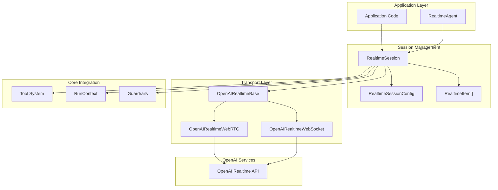
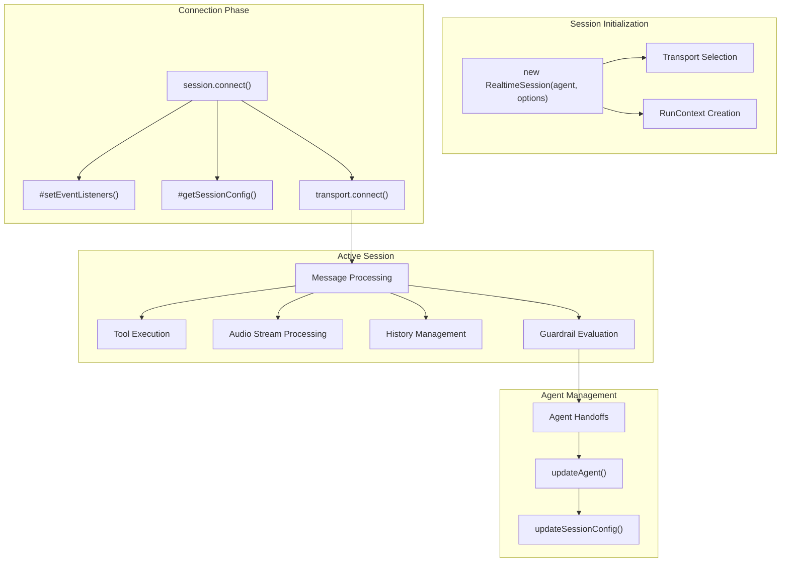
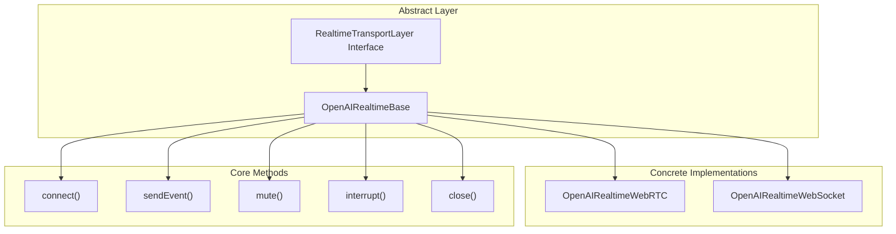
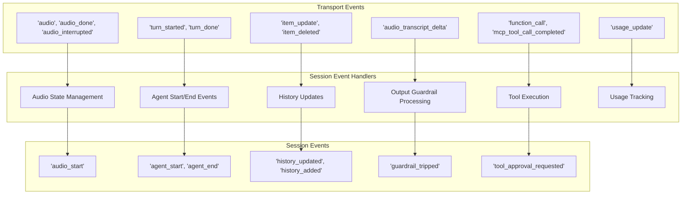

<!-- source: DeepWiki mcp.deepwiki.com · repo openai/openai-agents-js · page 4.3 Real-time Voice Agents · fetched 2026-10-26 -->

# Real-time Voice Agents

Relevant source files

The following files were used as context for generating this wiki page:

- [.changeset/realtime-text-output-guardrails.md](.changeset/realtime-text-output-guardrails.md)
- [docs/src/content/docs/ja/guides/guardrails.mdx](docs/src/content/docs/ja/guides/guardrails.mdx)
- [docs/src/content/docs/ja/guides/human-in-the-loop.mdx](docs/src/content/docs/ja/guides/human-in-the-loop.mdx)
- [docs/src/content/docs/ja/guides/tracing.mdx](docs/src/content/docs/ja/guides/tracing.mdx)
- [docs/src/content/docs/ja/guides/voice-agents/build.mdx](docs/src/content/docs/ja/guides/voice-agents/build.mdx)
- [docs/src/content/docs/ko/guides/guardrails.mdx](docs/src/content/docs/ko/guides/guardrails.mdx)
- [docs/src/content/docs/ko/guides/human-in-the-loop.mdx](docs/src/content/docs/ko/guides/human-in-the-loop.mdx)
- [docs/src/content/docs/ko/guides/tracing.mdx](docs/src/content/docs/ko/guides/tracing.mdx)
- [docs/src/content/docs/ko/guides/voice-agents/build.mdx](docs/src/content/docs/ko/guides/voice-agents/build.mdx)
- [docs/src/content/docs/zh/guides/human-in-the-loop.mdx](docs/src/content/docs/zh/guides/human-in-the-loop.mdx)
- [docs/src/content/docs/zh/guides/tracing.mdx](docs/src/content/docs/zh/guides/tracing.mdx)
- [docs/src/content/docs/zh/guides/voice-agents/build.mdx](docs/src/content/docs/zh/guides/voice-agents/build.mdx)
- [examples/docs/voice-agents/addImage.ts](examples/docs/voice-agents/addImage.ts)
- [examples/docs/voice-agents/agent.ts](examples/docs/voice-agents/agent.ts)
- [examples/docs/voice-agents/configureSession.ts](examples/docs/voice-agents/configureSession.ts)
- [examples/docs/voice-agents/createSession.ts](examples/docs/voice-agents/createSession.ts)
- [examples/docs/voice-agents/helloWorld.ts](examples/docs/voice-agents/helloWorld.ts)
- [examples/docs/voice-agents/sendMessage.ts](examples/docs/voice-agents/sendMessage.ts)
- [examples/docs/voice-agents/sipTransport.ts](examples/docs/voice-agents/sipTransport.ts)
- [examples/docs/voice-agents/thinClient.ts](examples/docs/voice-agents/thinClient.ts)
- [examples/docs/voice-agents/transportEvents.ts](examples/docs/voice-agents/transportEvents.ts)
- [examples/docs/voice-agents/turnDetection.ts](examples/docs/voice-agents/turnDetection.ts)
- [examples/docs/voice-agents/updateHistory.ts](examples/docs/voice-agents/updateHistory.ts)
- [examples/docs/voice-agents/websocketSession.ts](examples/docs/voice-agents/websocketSession.ts)
- [examples/realtime-demo/token.ts](examples/realtime-demo/token.ts)
- [examples/realtime-next/src/app/page.tsx](examples/realtime-next/src/app/page.tsx)
- [examples/realtime-next/src/app/raw-client/page.tsx](examples/realtime-next/src/app/raw-client/page.tsx)
- [examples/realtime-next/src/app/server/token.action.tsx](examples/realtime-next/src/app/server/token.action.tsx)
- [examples/realtime-next/src/app/websocket/page.tsx](examples/realtime-next/src/app/websocket/page.tsx)
- [examples/realtime-next/tsconfig.json](examples/realtime-next/tsconfig.json)
- [examples/realtime-twilio-sip/server.ts](examples/realtime-twilio-sip/server.ts)
- [examples/realtime-twilio/README.md](examples/realtime-twilio/README.md)
- [examples/realtime-twilio/index.ts](examples/realtime-twilio/index.ts)
- [packages/agents-realtime/src/clientMessages.ts](packages/agents-realtime/src/clientMessages.ts)
- [packages/agents-realtime/src/index.ts](packages/agents-realtime/src/index.ts)
- [packages/agents-realtime/src/openaiRealtimeBase.ts](packages/agents-realtime/src/openaiRealtimeBase.ts)
- [packages/agents-realtime/src/openaiRealtimeEvents.ts](packages/agents-realtime/src/openaiRealtimeEvents.ts)
- [packages/agents-realtime/src/openaiRealtimeWebRtc.ts](packages/agents-realtime/src/openaiRealtimeWebRtc.ts)
- [packages/agents-realtime/src/openaiRealtimeWebsocket.ts](packages/agents-realtime/src/openaiRealtimeWebsocket.ts)
- [packages/agents-realtime/src/realtimeSession.ts](packages/agents-realtime/src/realtimeSession.ts)
- [packages/agents-realtime/src/transportLayer.ts](packages/agents-realtime/src/transportLayer.ts)
- [packages/agents-realtime/src/transportLayerEvents.ts](packages/agents-realtime/src/transportLayerEvents.ts)
- [packages/agents-realtime/src/utils.ts](packages/agents-realtime/src/utils.ts)
- [packages/agents-realtime/test/openaiRealtimeBase.test.ts](packages/agents-realtime/test/openaiRealtimeBase.test.ts)
- [packages/agents-realtime/test/openaiRealtimeEvents.test.ts](packages/agents-realtime/test/openaiRealtimeEvents.test.ts)
- [packages/agents-realtime/test/openaiRealtimeWebRtc.test.ts](packages/agents-realtime/test/openaiRealtimeWebRtc.test.ts)
- [packages/agents-realtime/test/openaiRealtimeWebsocket.test.ts](packages/agents-realtime/test/openaiRealtimeWebsocket.test.ts)
- [packages/agents-realtime/test/realtimeSession.test.ts](packages/agents-realtime/test/realtimeSession.test.ts)
- [packages/agents-realtime/test/realtimeVoiceConfigRegression.test.ts](packages/agents-realtime/test/realtimeVoiceConfigRegression.test.ts)
- [packages/agents-realtime/test/stubs.ts](packages/agents-realtime/test/stubs.ts)
- [packages/agents-realtime/test/utils.test.ts](packages/agents-realtime/test/utils.test.ts)

Real-time voice agents enable continuous, interactive conversations between users and AI agents through audio streams. This system handles voice input/output, session management, tool execution, and agent handoffs in real-time using WebRTC or WebSocket connections to the OpenAI Realtime API.

## Architecture Overview

The real-time voice agent system is built around three core components: the `RealtimeSession` for orchestration, transport layers for connectivity, and the `RealtimeAgent` for voice-specific agent behavior.

### Core Component Relationships

**Sources:** [packages/agents-realtime/src/realtimeSession.ts:220-225](), [packages/agents-realtime/src/openaiRealtimeBase.ts:150-153](), [packages/agents-realtime/src/openaiRealtimeWebRtc.ts:88-91](), [packages/agents-realtime/src/openaiRealtimeWebsocket.ts:83-86]()

### Session Lifecycle Management

The `RealtimeSession` class orchestrates the entire voice interaction lifecycle, managing connections, history, and agent state transitions.

**Sources:** [packages/agents-realtime/src/realtimeSession.ts:241-380](), [packages/agents-realtime/src/realtimeSession.ts:834-851](), [packages/agents-realtime/src/realtimeSession.ts:393-401]()

## Transport Layer Architecture

The transport layer abstracts the underlying connection mechanism. The base class `OpenAIRealtimeBase` provides shared logic for event parsing and session configuration merging.

### Transport Implementation Hierarchy

**Sources:** [packages/agents-realtime/src/openaiRealtimeBase.ts:150-200](), [packages/agents-realtime/src/openaiRealtimeWebRtc.ts:88-91](), [packages/agents-realtime/src/openaiRealtimeWebsocket.ts:83-86]()

### Transport Comparison

| Transport | Environment | Audio Handling | Best For |
|-----------|-------------|----------------|----------|
| `WebRTC` | Browser | Managed by SDK (Mic/Speakers) | Low-friction browser apps |
| `WebSocket` | Server / Node.js | Manual PCM16 bytes | Custom audio pipelines |

**Sources:** [docs/src/content/docs/ja/guides/voice-agents/build.mdx:25-34](), [packages/agents-realtime/src/realtimeSession.ts:103-103]()

## Audio Interruption Handling

Handling interruptions is critical for a natural voice experience. The SDK uses a combination of VAD (Voice Activity Detection) and client-side triggers.

### Interruption Flow

1.  **Detection**: The model or transport detects user speech (e.g., via `input_audio_buffer.speech_started` [packages/agents-realtime/src/openaiRealtimeWebsocket.ts:112-117]()).
2.  **Cancellation**: `transport.interrupt()` is called, sending `response.cancel` to the OpenAI API to stop model generation [packages/agents-realtime/src/openaiRealtimeWebRtc.ts:400-405]().
3.  **Clearing**: An `output_audio_buffer.clear` event is sent to clear pending audio in the transport's playback queue [packages/agents-realtime/src/openaiRealtimeWebRtc.ts:406-408]().
4.  **Truncation**: The SDK sends `conversation.item.truncate` to ensure the history reflects exactly what the user heard before the interruption [packages/agents-realtime/src/openaiRealtimeWebsocket.ts:112-117]().

**Sources:** [packages/agents-realtime/src/openaiRealtimeWebRtc.ts:393-410](), [packages/agents-realtime/src/openaiRealtimeWebsocket.ts:112-117](), [docs/src/content/docs/ja/guides/voice-agents/build.mdx:120-131]()

## MCP Tool Management

Real-time sessions provide integrated support for the Model Context Protocol (MCP).

*   **Discovery**: `RealtimeSession` tracks available MCP tools and converts them to `RealtimeToolDefinition` [packages/agents-realtime/src/realtimeSession.ts:314-316]().
*   **Execution**: When a model triggers an MCP tool, the session handles the `mcp_tool_call_completed` event and updates the conversation history [packages/agents-realtime/src/realtimeSession.ts:534-541]().
*   **Approvals**: MCP tools often require explicit user approval. The session emits `tool_approval_requested` and manages `RealtimeMcpCallApprovalRequestItem` in the history [packages/agents-realtime/src/openaiRealtimeBase.ts:21-26]().
*   **Auto-Trigger**: The `automaticallyTriggerResponseForMcpToolCalls` option allows the session to immediately request a model response after an MCP tool finishes [packages/agents-realtime/src/realtimeSession.ts:164-166]().

**Sources:** [packages/agents-realtime/src/realtimeSession.ts:164-166](), [packages/agents-realtime/src/realtimeSession.ts:534-541](), [packages/agents-realtime/src/openaiRealtimeBase.ts:21-26]()

## Twilio Integration

Twilio integration is typically handled via a custom WebSocket transport that bridges Twilio Media Streams to the Realtime API.

*   **Audio Format**: Twilio typically requires specific formats like `g711_ulaw` or `audio/pcm` at 8000Hz, which must be configured in the `RealtimeSessionConfig` [packages/agents-realtime/src/openaiRealtimeBase.ts:75-90]().
*   **Event Bridging**: The transport layer must map Twilio's `media` events to the SDK's `sendAudio` calls [packages/agents-realtime/src/openaiRealtimeWebsocket.ts:133-138]().
*   **Interruption**: When Twilio detects an interruption or a "mark" is received, the SDK's `interrupt()` method should be called to synchronize the model's state [packages/agents-realtime/src/openaiRealtimeWebRtc.ts:393-410]().

**Sources:** [packages/agents-realtime/src/openaiRealtimeBase.ts:75-90](), [packages/agents-realtime/src/openaiRealtimeWebsocket.ts:133-138](), [docs/src/content/docs/ja/guides/voice-agents/build.mdx:44-44]()

## Event Processing and Message Flow

### Event Processing Pipeline

The `RealtimeSession` processes various event types from the transport layer and coordinates appropriate responses:

**Sources:** [packages/agents-realtime/src/realtimeSession.ts:588-780]()

## Configuration and Usage Patterns

### Session Configuration Options

| Option | Type | Purpose |
|--------|------|---------|
| `apiKey` | `ApiKey` | Authentication for OpenAI API [packages/agents-realtime/src/realtimeSession.ts:98]() |
| `transport` | `'webrtc' \| 'websocket' \| RealtimeTransportLayer` | Connection method [packages/agents-realtime/src/realtimeSession.ts:103]() |
| `model` | `OpenAIRealtimeModels` | AI model selection [packages/agents-realtime/src/realtimeSession.ts:108]() |
| `context` | `TContext` | Additional context data [packages/agents-realtime/src/realtimeSession.ts:113]() |
| `outputGuardrails` | `RealtimeOutputGuardrail[]` | Safety mechanisms [packages/agents-realtime/src/realtimeSession.ts:118]() |
| `config` | `Partial<RealtimeSessionConfig>` | Audio and model settings [packages/agents-realtime/src/realtimeSession.ts:128]() |
| `historyStoreAudio` | `boolean` | Audio data retention [packages/agents-realtime/src/realtimeSession.ts:140]() |
| `automaticallyTriggerResponseForMcpToolCalls` | `boolean` | Automatic response after MCP tool execution [packages/agents-realtime/src/realtimeSession.ts:164-166]() |

**Sources:** [packages/agents-realtime/src/realtimeSession.ts:94-173]()

---

