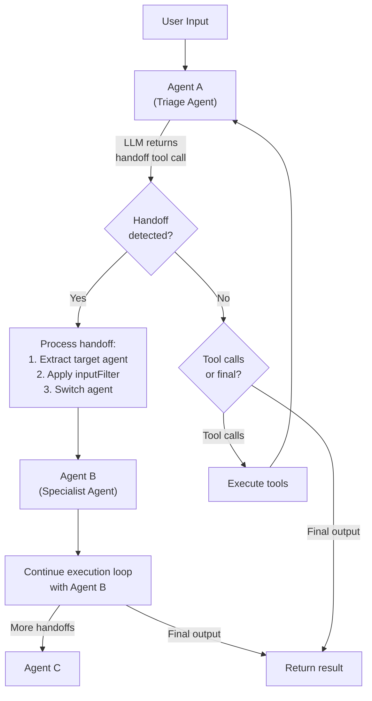
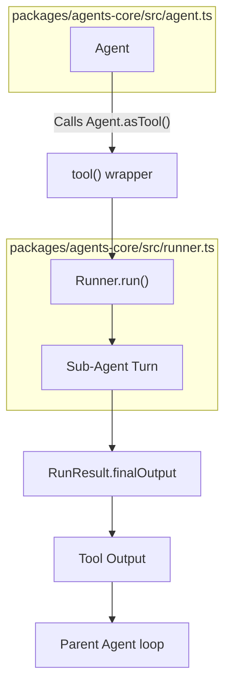
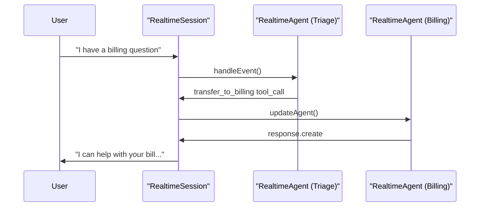

<!-- source: DeepWiki mcp.deepwiki.com · repo openai/openai-agents-js · page 4.4 Multi-Agent Workflows · fetched 2026-10-26 -->

# Multi-Agent Workflows

<details>
<summary>Relevant source files</summary>

The following files were used as context for generating this wiki page:

- [docs/src/content/docs/guides/context.mdx](docs/src/content/docs/guides/context.mdx)
- [docs/src/content/docs/guides/handoffs.mdx](docs/src/content/docs/guides/handoffs.mdx)
- [docs/src/content/docs/guides/multi-agent.md](docs/src/content/docs/guides/multi-agent.md)
- [examples/agent-patterns/README.md](examples/agent-patterns/README.md)
- [examples/agent-patterns/agents-as-tools-streaming.ts](examples/agent-patterns/agents-as-tools-streaming.ts)
- [examples/agent-patterns/agents-as-tools-structured.ts](examples/agent-patterns/agents-as-tools-structured.ts)
- [examples/agent-patterns/input-guardrails.ts](examples/agent-patterns/input-guardrails.ts)
- [examples/agent-patterns/output-guardrails.ts](examples/agent-patterns/output-guardrails.ts)
- [examples/agent-patterns/package.json](examples/agent-patterns/package.json)
- [examples/agent-patterns/streaming-guardrails.ts](examples/agent-patterns/streaming-guardrails.ts)
- [examples/customer-service/package.json](examples/customer-service/package.json)
- [examples/docs/human-in-the-loop/index.ts](examples/docs/human-in-the-loop/index.ts)
- [examples/docs/models/openaiProvider.ts](examples/docs/models/openaiProvider.ts)
- [examples/docs/tracing/cloudflareWorkers.ts](examples/docs/tracing/cloudflareWorkers.ts)
- [examples/docs/voice-agents/serverAgent.ts](examples/docs/voice-agents/serverAgent.ts)
- [examples/financial-research-agent/package.json](examples/financial-research-agent/package.json)
- [examples/handoffs/index.ts](examples/handoffs/index.ts)
- [examples/handoffs/package.json](examples/handoffs/package.json)
- [examples/research-bot/package.json](examples/research-bot/package.json)
- [examples/tools/code-interpreter.ts](examples/tools/code-interpreter.ts)
- [examples/tools/file-search.ts](examples/tools/file-search.ts)
- [packages/agents-core/src/agentToolInput.ts](packages/agents-core/src/agentToolInput.ts)
- [packages/agents-core/src/agentToolRunResults.ts](packages/agents-core/src/agentToolRunResults.ts)
- [packages/agents-core/src/defaultModel.ts](packages/agents-core/src/defaultModel.ts)
- [packages/agents-core/src/extensions/handoffFilters.ts](packages/agents-core/src/extensions/handoffFilters.ts)
- [packages/agents-core/src/handoff.ts](packages/agents-core/src/handoff.ts)
- [packages/agents-core/test/createSpans.test.ts](packages/agents-core/test/createSpans.test.ts)
- [packages/agents-core/test/defaultModel.test.ts](packages/agents-core/test/defaultModel.test.ts)
- [packages/agents-core/test/extensions/handoffFilters.test.ts](packages/agents-core/test/extensions/handoffFilters.test.ts)
- [packages/agents-core/test/handoff.test.ts](packages/agents-core/test/handoff.test.ts)
- [packages/agents-core/test/handoffs.test.ts](packages/agents-core/test/handoffs.test.ts)
- [packages/agents-core/test/lifecycle.test.ts](packages/agents-core/test/lifecycle.test.ts)

</details>


Multi-agent workflows allow you to decompose complex tasks by coordinating multiple specialized agents. The SDK provides two primary mechanisms for agent composition: **handoffs** (where one agent transfers control to another) and **agents-as-tools** (where one agent invokes another as a subroutine). This document explains both patterns, their execution semantics, and type-safe configuration strategies.

---

## Handoff Mechanism

A **handoff** is a specialized transfer of control from one agent to another. Unlike standard tool calls, handoffs pass conversation history to the receiving agent, allowing it to continue the workflow seamlessly. In the model's perspective, a handoff is represented as a tool, typically named `transfer_to_<agent_name>` [packages/agents-core/src/handoff.ts:59-68]().

### How Handoffs Work

Title: Handoff Execution Flow


Sources: [packages/agents-core/src/handoff.ts:86-107](), [docs/src/content/docs/guides/handoffs.mdx:13-17]()

### Configuring Handoffs

Handoffs are configured on the delegating agent using the `handoffs` array. This array can contain `Agent` instances or `Handoff` objects created via the `handoff()` helper [packages/agents-core/src/handoff.ts:224-225]().

**Key Configuration Properties**

| Property | Type | Purpose |
|----------|------|---------|
| `handoffDescription` | `string` | Appended to the default tool description to clarify when the model should pick this handoff [packages/agents-core/src/handoff.ts:80-82](). |
| `toolNameOverride` | `string` | Overrides the default `transfer_to_<agent_name>` tool name [packages/agents-core/src/handoff.ts:133-133](). |
| `inputType` | `ZodSchema` | Schema for structured payload metadata (e.g., `reason`, `priority`) the model provides during handoff [docs/src/content/docs/guides/handoffs.mdx:49-56](). |
| `onInvokeHandoff` | `Function` | Internal function that handles the transition; it returns the next agent to execute [packages/agents-core/src/handoff.ts:198-201](). |
| `isEnabled` | `Predicate` | Boolean or function that determines if the handoff is available for the current turn [packages/agents-core/src/handoff.ts:158-158](). |

Sources: [packages/agents-core/src/handoff.ts:108-201](), [docs/src/content/docs/guides/handoffs.mdx:29-41]()

### Handoff Input Filtering

By default, a handoff receives the entire conversation history. The `inputFilter` allows you to modify the data passed to the receiving agent [docs/src/content/docs/guides/handoffs.mdx:72-76](). It receives a `HandoffInputData` object containing `inputHistory`, `preHandoffItems`, and `newItems` [packages/agents-core/src/handoff.ts:21-42]().

A common use case is removing tool-related history to keep the context window clean for the next specialist:

```typescript
import { removeAllTools } from '@openai/agents-core/extensions';

const specialistHandoff = handoff(targetAgent, {
  inputFilter: removeAllTools // Filters out tool calls, results, and reasoning items
});
```

Sources: [packages/agents-core/src/extensions/handoffFilters.ts:36-55](), [packages/agents-core/test/extensions/handoffFilters.test.ts:136-167]()

---

## Agents as Tools

The **agents-as-tools** pattern allows one agent to invoke another agent as a tool call, without transferring conversation control. The sub-agent executes independently and returns its result to the parent.

Title: Agents-as-Tools Architecture


Sources: [examples/agent-patterns/package.json:11-14](), [docs/src/content/docs/guides/handoffs.mdx:105-108](), [examples/agent-patterns/agents-as-tools-streaming.ts:32-44]()

### Key Differences from Handoffs

| Aspect | Handoffs | Agents-as-Tools |
|--------|----------|-----------------|
| **Control Transfer** | New agent takes over conversation | Parent agent remains in control |
| **Context Passed** | Full conversation history (filtered) | Generated tool input only |
| **Return Behavior** | New agent produces final output | Sub-agent output becomes tool result |
| **Use Case** | Delegation, domain specialization | Encapsulated subtasks, subroutines |

Sources: [docs/src/content/docs/guides/handoffs.mdx:13-18](), [packages/agents-core/src/handoff.ts:86-107]()

---

## Multi-Agent Design Patterns

### Triage vs. Manager Patterns

The SDK supports two primary architectural patterns for coordinating multiple agents.

| Pattern | Composition Mechanism | Best For... |
|---------|----------------------|-------------|
| **Triage** | **Handoffs** | Routing users to the right specialist (e.g., Billing vs. Technical Support) [docs/src/content/docs/guides/handoffs.mdx:13-15](). |
| **Manager** | **Agents-as-Tools** | Coordinating a team of specialists to solve a complex problem where results must be aggregated. |

**Triage Example**:
```typescript
import { RECOMMENDED_PROMPT_PREFIX } from '@openai/agents';

const triageAgent = new Agent({
  name: 'Triage',
  handoffs: [billingAgent, technicalAgent],
  instructions: `Determine if the user needs billing or technical help. 
                 Use ${RECOMMENDED_PROMPT_PREFIX} for handoffs.`
});
```
Sources: [docs/src/content/docs/guides/handoffs.mdx:91-102](), [packages/agents-core/test/handoffs.test.ts:176-233]()

---

## Type Safety with Agent.create()

When agents in a handoff graph have different `outputType` schemas, standard TypeScript instantiation may fail to track the union of all possible final outputs. `Agent.create()` is a static factory method (available via the `Agent` class) that preserves these types during composition.

### Type Inference across Handoffs

```typescript
const agentA = new Agent({
  name: 'Agent A',
  outputType: z.object({ a: z.string() }),
});

const agentB = Agent.create({
  name: 'Agent B',
  outputType: z.object({ b: z.number() }),
  handoffs: [agentA],
});

const result = await run(agentB, "...");
// finalOutput is correctly inferred as { a: string } | { b: number } | string | undefined
const output = result.finalOutput;
```

Sources: [packages/agents-core/test/handoffs.test.ts:19-64]()

---

## Real-time Multi-Agent Workflows

Multi-agent workflows are also supported in voice interactions via `RealtimeAgent`. Realtime handoffs allow a voice session to switch models or instructions mid-conversation while maintaining audio continuity.

Title: Real-time Handoff Flow


Sources: [docs/src/content/docs/guides/handoffs.mdx:12-14](), [packages/agents-core/src/handoff.ts:52-56](), [examples/docs/voice-agents/serverAgent.ts:8-35]()

---

