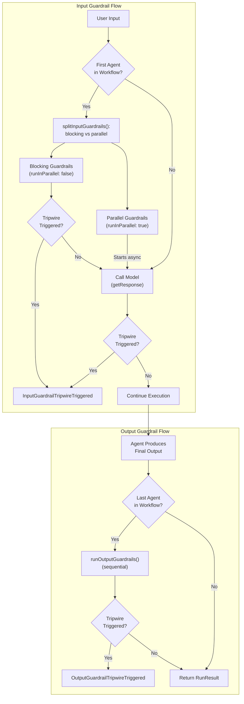
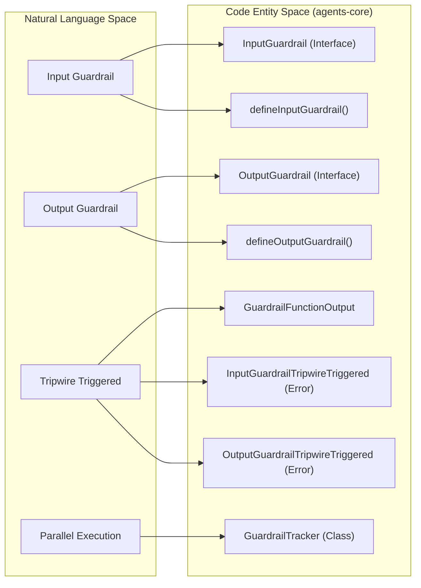

<!-- source: DeepWiki mcp.deepwiki.com · repo openai/openai-agents-js · page 4.5 Guardrails and Safety · fetched 2026-10-26 -->

# Guardrails and Safety

Relevant source files

The following files were used as context for generating this wiki page:

- [README.md](README.md)
- [docs/astro.config.mjs](docs/astro.config.mjs)
- [docs/src/components/Hero.astro](docs/src/components/Hero.astro)
- [docs/src/content/docs/extensions/twilio.mdx](docs/src/content/docs/extensions/twilio.mdx)
- [docs/src/content/docs/guides/guardrails.mdx](docs/src/content/docs/guides/guardrails.mdx)
- [docs/src/content/docs/guides/human-in-the-loop.mdx](docs/src/content/docs/guides/human-in-the-loop.mdx)
- [docs/src/content/docs/guides/quickstart.mdx](docs/src/content/docs/guides/quickstart.mdx)
- [docs/src/content/docs/guides/tracing.mdx](docs/src/content/docs/guides/tracing.mdx)
- [docs/src/content/docs/guides/voice-agents.mdx](docs/src/content/docs/guides/voice-agents.mdx)
- [docs/src/content/docs/guides/voice-agents/quickstart.mdx](docs/src/content/docs/guides/voice-agents/quickstart.mdx)
- [docs/src/content/docs/index.mdx](docs/src/content/docs/index.mdx)
- [docs/src/styles/global.css](docs/src/styles/global.css)
- [eslint.config.mjs](eslint.config.mjs)
- [packages/agents-core/src/errors.ts](packages/agents-core/src/errors.ts)
- [packages/agents-core/src/guardrail.ts](packages/agents-core/src/guardrail.ts)
- [packages/agents-core/src/runner/guardrails.ts](packages/agents-core/src/runner/guardrails.ts)
- [packages/agents-core/src/runner/turnPreparation.ts](packages/agents-core/src/runner/turnPreparation.ts)
- [packages/agents-core/test/errors.test.ts](packages/agents-core/test/errors.test.ts)
- [packages/agents-core/test/guardrail.test.ts](packages/agents-core/test/guardrail.test.ts)
- [packages/agents-core/test/runner/guardrails.test.ts](packages/agents-core/test/runner/guardrails.test.ts)
- [packages/agents/README.md](packages/agents/README.md)

Guardrails are validation mechanisms that execute alongside agent workflows to enforce safety constraints, validate inputs, and verify outputs. They provide a structured way to implement content moderation, policy enforcement, and quality checks without modifying agent instructions.

For information about runtime errors and exception handling, see [Agent Execution and State Management](#5.1). For human approval workflows that pause execution, see [Human-in-the-Loop Workflows](#5.5).

---

## Overview

The SDK supports three types of guardrails:

- **Input Guardrails** – Execute before the first agent processes user input, validating or rejecting requests based on policy or safety criteria. [docs/src/content/docs/guides/guardrails.mdx:15-15]()
- **Output Guardrails** – Execute after the final agent produces output, validating responses before returning them to the user. [docs/src/content/docs/guides/guardrails.mdx:16-16]()
- **Tool Guardrails** – Wrap function tools to validate or block tool calls specifically before and after execution. [docs/src/content/docs/guides/guardrails.mdx:24-24]()

Both agent-level types follow the same contract: receive context and data, perform checks, and return a `GuardrailFunctionOutput` indicating whether a "tripwire" was triggered. When triggered, execution halts immediately with a typed error. [packages/agents-core/src/guardrail.ts:24-34]()

Sources: [packages/agents-core/src/guardrail.ts:15-34](), [docs/src/content/docs/guides/guardrails.mdx:11-26]()

---

## Guardrail Execution Model

The `Runner` manages the lifecycle of guardrails, using a `GuardrailTracker` to monitor pending executions and failures. [packages/agents-core/src/runner/guardrails.ts:21-30]()

### Runner Guardrail Flow

**Key Execution Rules:**

1. **Input guardrails** execute only for the first agent in a chain. [docs/src/content/docs/guides/guardrails.mdx:22-22]()
2. **Output guardrails** execute only for the agent that produces the final output. [docs/src/content/docs/guides/guardrails.mdx:23-23]()
3. **Tool guardrails** run on every function-tool invocation (input before, output after). [docs/src/content/docs/guides/guardrails.mdx:24-24]()
4. **Blocking input guardrails** (`runInParallel: false`) complete before the model is called to prevent token spend. [docs/src/content/docs/guides/guardrails.mdx:41-41]()
5. **Sibling Synchronization**: The runner awaits all sibling guardrails before surfacing a tripwire to ensure clean state transitions. [packages/agents-core/src/runner/guardrails.ts:126-128]()

Sources: [docs/src/content/docs/guides/guardrails.mdx:18-51](), [packages/agents-core/src/runner/guardrails.ts:101-161](), [packages/agents-core/src/guardrail.ts:75-79]()

---

## Input Guardrails

Input guardrails validate or reject user input before executing expensive model calls or tool invocations. They receive `InputGuardrailFunctionArgs` which include the original input, current agent, and `RunContext`. [packages/agents-core/src/guardrail.ts:43-58]()

### Execution Modes

The `runInParallel` flag controls execution timing:

- **`true` (default)**: Guardrail starts alongside model call via `runInputGuardrails`, minimizing latency but allowing token consumption before validation completes. [docs/src/content/docs/guides/guardrails.mdx:40-40](), [packages/agents-core/src/guardrail.ts:138-138]()
- **`false`**: Guardrail blocks model call until completion, preventing token/tool usage if validation fails. [docs/src/content/docs/guides/guardrails.mdx:41-41]()

Sources: [packages/agents-core/src/guardrail.ts:63-104](), [docs/src/content/docs/guides/guardrails.mdx:28-41]()

---

## Output Guardrails

Output guardrails validate agent responses before returning them to the user. They receive `OutputGuardrailFunctionArgs` containing the agent's output and optional `details`. [packages/agents-core/src/guardrail.ts:161-177]()

### Details Object
Output guardrail functions receive a `details` object that enables inspection of:
- `modelResponse`: The underlying `ModelResponse` from the provider. [packages/agents-core/src/guardrail.ts:173-173]()
- `output`: All `AgentOutputItem` instances generated during the turn. [packages/agents-core/src/guardrail.ts:175-175]()

This allows guardrails to trip based on metadata (like finish reasons) or internal thought processes even if the final text looks safe. [docs/src/content/docs/guides/guardrails.mdx:53-53]()

Sources: [packages/agents-core/src/guardrail.ts:158-204](), [docs/src/content/docs/guides/guardrails.mdx:43-53]()

---

## Tool Guardrails

Tool guardrails provide granular protection for individual function tools. They are configured within the `tool()` helper via `inputGuardrails` and `outputGuardrails` properties. [docs/src/content/docs/guides/guardrails.mdx:55-57]()

### Behavior Options
Tool guardrails return a `behavior` that dictates the runner's next action:
- `allow`: Proceed to execution or next guardrail. [docs/src/content/docs/guides/guardrails.mdx:66-66]()
- `rejectContent`: Short-circuit with a message; the tool call is skipped or output is replaced. [docs/src/content/docs/guides/guardrails.mdx:67-67]()
- `throwException`: Immediately throw a tripwire error. [docs/src/content/docs/guides/guardrails.mdx:68-68]()

**Pre-Approval Guardrails:**
If a tool requires human approval, input guardrails normally run after approval. To run them before the approval request, set `toolExecution: { preApprovalInputGuardrails: true }` on `run()`. [docs/src/content/docs/guides/guardrails.mdx:64-64]()

Sources: [docs/src/content/docs/guides/guardrails.mdx:55-70](), [packages/agents-core/src/errors.ts:8-10]()

---

## Tripwire Mechanism

A "Tripwire" is a signal that a guardrail has failed validation. When `tripwireTriggered` is `true` in the `GuardrailFunctionOutput`, the runner halts execution and throws a specific error. [docs/src/content/docs/guides/guardrails.mdx:72-74](), [packages/agents-core/src/guardrail.ts:24-28]()

### Error Types

| Error Class | Thrown By | Description |
|-------------|-----------|-------------|
| `InputGuardrailTripwireTriggered` | `runInputGuardrails` | Triggered during initial user input validation. [packages/agents-core/src/errors.ts:192-202]() |
| `OutputGuardrailTripwireTriggered` | `runOutputGuardrails` | Triggered after final response generation. [packages/agents-core/src/errors.ts:207-220]() |
| `ToolInputGuardrailTripwireTriggered` | Tool execution | Triggered by tool input guardrails. [packages/agents-core/src/errors.ts:225-235]() |
| `ToolOutputGuardrailTripwireTriggered` | Tool execution | Triggered by tool output guardrails. [packages/agents-core/src/errors.ts:240-250]() |
| `GuardrailExecutionError` | Runner | Thrown if the guardrail function itself fails (e.g., code crash). [packages/agents-core/src/errors.ts:141-151]() |

Sources: [docs/src/content/docs/guides/guardrails.mdx:34-49](), [packages/agents-core/src/errors.ts:139-250]()

---

## Code Mapping

The following diagram maps the Natural Language concepts of Guardrails to their specific Code Entities.

Sources: [packages/agents-core/src/guardrail.ts:63-289](), [packages/agents-core/src/runner/guardrails.ts:21-94](), [docs/src/content/docs/guides/guardrails.mdx:28-49]()

---

## Validation Patterns

### Blocking for Cost Control
To prevent spending tokens on malicious or out-of-scope requests, use `runInParallel: false`. This is common when using a smaller "evaluator" model to check inputs for a larger, more expensive model. [docs/src/content/docs/guides/guardrails.mdx:11-11]()

### Multi-Agent Boundaries
In complex workflows with handoffs:
- **Input guardrails** only run on the entry-point agent. [docs/src/content/docs/guides/guardrails.mdx:22-22]()
- **Output guardrails** only run on the agent that finally responds to the user. [docs/src/content/docs/guides/guardrails.mdx:23-23]()
- Use **Tool Guardrails** for checks that must happen regardless of which agent in the hierarchy is calling the tool. [docs/src/content/docs/guides/guardrails.mdx:26-26]()

Sources: [docs/src/content/docs/guides/guardrails.mdx:18-27](), [packages/agents-core/src/guardrail.ts:43-58]()

---

