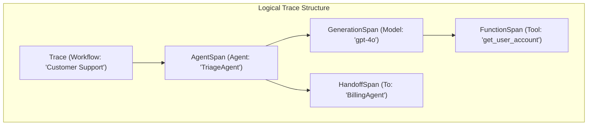
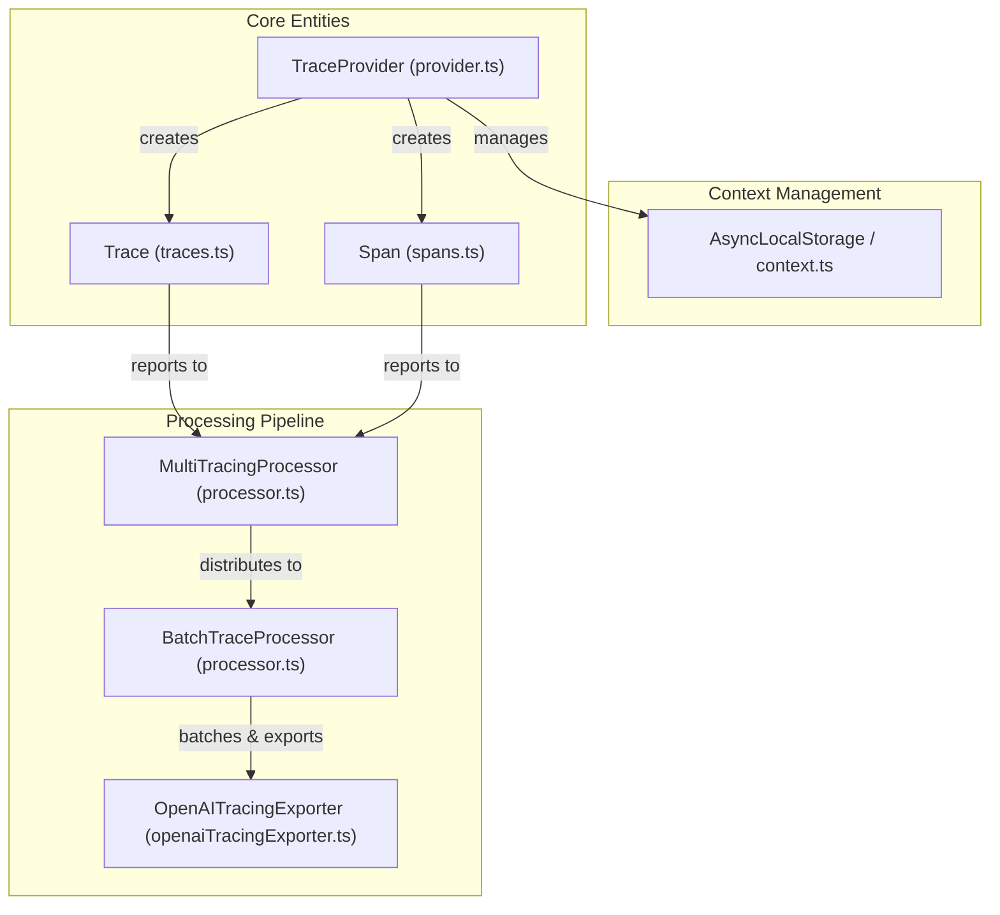
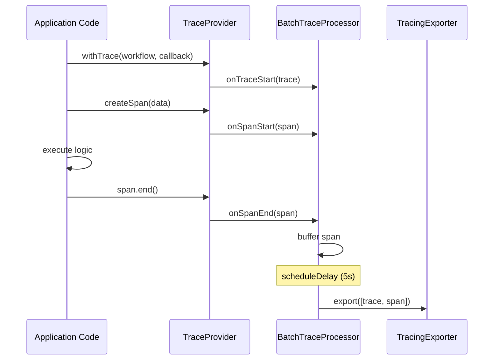

<!-- source: DeepWiki mcp.deepwiki.com · repo openai/openai-agents-js · page 4.6 Tracing and Observability · fetched 2026-10-26 -->

# Tracing and Observability

<details>
<summary>Relevant source files</summary>

The following files were used as context for generating this wiki page:

- [README.md](README.md)
- [docs/astro.config.mjs](docs/astro.config.mjs)
- [docs/src/components/Hero.astro](docs/src/components/Hero.astro)
- [docs/src/content/docs/extensions/twilio.mdx](docs/src/content/docs/extensions/twilio.mdx)
- [docs/src/content/docs/guides/guardrails.mdx](docs/src/content/docs/guides/guardrails.mdx)
- [docs/src/content/docs/guides/human-in-the-loop.mdx](docs/src/content/docs/guides/human-in-the-loop.mdx)
- [docs/src/content/docs/guides/quickstart.mdx](docs/src/content/docs/guides/quickstart.mdx)
- [docs/src/content/docs/guides/tracing.mdx](docs/src/content/docs/guides/tracing.mdx)
- [docs/src/content/docs/guides/voice-agents.mdx](docs/src/content/docs/guides/voice-agents.mdx)
- [docs/src/content/docs/guides/voice-agents/quickstart.mdx](docs/src/content/docs/guides/voice-agents/quickstart.mdx)
- [docs/src/content/docs/index.mdx](docs/src/content/docs/index.mdx)
- [docs/src/styles/global.css](docs/src/styles/global.css)
- [examples/docs/tracing/run-with-tracing-api-key.ts](examples/docs/tracing/run-with-tracing-api-key.ts)
- [packages/agents-core/src/tracing/config.ts](packages/agents-core/src/tracing/config.ts)
- [packages/agents-core/src/tracing/context.ts](packages/agents-core/src/tracing/context.ts)
- [packages/agents-core/src/tracing/createSpans.ts](packages/agents-core/src/tracing/createSpans.ts)
- [packages/agents-core/src/tracing/index.ts](packages/agents-core/src/tracing/index.ts)
- [packages/agents-core/src/tracing/processor.ts](packages/agents-core/src/tracing/processor.ts)
- [packages/agents-core/src/tracing/provider.ts](packages/agents-core/src/tracing/provider.ts)
- [packages/agents-core/src/tracing/spans.ts](packages/agents-core/src/tracing/spans.ts)
- [packages/agents-core/src/tracing/traces.ts](packages/agents-core/src/tracing/traces.ts)
- [packages/agents-core/src/tracing/utils.ts](packages/agents-core/src/tracing/utils.ts)
- [packages/agents-core/test/tracing.test.ts](packages/agents-core/test/tracing.test.ts)
- [packages/agents-openai/src/openaiTracingExporter.ts](packages/agents-openai/src/openaiTracingExporter.ts)
- [packages/agents-openai/test/openaiTracingExporter.test.ts](packages/agents-openai/test/openaiTracingExporter.test.ts)
- [packages/agents/README.md](packages/agents/README.md)

</details>


The OpenAI Agents SDK includes a built-in tracing system designed to collect a comprehensive record of events during an agent run. This system tracks LLM generations, tool calls, handoffs, guardrails, and custom events. By default, traces are exported to the [OpenAI Traces Dashboard](https://platform.openai.com/traces) for debugging, visualization, and monitoring in development and production [docs/src/content/docs/guides/tracing.mdx:10-10]().

## Core Concepts

The tracing system is built around two fundamental entities: **Traces** and **Spans**.

### Traces
A `Trace` represents a single end-to-end operation of a "workflow" [docs/src/content/docs/guides/tracing.mdx:41-41](). It serves as the root container for all related operations.
- `workflow_name`: The logical name of the application (e.g., "Code generation") [docs/src/content/docs/guides/tracing.mdx:42-42]().
- `trace_id`: A unique identifier formatted as `trace_<32_alphanumeric>` [docs/src/content/docs/guides/tracing.mdx:43-43]().
- `group_id`: An optional ID to link multiple traces from the same conversation (e.g., a thread ID) [docs/src/content/docs/guides/tracing.mdx:44-44]().

### Spans
A `Span` represents an operation with a specific start and end time [docs/src/content/docs/guides/tracing.mdx:47-47](). Spans are hierarchical, pointing to a `parent_id` to form a tree [docs/src/content/docs/guides/tracing.mdx:50-50]().
- **Span Types**: The SDK includes specialized data structures for different operations, such as `AgentSpanData`, `GenerationSpanData`, `FunctionSpanData`, `HandoffSpanData`, and `GuardrailSpanData` [packages/agents-core/src/tracing/index.ts:29-49]().


Sources: [docs/src/content/docs/guides/tracing.mdx:41-51](), [packages/agents-core/src/tracing/index.ts:29-49]()

## Tracing Architecture

The architecture relies on a `TraceProvider` to manage the lifecycle of traces and spans, using `AsyncLocalStorage` (or polyfills) to maintain execution context across asynchronous calls.


Sources: [packages/agents-core/src/tracing/provider.ts:34-47](), [packages/agents-core/src/tracing/context.ts:1-18](), [packages/agents-core/src/tracing/processor.ts:25-62]()

### TraceProvider
The `TraceProvider` is the central factory for creating traces and spans. It holds a `MultiTracingProcessor` which routes events to registered processors [packages/agents-core/src/tracing/provider.ts:35-43]().
- `createTrace()`: Initializes a new `Trace` or returns a `NoopTrace` if tracing is disabled [packages/agents-core/src/tracing/provider.ts:199-222]().
- `createSpan()`: Creates a new `Span`. It automatically detects the current parent span from the active context if no parent is explicitly provided [packages/agents-core/src/tracing/provider.ts:224-227]().

### Context Tracking
The SDK uses `AsyncLocalStorage` to ensure that spans are correctly nested even in concurrent environments [docs/src/content/docs/guides/tracing.mdx:91-92]().
- `withTrace()`: Wraps a function execution in a specific trace context [packages/agents-core/src/tracing/context.ts:17-17]().
- `getCurrentSpan()` / `getCurrentTrace()`: Retrieves the active entities from the current asynchronous execution stack [packages/agents-core/src/tracing/context.ts:10-11]().

## Default Tracing Instrumentation

The SDK automatically instruments the following operations [docs/src/content/docs/guides/tracing.mdx:55-65]():

| Operation | Implementation Entity | Span Type |
| :--- | :--- | :--- |
| **Runner Loop** | `run()` or `Runner.run()` | `Trace` |
| **Runner Invocation** | Top-level call | `TaskSpan` |
| **Agent Execution** | `Agent` run | `AgentSpan` |
| **Agent Loop Iteration**| Turn-based loop | `TurnSpan` |
| **LLM Call** | Model generation | `GenerationSpan` |
| **Tool Execution** | Function tool calls | `FunctionSpan` |
| **Guardrail Check** | Guardrail execution | `GuardrailSpan` |
| **Agent Switch** | Handoff processing | `HandoffSpan` |

Sources: [docs/src/content/docs/guides/tracing.mdx:53-65](), [packages/agents-core/src/tracing/createSpans.ts:1-60]()

## Data Flow and Exporting

### OpenAITracingExporter
The `OpenAITracingExporter` (in `@openai/agents-openai`) handles the transmission of collected data to the OpenAI backend [packages/agents-openai/src/openaiTracingExporter.ts:15-23]().
- **Sanitization**: It removes private fields (starting with `_`) and truncates large payloads to meet API limits [packages/agents-openai/src/openaiTracingExporter.ts:157-246]().
- **Usage Mapping**: It maps generation usage (tokens) into the specific schema required by the OpenAI Traces ingest API [packages/agents-openai/src/openaiTracingExporter.ts:25-53]().

### Custom Processors
Developers can intercept or redirect traces by implementing the `TracingProcessor` interface [packages/agents-core/src/tracing/processor.ts:25-62]().
- `addTraceProcessor(processor)`: Adds a processor to the existing pipeline [packages/agents-core/src/tracing/index.ts:66-68]().
- `setTraceProcessors(processors)`: Replaces all default processors (e.g., to disable OpenAI export and use a custom backend) [packages/agents-core/src/tracing/index.ts:75-77]().


Sources: [packages/agents-core/src/tracing/processor.ts:124-160](), [packages/agents-core/test/tracing.test.ts:87-111]()

## Environment-Specific Behavior

### Server Runtimes (Node.js, Deno, Bun)
Tracing is **enabled by default** in server runtimes [docs/src/content/docs/guides/tracing.mdx:14-14](). The `BatchTraceProcessor` automatically starts an export loop if supported by the environment [packages/agents-core/src/tracing/processor.ts:153-155]().

### Constrained Runtimes (Cloudflare Workers)
Automatic export loops are unavailable because the runtime may be torn down immediately [docs/src/content/docs/guides/tracing.mdx:27-27](). In these cases, manual flushing is required:
```typescript
try {
  const result = await runner.run(...);
} finally {
  await getGlobalTraceProvider().forceFlush();
}
```
Sources: [docs/src/content/docs/guides/tracing.mdx:27-32](), [packages/agents-core/src/tracing/processor.ts:61-61]()

### Browsers and Tests
Tracing is **disabled by default** in browsers and when `NODE_ENV=test` [docs/src/content/docs/guides/tracing.mdx:14-14](). It can be manually enabled using `setTracingDisabled(false)` [packages/agents-core/src/tracing/index.ts:85-86]().

## Sensitive Data Handling
By default, `GenerationSpan` and `FunctionSpan` capture inputs and outputs. To exclude potentially sensitive data from being sent to the tracing backend, set `traceIncludeSensitiveData: false` in the `RunConfig` [docs/src/content/docs/guides/tracing.mdx:104-105]().

Sources: [docs/src/content/docs/guides/tracing.mdx:100-105](), [packages/agents-core/src/tracing/spans.ts:37-54]()

---

