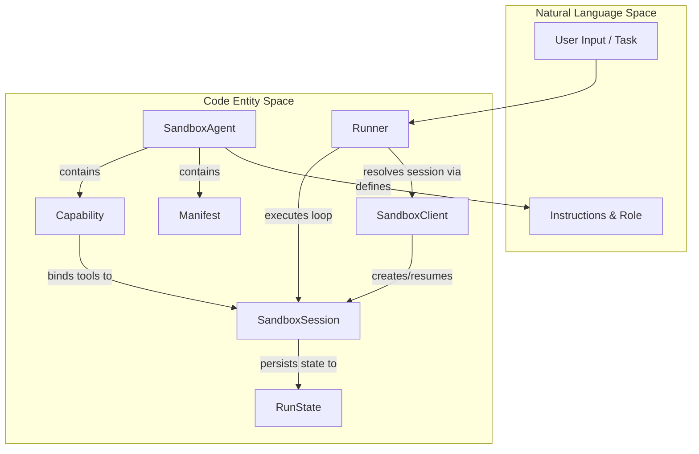
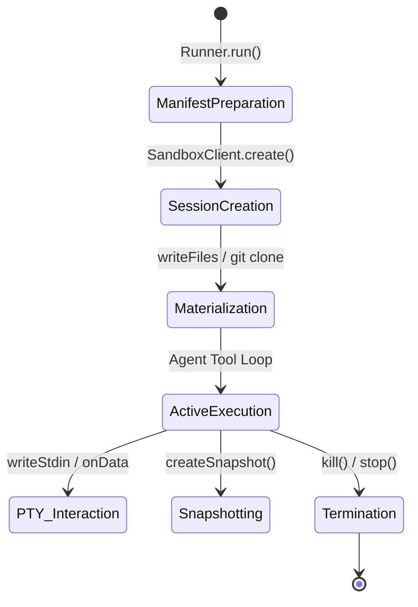

<!-- source: DeepWiki mcp.deepwiki.com · repo openai/openai-agents-js · page 4.7 Sandbox Agents · fetched 2026-10-26 -->

# Sandbox Agents

Relevant source files

The following files were used as context for generating this wiki page:

- [.agents/references/sandbox-runtime-and-provider-boundaries.md](.agents/references/sandbox-runtime-and-provider-boundaries.md)
- [docs/src/assets/images/harness_with_compute.png](docs/src/assets/images/harness_with_compute.png)
- [docs/src/content/docs/guides/sandbox-agents.mdx](docs/src/content/docs/guides/sandbox-agents.mdx)
- [docs/src/content/docs/guides/sandbox-agents/clients.mdx](docs/src/content/docs/guides/sandbox-agents/clients.mdx)
- [docs/src/content/docs/guides/sandbox-agents/concepts.mdx](docs/src/content/docs/guides/sandbox-agents/concepts.mdx)
- [docs/src/content/docs/guides/sandbox-agents/memory.mdx](docs/src/content/docs/guides/sandbox-agents/memory.mdx)
- [docs/src/content/docs/ja/guides/sandbox-agents.mdx](docs/src/content/docs/ja/guides/sandbox-agents.mdx)
- [docs/src/content/docs/ko/guides/sandbox-agents.mdx](docs/src/content/docs/ko/guides/sandbox-agents.mdx)
- [docs/src/content/docs/zh/guides/sandbox-agents.mdx](docs/src/content/docs/zh/guides/sandbox-agents.mdx)
- [packages/agents-core/src/sandbox/client.ts](packages/agents-core/src/sandbox/client.ts)
- [packages/agents-core/src/sandbox/internal/sessionStateTrust.ts](packages/agents-core/src/sandbox/internal/sessionStateTrust.ts)
- [packages/agents-core/src/sandbox/manifest.ts](packages/agents-core/src/sandbox/manifest.ts)
- [packages/agents-core/src/sandbox/permissions.ts](packages/agents-core/src/sandbox/permissions.ts)
- [packages/agents-core/src/sandbox/runtime/livePreservedSessions.ts](packages/agents-core/src/sandbox/runtime/livePreservedSessions.ts)
- [packages/agents-core/src/sandbox/runtime/manager.ts](packages/agents-core/src/sandbox/runtime/manager.ts)
- [packages/agents-core/src/sandbox/runtime/sessionSerialization.ts](packages/agents-core/src/sandbox/runtime/sessionSerialization.ts)
- [packages/agents-core/src/sandbox/runtime/sessionState.ts](packages/agents-core/src/sandbox/runtime/sessionState.ts)
- [packages/agents-core/src/sandbox/sandboxes/docker.ts](packages/agents-core/src/sandbox/sandboxes/docker.ts)
- [packages/agents-core/src/sandbox/sandboxes/shared/manifestPersistence.ts](packages/agents-core/src/sandbox/sandboxes/shared/manifestPersistence.ts)
- [packages/agents-core/src/sandbox/sandboxes/unixLocal.ts](packages/agents-core/src/sandbox/sandboxes/unixLocal.ts)
- [packages/agents-core/test/sandboxManifest.test.ts](packages/agents-core/test/sandboxManifest.test.ts)
- [packages/agents-core/test/sandboxes/docker.test.ts](packages/agents-core/test/sandboxes/docker.test.ts)
- [packages/agents-core/test/sandboxes/dockerUnit.test.ts](packages/agents-core/test/sandboxes/dockerUnit.test.ts)
- [packages/agents-core/test/sandboxes/unixLocal.test.ts](packages/agents-core/test/sandboxes/unixLocal.test.ts)
- [packages/agents-extensions/src/sandbox/blaxel/sandbox.ts](packages/agents-extensions/src/sandbox/blaxel/sandbox.ts)
- [packages/agents-extensions/src/sandbox/cloudflare/sandbox.ts](packages/agents-extensions/src/sandbox/cloudflare/sandbox.ts)
- [packages/agents-extensions/src/sandbox/daytona/sandbox.ts](packages/agents-extensions/src/sandbox/daytona/sandbox.ts)
- [packages/agents-extensions/src/sandbox/e2b/sandbox.ts](packages/agents-extensions/src/sandbox/e2b/sandbox.ts)
- [packages/agents-extensions/src/sandbox/modal/sandbox.ts](packages/agents-extensions/src/sandbox/modal/sandbox.ts)
- [packages/agents-extensions/src/sandbox/runloop/sandbox.ts](packages/agents-extensions/src/sandbox/runloop/sandbox.ts)
- [packages/agents-extensions/src/sandbox/shared/archive.ts](packages/agents-extensions/src/sandbox/shared/archive.ts)
- [packages/agents-extensions/src/sandbox/shared/inContainerMounts.ts](packages/agents-extensions/src/sandbox/shared/inContainerMounts.ts)
- [packages/agents-extensions/src/sandbox/vercel/index.ts](packages/agents-extensions/src/sandbox/vercel/index.ts)
- [packages/agents-extensions/src/sandbox/vercel/mounts.ts](packages/agents-extensions/src/sandbox/vercel/mounts.ts)
- [packages/agents-extensions/src/sandbox/vercel/sandbox.ts](packages/agents-extensions/src/sandbox/vercel/sandbox.ts)
- [packages/agents-extensions/test/sandbox/cloudflare.test.ts](packages/agents-extensions/test/sandbox/cloudflare.test.ts)
- [packages/agents-extensions/test/sandbox/e2b.test.ts](packages/agents-extensions/test/sandbox/e2b.test.ts)
- [packages/agents-extensions/test/sandbox/modal.test.ts](packages/agents-extensions/test/sandbox/modal.test.ts)
- [packages/agents-extensions/test/sandbox/runloop.test.ts](packages/agents-extensions/test/sandbox/runloop.test.ts)
- [packages/agents-extensions/test/sandbox/shared.test.ts](packages/agents-extensions/test/sandbox/shared.test.ts)
- [packages/agents-extensions/test/sandbox/tarFixture.ts](packages/agents-extensions/test/sandbox/tarFixture.ts)
- [packages/agents-extensions/test/sandbox/vercel.test.ts](packages/agents-extensions/test/sandbox/vercel.test.ts)
- [scripts/update-rclone-pin.mjs](scripts/update-rclone-pin.mjs)
- [scripts/update-rclone-pin.test.mjs](scripts/update-rclone-pin.test.mjs)

The `SandboxAgent` feature (currently in beta) provides agents with a persistent, isolated workspace for interacting with filesystems, executing shell commands, and managing long-running tasks across multiple turns. While a standard `Agent` operates in a stateless conversational context, a `SandboxAgent` is paired with a live execution environment where it can search document sets, edit code, and generate artifacts [docs/src/content/docs/guides/sandbox-agents/concepts.mdx:14-20]().

## Architecture and Data Flow

The Sandbox system separates the **Agent Definition** (what the agent can do) from the **Sandbox Execution** (where the work happens). The `Runner` orchestrates this by binding the agent's capabilities to a live `SandboxSession` provided by a `SandboxClient` [docs/src/content/docs/guides/sandbox-agents/concepts.mdx:42-69]().

### Sandbox Execution Flow
The following diagram illustrates how a `SandboxAgent` definition is transformed into a live execution by the `Runner`.

**Sandbox Preparation and Execution**

Sources: [docs/src/content/docs/guides/sandbox-agents/concepts.mdx:42-69](), [packages/agents-core/src/sandbox/sandboxes/docker.ts:156-169](), [packages/agents-core/src/sandbox/runtime/manager.ts:1-20]()

## Workspace Definition: Manifests

A `Manifest` declares the initial content and layout of the sandbox workspace. It acts as a contract for what files, repositories, and mounts should exist when a fresh session starts [docs/src/content/docs/guides/sandbox-agents/concepts.mdx:30-36]().

| Entry Type | Function |
| :--- | :--- |
| `file(path, content)` | Creates a file with inline text or binary content [packages/agents-core/test/sandboxManifest.test.ts:76-79](). |
| `localFile(src)` | Copies a specific file from the host machine to the sandbox [packages/agents-extensions/test/sandbox/shared.test.ts:104](). |
| `localDir(src)` | Recursively copies a directory from the host [packages/agents-extensions/test/sandbox/shared.test.ts:103](). |
| `gitRepo(repo, ref)` | Clones a Git repository into the workspace [packages/agents-core/test/sandboxManifest.test.ts:93-96](). |
| `mount(path, source)` | Attaches remote storage (S3, GCS, Azure, R2, Box) to a path [packages/agents-core/test/sandboxManifest.test.ts:97-102](). |

Sources: [packages/agents-core/test/sandboxManifest.test.ts:73-111](), [packages/agents-extensions/test/sandbox/shared.test.ts:90-112](), [packages/agents-core/src/sandbox/sandboxes/docker.ts:49-53]()

## Sandbox Clients and Sessions

`SandboxClient` implementations manage the lifecycle of the execution environment. The SDK supports local, containerized, and hosted providers.

### Client Types
1.  **UnixLocalSandboxClient**: Executes commands directly on the host OS. Best for fast local iteration [docs/src/content/docs/guides/sandbox-agents/concepts.mdx:93-95]().
2.  **DockerSandboxClient**: Provides container isolation using local Docker images. It manages volume mounts and container lifecycles [packages/agents-core/src/sandbox/sandboxes/docker.ts:131-154]().
3.  **Hosted Providers** (via `@openai/agents-extensions`):
    *   **CloudflareSandboxClient**: Executes within Cloudflare's sandbox infrastructure [packages/agents-extensions/src/sandbox/cloudflare/sandbox.ts:117-127]().
    *   **VercelSandboxClient**: Integration with Vercel's sandbox environment, supporting S3-backed mounts [packages/agents-extensions/src/sandbox/vercel/sandbox.ts:204-234]().
    *   **E2BSandboxClient**: Integration with E2B for code interpretation and managed sandboxing [packages/agents-extensions/src/sandbox/e2b/sandbox.ts:160-179]().
    *   **DaytonaSandboxClient**: Hosted development environment provider [packages/agents-extensions/src/sandbox/daytona/sandbox.ts:1-20]().

### Session Lifecycle
Sessions can be **SDK-managed** (closed automatically by the Runner) or **Developer-managed** (kept open for manual inspection or multi-run coordination) [docs/src/content/docs/guides/sandbox-agents/concepts.mdx:73-79]().

**Session Lifecycle States**

Sources: [docs/src/content/docs/guides/sandbox-agents/concepts.mdx:42-69](), [packages/agents-extensions/src/sandbox/cloudflare/sandbox.ts:220-226](), [packages/agents-extensions/src/sandbox/e2b/sandbox.ts:231-240]()

## Capabilities and Native Tools

Capabilities are sandbox-native behaviors attached to a `SandboxAgent`. They inject specific instructions and bind tools directly to the `SandboxSession` [docs/src/content/docs/guides/sandbox-agents/concepts.mdx:103-106]().

*   **`shell()`**: Adds `exec_command` and `write_stdin`. Allows the model to run arbitrary bash/sh commands. If PTY is supported, it provides interactive terminal access [packages/agents-extensions/src/sandbox/cloudflare/sandbox.ts:220-226]().
*   **`filesystem()`**: Adds tools for reading, writing, and listing files. Includes `apply_patch` for precise file editing [packages/agents-core/src/sandbox/sandboxes/docker.ts:180-186]().
*   **`skills()`**: Enables "skill discovery" by scanning the workspace for `.agents/skills` or `SKILL.md` files [packages/agents-core/test/sandboxes/dockerUnit.test.ts:60]().
*   **`memory()`**: Allows the agent to persist long-term lessons in a dedicated file within the sandbox [docs/src/content/docs/guides/sandbox-agents/memory.mdx:1-10]().
*   **`compaction()`**: Manages context window pressure by summarizing or archiving old workspace state during long sessions [docs/src/content/docs/guides/sandbox-agents/concepts.mdx:30]().

Sources: [docs/src/content/docs/guides/sandbox-agents/concepts.mdx:103-106](), [packages/agents-extensions/src/sandbox/cloudflare/sandbox.ts:220-226](), [packages/agents-core/src/sandbox/sandboxes/docker.ts:180-186]()

## Implementation Details

### Materialization
The process of turning a `Manifest` into a physical directory structure is called **materialization**. For remote sandboxes, this involves uploading files via `writeFiles` or executing `git clone` commands within the environment [packages/agents-extensions/src/sandbox/cloudflare/sandbox.ts:39-47](), [packages/agents-extensions/src/sandbox/vercel/sandbox.ts:35-36]().

### RunAs and Permissions
`SandboxAgent` supports a `runAs` option, which determines the user identity for shell commands and file operations. This is critical for hosted environments where the agent must act as a specific system user [packages/agents-extensions/src/sandbox/shared/shared.test.ts:58](), [packages/agents-extensions/src/sandbox/cloudflare/sandbox.ts:87-92]().

### Snapshots and Persistence
Sandbox state can be persisted in two ways:
1.  **`sessionState`**: A serialized object used to reconnect to the *exact same* running backend session [packages/agents-core/src/sandbox/sandboxes/shared/manifestPersistence.ts:36-46](), [packages/agents-extensions/src/sandbox/cloudflare/sandbox.ts:93-97]().
2.  **`snapshot`**: A saved archive of the workspace filesystem used to seed *new* sessions with previous results [packages/agents-core/src/sandbox/sandboxes/docker.ts:135](), [packages/agents-extensions/src/sandbox/vercel/sandbox.ts:167]().

Sources: [packages/agents-core/src/sandbox/sandboxes/shared/manifestPersistence.ts:32-46](), [packages/agents-extensions/src/sandbox/cloudflare/sandbox.ts:135-145](), [packages/agents-core/src/sandbox/sandboxes/docker.ts:87-93]()

---

