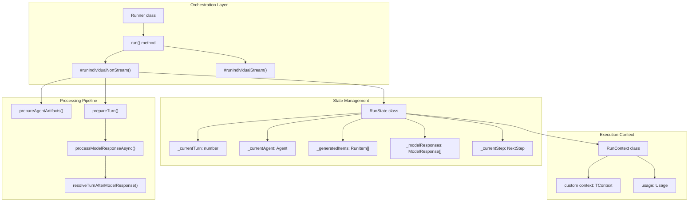
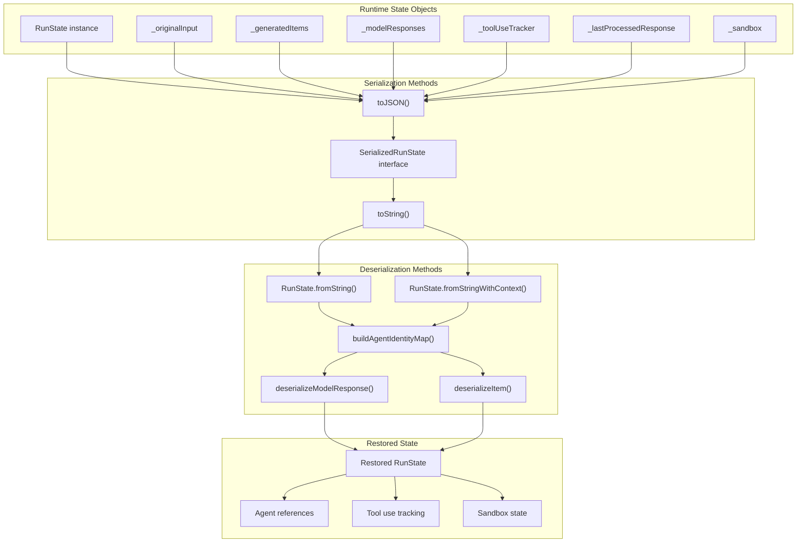
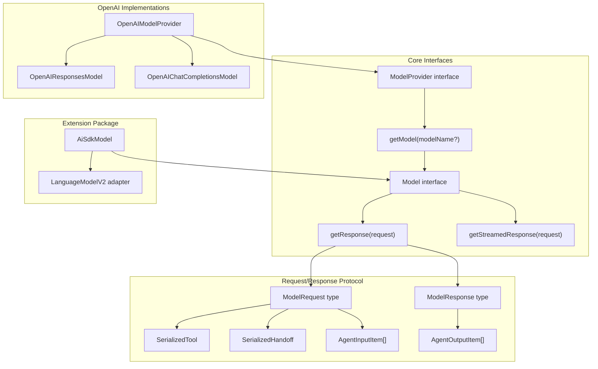
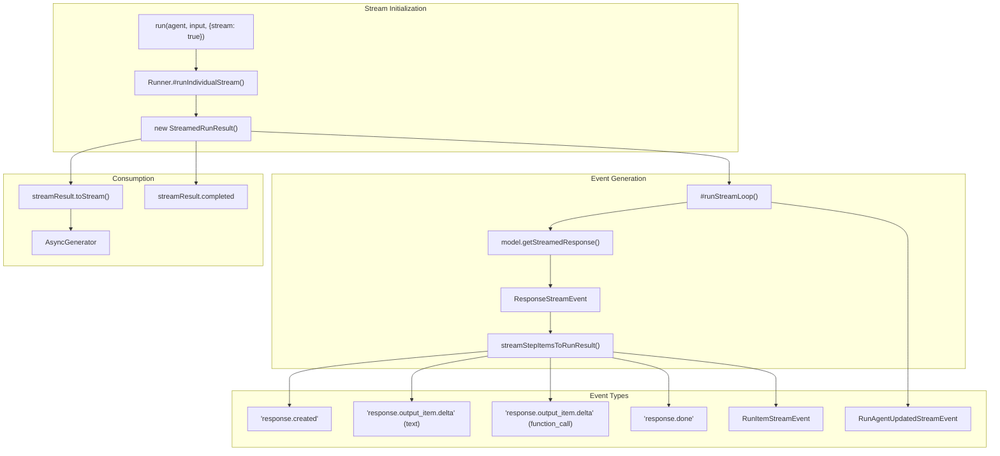
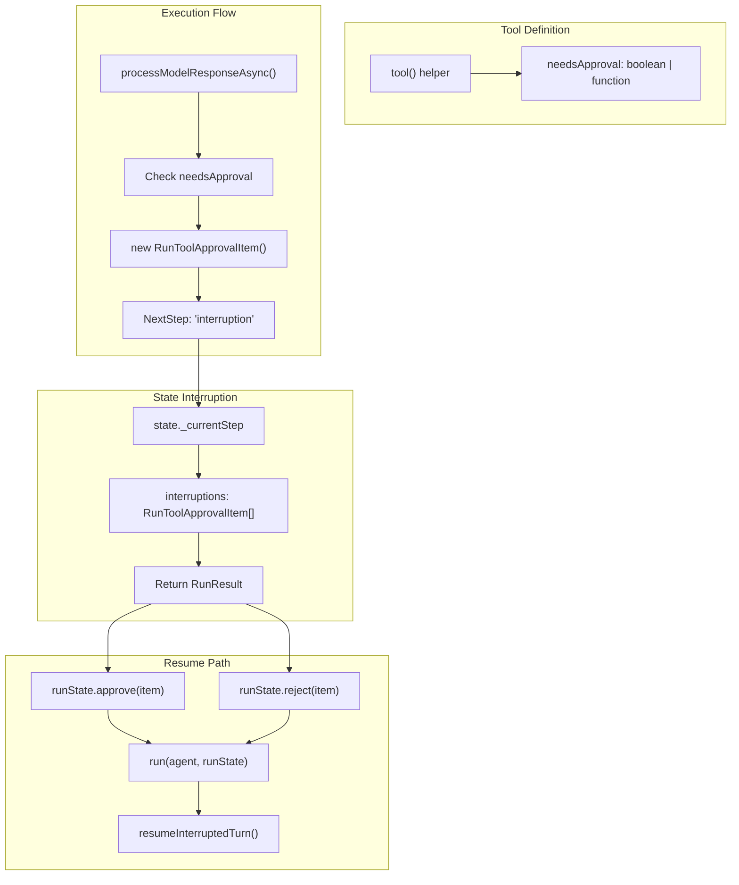

<!-- source: DeepWiki mcp.deepwiki.com · repo openai/openai-agents-js · page 5 Advanced Topics · fetched 2026-10-26 -->

# Advanced Topics

Relevant source files

The following files were used as context for generating this wiki page:

- [packages/agents-core/src/index.ts](packages/agents-core/src/index.ts)
- [packages/agents-core/src/run.ts](packages/agents-core/src/run.ts)
- [packages/agents-core/src/runState.ts](packages/agents-core/src/runState.ts)
- [packages/agents-core/src/runner/runLoop.ts](packages/agents-core/src/runner/runLoop.ts)
- [packages/agents-core/src/runner/toolExecution.ts](packages/agents-core/src/runner/toolExecution.ts)
- [packages/agents-core/src/runner/turnResolution.ts](packages/agents-core/src/runner/turnResolution.ts)
- [packages/agents-core/test/run.stream.test.ts](packages/agents-core/test/run.stream.test.ts)
- [packages/agents-core/test/run.test.ts](packages/agents-core/test/run.test.ts)
- [packages/agents-core/test/runState.test.ts](packages/agents-core/test/runState.test.ts)
- [packages/agents-core/test/runner/toolExecution.test.ts](packages/agents-core/test/runner/toolExecution.test.ts)

This section covers advanced implementation details, customization patterns, and deep technical concepts for working with the OpenAI Agents SDK. These topics assume familiarity with basic agent usage and focus on internal mechanics, extension points, and sophisticated execution patterns.

For fundamental concepts, see [Core Concepts](#1.2) and [Getting Started](#2). For package-specific details, see [Core Packages](#3).

## Overview of Advanced Topics

The SDK's advanced capabilities span several interconnected areas:

| Topic | Key Components | Covered in Section |
|-------|----------------|-------------------|
| Execution internals | `Runner`, `RunState`, `RunContext`, turn-based loop | [Agent Execution and State Management](#5.1) |
| Model abstraction | `Model` interface, `ModelProvider`, provider implementations | [Custom Model Providers](#5.2) |
| Platform compatibility | Environment shims, conditional exports, polyfills | [Environment Shims and Cross-Platform Support](#5.3) |
| Real-time execution | Streaming APIs, event types, backpressure handling | [Streaming and Events](#5.4) |
| Approval workflows | `needsApproval`, `RunToolApprovalItem`, state interruption | [Human-in-the-Loop Workflows](#5.5) |
| Session and Memory | `Session`, `MemorySession`, `OpenAIConversationsSession`, history management | [Sessions and Memory](#5.6) |

Each subsection provides detailed technical documentation for its respective area.

## Agent Execution and State Management

The SDK uses a turn-based execution model orchestrated by the `Runner` class [packages/agents-core/src/run.ts:227](). Each turn represents a complete cycle of model invocation, response processing, tool execution, and state updates.

**Core Execution Components**

**Turn-Based Execution Loop**

The `Runner.run()` method implements a loop that continues until a final output is produced, a handoff occurs, or the maximum turn limit is reached. Each iteration:

1.  **Increments turn counter**: `state._currentTurn++` tracks execution progress [packages/agents-core/src/runner/turnPreparation.ts:229]().
2.  **Prepares turn**: Gathers tools, instructions, and input via `prepareTurn()` [packages/agents-core/src/runner/turnPreparation.ts:55-132]().
3.  **Invokes model**: Calls `model.getResponse()` or `model.getStreamedResponse()` via `getResponseWithRetry()` or `getStreamedResponseWithRetry()` [packages/agents-core/src/run.ts:60-61]().
4.  **Processes response**: Parses output into tool calls, handoffs, or final output via `processModelResponseAsync()` [packages/agents-core/src/runner/modelOutputs.ts:63]().
5.  **Executes tools**: Runs function tools and updates state via `resolveTurnAfterModelResponse()` [packages/agents-core/src/runner/turnResolution.ts:75]().
6.  **Updates step**: Sets `_currentStep` to determine the next action (continue, handoff, or complete) using `NextStep` [packages/agents-core/src/runState.ts:28]().

The `maxTurns` parameter (default defined in `DEFAULT_MAX_TURNS` [packages/agents-core/src/runner/constants.ts:38]()) prevents infinite loops by throwing `MaxTurnsExceededError` [packages/agents-core/src/errors.ts:36]() when exceeded [packages/agents-core/src/runner/turnPreparation.ts:81-84]().

For details, see [Agent Execution and State Management](#5.1).

Sources: [packages/agents-core/src/run.ts:227](), [packages/agents-core/src/runState.ts:1-127](), [packages/agents-core/src/runner/turnPreparation.ts:55-229](), [packages/agents-core/src/runner/turnResolution.ts:75]()

## State Persistence and Serialization

The `RunState` class [packages/agents-core/src/runState.ts:215]() provides comprehensive serialization capabilities enabling execution to pause and resume across different processes or sessions.

**State Serialization Flow**

Key serialization features:

-   **Schema versioning**: `CURRENT_SCHEMA_VERSION` [packages/agents-core/src/runState.ts:127]() ensures compatibility across SDK versions.
-   **Agent graph reconstruction**: `buildAgentIdentityMap()` [packages/agents-core/src/runState.ts:5]() rebuilds agent network from serialized names and handoff definitions.
-   **Tool tracking**: Per-agent tool usage history preserved via `AgentToolUseTracker` [packages/agents-core/src/runner/toolUseTracker.ts:27]().
-   **Approval state**: Human-in-the-loop decisions maintain consistency across resume via the `RunContext` [packages/agents-core/src/runContext.ts:213]().
-   **Sandbox state**: `_sandbox` property [packages/agents-core/src/runState.ts:113]() allows sandbox agent sessions to be persisted and resumed using `SANDBOX_SESSION_STATE_VERSION`.
-   **Context override**: `RunState.fromStringWithContext()` [packages/agents-core/src/runState.ts:152]() allows injecting a fresh `RunContext` with `merge` or `replace` strategies.

The serialization system is particularly important for:
-   Long-running workflows that span multiple requests
-   Serverless environments with execution time limits
-   Human-in-the-loop approval flows that require state persistence
-   Debugging and audit trails

For detailed state management information, see [Agent Execution and State Management](#5.1).

Sources: [packages/agents-core/src/runState.ts:127-152](), [packages/agents-core/src/runState.ts:215](), [packages/agents-core/src/runContext.ts:213](), [packages/agents-core/src/runner/toolUseTracker.ts:27]()

## Custom Model Providers

The SDK separates model selection from execution through the `ModelProvider` [packages/agents-core/src/model.ts:159]() and `Model` [packages/agents-core/src/model.ts:158]() interfaces. This abstraction enables integration with different AI providers while maintaining a consistent interface.

**Model Interface Hierarchy**

**Data Transformation Pipeline**

Model implementations handle bidirectional transformation between SDK protocol types and provider-specific formats:

1.  **Request transformation**: `ModelRequest` [packages/agents-core/src/model.ts:165]() → Provider format
    *   `SerializedTool` [packages/agents-core/src/model.ts:174]() → Provider tool schema
    *   `AgentInputItem[]` [packages/agents-core/src/types.ts:38]() → Provider message format
    *   `ModelSettings` [packages/agents-core/src/model.ts:167]() → Provider-specific parameters

2.  **Response transformation**: Provider response → `ModelResponse` [packages/agents-core/src/model.ts:166]()
    *   Provider output → `AgentOutputItem[]` [packages/agents-core/src/types.ts:38]()
    *   Provider usage data → `Usage` object [packages/agents-core/src/usage.ts:33]()
    *   Provider-specific metadata → `providerData` field

For detailed model provider implementation guidance, see [Custom Model Providers](#5.2).

Sources: [packages/agents-core/src/model.ts:158-176](), [packages/agents-core/src/usage.ts:33](), [packages/agents-core/src/runState.ts:38]()

## Environment Shims and Cross-Platform Support

The SDK is designed for cross-platform compatibility, supporting Node.js, browser environments, and Cloudflare Workers. This is achieved through a shim architecture that provides environment-specific implementations for core functionalities like `RuntimeEventEmitter` [packages/agents-core/src/index.ts:4]() and `AsyncLocalStorage`.

For details, see [Environment Shims and Cross-Platform Support](#5.3).

## Streaming and Event Processing

The SDK provides streaming execution through `StreamedRunResult` [packages/agents-core/src/result.ts:186](), which enables real-time observation of agent execution while maintaining state consistency.

**Streaming Event Flow**

**Event Types and Timing**

| Event Type | Description | Timing |
|------------|-------------|--------|
| `RunRawModelStreamEvent` | Low-level model event [packages/agents-core/src/events.ts:50]() | During generation |
| `RunItemStreamEvent` | New `RunItem` added to state [packages/agents-core/src/events.ts:51]() | After processing complete chunk |
| `RunAgentUpdatedStreamEvent` | Agent handoff occurred [packages/agents-core/src/events.ts:49]() | After handoff processing |

Key streaming characteristics:

-   **State consistency**: `StreamedRunResult.state` remains consistent with non-streaming execution [packages/agents-core/src/result.ts:186]().
-   **Error propagation**: Errors during streaming are captured in the stream loop [packages/agents-core/test/run.stream.test.ts:269]().
-   **Parallel consumption**: Multiple consumers can call `toStream()` independently.

For detailed streaming patterns and event handling, see [Streaming and Events](#5.4).

Sources: [packages/agents-core/src/result.ts:186](), [packages/agents-core/src/events.ts:49-53](), [packages/agents-core/test/run.stream.test.ts:269]()

## Human-in-the-Loop Workflows

The SDK provides built-in support for approval workflows through the `needsApproval` mechanism [packages/agents-core/src/tool.ts:243](), enabling human oversight of tool execution.

**Approval Workflow Architecture**

**Approval Lifecycle**

1.  **Tool invocation**: Model calls a tool with `needsApproval` configured.
2.  **Interruption**: Execution pauses, creating `RunToolApprovalItem` [packages/agents-core/src/items.ts:105]() in state.
3.  **State serialization**: `RunState.toJSON()` [packages/agents-core/src/runState.ts:215]() preserves interruption point.
4.  **Human decision**: External process reviews and approves/rejects via `RunContext`.
5.  **State restoration**: `RunState.fromString()` [packages/agents-core/src/runState.ts:215]() rebuilds interrupted state.
6.  **Approval application**: `approve()` or `reject()` updates the `RunContext`.
7.  **Execution resume**: `run(agent, runState)` continues via `resumeInterruptedTurn()` [packages/agents-core/src/runner/runLoop.ts:61]().

For comprehensive approval workflow patterns, see [Human-in-the-Loop Workflows](#5.5).

Sources: [packages/agents-core/src/items.ts:105](), [packages/agents-core/src/runState.ts:215](), [packages/agents-core/src/runner/runLoop.ts:61](), [packages/agents-core/src/runner/turnResolution.ts:130-152]()

## Sessions and Memory

The SDK provides mechanisms for managing conversation history and agent memory through the `Session` [packages/agents-core/src/run.ts:40]() interface and its implementations.

For details, see [Sessions and Memory](#5.6).

---

