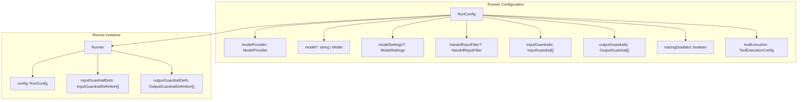
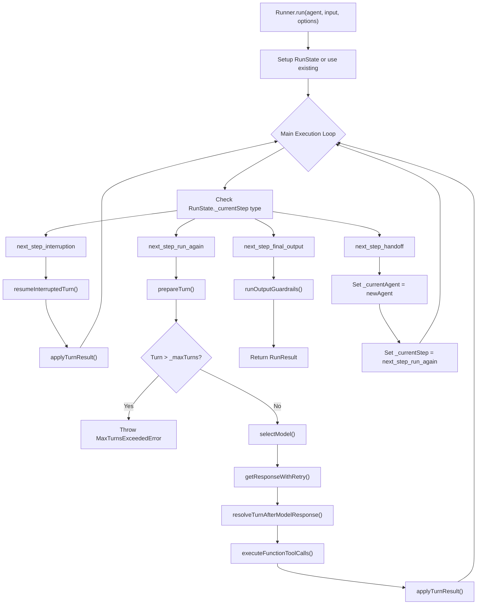
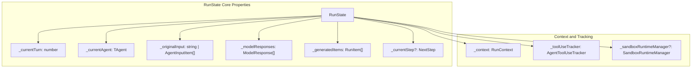
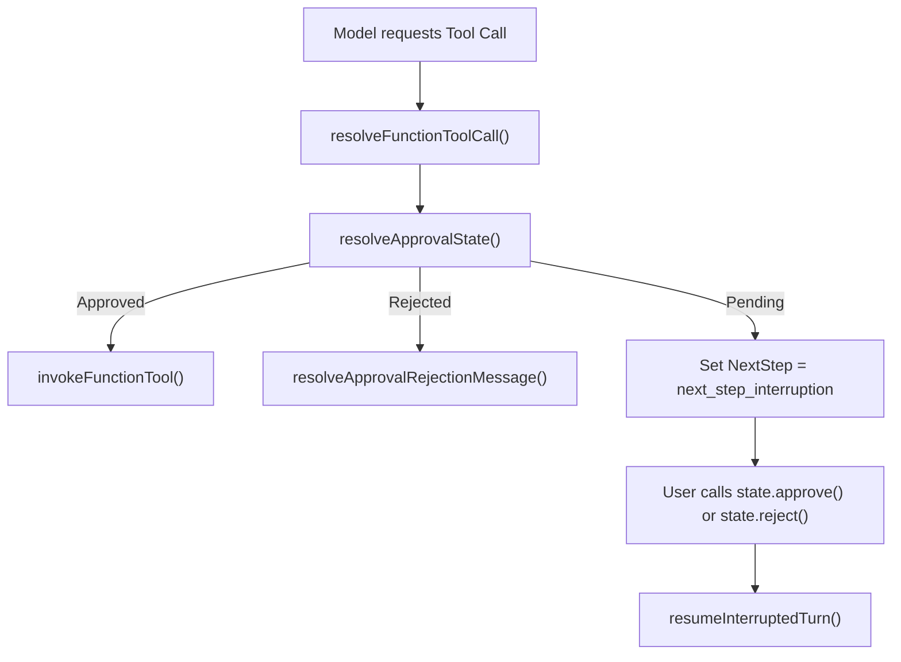

<!-- source: DeepWiki mcp.deepwiki.com · repo openai/openai-agents-js · page 5.1 Agent Execution and State Management · fetched 2026-10-26 -->

# Agent Execution and State Management

Relevant source files

The following files were used as context for generating this wiki page:

- [.changeset/fair-items-keep-order.md](.changeset/fair-items-keep-order.md)
- [packages/agents-core/src/agentToolRunConfig.ts](packages/agents-core/src/agentToolRunConfig.ts)
- [packages/agents-core/src/index.ts](packages/agents-core/src/index.ts)
- [packages/agents-core/src/items.ts](packages/agents-core/src/items.ts)
- [packages/agents-core/src/run.ts](packages/agents-core/src/run.ts)
- [packages/agents-core/src/runState.ts](packages/agents-core/src/runState.ts)
- [packages/agents-core/src/runner/conversation.ts](packages/agents-core/src/runner/conversation.ts)
- [packages/agents-core/src/runner/items.ts](packages/agents-core/src/runner/items.ts)
- [packages/agents-core/src/runner/modelOutputs.ts](packages/agents-core/src/runner/modelOutputs.ts)
- [packages/agents-core/src/runner/modelPreparation.ts](packages/agents-core/src/runner/modelPreparation.ts)
- [packages/agents-core/src/runner/modelSettings.ts](packages/agents-core/src/runner/modelSettings.ts)
- [packages/agents-core/src/runner/modelSettingsMerge.ts](packages/agents-core/src/runner/modelSettingsMerge.ts)
- [packages/agents-core/src/runner/runLoop.ts](packages/agents-core/src/runner/runLoop.ts)
- [packages/agents-core/src/runner/sessionPersistence.ts](packages/agents-core/src/runner/sessionPersistence.ts)
- [packages/agents-core/src/runner/toolExecution.ts](packages/agents-core/src/runner/toolExecution.ts)
- [packages/agents-core/src/runner/turnResolution.ts](packages/agents-core/src/runner/turnResolution.ts)
- [packages/agents-core/src/runner/types.ts](packages/agents-core/src/runner/types.ts)
- [packages/agents-core/test/index.test.ts](packages/agents-core/test/index.test.ts)
- [packages/agents-core/test/items.test.ts](packages/agents-core/test/items.test.ts)
- [packages/agents-core/test/run.stream.test.ts](packages/agents-core/test/run.stream.test.ts)
- [packages/agents-core/test/run.test.ts](packages/agents-core/test/run.test.ts)
- [packages/agents-core/test/run.utils.test.ts](packages/agents-core/test/run.utils.test.ts)
- [packages/agents-core/test/runState.test.ts](packages/agents-core/test/runState.test.ts)
- [packages/agents-core/test/runner/conversation.test.ts](packages/agents-core/test/runner/conversation.test.ts)
- [packages/agents-core/test/runner/items.helpers.test.ts](packages/agents-core/test/runner/items.helpers.test.ts)
- [packages/agents-core/test/runner/modelOutputs.test.ts](packages/agents-core/test/runner/modelOutputs.test.ts)
- [packages/agents-core/test/runner/modelSettings.test.ts](packages/agents-core/test/runner/modelSettings.test.ts)
- [packages/agents-core/test/runner/sessionPersistence.extended.test.ts](packages/agents-core/test/runner/sessionPersistence.extended.test.ts)
- [packages/agents-core/test/runner/sessionPersistence.test.ts](packages/agents-core/test/runner/sessionPersistence.test.ts)
- [packages/agents-core/test/runner/toolExecution.test.ts](packages/agents-core/test/runner/toolExecution.test.ts)
- [packages/agents-core/test/runner/turnResolution.test.ts](packages/agents-core/test/runner/turnResolution.test.ts)
- [packages/agents-core/test/sandboxRunner.test.ts](packages/agents-core/test/sandboxRunner.test.ts)
- [packages/agents/test/index.test.ts](packages/agents/test/index.test.ts)

This document provides a deep dive into the core execution engine of the OpenAI Agents SDK, focusing on the `Runner` class, `RunState` management, execution loops, and state serialization. It covers how agents are orchestrated, how conversation state is maintained across turns, and how execution can be paused and resumed for human-in-the-loop workflows.

For information about creating and configuring agents themselves, see [Agent Fundamentals](#2.3). For streaming and event handling patterns, see [Streaming and Events](#5.4).

## Runner Architecture

The `Runner` class serves as the main orchestrator for agent execution. It manages the execution lifecycle, applies global configurations, and handles the coordination between agents, tools, and models.

### Runner Configuration

**Sources**: [packages/agents-core/src/run.ts:223-333](), [packages/agents-core/src/run.ts:143-147](), [packages/agents-core/test/run.test.ts:130-136]()

The `Runner` can be configured with global settings that override agent-specific configurations. The most commonly used configuration options include:

| Configuration | Purpose |
|---------------|---------|
| `modelProvider` | Resolves string model names to `Model` instances [packages/agents-core/src/run.ts:227-228]() |
| `model` | Forces all agents to use a specific model [packages/agents-core/src/run.ts:225-226]() |
| `modelSettings` | Global model tuning parameters that override agent settings [packages/agents-core/src/run.ts:233-234]() |
| `inputGuardrails` | Global input validation applied to initial user input [packages/agents-core/src/run.ts:248-249]() |
| `outputGuardrails` | Global output validation applied to final outputs [packages/agents-core/src/run.ts:253-254]() |
| `toolExecution` | SDK-side execution settings like concurrency and pre-approval guardrails [packages/agents-core/src/run.ts:326-327]() |

## Execution Loop

The core execution logic follows a turn-based loop that continues until a final output is produced or an error occurs. The loop is protected by a safety limit defined by `DEFAULT_MAX_TURNS` (defaulting to 30).

**Sources**: [packages/agents-core/src/run.ts:38-38](), [packages/agents-core/src/run.ts:400-600]()

### Main Execution Flow

**Sources**: [packages/agents-core/src/run.ts:430-550](), [packages/agents-core/src/runner/runLoop.ts:61-85](), [packages/agents-core/src/runner/turnResolution.ts:1-21]()

### Turn Resolution

The `resolveTurnAfterModelResponse` function analyzes the model's output to determine if it requested tool calls, a handoff, or provided a final response. If tools are requested, they are executed via `executeFunctionToolCalls` or specialized handlers for computer/shell actions.

**Sources**: [packages/agents-core/src/runner/turnResolution.ts:22-62](), [packages/agents-core/src/runner/toolExecution.ts:1-43]()

## State Management (RunState)

The `RunState` class maintains the complete state of an agent execution. It is designed to be versioned and serializable to support long-running workflows and nested agent tool calls.

### RunState Structure

**Sources**: [packages/agents-core/src/runState.ts:21-59](), [packages/agents-core/src/runState.ts:157-200]()

### Serialization and Persistence

The SDK uses `CURRENT_SCHEMA_VERSION` (currently `1.16`) to track compatibility. Serialized states include usage metrics, reasoning policies, and sandbox session data.

| Feature | Implementation |
|----------|---------|
| **Serialization** | `RunState.toJSON()` converts the state into a validated Zod object [packages/agents-core/src/runState.ts:157-190]() |
| **Resumption** | `RunState.fromJSON()` reconstructs the state and agent graph [packages/agents-core/src/runState.ts:127-147]() |
| **Schema History** | Tracks changes from `1.0` to `1.16`, including nested agent tool runs and sandbox envelopes [packages/agents-core/src/runState.ts:95-146]() |

**Sources**: [packages/agents-core/src/runState.ts:127-146](), [packages/agents-core/src/runState.ts:157-190]()

## Human-in-the-Loop and Tool Execution

The tool execution flow in `executeFunctionToolCalls` handles the `needsApproval` logic. If a tool requires approval and hasn't been granted it yet, the runner creates a `RunToolApprovalItem` and pauses the loop with a `next_step_interruption`.

### Tool Approval Flow

**Sources**: [packages/agents-core/src/runner/toolExecution.ts:37-78](), [packages/agents-core/src/runner/turnResolution.ts:154-216](), [packages/agents-core/src/runner/runLoop.ts:61-85]()

### Approval Persistence
Decisions can be tracked via `RunContext.isToolApproved`. The SDK supports dynamic approval policies and provides a standard rejection message if a user denies a tool call.

**Sources**: [packages/agents-core/src/runner/turnResolution.ts:199-216](), [packages/agents-core/src/runner/toolExecution.ts:75-78]()

## Session Persistence

The SDK supports session-based memory through the `Session` interface. The `SessionPersistenceTracker` coordinates between the active run and the session store to manage conversation history and compaction.

**Sources**: [packages/agents-core/src/runner/sessionPersistence.ts:71-88](), [packages/agents-core/src/run.ts:70-77]()

### Session Lifecycle in Runner
1. **Input Preparation**: `prepareInputItemsWithSession` merges session history with new turn inputs, applying reasoning policies [packages/agents-core/src/runner/sessionPersistence.ts:22-26]().
2. **Turn Tracking**: `recordTurnItems` updates the persistence tracker with new generated items [packages/agents-core/src/runner/sessionPersistence.ts:172-175]().
3. **Commit**: `saveToSession` or `saveStreamResultToSession` writes the final state back to the storage provider [packages/agents-core/src/runner/sessionPersistence.ts:24-25]().

**Sources**: [packages/agents-core/src/runner/sessionPersistence.ts:90-209](), [packages/agents-core/src/run.ts:70-77]()

---

