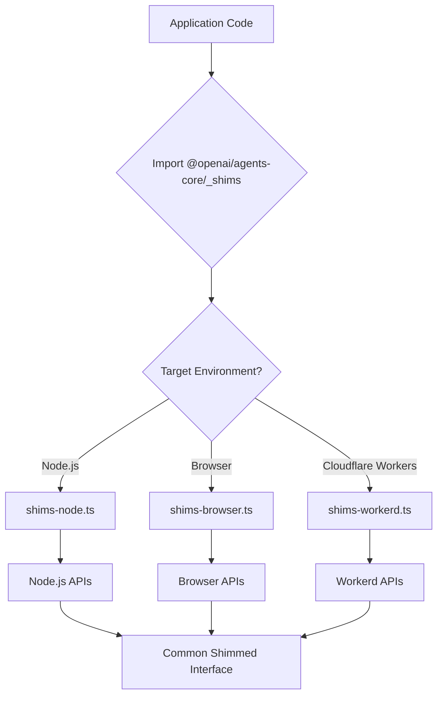
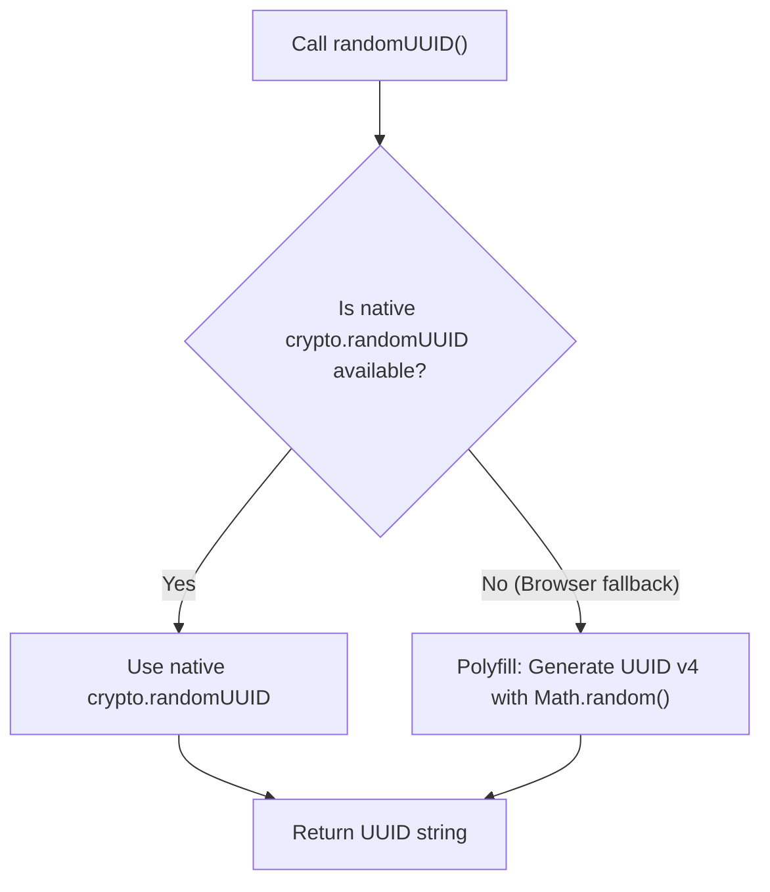

<!-- source: DeepWiki mcp.deepwiki.com · repo openai/openai-agents-js · page 5.3 Environment Shims and Cross-Platform Support · fetched 2026-10-26 -->

# Environment Shims and Cross-Platform Support

<details>
<summary>Relevant source files</summary>

The following files were used as context for generating this wiki page:

- [.changeset/quiet-expected-test-logs.md](.changeset/quiet-expected-test-logs.md)
- [integration-tests/bun.test.ts](integration-tests/bun.test.ts)
- [integration-tests/bun/package.json](integration-tests/bun/package.json)
- [integration-tests/cloudflare-workers/worker/package.json](integration-tests/cloudflare-workers/worker/package.json)
- [integration-tests/cloudflare-workers/worker/src/index.ts](integration-tests/cloudflare-workers/worker/src/index.ts)
- [integration-tests/deno.test.ts](integration-tests/deno.test.ts)
- [integration-tests/deno/aisdk.ts](integration-tests/deno/aisdk.ts)
- [integration-tests/deno/package.json](integration-tests/deno/package.json)
- [integration-tests/node/aisdk.cjs](integration-tests/node/aisdk.cjs)
- [packages/agents-core/src/mcp.ts](packages/agents-core/src/mcp.ts)
- [packages/agents-core/src/mcpLogging.ts](packages/agents-core/src/mcpLogging.ts)
- [packages/agents-core/src/mcpServers.ts](packages/agents-core/src/mcpServers.ts)
- [packages/agents-core/src/mcpUtil.ts](packages/agents-core/src/mcpUtil.ts)
- [packages/agents-core/src/shims/mcp-server/browser.ts](packages/agents-core/src/shims/mcp-server/browser.ts)
- [packages/agents-core/src/shims/mcp-server/node.ts](packages/agents-core/src/shims/mcp-server/node.ts)
- [packages/agents-core/src/shims/shims-browser.ts](packages/agents-core/src/shims/shims-browser.ts)
- [packages/agents-core/src/shims/shims-node.ts](packages/agents-core/src/shims/shims-node.ts)
- [packages/agents-core/src/shims/shims-workerd.ts](packages/agents-core/src/shims/shims-workerd.ts)
- [packages/agents-core/test/mcpCache.test.ts](packages/agents-core/test/mcpCache.test.ts)
- [packages/agents-core/test/mcpLogging.test.ts](packages/agents-core/test/mcpLogging.test.ts)
- [packages/agents-core/test/mcpServers.test.ts](packages/agents-core/test/mcpServers.test.ts)
- [packages/agents-core/test/mcpToFunctionTool.test.ts](packages/agents-core/test/mcpToFunctionTool.test.ts)
- [packages/agents-core/test/mcpToolFilter.integration.test.ts](packages/agents-core/test/mcpToolFilter.integration.test.ts)
- [packages/agents-core/test/shims/browser-shims.test.ts](packages/agents-core/test/shims/browser-shims.test.ts)
- [packages/agents-core/test/shims/mcp-server/browser.test.ts](packages/agents-core/test/shims/mcp-server/browser.test.ts)
- [packages/agents-core/test/shims/mcp-server/node.test.ts](packages/agents-core/test/shims/mcp-server/node.test.ts)
- [packages/agents-core/test/taskTurnTracing.test.ts](packages/agents-core/test/taskTurnTracing.test.ts)
- [packages/agents-core/test/toolCustomData.test.ts](packages/agents-core/test/toolCustomData.test.ts)

</details>


The OpenAI Agents SDK is designed to run across various JavaScript environments, including Node.js, web browsers, and Cloudflare Workers. Achieving this cross-platform compatibility requires a robust shim architecture that abstracts away environment-specific APIs and provides polyfills where native implementations are unavailable. This page details the shim architecture, conditional exports, `AsyncLocalStorage` polyfills, and `crypto.randomUUID` binding.

## Conditional Exports and Environment Detection

The SDK uses conditional exports in its `package.json` files to load environment-specific shim implementations. This allows the build system to select the correct set of APIs based on the target environment. The core shims are located in `packages/agents-core/src/shims/`.

The primary shim files are:
*   `shims-node.ts`: For Node.js environments.
*   `shims-browser.ts`: For browser environments [packages/agents-core/src/shims/shims-browser.ts:1-244]().
*   `shims-workerd.ts`: For Cloudflare Workers (which uses the Workerd runtime) [packages/agents-core/src/shims/shims-workerd.ts:1-55]().

Each shim file exports a common set of interfaces and functions, but their underlying implementations differ.

### Environment Detection Logic

The `isBrowserEnvironment()` function is used to determine the current runtime. This function returns `true` in browser environments [packages/agents-core/src/shims/shims-browser.ts:5-5]() and `false` in server-side runtimes like Workerd [packages/agents-core/src/shims/shims-workerd.ts:6-6](). Similarly, `isTracingLoopRunningByDefault()` indicates whether tracing loops should run by default, which is `false` in environments like Cloudflare Workers due to their request-scoped execution model [packages/agents-core/src/shims/shims-workerd.ts:23-27]() and browsers [packages/agents-core/src/shims/shims-browser.ts:210-212]().

### Diagram: Shim Selection Flow



Sources: [packages/agents-core/src/shims/shims-browser.ts:1-244](), [packages/agents-core/src/shims/shims-workerd.ts:1-55]()

## AsyncLocalStorage Polyfills

`AsyncLocalStorage` is a Node.js API used for managing asynchronous context. Since it's not natively available in all environments, the SDK provides polyfills.

### Browser Implementation

For browser environments, a robust `AsyncLocalStorage` class is provided [packages/agents-core/src/shims/shims-browser.ts:146-208](). This polyfill maintains a context stack and implements `run()`, `getStore()`, and `enterWith()` methods. Crucially, it handles asynchronous restoration by checking for deferred promises via `getDeferredRestorePromise` [packages/agents-core/src/shims/shims-browser.ts:126-144]().

```typescript
export class AsyncLocalStorage<T = any> {
  context: T | undefined = undefined;
  #stack: Array<{ context: T }> = [];

  run<TResult>(context: T, fn: () => TResult): TResult {
    // Implementation handles context stacking and promise restoration
  }
  
  getStore() {
    return this.context;
  }
}
```
[packages/agents-core/src/shims/shims-browser.ts:146-208]()

### Cloudflare Workers Implementation

Cloudflare Workers (Workerd runtime) provides a `node:async_hooks` module [packages/agents-core/src/shims/shims-workerd.ts:1-1](). However, the shim for Workerd extends the built-in `AsyncLocalStorage` and overrides `enterWith()` to use `run()` instead, as `enterWith()` behavior is limited in that environment [packages/agents-core/src/shims/shims-workerd.ts:16-21]().

Sources: [packages/agents-core/src/shims/shims-browser.ts:146-208](), [packages/agents-core/src/shims/shims-workerd.ts:16-21]()

## crypto.randomUUID Binding

The `randomUUID()` function is essential for generating unique identifiers. Its availability and implementation vary across environments.

### Browser Implementation

In browser environments, the shim checks for the native `crypto.randomUUID` availability. If present, it uses the native implementation. Otherwise, it falls back to a polyfill that generates a UUID v4 string using `Math.random()` [packages/agents-core/src/shims/shims-browser.ts:79-92]().

```typescript
export const randomUUID: () => `${string}-${string}-${string}-${string}-${string}` =
  () => {
    if (typeof crypto !== 'undefined' && crypto.randomUUID) {
      return crypto.randomUUID();
    }
    // Fallback logic...
  };
```
[packages/agents-core/src/shims/shims-browser.ts:79-92]()

### Cloudflare Workers Implementation

Cloudflare Workers provides `randomUUID` from the `node:crypto` compatibility layer [packages/agents-core/src/shims/shims-workerd.ts:8-8]().

### Diagram: randomUUID Implementation Strategy



Sources: [packages/agents-core/src/shims/shims-browser.ts:79-92](), [packages/agents-core/src/shims/shims-workerd.ts:8-8]()

## MCP Server Environment Shims

The Model Context Protocol (MCP) requires transport-specific logic that varies significantly between Node.js and the Browser.

*   **Node.js/Workerd**: Uses `NodeMCPServerStdio`, `NodeMCPServerSSE`, and `NodeMCPServerStreamableHttp` which leverage the `@modelcontextprotocol/sdk` and Node's networking capabilities [packages/agents-core/src/shims/mcp-server/node.ts:7-27]().
*   **Browser**: Provides `MCPServerStdio`, `MCPServerStreamableHttp`, and `MCPServerSSE` stubs that throw errors for unsupported transports (like Stdio) in the browser environment [packages/agents-core/src/shims/mcp-server/browser.ts:19-167]().

### Diagram: MCP Server Class Hierarchy

```mermaid
classDiagram
    class "BaseMCPServerStdio" ["BaseMCPServerStdio"]
    class "NodeMCPServerStdio" ["NodeMCPServerStdio"]
    class "MCPServerStdio (Browser)" ["MCPServerStdio"]

    "BaseMCPServerStdio" <|-- "NodeMCPServerStdio"
    "BaseMCPServerStdio" <|-- "MCPServerStdio (Browser)"

    "NodeMCPServerStdio" : +connect()
    "MCPServerStdio (Browser)" : +connect() "throws Error"
```

Sources: [packages/agents-core/src/shims/mcp-server/node.ts:7-27](), [packages/agents-core/src/shims/mcp-server/browser.ts:19-65](), [packages/agents-core/src/mcp.ts:225-233]()

## Other Shimmed APIs

*   **EventEmitter**: Browsers use `BrowserEventEmitter` [packages/agents-core/src/shims/shims-browser.ts:9-75]() which wraps `EventTarget`, while Workerd uses `node:events` [packages/agents-core/src/shims/shims-workerd.ts:2-2]().
*   **Streams**: `ReadableStream` and `TransformStream` are mapped to `globalThis` across environments [packages/agents-core/src/shims/shims-browser.ts:112-115](), [packages/agents-core/src/shims/shims-workerd.ts:11-14]().
*   **Timer**: A `Timer` interface is implemented by `BrowserTimer` [packages/agents-core/src/shims/shims-browser.ts:224-242]() and `NodeTimer` [packages/agents-core/src/shims/shims-workerd.ts:44-54]() to provide a consistent `setTimeout` and `clearTimeout` API.

Sources: [packages/agents-core/src/shims/shims-browser.ts](), [packages/agents-core/src/shims/shims-workerd.ts]()

---

