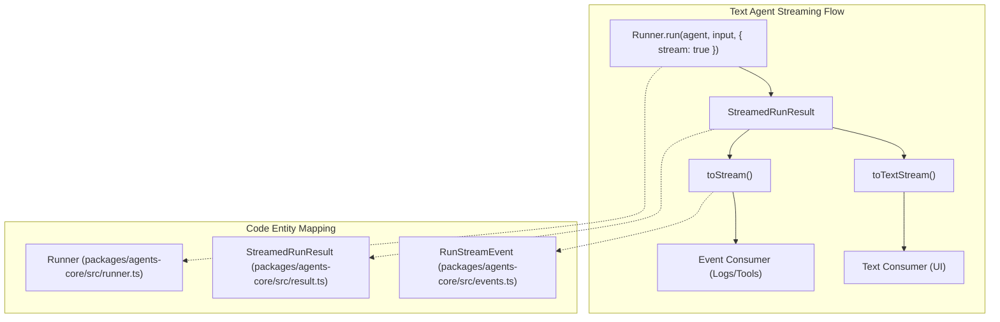
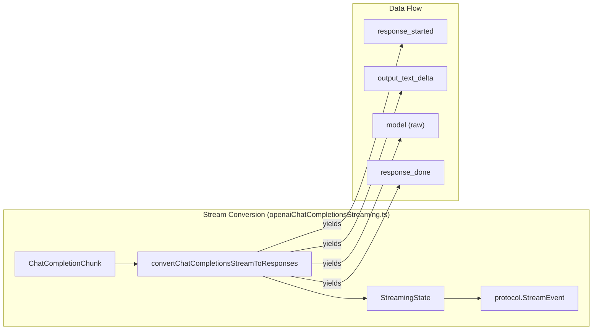

<!-- source: DeepWiki mcp.deepwiki.com · repo openai/openai-agents-js · page 5.4 Streaming and Events · fetched 2026-10-26 -->

# Streaming and Events

Relevant source files

The following files were used as context for generating this wiki page:

- [docs/src/content/docs/guides/results.mdx](docs/src/content/docs/guides/results.mdx)
- [docs/src/content/docs/guides/streaming.mdx](docs/src/content/docs/guides/streaming.mdx)
- [examples/docs/mcp/hostedStream.ts](examples/docs/mcp/hostedStream.ts)
- [examples/docs/streaming/openaiResponsesRawModelStreamEvent.ts](examples/docs/streaming/openaiResponsesRawModelStreamEvent.ts)
- [examples/docs/streaming/runAgentUpdatedStreamEvent.ts](examples/docs/streaming/runAgentUpdatedStreamEvent.ts)
- [examples/docs/streaming/runItemStreamEvent.ts](examples/docs/streaming/runItemStreamEvent.ts)
- [examples/docs/streaming/runRawModelStreamEvent.ts](examples/docs/streaming/runRawModelStreamEvent.ts)
- [examples/docs/tools/agentToolRunContext.ts](examples/docs/tools/agentToolRunContext.ts)
- [packages/agents-core/src/result.ts](packages/agents-core/src/result.ts)
- [packages/agents-core/src/runner/streamReconciliation.ts](packages/agents-core/src/runner/streamReconciliation.ts)
- [packages/agents-core/src/runner/streaming.ts](packages/agents-core/src/runner/streaming.ts)
- [packages/agents-core/test/manual/gcRuntime.ts](packages/agents-core/test/manual/gcRuntime.ts)
- [packages/agents-core/test/manual/streamedRunResultLeakCheck.ts](packages/agents-core/test/manual/streamedRunResultLeakCheck.ts)
- [packages/agents-core/test/manual/streamedRunResultLeakStress.ts](packages/agents-core/test/manual/streamedRunResultLeakStress.ts)
- [packages/agents-core/test/result.test.ts](packages/agents-core/test/result.test.ts)
- [packages/agents-extensions/src/ai-sdk-ui/uiMessageStream.ts](packages/agents-extensions/src/ai-sdk-ui/uiMessageStream.ts)
- [packages/agents-extensions/test/ai-sdk-ui/textStream.test.ts](packages/agents-extensions/test/ai-sdk-ui/textStream.test.ts)
- [packages/agents-extensions/test/ai-sdk-ui/uiMessageStream.test.ts](packages/agents-extensions/test/ai-sdk-ui/uiMessageStream.test.ts)
- [packages/agents-openai/src/openaiChatCompletionsStreaming.ts](packages/agents-openai/src/openaiChatCompletionsStreaming.ts)
- [packages/agents-openai/test/openaiChatCompletionsModel.scenario.test.ts](packages/agents-openai/test/openaiChatCompletionsModel.scenario.test.ts)
- [packages/agents-openai/test/openaiChatCompletionsStreaming.test.ts](packages/agents-openai/test/openaiChatCompletionsStreaming.test.ts)

The Agents SDK can deliver output from the model and other execution steps incrementally. Streaming keeps your UI responsive and avoids waiting for the entire final result before updating the user. This page covers the streaming and event emission systems, including the internal conversion of model chunks into protocol events and integration with external frameworks like the Vercel AI SDK.

---

## Enabling Streaming for Text Agents

Pass a `{ stream: true }` option to `Runner.run()` to obtain a `StreamedRunResult` rather than a full `RunResult`. When streaming is enabled, the returned object implements the `AsyncIterable` interface [docs/src/content/docs/guides/streaming.mdx:18-28]().

### Text Output vs. Full Event Stream

Most applications only need the model's text, but the SDK yields distinct event types to describe different parts of the agent's execution.

*   **`toTextStream()`**: Returns a stream of emitted text. If `compatibleWithNodeStreams` is `true`, it returns a Node.js `Readable` stream. This only emits assistant text; tool calls and handoffs must be captured from the full stream [docs/src/content/docs/guides/streaming.mdx:30-43](). Internally, this is powered by a `TransformStream` that filters for text deltas [packages/agents-core/src/result.ts:14-18]().
*   **`toStream()`**: Returns the full `AsyncIterable<RunStreamEvent>`. This is useful for monitoring low-level model events, agent switches, and tool execution progress [docs/src/content/docs/guides/streaming.mdx:45-55]().

### Completion and State
The `stream.completed` promise resolves once the run and all pending callbacks (like session persistence or history compaction) are finished [docs/src/content/docs/guides/streaming.mdx:41-43](). If a stream is cancelled, `stream.cancelled` becomes `true` and `finalOutput` remains `undefined` because the turn never finished [docs/src/content/docs/guides/results.mdx:141-142]().

**Sources:** [docs/src/content/docs/guides/streaming.mdx:18-43](), [packages/agents-core/src/result.ts:139-160](), [docs/src/content/docs/guides/results.mdx:141-142]()

---

## Event Types

The stream yields three different event types, each representing a different layer of the execution:

### 1. `raw_model_stream_event`
Contains raw data from the model provider. This is used for transport-agnostic streaming or when provider-specific deltas are required.
*   **OpenAI Responses**: Use `isOpenAIResponsesRawModelStreamEvent(event)` to narrow payloads for reasoning summary deltas or MCP argument deltas [docs/src/content/docs/guides/streaming.mdx:107-116]().
*   **Chat Completions**: Use `isOpenAIChatCompletionsRawModelStreamEvent(event)` for standard chat chunks [docs/src/content/docs/guides/streaming.mdx:110-112]().

### 2. `run_item_stream_event`
Emitted when a semantic `RunItem` is produced. The `name` property identifies the event type:

| `name` | Meaning |
| --- | --- |
| `message_output_created` | A message output item was created [docs/src/content/docs/guides/streaming.mdx:130](). |
| `handoff_requested` | The model requested a handoff [docs/src/content/docs/guides/streaming.mdx:131](). |
| `handoff_occurred` | The runtime completed a handoff to another agent [docs/src/content/docs/guides/streaming.mdx:132](). |
| `tool_called` | A tool call item was emitted [docs/src/content/docs/guides/streaming.mdx:135](). |
| `tool_output` | A tool result item was emitted [docs/src/content/docs/guides/streaming.mdx:136](). |
| `tool_approval_requested` | A tool call paused for human approval [docs/src/content/docs/guides/streaming.mdx:138](). |
| `reasoning_item_created` | A reasoning block was emitted [packages/agents-core/src/runner/streaming.ts:46-48](). |

### 3. `agent_updated_stream_event`
Emitted when the active agent changes, typically following a handoff. The `agent` property contains the new agent's metadata [docs/src/content/docs/guides/streaming.mdx:157-174]().

---

## Implementation: Chat Completion Streaming

The function `convertChatCompletionsStreamToResponses` transforms a raw `Stream<ChatCompletionChunk>` into protocol-level `StreamEvent`s. It maintains a `StreamingState` to accumulate text, reasoning, and tool call arguments across chunks [packages/agents-openai/src/openaiChatCompletionsStreaming.ts:9-37]().

### Reconciliation Logic
The converter handles several edge cases:
*   **Multiple Choices**: Only choice index 0 is supported; others trigger warnings or errors [packages/agents-openai/src/openaiChatCompletionsStreaming.ts:74-90]().
*   **Usage Tracking**: Usage is preserved even if it arrives on a non-final chunk, preventing zero-token reports from providers that omit usage on the terminal chunk [packages/agents-openai/src/openaiChatCompletionsStreaming.ts:64-70]().
*   **Tool Call Buffering**: Function names and arguments are concatenated into the `state.function_calls` map until the stream finishes [packages/agents-openai/src/openaiChatCompletionsStreaming.ts:139-171]().

**Sources:** [packages/agents-openai/src/openaiChatCompletionsStreaming.ts:21-53](), [packages/agents-openai/src/openaiChatCompletionsStreaming.ts:64-70](), [packages/agents-openai/src/openaiChatCompletionsStreaming.ts:139-171]()

---

## AI SDK UI Integration

The `@openai/agents-extensions` package provides utilities to bridge the Agents SDK event stream to the Vercel AI SDK `UIMessageChunk` format.

### `createAiSdkUiMessageStream`
This function maps `RunStreamEvent` types to UI-specific chunks like `text-delta`, `tool-input-available`, and `reasoning-delta` [packages/agents-extensions/src/ai-sdk-ui/uiMessageStream.ts:217-243]().

*   **Tool Correlation**: It uses a FIFO queue (`pendingToolSearchCallIds`) to correlate tool search outputs with their corresponding calls when explicit IDs are missing [packages/agents-extensions/src/ai-sdk-ui/uiMessageStream.ts:231-233]().
*   **Step Lifecycle**: It manages `start-step` and `finish-step` events to represent multi-turn agent logic within a single UI message [packages/agents-extensions/src/ai-sdk-ui/uiMessageStream.ts:246-255]().

**Sources:** [packages/agents-extensions/src/ai-sdk-ui/uiMessageStream.ts:12-21](), [packages/agents-extensions/src/ai-sdk-ui/uiMessageStream.ts:217-260]()

---

## Stopping and Backpressure

### Abort Reconciliation
When a stream is aborted, the SDK must reconcile pending tool calls to prevent the model from getting stuck in an inconsistent state. `recordStreamEventForAbortReconciliation` tracks active function, shell, and program calls [packages/agents-core/src/runner/streamReconciliation.ts:108-120]().
If the run is cancelled, `buildAbortReconciliationInput` generates "incomplete" or "aborted" result items to satisfy the model's history requirements [packages/agents-core/src/runner/streamReconciliation.ts:220-250]().

### Backpressure Handling
*   **Text Agents**: Built on `AsyncIterable` (Pull-based). The model producer waits for the consumer to request the next chunk, providing natural backpressure [docs/src/content/docs/guides/streaming.mdx:28]().
*   **Realtime Agents**: Built on `EventEmitter` (Push-based). Audio data and transcripts are pushed to listeners immediately. There is no built-in backpressure; handlers must process audio buffers synchronously to avoid artifacts [docs/src/content/docs/guides/streaming.mdx:28-32]().

**Sources:** [packages/agents-core/src/runner/streamReconciliation.ts:39-67](), [packages/agents-core/src/runner/streamReconciliation.ts:108-120](), [docs/src/content/docs/guides/streaming.mdx:16-32]()

---

