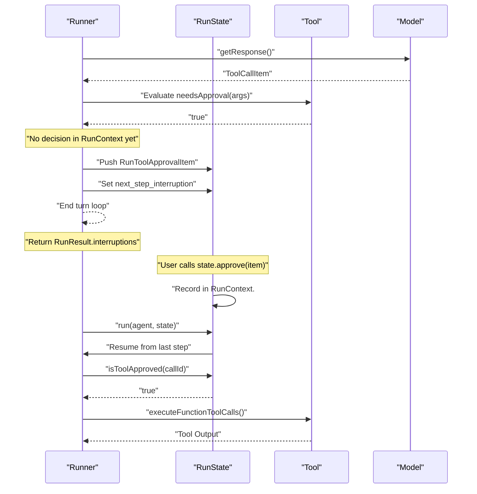
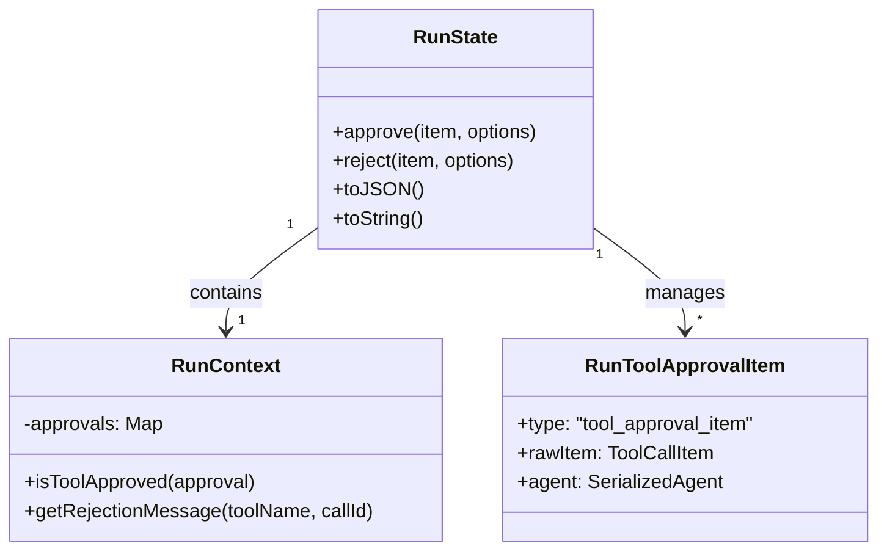

<!-- source: DeepWiki mcp.deepwiki.com · repo openai/openai-agents-js · page 5.5 Human-in-the-Loop Workflows · fetched 2026-10-26 -->

# Human-in-the-Loop Workflows

<details>
<summary>Relevant source files</summary>

The following files were used as context for generating this wiki page:

- [.changeset/steady-tools-survive-guardrails.md](.changeset/steady-tools-survive-guardrails.md)
- [README.md](README.md)
- [docs/astro.config.mjs](docs/astro.config.mjs)
- [docs/src/components/Hero.astro](docs/src/components/Hero.astro)
- [docs/src/content/docs/extensions/twilio.mdx](docs/src/content/docs/extensions/twilio.mdx)
- [docs/src/content/docs/guides/guardrails.mdx](docs/src/content/docs/guides/guardrails.mdx)
- [docs/src/content/docs/guides/human-in-the-loop.mdx](docs/src/content/docs/guides/human-in-the-loop.mdx)
- [docs/src/content/docs/guides/quickstart.mdx](docs/src/content/docs/guides/quickstart.mdx)
- [docs/src/content/docs/guides/tracing.mdx](docs/src/content/docs/guides/tracing.mdx)
- [docs/src/content/docs/guides/voice-agents.mdx](docs/src/content/docs/guides/voice-agents.mdx)
- [docs/src/content/docs/guides/voice-agents/quickstart.mdx](docs/src/content/docs/guides/voice-agents/quickstart.mdx)
- [docs/src/content/docs/index.mdx](docs/src/content/docs/index.mdx)
- [docs/src/styles/global.css](docs/src/styles/global.css)
- [examples/docs/mcp/hosted.ts](examples/docs/mcp/hosted.ts)
- [examples/docs/mcp/hostedAgent.ts](examples/docs/mcp/hostedAgent.ts)
- [examples/docs/mcp/hostedHITL.ts](examples/docs/mcp/hostedHITL.ts)
- [examples/docs/mcp/streamableHttp.ts](examples/docs/mcp/streamableHttp.ts)
- [examples/mcp/hosted-mcp-human-in-the-loop.ts](examples/mcp/hosted-mcp-human-in-the-loop.ts)
- [examples/mcp/hosted-mcp-on-approval.ts](examples/mcp/hosted-mcp-on-approval.ts)
- [examples/memory/.gitignore](examples/memory/.gitignore)
- [examples/memory/hitl-session-scenario.ts](examples/memory/hitl-session-scenario.ts)
- [examples/memory/package.json](examples/memory/package.json)
- [packages/agents-core/src/index.ts](packages/agents-core/src/index.ts)
- [packages/agents-core/src/run.ts](packages/agents-core/src/run.ts)
- [packages/agents-core/src/runState.ts](packages/agents-core/src/runState.ts)
- [packages/agents-core/src/runner/runLoop.ts](packages/agents-core/src/runner/runLoop.ts)
- [packages/agents-core/src/runner/toolExecution.ts](packages/agents-core/src/runner/toolExecution.ts)
- [packages/agents-core/src/runner/turnResolution.ts](packages/agents-core/src/runner/turnResolution.ts)
- [packages/agents-core/test/hitlMemorySessionScenario.test.ts](packages/agents-core/test/hitlMemorySessionScenario.test.ts)
- [packages/agents-core/test/run.approvalGuardrailSession.test.ts](packages/agents-core/test/run.approvalGuardrailSession.test.ts)
- [packages/agents-core/test/run.stream.test.ts](packages/agents-core/test/run.stream.test.ts)
- [packages/agents-core/test/run.test.ts](packages/agents-core/test/run.test.ts)
- [packages/agents-core/test/runState.test.ts](packages/agents-core/test/runState.test.ts)
- [packages/agents-core/test/runner/toolExecution.test.ts](packages/agents-core/test/runner/toolExecution.test.ts)
- [packages/agents-openai/test/hitlOpenAIConversationsSession.test.ts](packages/agents-openai/test/hitlOpenAIConversationsSession.test.ts)
- [packages/agents/README.md](packages/agents/README.md)

</details>


This document describes the human-in-the-loop (HITL) approval system built into the Agents SDK, which allows agent execution to pause for human approval of sensitive operations before continuing. The primary use case is requiring approval before executing specific tools, but the system can support other interruption scenarios.

For information about input/output validation that doesn't require human intervention, see [Guardrails and Safety](/4.5). For general agent execution concepts, see [Agent Execution and State Management](/5.1).

---

## Overview

The HITL system enables agents to request approval before executing sensitive operations, typically tool calls. When an approval is required, the agent execution pauses and returns a `RunResult` [packages/agents-core/src/result.ts:5-10]() containing pending `interruptions` [packages/agents-core/src/runner/runLoop.ts:83-85](). The caller can then approve or reject each interruption and resume execution by passing the modified state back to `run()`.

The system supports both short-lived approvals (handled in the same process) and long-running approvals (where state is serialized to persistent storage and resumed later, potentially in a different process or after server restart) [packages/agents-core/src/runState.ts:96-126]().

**Key Components:**

- `needsApproval` configuration on tools (boolean or function) [packages/agents-core/src/tool.ts:188-190]()
- `RunToolApprovalItem` representing pending approvals [packages/agents-core/src/items.ts:105-105]()
- `state.approve()` and `state.reject()` methods for resolving interruptions [packages/agents-core/src/runState.ts:165-168]() (Legacy/Internal access via `RunState`)
- `RunContext` management of approval records and rejection messages [packages/agents-core/src/runContext.ts:104-123]()

Sources: [packages/agents-core/src/runState.ts:96-168](), [packages/agents-core/src/runner/toolExecution.ts:1-100](), [packages/agents-core/src/items.ts:100-110]()

---

## Tool Approval Configuration

### Basic Configuration

Tools can be marked as requiring approval by setting the `needsApproval` property when defining a tool. This flag is supported on `FunctionTool`, `HostedTool`, and `MCPServer` integrations [packages/agents-core/src/tool.ts:188-212]().

```typescript
const sensitiveTool = tool({
  name: 'delete_user',
  description: 'Delete a user account',
  parameters: z.object({ userId: z.string() }),
  needsApproval: true,  // Static approval requirement
  execute: async ({ userId }) => {
    return `User ${userId} deleted`;
  }
});
```

### Dynamic Approval Logic

For more complex scenarios, `needsApproval` can be an async function that receives the tool arguments and returns a boolean [packages/agents-core/src/tool.ts:188-190]().

```typescript
const dynamicApprovalTool = tool({
  name: 'transfer_funds',
  parameters: z.object({ amount: z.number() }),
  needsApproval: async ({ amount }) => {
    return amount > 10000; // Only require approval for large transfers
  },
  execute: async ({ amount }) => `Transferred $${amount}`
});
```

### Agents as Tools

When an agent is used as a tool via `agent.asTool()`, it can also require approval. Approvals can happen at two layers: the agent tool itself requiring approval to start, or a tool inside the nested agent requiring approval during its run [packages/agents-core/src/agent.ts:1-20]().

Sources: [packages/agents-core/src/tool.ts:188-212](), [packages/agents-core/src/agent.ts:10-15]()

---

## Execution Flow with Approvals

### Flow Diagram: Code Entity Space

This diagram shows how `Runner` [packages/agents-core/src/run.ts:130-134]() interacts with `RunState` [packages/agents-core/src/runState.ts:215-215]() and `Tool` [packages/agents-core/src/tool.ts:232-232]() definitions during an interrupted turn.



Sources: [packages/agents-core/src/runner/toolExecution.ts:33-37](), [packages/agents-core/src/runContext.ts:213-240](), [packages/agents-core/src/runState.ts:165-168]()

### Step-by-Step Process

1. **Approval evaluation**: Before executing a tool, the SDK evaluates `needsApproval` [packages/agents-core/src/runner/toolExecution.ts:38-43]().
2. **Interruption creation**: If approval is needed and no decision exists, the tool call is not executed. Instead, the run records a `RunToolApprovalItem` [packages/agents-core/src/items.ts:105-105]().
3. **Execution pause**: The run returns a `RunResult` where `interruptions` is populated with all pending items from that turn [packages/agents-core/src/runner/runLoop.ts:83-85]().
4. **Human decision**: The user interacts with the `RunState` object to approve or reject [packages/agents-core/src/runState.ts:165-168]().
5. **Resume**: The updated state is passed back to `run()`. The SDK continues from the point of interruption [packages/agents-core/src/run.ts:179-180]().

Sources: [packages/agents-core/src/runner/toolExecution.ts:1-50](), [packages/agents-core/src/run.ts:175-185]()

---

## Handling Interruptions

### RunToolApprovalItem Structure

The `RunToolApprovalItem` class represents a tool call waiting for a decision. It contains the `rawItem` (the underlying protocol tool call) and the `agent` that initiated it [packages/agents-core/src/items.ts:105-105]().



### Approval/Rejection Methods

`RunState` provides methods to resolve interruptions. Decisions can be "sticky" using the `alwaysApprove` or `alwaysReject` flags [packages/agents-core/src/runState.ts:165-168]().

- **`state.approve(interruption, { alwaysApprove: true })`**: Allows the tool call to proceed [packages/agents-core/src/runState.ts:165-168]().
- **`state.reject(interruption, { message: '...', alwaysReject: true })`**: Blocks the tool call. The `message` controls what text is sent back to the model as the rejection notice [packages/agents-core/src/runner/approvalRejection.ts:77-78](). If no message is provided, the SDK falls back to the `toolErrorFormatter` or a default rejection message [packages/agents-core/src/run.ts:181-213]().

Sources: [packages/agents-core/src/runState.ts:165-168](), [packages/agents-core/src/runner/approvalRejection.ts:75-80](), [packages/agents-core/src/run.ts:179-213]()

---

## State Serialization and Resumption

### Long-Running Approvals

The `RunState` can be serialized to a string for storage in a database, allowing for approvals that take hours or days [packages/agents-core/src/runState.ts:127-146]().

```typescript
// Serialize
const serialized = result.state.toString();

// Deserialize and Resume
const state = await RunState.fromString(agent, serialized);
const resumedResult = await run(agent, state);
```

### Serialization Mechanics

When a `RunState` is serialized, the SDK records stable agent identifiers for handoffs and `agent.asTool()` graphs [packages/agents-core/src/runState.ts:116-126](). During deserialization, the SDK traverses the root agent's references to resolve all serialized agent references against the reconstructed graph [packages/agents-core/src/runState.ts:127-146]().

### contextStrategy

When resuming with `RunState.fromStringWithContext()`, two strategies control how the new context interacts with the serialized one:
- **`merge` (default)**: Preserves the provided `RunContext`, merges serialized approval records, and restores `toolInput` if not already defined [packages/agents-core/src/runState.ts:150-155]().
- **`replace`**: Rebuilds the run using the provided `RunContext` as-is.

Sources: [packages/agents-core/src/runState.ts:127-155](), [packages/agents-core/src/runContext.ts:1-50]()

---

## Automatic vs. Manual Approvals

While `interruptions` are the manual pattern, some tools support programmatic callbacks that prevent the execution from pausing [packages/agents-core/src/tool.ts:248-250]().

| Tool Type | Approval Mechanism | Callback |
| :--- | :--- | :--- |
| **Function Tool** | Manual Interruption | N/A |
| **Shell Tool** | Programmatic | `onApproval` |
| **Apply Patch** | Programmatic | `onApproval` |
| **Computer Tool** | Programmatic | `onSafetyCheck` [packages/agents-core/src/tool.ts:248-250]() |

If these callbacks return a decision immediately, the run continues without pausing for human input [packages/agents-core/src/runner/toolExecution.ts:38-43]().

Sources: [packages/agents-core/src/tool.ts:244-260](), [packages/agents-core/src/runner/toolExecution.ts:33-45]()

---

