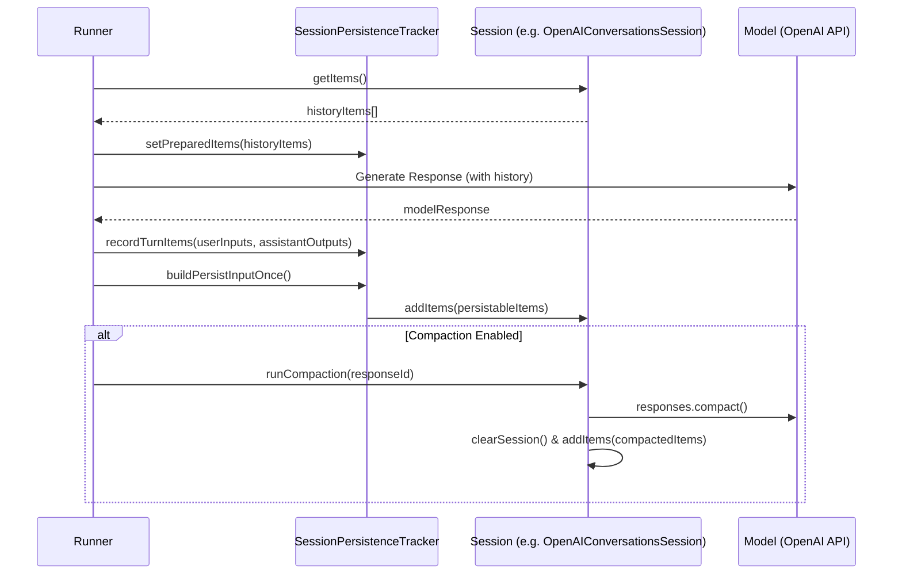

<!-- source: DeepWiki mcp.deepwiki.com · repo openai/openai-agents-js · page 5.6 Sessions and Memory · fetched 2026-10-26 -->

# Sessions and Memory

<details>
<summary>Relevant source files</summary>

The following files were used as context for generating this wiki page:

- [.changeset/quiet-conversations-share-lifecycle.md](.changeset/quiet-conversations-share-lifecycle.md)
- [docs/src/content/docs/extensions/ai-sdk.mdx](docs/src/content/docs/extensions/ai-sdk.mdx)
- [docs/src/content/docs/guides/agents.mdx](docs/src/content/docs/guides/agents.mdx)
- [docs/src/content/docs/guides/mcp.mdx](docs/src/content/docs/guides/mcp.mdx)
- [docs/src/content/docs/guides/models.mdx](docs/src/content/docs/guides/models.mdx)
- [docs/src/content/docs/guides/running-agents.mdx](docs/src/content/docs/guides/running-agents.mdx)
- [docs/src/content/docs/guides/sessions.mdx](docs/src/content/docs/guides/sessions.mdx)
- [docs/src/content/docs/guides/tools.mdx](docs/src/content/docs/guides/tools.mdx)
- [docs/src/content/docs/guides/voice-agents/build.mdx](docs/src/content/docs/guides/voice-agents/build.mdx)
- [examples/docs/sessions/responsesCompactionManualSession.ts](examples/docs/sessions/responsesCompactionManualSession.ts)
- [examples/memory/.gitignore](examples/memory/.gitignore)
- [examples/memory/hitl-session-scenario.ts](examples/memory/hitl-session-scenario.ts)
- [examples/memory/oai-compact.ts](examples/memory/oai-compact.ts)
- [examples/memory/package.json](examples/memory/package.json)
- [packages/agents-core/src/memory/session.ts](packages/agents-core/src/memory/session.ts)
- [packages/agents-core/test/hitlMemorySessionScenario.test.ts](packages/agents-core/test/hitlMemorySessionScenario.test.ts)
- [packages/agents-core/test/sandboxToolRehydration.test.ts](packages/agents-core/test/sandboxToolRehydration.test.ts)
- [packages/agents-core/test/sandboxTools.test.ts](packages/agents-core/test/sandboxTools.test.ts)
- [packages/agents-openai/src/index.ts](packages/agents-openai/src/index.ts)
- [packages/agents-openai/src/memory/openaiConversationsSession.ts](packages/agents-openai/src/memory/openaiConversationsSession.ts)
- [packages/agents-openai/src/memory/openaiResponsesCompactionSession.ts](packages/agents-openai/src/memory/openaiResponsesCompactionSession.ts)
- [packages/agents-openai/src/openaiProvider.ts](packages/agents-openai/src/openaiProvider.ts)
- [packages/agents-openai/test/hitlOpenAIConversationsSession.test.ts](packages/agents-openai/test/hitlOpenAIConversationsSession.test.ts)
- [packages/agents-openai/test/openaiConversationsSession.test.ts](packages/agents-openai/test/openaiConversationsSession.test.ts)
- [packages/agents-openai/test/openaiResponsesCompactionSession.test.ts](packages/agents-openai/test/openaiResponsesCompactionSession.test.ts)

</details>


Sessions provide a **persistent memory layer** for the OpenAI Agents SDK, allowing agents to maintain context across multiple turns and independent execution runs. By implementing the `Session` interface, developers can decouple conversation state from the active `Runner` instance, enabling features like chat persistence, "undo" functionality, and context window management.

## The Session Interface

The `Session` interface defines the contract for any storage backend used to persist conversation history. It operates on `AgentInputItem` objects, which are the fundamental units of conversation (messages, tool calls, tool results, etc.) used by the SDK.

[packages/agents-core/src/memory/session.ts:27-74]()

| Method | Description |
| :--- | :--- |
| `getSessionId()` | Returns a unique identifier for the session, creating one if necessary [packages/agents-openai/src/memory/openaiConversationsSession.ts:51-53](). |
| `getItems(limit?)` | Retrieves stored `AgentInputItem` objects in chronological order [packages/agents-openai/src/memory/openaiConversationsSession.ts:55-59](). |
| `addItems(items)` | Appends new items to the persistent history [packages/agents-openai/src/memory/openaiConversationsSession.ts:210-222](). |
| `popItem()` | Removes and returns the most recent item (useful for "undo") [packages/agents-openai/src/memory/openaiConversationsSession.ts:232-248](). |
| `clearSession()` | Resets the session by removing all items [packages/agents-openai/src/memory/openaiConversationsSession.ts:250-254](). |

### Data Flow: Session Persistence
The `Runner` interacts with a `Session` during two critical phases of an agent turn: **Preparation** and **Persistence**. Coordination is managed by the `SessionPersistenceTracker`.

1.  **Preparation**: Before calling the model, the `Runner` retrieves history via `session.getItems()`. The `SessionPersistenceTracker` takes a snapshot of these items to track what was already in memory [packages/agents-core/src/runner/sessionPersistence.ts:74-85]().
2.  **Persistence**: After the model responds, the `Runner` saves the turn items. For streaming runs, user inputs are saved immediately, while assistant outputs are appended once the stream resolves [packages/agents-core/src/runner/sessionPersistence.ts:222-245]().

**Sources:** [packages/agents-core/src/memory/session.ts:27-74](), [packages/agents-core/src/runner/sessionPersistence.ts:43-146](), [packages/agents-core/src/runner/sessionPersistence.ts:222-245]()

---

## Implementation Classes

### MemorySession
`MemorySession` is a standard in-memory implementation used for local development, testing, and short-lived state. It stores items in a local array and does not persist data across process restarts [docs/src/content/docs/guides/sessions.mdx:46-53](). It serves as the base for many test scenarios [packages/agents-openai/test/openaiResponsesCompactionSession.test.ts:12-30]().

**Sources:** [docs/src/content/docs/guides/sessions.mdx:46-53](), [packages/agents-openai/test/openaiResponsesCompactionSession.test.ts:12-30]()

### OpenAIConversationsSession
`OpenAIConversationsSession` synchronizes conversation history with the **OpenAI Conversations API**. It allows the SDK to leverage server-side state management while providing the standard `Session` interface.

*   **Lazy Creation**: If no `conversationId` is provided, it can be created using `startOpenAIConversationsSession` which calls the `conversations.create` endpoint [packages/agents-openai/src/memory/openaiConversationsSession.ts:23-29]().
*   **Item Mapping**: It translates between the SDK's `AgentInputItem` and the API's `ConversationItem`. System messages are normalized to text content [packages/agents-openai/src/memory/openaiConversationsSession.ts:66-77](), while user messages handle `input_text`, `input_image` (including `file_id`), and `input_file` [packages/agents-openai/src/memory/openaiConversationsSession.ts:79-133]().
*   **Replay Metadata**: It implements `prepareHistoryItemForModelInput` to strip assistant replay metadata from stored items before they are re-sent to the model [packages/agents-openai/src/memory/openaiConversationsSession.ts:194-196]().

**Sources:** [packages/agents-openai/src/memory/openaiConversationsSession.ts:30-224](), [packages/agents-openai/test/openaiConversationsSession.test.ts:41-97]()

---

## History Management Strategies

The SDK supports several strategies for managing how much context is sent to the model and how it is stored.

### 1. Client-Managed Sessions
The client provides a `Session` object to `Runner.run()`. The SDK handles fetching history and appending new turns automatically [docs/src/content/docs/guides/running-agents.mdx:66]().

### 2. Server-Managed (Response Chaining)
When using the OpenAI Responses API, the server can manage history via `previousResponseId` or `conversationId` [docs/src/content/docs/guides/running-agents.mdx:76-77](). This uses the server-side state instead of sending the full history array in the request body.

### 3. Context Compaction
`OpenAIResponsesCompactionSession` is a decorator that wraps an `underlyingSession` and uses the `responses.compact` API to summarize or truncate history when it exceeds a threshold [docs/src/content/docs/guides/sessions.mdx:22]().

*   **Triggering**: It uses a threshold of candidate items. Users can provide a custom `shouldTriggerCompaction` hook to decide when to invoke the API [packages/agents-openai/src/memory/openaiResponsesCompactionSession.ts:96-98]().
*   **Compaction Modes**:
    *   `input`: Sends the locally stored session items as the input for compaction [packages/agents-openai/src/memory/openaiResponsesCompactionSession.ts:84]().
    *   `previous_response_id`: Uses the server-managed response chain for the compaction request [packages/agents-openai/src/memory/openaiResponsesCompactionSession.ts:83]().
    *   `auto`: Defaults to `input` if no response ID is available [packages/agents-openai/src/memory/openaiResponsesCompactionSession.ts:82]().

**Sources:** [docs/src/content/docs/guides/running-agents.mdx:66-77](), [packages/agents-openai/src/memory/openaiResponsesCompactionSession.ts:80-148](), [packages/agents-openai/test/openaiResponsesCompactionSession.test.ts:201-225]()

---

## Technical Architecture Diagrams

### Session Persistence Lifecycle
This diagram shows how the `Runner` and `SessionPersistenceTracker` coordinate with a `Session` implementation during a turn.


**Sources:** [packages/agents-core/src/runner/sessionPersistence.ts:43-146](), [packages/agents-openai/src/memory/openaiResponsesCompactionSession.ts:150-187]()

### Entity Mapping: Memory Space to Code
This diagram bridges the conceptual "Memory Space" to specific classes and interfaces in the codebase.

```mermaid
graph TD
    subgraph "Memory Concepts"
        C1["'Remember our last chat'"]
        C2["'Summarize long history'"]
        C3["'Forget the last message'"]
    end

    subgraph "Code Entity Space"
        I1["Session (Interface)"]
        class I1 "packages/agents-core/src/memory/session.ts"
        
        A1["OpenAIConversationsSession"]
        class A1 "packages/agents-openai/src/memory/openaiConversationsSession.ts"
        
        A2["MemorySession"]
        class A2 "packages/agents-core/src/memory/session.ts"
        
        D1["OpenAIResponsesCompactionSession"]
        class D1 "packages/agents-openai/src/memory/openaiResponsesCompactionSession.ts"
        
        P1["SessionPersistenceTracker"]
        class P1 "packages/agents-core/src/runner/sessionPersistence.ts"
        
        CT["ServerConversationTracker"]
        class CT "packages/agents-core/src/runner/conversation.ts"
    end

    C1 --> I1
    C2 --> D1
    C3 --> I1
    
    I1 -- implements --- A1
    I1 -- implements --- A2
    D1 -- decorates --- I1
    P1 -- uses --- I1
    CT -- manages --- I1
```
**Sources:** [packages/agents-core/src/memory/session.ts:27-128](), [packages/agents-core/src/runner/sessionPersistence.ts:43-52](), [packages/agents-openai/src/memory/openaiConversationsSession.ts:31-35]()

---

## Advanced Usage: `sessionInputCallback`

When passing an array of `AgentInputItem` to `Runner.run`, developers can provide a `sessionInputCallback`. This function is executed **after** history is fetched but **before** the model is called, allowing for programmatic manipulation of the final context [docs/src/content/docs/guides/sessions.mdx:122-130]().

[packages/agents-core/src/memory/session.ts:7-10]()

Common use cases include:
*   **Truncation**: Removing items that exceed a specific count or token limit [docs/src/content/docs/guides/sessions.mdx:124-125]().
*   **Filtering**: Redacting sensitive information via a `callModelInputFilter` [docs/src/content/docs/guides/running-agents.mdx:68]().
*   **Custom Merging**: Deterministically combining new input with stored history [docs/src/content/docs/guides/sessions.mdx:124]().

**Sources:** [packages/agents-core/src/memory/session.ts:7-10](), [docs/src/content/docs/guides/sessions.mdx:122-130](), [docs/src/content/docs/guides/running-agents.mdx:67-68]()

---

