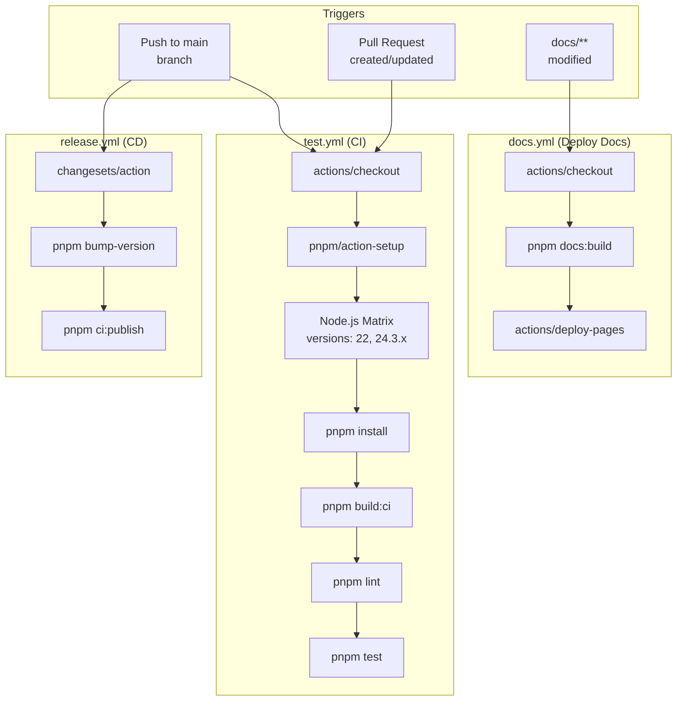

<!-- source: DeepWiki mcp.deepwiki.com · repo openai/openai-agents-js · page 6 Development Guide · fetched 2026-10-26 -->

# Development Guide

<details>
<summary>Relevant source files</summary>

The following files were used as context for generating this wiki page:

- [.agents/skills/code-change-verification/SKILL.md](.agents/skills/code-change-verification/SKILL.md)
- [.agents/skills/code-change-verification/scripts/run.mjs](.agents/skills/code-change-verification/scripts/run.mjs)
- [.agents/skills/implementation-strategy/SKILL.md](.agents/skills/implementation-strategy/SKILL.md)
- [.agents/skills/pr-draft-summary/SKILL.md](.agents/skills/pr-draft-summary/SKILL.md)
- [.github/dependabot.yml](.github/dependabot.yml)
- [.github/workflows/changeset.yml](.github/workflows/changeset.yml)
- [.github/workflows/docs.yml](.github/workflows/docs.yml)
- [.github/workflows/issues.yml](.github/workflows/issues.yml)
- [.github/workflows/release-tag.yml](.github/workflows/release-tag.yml)
- [.github/workflows/release.yml](.github/workflows/release.yml)
- [.github/workflows/test.yml](.github/workflows/test.yml)
- [AGENTS.md](AGENTS.md)
- [package.json](package.json)
- [scripts/prettier-changed.mjs](scripts/prettier-changed.mjs)

</details>


This guide is for contributors and developers working on the OpenAI Agents SDK itself—modifying packages, adding features, fixing bugs, or improving documentation. It covers the development workflow, build system, testing infrastructure, and release process.

For information about building applications with the SDK, see [Getting Started](#2). For detailed package internals, see [Core Packages](#3).

## Purpose and Scope

This page provides an overview of the SDK development process, including:
- Local development environment setup
- Build and test workflows
- CI/CD pipeline architecture
- Release and versioning procedures

For detailed information, see the following sub-pages:
- [Monorepo Structure](#6.1) — Explain pnpm workspaces, package interdependencies (`workspace:*`), directory organization (`packages/`, `examples/`, `docs/`), and the role of each package.
- [Development Environment Setup](#6.2) — Cover local setup: pnpm installation, Node.js version requirements, environment variables, local npm registry (Verdaccio), and running examples.
- [Building and Testing](#6.3) — Document build scripts (`tsc-multi`, `prebuild`, `bundle`), test infrastructure (Vitest, Playwright), CI workflows (`test.yml`), linting (ESLint), code coverage, and integration tests across runtimes.
- [Release and Versioning](#6.4) — Explain Changesets workflow, version synchronization across packages (0.14.2), `metadata.ts` generation, changelog updates, and npm publishing process.

---

## Development Workflow Overview

The SDK uses a modern monorepo development workflow with pnpm workspaces, parallel TypeScript compilation, and automated testing. Below is the complete development cycle:

**Development Workflow and Key Commands**

```mermaid
graph TB
    subgraph "Local Development"
        Clone["git clone<br/>openai-agents-js"]
        Install["pnpm install<br/>(pnpm@11.18.0)"]
        EnvSetup["Set OPENAI_API_KEY<br/>for tests"]
        DevMode["pnpm packages:dev<br/>(tsc-multi --watch)"]
        RunExample["pnpm examples:basic<br/>or other examples"]
    end
    
    subgraph "Build Process"
        Prebuild["pnpm prebuild<br/>(generate metadata.ts)"]
        Build["pnpm build<br/>(tsc-multi)"]
        Postbuild["pnpm postbuild<br/>(bundle packages)"]
        Clean["pnpm clean<br/>(tsc-multi --clean)"]
    end
    
    subgraph "Quality Checks"
        Lint["pnpm lint<br/>(eslint)"]
        LintFix["pnpm lint:fix<br/>(eslint --fix)"]
        TypeCheck["pnpm docs:scripts:check<br/>(tsc docs scripts)"]
        Test["pnpm test<br/>(vitest)"]
        TestCoverage["pnpm test:coverage<br/>(vitest with coverage)"]
        TestExamples["pnpm test:examples<br/>(build-check all examples)"]
    end
    
    subgraph "Documentation"
        DocsDev["pnpm docs:dev<br/>(Astro dev server)"]
        DocsTranslate["pnpm docs:translate<br/>(LLM translation)"]
        DocsBuild["pnpm docs:build<br/>(static site)"]
    end
    
    subgraph "Release Process"
        BumpVersion["pnpm bump-version<br/>(changeset version)"]
        Publish["pnpm ci:publish<br/>(publish to npm)"]
        LocalNpm["pnpm local-npm:start<br/>(Verdaccio registry)"]
        LocalPublish["pnpm local-npm:publish<br/>(test locally)"]
    end
    
    Clone --> Install
    Install --> EnvSetup
    EnvSetup --> DevMode
    DevMode --> RunExample
    
    Build --> Prebuild
    Prebuild --> Build
    Build --> Postbuild
    
    Lint --> Test
    LintFix --> Lint
    TypeCheck --> Test
    Test --> TestCoverage
    TestExamples --> Test
    
    DocsDev --> DocsTranslate
    DocsTranslate --> DocsBuild
    
    BumpVersion --> Publish
    LocalNpm --> LocalPublish
```



Sources: [package.json:1-108](), [AGENTS.md:1-70]()

---

## Key Development Commands

The monorepo provides a comprehensive set of npm scripts for all development tasks. These are defined in the root `package.json` and use pnpm's filtering capabilities to target specific packages or run commands across all workspaces.

### Build Commands

| Command | Description | Implementation |
|---------|-------------|----------------|
| `pnpm clean` | Remove all compiled output | `node scripts/clean-package-dists.mjs && tsc-multi --clean` [package.json:6]() |
| `pnpm prebuild` | Generate metadata files (version, exports) | `pnpm -F @openai/* -r prebuild` [package.json:7]() |
| `pnpm build` | Compile all packages in parallel | `pnpm clean && tsc-multi` [package.json:8]() |
| `pnpm postbuild` | Bundle packages for distribution | `pnpm -r -F @openai/* bundle` [package.json:10]() |
| `pnpm packages:dev` | Watch mode for development | `tsc-multi --watch` [package.json:11]() |

### Test Commands

| Command | Description | Configuration |
|---------|-------------|---------------|
| `pnpm test` | Run unit tests | Vitest with CI=1 [package.json:16]() |
| `pnpm test:coverage` | Generate coverage report | Vitest with v8 provider [package.json:17]() |
| `pnpm test:examples` | Verify example builds | `pnpm -r build-check` [package.json:18]() |
| `pnpm test:integration` | Run integration tests | `vitest.integration.config.ts` [package.json:19]() |
| `pnpm test:watch` | Interactive test mode | `vitest --watch` [package.json:23]() |

### Documentation Commands

| Command | Description | Implementation |
|---------|-------------|----------------|
| `pnpm docs:dev` | Start Astro dev server | `pnpm -F docs dev` [package.json:12]() |
| `pnpm docs:translate` | Translate documentation using LLM | `pnpm -F docs translate` [package.json:13]() |
| `pnpm docs:build` | Build static site | `pnpm -F docs build` [package.json:14]() |
| `pnpm docs:scripts:check` | Type-check doc scripts | `pnpm exec tsc --project docs/tsconfig.scripts.json` [package.json:15]() |

Sources: [package.json:5-82]()

---

## CI/CD Pipeline Architecture

The SDK uses GitHub Actions for continuous integration, documentation deployment, and release management.

**CI/CD Workflows and Triggers**



### Test Workflow (`test.yml`)

The test workflow runs on every push to `main` and on all pull requests. It performs comprehensive validation across multiple Node.js versions:

**Matrix Strategy:**
- Node.js versions: `22`, `24.3.x` [.github/workflows/test.yml:98]()
- Memory allocation: `--max_old_space_size=6144` [.github/workflows/test.yml:93]()

**Execution Steps:**
1. **Checkout**: Clone repository [.github/workflows/test.yml:105]()
2. **Setup**: Install pnpm and configure Node.js matrix [.github/workflows/test.yml:110-117]()
3. **Build**: Compile all packages with `pnpm build:ci` [.github/workflows/test.yml:124]()
4. **Dist Check**: Validate generated declarations [.github/workflows/test.yml:127]()
5. **Lint**: Run ESLint across codebase [.github/workflows/test.yml:130]()
6. **Examples**: Compile all examples to verify compatibility [.github/workflows/test.yml:136]()
7. **Test**: Execute Vitest test suite [.github/workflows/test.yml:139]()

Sources: [.github/workflows/test.yml:1-140]()

---

## Development Environment Requirements

### Node.js and pnpm Version Support

The SDK officially supports and tests against:

- **Node.js**: 22, 24.3.x [.github/workflows/test.yml:98]()
- **pnpm**: 11.18.0 (specified in `packageManager`) [package.json:107]()

### Core Development Dependencies

Key development tools installed at the root level:

| Tool | Version | Purpose |
|------|---------|---------|
| `typescript` | ^5.9.3 | TypeScript compiler [package.json:102]() |
| `tsc-multi` | ^1.1.0 | Parallel TypeScript compilation [package.json:100]() |
| `vitest` | ^3.2.6 | Testing framework [package.json:105]() |
| `eslint` | ^9.39.4 | JavaScript/TypeScript linting [package.json:92]() |
| `prettier` | ^3.9.4 | Code formatting [package.json:98]() |
| `husky` | ^9.1.7 | Git hooks management [package.json:96]() |
| `@changesets/cli` | ^2.31.0 | Version management and changelogs [package.json:85]() |
| `verdaccio` | ^6.7.4 | Local npm registry for testing [package.json:104]() |

Sources: [package.json:84-108]()

---

## Local npm Registry

The SDK includes Verdaccio configuration for local testing of package publishing.

### Starting the Local Registry

```bash
# Start Verdaccio server (runs on http://localhost:4873)
pnpm local-npm:start [package.json:81]()

# Reset storage (clear all published packages)
pnpm local-npm:reset [package.json:80]()
```

### Publishing to Local Registry

```bash
# Publish all workspace packages to local registry
pnpm local-npm:publish [package.json:82]()
```

This is useful for verifying the publishing process and package interdependencies without affecting the production npm registry.

Sources: [package.json:80-82]()

---

## Release Process

The SDK uses `changesets` for versioning and release management.

**Release Pipeline:**
1. **Versioning**: `pnpm bump-version` runs `changeset version` and updates metadata [.github/workflows/release.yml:58](), [package.json:77]()
2. **Publishing**: `pnpm ci:publish` publishes all packages to npm [.github/workflows/release.yml:59](), [package.json:76]()
3. **Validation**: CI ensures `dist:check` passes before any release [.github/workflows/test.yml:127]()

Sources: [.github/workflows/release.yml:1-64](), [package.json:76-77]()

---

## Next Steps

For detailed information about specific development workflows, consult the following pages:

- **[Monorepo Structure](#6.1)**: Package organization, workspace dependencies, directory layout.
- **[Development Environment Setup](#6.2)**: Complete local setup guide, environment variables, tooling installation.
- **[Building and Testing](#6.3)**: Build system internals, test infrastructure, CI workflows.
- **[Release and Versioning](#6.4)**: Changesets workflow, versioning strategy, npm publishing.

For documentation system details, see [Documentation System](#7).

---

